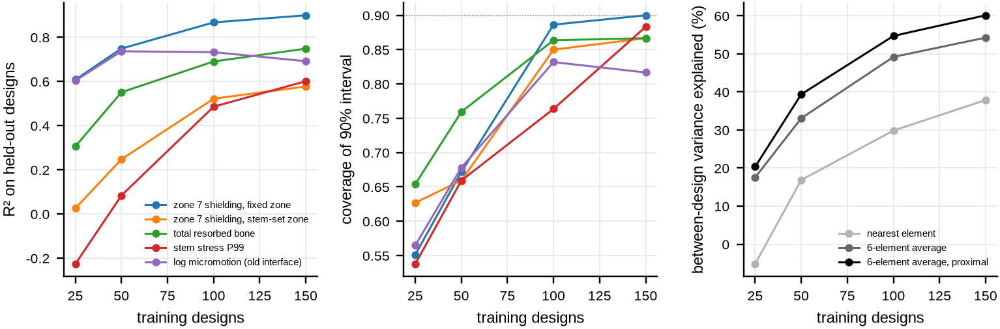
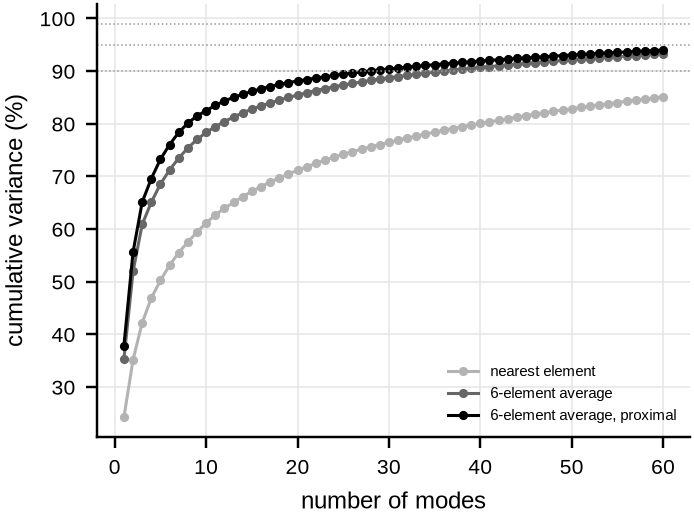

# 试验设计论证：为什么做、做多少、采集什么

生成时间：2026-09-29 19:16。没有新的求解。依据有三类：统计精度的公式、已有数据上的实测、求解成本。实测部分是今晚新做的零求解分析，代码是 `v2/doe_evidence.py`。

本文是 `REDESIGN_PROPOSAL_2026-09-29.pdf` 的补充。分析结果改变了那份方案里的三个数，第 7 节列出。

## 1 结论

1. **样本量不能靠经验公式定。** 已有数据显示，13 个变量、150 个样本时，最平滑的量留出集 R² 达到 0.90，柄应力只有 0.60，微动停在 0.69 不再上升。
2. **三类量要三种对策。** 平滑的量加样本就行。应力极值要上千个样本，只能用便宜的粘接模型。微动加样本没有用，要先改提法。
3. **场的代理受网格噪声限制，不受样本量限制。** 逐点看，网格造成的差别比设计造成的差别还大：只有 10% 的皮质采样点上，设计间的差别超过网格噪声的两倍。先降噪，再谈加样本。
4. **优化算法的比较需要约 25 个随机种子**才能分辨 0.05 的超体积差。真有限元上的 3 个种子只能分辨约 0.14 的差，只够做确认。
5. **每项试验都设停止规则。** 分批做，达到门槛或者学习曲线走平就停，不按固定总量跑完。

## 2 论证的方法

每项试验回答三个问题。

- **为什么做**：它的结果会改变哪个决定。结果无论如何都不改变决定的试验不做。
- **做多少**：由需要的统计精度、已有数据上的实测、单次成本三者决定。
- **采集什么**：除了当前要用的量，还要留下以后换口径时用得上的原始场。这个项目里分区定义改过三次，每次都靠留下的场重算。

单次成本用本机求解日志的中位数，三个求解槽并行：

| 模型 | 网格 (mm) | 单次用时 | 样本数 | 每小时可解 |
|---|---|---|---|---|
| 粘接 | 2.0 | 35 秒 | 138 | 309 |
| 完整股骨 | 2.0 | 57 秒 | 9 | 189 |
| 摩擦，两个循环 | 2.0 | 16 分钟 | 65 | 11 |
| 摩擦，两个循环 | 1.4 | 40 分钟 | 8 | 4.5 |

粘接模型比摩擦模型便宜约 28 倍。这决定了哪些试验可以大量做。

## 3 已有数据给出的证据

数据是 210 个现行版本设计的粘接模型结果，输入是 13 个变量。这些设计来自参考集、优化过程和探针，不是均匀采样，所以下面的数只说明量级。

### 3.1 标量的学习曲线

高斯过程在留出集上的 R²，随机划分重复 10 次取中位数：

| 关注量 | 25 个样本 | 50 个样本 | 100 个样本 | 150 个样本 | 150 个样本时的秩相关 | 90% 区间覆盖率 | 噪声占比 |
|---|---|---|---|---|---|---|---|
| 7 区应力屏蔽，固定分区 | 0.61 | 0.75 | 0.87 | 0.90 | 0.95 | 0.90 | 5% |
| 7 区应力屏蔽，随柄分区 | 0.03 | 0.25 | 0.52 | 0.58 | 0.82 | 0.87 | 17% |
| 骨吸收总值，随柄分区 | 0.31 | 0.55 | 0.69 | 0.75 | 0.88 | 0.87 | 17% |
| 柄体应力 P99 | -0.23 | 0.08 | 0.49 | 0.60 | 0.87 | 0.88 | 5% |
| 旧界面模型的微动（对数） | 0.60 | 0.74 | 0.73 | 0.69 | 0.81 | 0.82 | 4% |

噪声占比是高斯过程自己估计的、不能由输入解释的方差比例。它给出 R² 的上限。

*左：留出集 R² 对训练样本数。中：90% 预测区间的实际覆盖率。右：场代理解释的设计间方差。*

从这张表读出四点。

- 固定分区的量最好学，100 个样本时 R² 是 0.87，覆盖率也到了名义值。
- 同一个量换成随柄移动的分区就难学得多。分区边界跨过采样点时数值会跳，代理把它当成噪声。所以优化和代理用固定分区，随柄分区只用于对照文献。
- 柄应力 P99 在 150 个样本时 R² 只有 0.60。按 100 到 150 这一段的下降速度外推，R² 到 0.9 需要约 1400 个样本。外推很粗，只能当量级看。
- 旧界面模型的微动从 50 个样本起就停在 0.7 左右，而它的噪声占比只有 4%。这说明问题不在噪声也不在样本量，而在这个量本身是阈值型的，平稳的高斯过程表示不了。

覆盖率在 50 个样本以下明显偏低，代理会过度自信。少于 100 个样本时不要相信代理给的不确定度。

### 3.2 哪些变量在起作用

高斯过程各变量的相关长度的倒数，归一化后当作重要性。前四位：

| 关注量 | 第一 | 第二 | 第三 | 第四 | 前四位合计 |
|---|---|---|---|---|---|
| 7 区应力屏蔽，固定分区 | 柄长 26% | 插入角 22% | 截骨高度 11% | 前后向长宽比 10% | 68% |
| 7 区应力屏蔽，随柄分区 | 截骨高度 43% | 插入角 18% | 柄长 15% | 面积曲线指数 7% | 83% |
| 骨吸收总值，随柄分区 | 插入角 29% | 柄长 26% | 前后向长宽比 12% | 尖端面积比 7% | 74% |
| 柄体应力 P99 | 柄长 26% | 截骨高度 24% | 插入角 21% | 前后向长宽比 8% | 78% |
| 旧界面模型的微动（对数） | 柄长 21% | 插入角 21% | 皮质余量 14% | 前后向长宽比 10% | 66% |

柄长、插入角、截骨高度在每个量上都排在前面。6 个变量在所有量上的重要性都低于 6%：截面混合、内外向长宽比、前方方度、后方方度、前方楔度、后方楔度。它们多数是截面形状的细节。这支持先筛选再优化。

### 3.3 场的噪声与可压缩性

皮质骨应变能密度的对数，在公共采样点上比较三种表示：

| 表示 | 采样点数 | 网格噪声 | 设计间标准差，中位 | 设计差别超过两倍噪声的点 | 解释 90% 方差所需模态 | 解释 99% 所需模态 |
|---|---|---|---|---|---|---|
| 最近单元 | 24273 | 0.076 | 0.032 | 10% | 88 | 187 |
| 6 个单元平均 | 24273 | 0.043 | 0.022 | 17% | 37 | 164 |
| 6 个单元平均，只看近端 | 10277 | 0.060 | 0.061 | 22% | 28 | 163 |

网格噪声取完整股骨 1.4 mm 网格与 2.0 mm 网格之差的均方根，单位是以 10 为底的对数。0.076 相当于 19% 的逐点差别。

*累计方差对模态数。曲线越平，说明场里不相关的成分越多。*

场代理的表现，主成分降维加高斯过程，最多保留 25 个模态：

| 表示 | 训练样本 | 解释的设计间方差 | 只做截断时的上限 | 固定 7 区指标的误差，中位 | 同上，P90 |
|---|---|---|---|---|---|
| 最近单元 | 25 | -5% | 48% | 2.9 | 7.3 |
| 最近单元 | 50 | 17% | 57% | 2.5 | 6.6 |
| 最近单元 | 100 | 30% | 61% | 2.4 | 5.8 |
| 最近单元 | 150 | 38% | 64% | 2.1 | 5.0 |
| 6 个单元平均 | 25 | 18% | 69% | 2.9 | 7.6 |
| 6 个单元平均 | 50 | 33% | 76% | 2.1 | 6.0 |
| 6 个单元平均 | 100 | 49% | 80% | 1.6 | 4.2 |
| 6 个单元平均 | 150 | 54% | 81% | 1.5 | 4.4 |
| 6 个单元平均，只看近端 | 25 | 20% | 74% | 2.8 | 8.2 |
| 6 个单元平均，只看近端 | 50 | 39% | 80% | 2.1 | 5.8 |
| 6 个单元平均，只看近端 | 100 | 55% | 83% | 1.5 | 4.6 |
| 6 个单元平均，只看近端 | 150 | 60% | 84% | 1.4 | 3.9 |

误差的单位是百分点。

读出三点。

- 原始表示下需要 88 个模态才解释 90% 的方差，而样本一共只有 210 个。场里大部分变化是互不相关的网格噪声，不是设计造成的。
- 平滑并且只看近端之后，150 个样本的代理解释了 60% 的设计间方差。按噪声与总方差之比估计，可解释的上限约 62%。也就是说代理已经接近噪声允许的上限，再加样本收益很小。
- 逐点的场学不准，但由场算出的分区指标是准的。150 个样本时固定 7 区指标的误差中位数是 1.4 个百分点，因为分区平均把噪声抵消了。

上限的估计比较粗：噪声是用两套不同尺寸的网格估的，里面混有离散误差。要准确知道，需要第 4.4 节的重复网格试验。

### 3.4 种子之间的波动

v1 的三型各 3 个种子，60 次评估后的超体积比：

| 股骨型 | 贝叶斯优化，三个种子 | 标准差 | 随机采样，三个种子 | 标准差 | 均值之差 |
|---|---|---|---|---|---|
| A | 0.79、0.96、0.89 | 0.084 | 0.52、0.57、0.58 | 0.035 | 0.32 |
| B | 0.96、0.96、0.92 | 0.024 | 0.63、0.65、0.71 | 0.042 | 0.28 |
| C | 0.90、0.98、0.89 | 0.050 | 0.79、0.59、0.65 | 0.101 | 0.25 |

合并标准差是 0.063。v1 里两种方法相差 0.25 到 0.32，3 个种子足以分辨。三维真实股骨上两者只差 0.003，要分辨它需要的种子数是天文数字，实际含义是两者没有差别。

### 3.5 过盈量方向上的形状

| 设计 | 过盈 0.01 mm | 0.025 mm | 0.05 mm | 0.10 mm |
|---|---|---|---|---|
| 基准 | 31.1 | 7.4 | 0.7 | 0.4 |
| 原读数 | 44.1 | 18.7 | 2.5 | 0.7 |
| 短柄 | 134.1 | 89.5 | 30.0 | 4.6 |

可恢复微动 P95，µm。用 0.01 和 0.05 两档在对数坐标上插值来估 0.025 这一档，与实际值比较：基准估 3.6、实际 7.4；原读数估 8.5、实际 18.7；短柄估 57.2、实际 89.5。最大相差 2.2 倍。三档固定的过盈量定不准阈值，要按设计自适应地加密。

### 3.6 标量的噪声底

| 设计 | 过盈 (mm) | 网格数 | 可恢复微动均值 (µm) | 微动的变异系数 | 柄应力的变异系数 |
|---|---|---|---|---|---|
| 基准 | 0.10 | 5 | 0.47 | 4.5% | 1.9% |
| 原读数 | 0.10 | 5 | 0.71 | 5.6% | 1.6% |
| 短柄 | 0.10 | 5 | 4.51 | 2.8% | 2.3% |
| 短柄 | 0.05 | 5 | 29.7 | 2.1% | 2.3% |
| 短柄 | 0.025 | 5 | 89.2 | 1.1% | 2.3% |

每组只有 5 套网格，标准差本身的相对误差约 35%。

## 4 各项试验

下面按 16 个初始变量、筛选后 10 个变量来算。

### 4.1 设计空间的几何扫描

- **为什么做**：确认新的参数化构造上可行，并找出不可行集中在哪里。不过这一关，后面所有有限元都会浪费在放不进去的设计上。
- **做多少**：每根股骨 8192 个 Sobol 点。可行率 90% 时，估计的标准误是 0.33%。按柄长和插入角分成 64 格，每格 128 个点，单格标准误 2.7%，足以看出哪一格不可行。
- **采集什么**：可行与否及原因；模板化得到的尺寸和位姿；各高度的填充率；与皮质的最小距离；接触面积；去骨体积的两个分项；最小壁厚；插入路径检查。
- **成本**：只算几何，每根股骨几分钟。
- **判据**：可行率不低于 90%，且没有哪一格低于 50%。

### 4.2 变量筛选

- **为什么做**：第 3.1 节显示 13 个变量下 150 个样本不够。每去掉一个不起作用的变量，后面所有试验都省样本。
- **做多少**：Morris 法，20 条轨迹，每条 17 个点，共 340 个粘接模型，约 1.1 小时。轨迹数取 20 是因为基本效应均值的标准误与轨迹数的平方根成反比，20 条时约为单条的 22%。
  摩擦模型太贵，不在 16 个变量上做。粘接模型筛完之后，在剩下的变量上做 10 条轨迹，共 110 个，约 10 小时。
- **采集什么**：全部标量和场。筛选的样本同时并入训练集。
- **判据**：一个变量在所有关注量上的基本效应都低于最大者的 5%，且与其他变量没有交互，才固定。去骨体积对它敏感的变量不能固定，面积曲线就是例子。

### 4.3 网格收敛与排序保持

- **为什么做**：决定生产网格，并给每个关注量一个数值不确定度。它直接决定哪些量能当优化目标。
- **做多少**：三档网格是估计收敛阶的最少档数。设计个数由排序检验的精度决定。观察到的秩相关为 ρ 时，95% 置信下限如下：

| 设计个数 | 观察到 0.95 | 观察到 0.97 | 观察到 0.99 |
|---|---|---|---|
| 8 | 0.73 | 0.83 | 0.94 |
| 12 | 0.82 | 0.89 | 0.96 |
| 16 | 0.85 | 0.91 | 0.97 |
| 20 | 0.87 | 0.92 | 0.97 |
| 30 | 0.89 | 0.94 | 0.98 |

  要让下限不低于 0.90，观察值 0.97 时需要 14 个设计，观察值 0.95 时需要 35 个。此前的网格排序检验用 12 个设计，两个目标观察到 0.92 和 0.99，下限是 0.72 和 0.96。前一个其实没有通过。
  取 16 个设计做三档：4 个极端设计加 12 个 Sobol 点。摩擦模型约 16 小时，其中 1.0 mm 一档的用时是按 1.4 mm 的 3 倍估的。
- **采集什么**：每档的全部关注量；各部件的单元数和单元质量；求解的迭代次数和回退次数；界面的接触状态；公共采样点上的场，用来画局部收敛图。
- **判据**：每个关注量的数值不确定度不超过需要分辨的最小差别的三分之一；秩相关的置信下限不低于 0.90。达不到的量降级为只报告。

### 4.4 噪声底：标量和场

- **为什么做**：噪声底决定代理的精度上限和优化器能分辨的最小差别。第 3.3 节显示场的噪声比信号还大，但那个估计混有离散误差，需要专门的重复试验。
- **做多少**：4 个设计，每个 8 套网格，名义尺寸上下浮动 3%。合并自由度 28，标准差的相对误差约 13%。现在每组 5 套网格、单独估计，相对误差约 35%。共 32 个摩擦模型，约 3 小时。
- **采集什么**：标量；公共采样点上的全部场，用来算逐点的噪声图；界面上的场。
- **判据**：由逐点噪声图确定平滑的尺度和感兴趣区域。信号低于噪声两倍的区域不进场代理。

### 4.5 界面的数值设置

- **为什么做**：摩擦容差扫描没有出现平台，这是目前最大的未决问题。它决定微动的绝对值能不能信。
- **做多少**：3 个设计 × 2 档过盈 × 4 档容差，共 24 个摩擦模型，约 2 小时。另加两种接触算法各 6 个。
- **采集什么**：微动的三种定义；粘着、滑动、张开的面积比例；接触合力与外载荷的差；迭代次数。
- **判据**：微动对容差的变化小于噪声底，或者容差由文献或实验的界面刚度定下来。两者都做不到时，微动只用于排序，不报绝对值。

### 4.6 所需过盈的定位

- **为什么做**：新提法的目标是“达到 40 µm 所需的最小过盈”。第 3.5 节显示固定三档插值会差一倍以上。
- **做多少**：先做试点，12 个设计 × 5 档过盈，共 60 个，约 5 小时。用它确定曲线的形状和插值误差。生产时每个设计 3 到 4 次求解，按对数二分法自适应地取过盈量，第一次的位置由代理给出。
- **采集什么**：每档过盈下的微动、接触压力、柄周松质骨的压缩主应变、张开面积。
- **判据**：所需过盈的定位误差不超过 20%。达不到就把每个设计的求解次数加到 5。

### 4.7 粘接模型的训练集

- **为什么做**：应力屏蔽、骨吸收、柄应力的代理，以及摩擦模型代理的低保真层。
- **做多少**：上限 1500 个，分批做，每批 250 个 Sobol 点。依据是第 3.1 节：平滑的量 150 个就够，应力极值按外推要约 1400 个。全部做完约 5 小时。粘接模型便宜，这里不必省。
- **采集什么**：见第 5 节。三个力分量和各组肌力的单位工况分别输出，工况组合留到事后。
- **停止规则**：每批之后在留出集上算 R²。所有关注量的 R² 都到 0.9，或者连续两批的提升小于 0.02，就停。

### 4.8 摩擦模型的训练集

- **为什么做**：稳定性代理。这是最贵的一项，也是最不确定的一项。
- **做多少**：先做 60 个设计，每个 3 档过盈，共 180 个，约 16 小时。然后看学习曲线。曲线还在上升就加到 150 个设计，共 450 个，约 41 小时。上限 200 个设计。
  不一次做完的理由是第 3.1 节：旧的微动指标从 50 个样本起就不再改善。新提法如果也是这样，加样本是浪费，应当回头改提法或加低保真特征。
- **采集什么**：见第 5 节。每个加载步的界面场都要留，包括压配后、首次加载、卸载、再加载。
- **停止规则**：留出集上所需过盈的秩相关到 0.9 就停；从 60 到 100 个设计秩相关提升小于 0.03 也停，并转去改提法。

### 4.9 代理的验收集

- **为什么做**：训练时用过的样本不能用来验收。优化器选出来的点也不能，因为它们集中在代理自认为好的地方。
- **做多少**：粘接模型 100 个，摩擦模型 40 个设计，全部是新的 Sobol 点。覆盖率估计的标准误分别是 3% 和 5%。第 3.1 节显示覆盖率在样本少时会低到 0.55，100 个点足以发现这种程度的偏差。
  成本：粘接约 0.3 小时，摩擦约 11 小时。
- **采集什么**：与训练集相同。
- **判据**：方案第 5.3 节的门槛。场的门槛改为第 7 节的新口径。

### 4.10 优化算法测验

- **为什么做**：三维真实股骨上贝叶斯优化与随机采样打平。不先测验，后面几百次有限元可能花在一个不比随机采样强的算法上。
- **做多少**：种子数由要分辨的差别决定。种子间标准差取 0.063，双侧 5% 显著性、80% 检验效能：

| 要分辨的超体积比之差 | 每种算法需要的种子数 |
|---|---|
| 0.30 | 3 |
| 0.15 | 3 |
| 0.10 | 7 |
| 0.05 | 25 |
| 0.03 | 69 |

  取 25 个种子，能分辨 0.05。6 种算法，每次跑到 200 次评估并在 50 和 100 处读数，共 150 次运行。全部在仿真器上做，不占求解槽，在 Linux 上约需一到两天。
- **采集什么**：每次评估的输入、输出和先后顺序；每一步的超体积；代理的超参数；采集函数优化的用时；失败点。
- **判据**：在与真实预算相同的评估次数下，对随机采样的优势要有统计显著性，并且大于 0.05。

### 4.11 真有限元上的确认

- **为什么做**：检验仿真器的预测在真有限元上成不成立。它不是用来给算法排名的。
- **做多少**：选中的算法和随机采样各 3 个种子，每个 60 次评估，共 360 次，每次 3 档过盈里平均用 2 次求解，约 66 小时。3 个种子只能分辨约 0.14 的差。
  这些求解不是纯开销。算法这一支就是该患者的正式优化，随机采样这一支全部并入训练集。
- **采集什么**：与训练集相同，并全部并入数据集。
- **判据**：观察到的差别与仿真器预测的差别之差不超过 0.15。超过说明仿真器不可信，要回到第 4.8 节。

### 4.12 多患者队列

- **为什么做**：检验设计策略能不能跨患者，以及人群层面的达标比例。
- **做多少**：分两种用途。

| 用途 | 患者数 | 依据 |
|---|---|---|
| 开发与留一验证 | 10 到 20 | 覆盖 Dorr 三型各 3 到 6 例。策略每个设计变量只用 2 到 3 个解剖量，参数个数与患者数相当 |
| 证明 90% 的患者达标，置信度 90% | 22 | 全部达标时所需的最少例数 |
| 证明 95% 的患者达标，置信度 90% | 45 | 同上 |
| 证明 95% 的患者达标，置信度 95% | 59 | 同上 |

  每个患者：粘接模型 300 个，约 1 小时；摩擦模型 60 个设计 × 3 档，约 16 小时。10 个患者合计约 174 小时。
- **采集什么**：每个患者的解剖描述量、标志点、坐标系、髓腔与外表面的距离场、体重；其余与单患者相同。场要配准到模板上再存。
- **判据**：留一个患者时，策略给出的设计与该患者完整优化的设计相比，所需过盈相差不超过 20%，去骨体积相差不超过 10%。

### 4.13 实物试验

- **为什么做**：数值验证只能说明方程解对了，不能说明模型对了。
- **做多少**：一致性界限的精度由测点数决定。界限的 95% 置信半宽约为 1.96 × √(3 ÷ n) 倍的差值标准差：

| 测点数 | 界限的置信半宽，以差值标准差为单位 |
|---|---|
| 10 | 1.07 |
| 20 | 0.76 |
| 46 | 0.50 |
| 100 | 0.34 |

  Naghavi 的 10 个应变花对应 1.07 倍标准差，界限本身很不确定。要到 0.5 倍需要 46 个独立测点，应变花做不到，需要数字图像相关。试件数方面，论文自己建议每种构型至少 5 个。微动测量建议至少 4 个位置、5 次重复植入，用来覆盖压配的离散性。
- **采集什么**：载荷与位移曲线；各测点的三个应变分量；试件的 CT，用来建一一对应的模型；植入后的 X 光或 CT，用来确认实际位置和间隙。
- **判据**：模型与实验的平均差和一致性界限。这一项需要与导师商量，本文只给出规模。

### 4.14 对照设计与批次

- **锚点设计。** 每一批都重解同样的 3 个设计。它们相当于实验里的对照组，用来发现代码版本、求解器设置、机器状态造成的漂移。
- **按版本分块。** 建模代码一变，先重解锚点和回归对照，确认逐位相同或差别已知，再继续生产。
- **随机顺序。** 同一批里的设计按随机顺序提交。今天两个作业因为白天内存紧张而失败，如果按设计变量的顺序提交，这种影响会和变量混在一起。
- **大模型错开。** 内存需求大的作业排在夜间，或者限内存。

## 5 采集的数据清单

| 类别 | 内容 | 为什么要 |
|---|---|---|
| 输入 | 设计变量、患者描述量、过盈、摩擦系数、材料、载荷工况 | 代理的输入；重现 |
| 版本 | 建模代码哈希、求解器版本、网格参数、随机种子 | 不同版本的数据不混用 |
| 网格统计 | 各部件单元数、最差单元质量、界面节点对数 | 解释异常值 |
| 求解诊断 | 每步的增量数、迭代数、回退次数、用时、峰值内存 | 训练失败分类器；安排调度 |
| 平衡检查 | 支座反力、接触合力、与外载荷之差 | 每个作业自带的验证 |
| 骨内的场 | 应力张量、主应变、应变能密度、单元体积，映射到公共采样点 | 分区可以事后改；骨吸收；柄周应变 |
| 界面的场 | 每个加载步的法向间隙、切向相对位移矢量、接触压力、剪应力、接触状态 | 微动的定义可以事后改 |
| 柄表面的场 | von Mises 与最大主应力 | 强度与疲劳 |
| 标量 | 微动的三种定义及中位、P95、P99；超阈值面积；分区应力屏蔽；骨吸收；柄应力分段；去骨体积分项 | 直接使用 |
| 失败记录 | 失败的阶段、等级、原因、日志摘录 | 不可行区域也是信息 |

应力现在只导出了 von Mises 和面内分量，主应变是后来才加的。从头做时第一天就导出完整张量。

存储量：骨内约 7 万个采样点、10 个分量，单精度约 2.8 MB；界面 64 × 64 格、5 个量、5 个加载步，约 0.4 MB。每个作业约 3 MB，5000 个作业约 15 GB。

## 6 总量与机时

| 试验 | 规模 | 求解次数 | 机时（小时） |
|---|---|---|---|
| 4.1 几何扫描 | 8192 个点 × 每根股骨 | 0 | 0 |
| 4.2 变量筛选 | 粘接 340，摩擦 110 | 450 | 11 |
| 4.3 网格收敛 | 16 个设计 × 3 档 | 48 | 16 |
| 4.4 噪声底 | 4 个设计 × 8 套网格 | 32 | 3 |
| 4.5 界面设置 | 36 个摩擦模型 | 36 | 3 |
| 4.6 过盈试点 | 60 个摩擦模型 | 60 | 5 |
| 4.7 粘接训练集 | 上限 1500 | 1500 | 5 |
| 4.8 摩擦训练集 | 180 起，上限 600 | 450 | 41 |
| 4.9 验收集 | 粘接 100，摩擦 120 | 220 | 11 |
| 4.10 算法测验 | 仿真器上 | 0 | 0 |
| 4.11 真有限元确认 | 720 个摩擦模型 | 720 | 66 |
| 4.12 多患者，10 例 | 粘接 3000，摩擦 1800 | 4800 | 174 |
| 合计 |  | 8316 | 335 |

合计约 335 小时，连续跑约 14 天。摩擦训练集按 150 个设计计。单患者部分约 161 小时。

最贵的三项是多患者、真有限元确认、摩擦训练集。它们都排在后面，前面的试验不过关就不会做到。

## 7 对从头设计方案的修订

| 方案里的说法 | 修订 | 依据 |
|---|---|---|
| 粘接模型训练集约 400 个 | 上限 1500 个，分批并设停止规则 | 第 3.1 节：应力极值的学习曲线 |
| 场代理的门槛是留出集相对误差不超过 10% | 改为两条：感兴趣区域内解释的设计间方差达到噪声上限的 90%；由场算出的固定分区指标误差不超过 3 个百分点 | 第 3.3 节：只用平均场当预测，全局相对误差也只有 3% 到 6%，这个指标分辨不出代理好坏 |
| 场用采样点上最近单元的值 | 先平滑，只在信号高于噪声的区域建代理；并试验远场骨网格固定不变的建模方式 | 第 3.3 节：逐点网格噪声大于设计间差别 |
| 机时约 135 小时 | 约 335 小时 | 网格、噪声、过盈试点和确认试验都按统计精度重新定了规模 |
| 排序保持用 12 个设计 | 16 个 | 第 4.3 节：12 个设计时置信下限达不到 0.90 |

## 8 没有把握的地方

- 学习曲线来自旧设计空间、单根股骨、非均匀采样的数据。新设计空间的曲线可能更好也可能更差，所以训练集都设了停止规则而不是固定总量。
- 柄应力所需样本数是用两个点外推的，只能当量级。
- 场的噪声上限混有离散误差，可能高估了噪声。
- 种子间标准差来自二维模型的 9 次运行。三维问题上的波动可能不同。
- 1.0 mm 摩擦模型的用时是按 1.4 mm 的 3 倍估的。
- 统计公式用了正态近似。种子数很少时实际需要的数量会更多。
- 实物试验的规模只是统计上的最低要求，没有考虑实验室的实际条件。

