# 项目全过程总结：FEA → 代理 → 多目标贝叶斯优化的简单模型测试（mobo_toy）

2026-09-26 23:28 至 2026-09-29 17:10。目录 `G:\projects\Femoral implant generation\sandbox\mobo_toy\`，本地 git 共 46 次提交，未推送。本文按时间顺序写每个阶段做了什么、怎么做的、得到什么数、谁做了什么决定、哪里出过错。每节末尾标“数据”的表与图由 `build_history.py` 直接从报告 CSV、队列导出与结果 JSON 生成，没有手抄。

**术语（2026-09-29 起）**：截骨与锉骨去掉的骨体积统一叫“去骨体积”（bone removal volume），此前的文档和 V3 报告里叫“骨量损失”。“骨吸收”（bone resorption，文献里也写作 bone loss）只指应力屏蔽引起、按死区规则算出的量。改名的原因见 `v2/ATA_THESIS_COMPARISON_2026-09-29.pdf` 第 4.1 节。

## 0 一页概要

| 阶段 | 时间 | 模型 | FE 规模 | 结论一句话 |
|---|---|---|---|---|
| v1 | 09-26 夜 – 09-27 20:11 | 2D 冠状面，Dorr A/B/C，圆弧中轴短柄，5 个变量 | runs.csv 约 12,000 行 | 优化器有效（每型 60 次 FE 明显胜过同预算随机采样）；2D 模型只能做型内排序 |
| 柄型变更 | 09-27 20:30 – 23:15 | 直轴短柄，11 个变量，模板化定尺寸 | 0（只做几何） | 用户否定圆弧柄，改为直柄、不对称截面、插入角可变 |
| V2A | 09-28 00:08 – 12:04 | 真实股骨（STEP，Dorr A），3D | 132 个设计 | 验证通过，BO 与随机采样持平，前沿在 L 55–64 mm |
| V2A-2 / C / U | 09-28 12:30 – 15:30 | 柄长下限 20 mm；皮质余量并入变量 | 约 60 个 | 20–25 mm 柄微动高一个量级；留 1 mm 松质层后可行率 37% |
| V3 | 09-28 14:00 – 21:51 | 稳定性对去骨体积，9 个变量 | 78 + 16 | 两个种子前沿不动；事后查明是提法造成的 |
| 外部评估 | 09-28 22:40 | — | 0 | V2A/V3 的前沿与读数设计撤回；界面模型没被控制住 |
| 应力屏蔽 | 09-28 23:55 | 粘接模型，210 个设计对完整股骨 | 1 | 股骨距皮质应力中位降 45%；旧约束量的符号反了 |
| M1 | 09-29 00:00 – 06:32 | 新界面模型 | 47 + 8 | 力学正确、地板降到 1 µm；微动首先取决于过盈量 |

**现在成立的结论**：流程与基础设施可用；几何处理可靠；新界面模型通过解析对照；设计之间的微动排序在新旧模型间一致（秩相关 0.98）；应力屏蔽集中在近端且主要受插入角控制。

**已撤回的结论**：V2A/V3 的前沿、读数设计、"最优区 L 48–62 mm"、"贴皮质优于留松质层"。

**卡在哪里**：过盈量取值、卸载水平、微动定义、短柄网格四件事未定；定之前不宜重跑参考集。

## 1 项目定位与约束

**目的**。博士课题的 Gate 1 是"FEA 数据工厂"。这个沙盒项目用尽量简单的模型把整条链跑通：参数化几何 → 自动建模 → Abaqus 求解 → 关注量 → 高斯过程代理 → 多目标贝叶斯优化 → 报告，检验每一环是否可靠、哪里会出问题。它是探针实验，不进正式的 nTop 流水线，不下临床结论。

**固定约束**：

- 单位 mm、N、MPa。每个设计两个 `.inp`：摩擦模型算微动，粘接模型算应力与应变能。
- 失败分级 L1（几何不成立）、L3（建网失败）、L4（求解失败或超时）、L5（导出或后处理失败）；失败如实记录，不进代理。
- 不读写 `.ntop`；Abaqus 内嵌 Python 不装第三方包；凭据不进代码；不假设节点编号跨设计一致。
- Abaqus 2025 只在 Windows 本机，许可不外延；Linux 工作站不装求解器。
- git 只在本地，不推送。下载文件须先经用户同意。

**报告规范**（`REPORTING_SPEC.md`，用户 09-26 确认）：每份报告同一结构（结论摘要、使用情境、输入与版本、方法、结果、验收、局限、溯源附录）；图表先写 CSV 再从 CSV 画图，记数据与脚本的哈希；图题必须是由数据算出的结论句；验收判定为 PASS / FAIL / FAIL-APPROVED / INCOMPLETE，FAIL 的处置须经用户批准。依据 Erdemir 2012 报告清单、ASME V&V 40、Erdemir 2020 十条规则、REFORMS。

## 2 第一阶段 v1：2D 圆弧柄 × Dorr A/B/C

### 2.1 几何（S1，报告 R1）

- **股骨**：2D 冠状面。三型共用一个外轮廓（干部外径 27 mm，头心偏距 42 mm、高 60 mm，头半径 23 mm，颈干角 130°），只改髓腔。髓腔张开指数 CFI 5.00 / 3.80 / 2.60，皮质指数 0.62 / 0.53 / 0.44，与预设偏差不超过 0.002。松质骨模量 400 / 300 / 150 MPa，对照组三型同为 300 MPa。颈中段截骨，距头心 25 mm。
- **柄**：圆弧中轴，绕曲率中心旋转插入。数值复核 30 个设计最大过切 0.000%。
- **设计变量的第一次修订**：原计划用（弧长，曲率）作变量，几何门通过率只有 0.4–2%，因为沿颈轴进入的圆弧大多从外侧皮质穿出。改为由尖端位置定义圆弧，5 个变量：尖端深度 15–65 mm、尖端在髓腔内的横向位置 0.10–0.90、近端宽比 0.70–1.00、锥度 0.30–0.80、入柄角 ±10°。
- **几何门通过率** A 42%、B 37%、C 16%。C 型低于 20% 验收线（R1-A4 不通过），失败多因柄切入股骨距皮质。用户 09-27 同意处置：不改设计空间，C 型候选池从 20,000 加到 40,000。

#### 数据：三型股骨的实测尺寸（R1-T01）

| Dorr | CFI 预设 / 实测 | 皮质指数 预设 / 实测 | 小转子上 20 mm 髓腔宽 (mm) | 峡部髓腔宽 (mm) | 内 / 外侧壁厚 (mm) | 截骨处髓腔半宽 (mm) | 松质骨模量 (MPa) |
|---|---|---|---|---|---|---|---|
| A | 5.0 / 5.000 | 0.62 / 0.620 | 51.3 | 10.3 | 3.3 / 2.6 | 15.4 | 400 |
| B | 3.8 / 3.801 | 0.53 / 0.530 | 48.2 | 12.7 | 5.0 / 4.0 | 15.0 | 300 |
| C | 2.6 / 2.602 | 0.44 / 0.440 | 39.3 | 15.1 | 9.9 / 8.0 | 14.2 | 150 |

内 / 外侧壁厚从 A 到 C 变厚（3.3 / 2.6 → 9.9 / 8.0 mm），就是后来发现的“Dorr C 干骺端皮质最厚”的问题。

#### 数据：几何门结果（每型 1,024 个 Sobol 设计，R1-T03）

| 结果 | 原因 | Dorr A | Dorr B | Dorr C |
|---|---|---|---|---|
| L1 | tip wider than canal | 346 | 285 | 356 |
| L2 | cuts cortex | 248 | 358 | 500 |
| OK | PASS | 430 | 381 | 168 |
| — | pass rate | 42.0% | 37.2% | 16.4% |

#### 图题（由数据算出的结论）

- R1-F01：The three femora share one outer contour and hit their Dorr targets (CFI 5.00 / 3.80 / 2.60)
- R1-F02：The same eight normalised designs give different stems in each Dorr type; 3 of 8 change gate outcome
- R1-F03：Rotating the stem about its arc centre removes no bone beyond the stem (max overcut 0.000 %)
- R1-F04：Gate pass rate falls from 42% (A) to 16% (C); failures are tips wider than the canal and stems that cut cortex
- R1-F05：No design fails on wall thickness alone: all 280 designs with a wall below 1 mm also cut cortex; passing designs keep at least 2.3 mm

### 2.2 FE 模型与验证（S2，报告 R2）

- **模型**：平面应力，骨厚 30 mm、柄厚 12 mm。界面单元 0.75 mm，远场 3 mm。皮质 16.8 GPa、钛合金 110 GPa、摩擦 0.3、过盈 0.10 mm。
- **侧板**：没有侧板时 2D 骨在截骨面处是开口的 U 形，压配后 88% 界面张开。加前后皮质"侧板"提供环向刚度，厚度最初 3 mm，后按 36 个设计的 2D–3D 秩相关校准为 2 mm（平均 ρ 0.78，最差 0.60）。
- **压配三步**：固定假体头压配 → 释放 → 加载。微动 = 加载相对释放的滑移增量，面积加权 P95。
- **载荷**：上楼峰值，Fz −2296 N。源模型的 Fx 是 +668 N（指向内侧），与髋关节力指向外下方的常识相反，用户 09-27 同意改号为 −668 N。头心 14 mm 圆盘内节点均分载荷，比分布耦合快 5 倍。
- **验证结果**：
    - Lamé 压配接触压力误差 3.2%（皮质环）、3.6%（松质环），通过。
    - 网格收敛不通过：界面单元从 0.75 减半到 0.375 mm，f1 最多变 47%；换 Lagrange 摩擦、滑移容差 0.0005 也不改变结论。两套网格对设计的排序一致，用户同意保留生产网格、f1 只作相对比较。
    - 符号检查 5/7 方向正确。不符的两项都是"柄更宽"：f1 6.0 → 6.6 µm（预期降），f2 21.3 → 14.1%（预期升）。3D 探针显示 2D 侧板模型把宽度效应反了。
    - 同一设计重跑逐位相同；重新网格化噪声底 f1 3.3%、f2 0.03 个百分点。
    - 三型基线：f1 6.7 / 6.0 / 3.5 µm，f2 31 / 21 / 3%。

#### 数据：网格收敛指数（Celik 2008，R2-T02）

三档网格界面单元 1.5 / 0.75 / 0.375 mm，细化比 2。

| Dorr | 量 | 单元数 细 / 中 / 粗 | 细 | 中（生产） | 粗 | 表观阶 p | 外推值 | 中对细相对差 | 细网格 GCI | 行为 |
|---|---|---|---|---|---|---|---|---|---|---|
| A | f1 (µm) | 30,525 / 8,182 / 2,391 | 7.69 | 6.66 | 6.47 | 2.43 | 7.93 | 13.4% | 3.8% | 单调 |
| A | f2 (%) | 30,525 / 8,182 / 2,391 | 31.45 | 31.39 | 24.07 | 6.96 | 31.45 | 0.2% | 0.0% | 单调 |
| B | f1 (µm) | 30,373 / 8,212 / 2,425 | 7.10 | 6.03 | 5.10 | 0.21 | 14.04 | 15.0% | 122.3% | 单调 |
| B | f2 (%) | 30,373 / 8,212 / 2,425 | 22.68 | 21.33 | 19.04 | 0.76 | 24.61 | 5.9% | 10.6% | 单调 |
| C | f1 (µm) | 30,117 / 8,105 / 2,335 | 4.88 | 3.49 | 4.29 | 0.79 | 6.79 | 28.4% | 49.1% | 振荡 |
| C | f2 (%) | 30,117 / 8,105 / 2,335 | 5.59 | 2.95 | -4.20 | 1.43 | 7.15 | 47.3% | 34.7% | 单调 |

#### 数据：符号检查（Dorr B 基线设计，R2-F04）

| 检查 | 量 | 变体 | 值 | 预期 | 符合 |
|---|---|---|---|---|---|
| interference δ | f1 P95 (µm) | δ = 0.1 | 6.03 | δ = 0 > δ = 0.1 | ✓ |
| interference δ | f1 P95 (µm) | δ = 0 | 12.41 | δ = 0 > δ = 0.1 | ✓ |
| friction μ | f1 P95 (µm) | μ = 0.3 | 6.03 | decreasing with μ | ✓ |
| friction μ | f1 P95 (µm) | μ = 0.5 | 1.23 | decreasing with μ | ✓ |
| friction μ | f1 P95 (µm) | μ = 0.8 | 0.58 | decreasing with μ | ✓ |
| bonded interface | slip P95 (µm) | friction | 6.03 | bonded ≈ 0 ≪ friction | ✓ |
| bonded interface | slip P95 (µm) | bonded | 0.01 | bonded ≈ 0 ≪ friction | ✓ |
| stem length → f1 | f1 P95 (µm) | baseline | 6.03 | shorter > baseline | ✓ |
| stem length → f1 | f1 P95 (µm) | shorter | 8.55 | shorter > baseline | ✓ |
| stem length → f2 | f2 Gruen 7 loss (%) | baseline | 21.33 | shorter < baseline | ✓ |
| stem length → f2 | f2 Gruen 7 loss (%) | shorter | 13.15 | shorter < baseline | ✓ |
| stem width → f1 | f1 P95 (µm) | baseline | 6.03 | wider < baseline | ✗ |
| stem width → f1 | f1 P95 (µm) | wider | 6.61 | wider < baseline | ✗ |
| stem width → f2 | f2 Gruen 7 loss (%) | baseline | 21.33 | wider > baseline | ✗ |
| stem width → f2 | f2 Gruen 7 loss (%) | wider | 14.15 | wider > baseline | ✗ |
| side plate (sensitivity) | f1 P95 (µm) | 0 mm | 1,104 | sensitivity, no expected sign | — |
| side plate (sensitivity) | f1 P95 (µm) | 1 mm | 10.86 | sensitivity, no expected sign | — |
| side plate (sensitivity) | f1 P95 (µm) | 2 mm | 6.03 | sensitivity, no expected sign | — |
| side plate (sensitivity) | f1 P95 (µm) | 3 mm | 4.12 | sensitivity, no expected sign | — |
| side plate (sensitivity) | f1 P95 (µm) | 6 mm | 2.03 | sensitivity, no expected sign | — |
| side plate (sensitivity) | f1 P95 (µm) | 12 mm | 0.98 | sensitivity, no expected sign | — |
| load direction (sensitivity) | f1 P95 (µm) | Fx lateral (used) | 6.03 | sensitivity, no expected sign | — |
| load direction (sensitivity) | f1 P95 (µm) | Fx medial (source) | 39.78 | sensitivity, no expected sign | — |

#### 数据：侧板厚度校准（2D 对 3D 的秩相关，R2-F11）

| 侧板 (mm) | A f1 | A f2 | B f1 | B f2 | C f1 | C f2 | 平均 | 最差 |
|---|---|---|---|---|---|---|---|---|
| 0.0 | -0.43 | 0.83 | -0.37 | 0.85 | 0.36 | 0.52 | 0.29 | -0.43 |
| 0.5 | 0.07 | 0.92 | 0.48 | 0.88 | 0.41 | 0.84 | 0.60 | 0.07 |
| 1.0 | 0.04 | 0.94 | 0.45 | 0.90 | 0.88 | 0.70 | 0.65 | 0.04 |
| 2.0 | 0.65 | 0.95 | 0.60 | 0.90 | 0.87 | 0.70 | 0.78 | 0.60 |
| 3.0 | 0.67 | 0.93 | 0.53 | 0.90 | 0.82 | 0.70 | 0.76 | 0.53 |
| 6.0 | 0.64 | 0.87 | 0.47 | 0.85 | 0.83 | 0.64 | 0.71 | 0.47 |

#### 图题

- R2-F01：Meshes use 0.75 mm elements at the interface and 3 mm far away (6,157 bone + 2,055 stem elements for Dorr B)
- R2-F02：Press-fit contact pressure matches the Lamé solution within 3.6 %
- R2-F03：Halving the interface element size from 0.75 to 0.375 mm changes f1 and f2 by at most 47.3 %
- R2-F04：5 of 7 sign checks go the expected way
- R2-F05：Stem von Mises P99 is 51 / 51 / 52 MPa (A / B / C), well below the 440 MPa limit
- R2-F06：Under load the medial flank carries the higher mean contact pressure in all three types
- R2-F07：Micromotion stays below 50 µm along the whole interface for all three baselines (max 11 µm)
- R2-F08：Relative to the intact femur, Gruen 7 SED changes by -31 % / -21 % / -3 % and Gruen 1 SED by +19 % / +26 % / -11 % (A / B / C)
- R2-F09：Re-meshing noise (RMS for perturbations ≤ 1e-3) is 3.3 % in f1 and 0.03 points in f2
- R2-F10：The 0.75 mm mesh underestimates micromotion but ranks designs like the 0.375 mm mesh (Spearman ρ for f1 ≥ 0.90, f2 ≥ 0.95)
- R2-F11：A 2 mm side plate gives the best 2D–3D rank agreement (mean ρ 0.78, worst 0.60)
- R2-F12：With a 2 mm side plate, 2D and 3D values for the calibration designs

### 2.3 优化器自检（S3，报告 R3）
同一套 BO 代码（20,000 点离散候选池，每轮选 4 个，12 + 12 × 4 = 60 次评估）在解析基准上的中位最终超体积比：BraninCurrin（2 维）0.969，ZDT1（5 维）0.964，达到 95% 验收线；每个种子都胜过同预算 Sobol。

#### 数据：60 次评估时的超体积比与 IGD（5 个种子，R3-T01）

| 基准 | 方法 | 超体积比 中位 | 均值 ± 标准差 | IGD 均值 ± 标准差 | 候选池上限 |
|---|---|---|---|---|---|
| BraninCurrin (d = 2) | qNEHVI | 0.969 | 0.969 ± 0.001 | 0.010 ± 0.000 | 0.970 |
| BraninCurrin (d = 2) | Sobol | 0.318 | 0.348 ± 0.092 | 0.259 ± 0.036 | 0.970 |
| ZDT1 (d = 5) | qNEHVI | 0.964 | 0.966 ± 0.004 | 0.287 ± 0.035 | 0.964 |
| ZDT1 (d = 5) | Sobol | 0.895 | 0.899 ± 0.013 | 0.826 ± 0.123 | 0.964 |

“候选池上限”是离散候选池里最优子集能达到的超体积比：BO 在两个基准上都已贴近这个上限。

### 2.4 参考扫描（S4，报告 R4）
尝试数 A 1247、B 1378、C 3258，对照组 618 与 1650。前沿点数 9 / 16 / 12，按计划扩到 512 个设计后仍不足 15（R4-A1 不通过）：数百个可行设计里只有个位数非支配点，说明两个目标强相关、权衡面短，不是采样不足。FE 失败率最高 2.0%。

#### 数据：失败分级计数（R4-T02）

| 组 | 尝试 | 成功 | L1 尖端比髓腔宽 | L2 切入皮质 | L3 建网 | L4 求解 | 过几何门 | FE 失败率 |
|---|---|---|---|---|---|---|---|---|
| A_E400 | 1247 | 510 | 415 | 320 | 2 | 0 | 512 | 0.39% |
| B_E300 | 1378 | 507 | 389 | 477 | 5 | 0 | 512 | 0.98% |
| C_E150 | 3258 | 505 | 1156 | 1590 | 7 | 0 | 512 | 1.37% |
| A_ctrl300 | 618 | 252 | 207 | 155 | 0 | 4 | 256 | 1.56% |
| C_ctrl300 | 1650 | 251 | 585 | 809 | 5 | 0 | 256 | 1.95% |

#### 数据：单设计耗时（网格 + 两个 Abaqus 作业 + 关注量，R4-T03）

| 组 | 设计数 | 中位 (s) | P95 (s) | 总机时 (h) |
|---|---|---|---|---|
| A_E400 | 510 | 27.7 | 35.5 | 4.01 |
| B_E300 | 507 | 26.5 | 32.6 | 3.87 |
| C_E150 | 505 | 29.3 | 37.2 | 4.29 |
| A_ctrl300 | 252 | 29.1 | 35.3 | 2.08 |
| C_ctrl300 | 251 | 28.8 | 35.6 | 2.00 |

#### 数据：参考前沿设计清单（R4-T01，全部 37 个）

| 组 | 尖端深度 (mm) | 尖端横向位置 | 近端宽比 | 锥度 | 入柄角 (°) | f1 (µm) | f2 (%) | 柄应力 (MPa) |
|---|---|---|---|---|---|---|---|---|
| A_E400 | 27.8 | 0.42 | 0.73 | 0.78 | -8.1 | 3.27 | 42.8 | 48 |
| A_E400 | 39.6 | 0.52 | 0.73 | 0.43 | -3.1 | 4.38 | 25.2 | 51 |
| A_E400 | 28.8 | 0.79 | 0.71 | 0.58 | -5.1 | 4.72 | 24.5 | 52 |
| A_E400 | 40.3 | 0.49 | 0.71 | 0.37 | -4.9 | 4.90 | 18.6 | 53 |
| A_E400 | 29.8 | 0.65 | 0.87 | 0.39 | -9.2 | 5.16 | 17.0 | 45 |
| A_E400 | 27.3 | 0.59 | 0.83 | 0.44 | -9.6 | 5.95 | 16.6 | 48 |
| A_E400 | 24.9 | 0.51 | 0.93 | 0.40 | -8.7 | 6.22 | 14.4 | 46 |
| A_E400 | 31.4 | 0.61 | 0.97 | 0.30 | -7.9 | 6.46 | 6.3 | 45 |
| A_E400 | 17.2 | 0.63 | 0.97 | 0.37 | -3.2 | 6.91 | -16.6 | 50 |
| B_E300 | 34.2 | 0.14 | 0.80 | 0.50 | -7.8 | 3.74 | 21.3 | 48 |
| B_E300 | 28.8 | 0.79 | 0.71 | 0.58 | -5.1 | 4.11 | 18.3 | 52 |
| B_E300 | 32.6 | 0.28 | 0.87 | 0.43 | -8.0 | 4.19 | 16.2 | 47 |
| B_E300 | 30.9 | 0.60 | 0.75 | 0.44 | -6.7 | 4.40 | 15.4 | 52 |
| B_E300 | 32.5 | 0.75 | 0.73 | 0.34 | -3.6 | 4.71 | 8.8 | 53 |
| B_E300 | 27.9 | 0.82 | 0.79 | 0.46 | -5.9 | 5.65 | 8.6 | 52 |
| B_E300 | 25.2 | 0.84 | 0.88 | 0.48 | -3.9 | 5.96 | 6.8 | 51 |
| B_E300 | 25.8 | 0.73 | 0.91 | 0.38 | -5.4 | 6.03 | -0.7 | 50 |
| B_E300 | 24.3 | 0.78 | 0.93 | 0.31 | -6.6 | 6.10 | -9.3 | 48 |
| B_E300 | 16.6 | 0.54 | 0.94 | 0.47 | -7.3 | 7.32 | -9.7 | 51 |
| B_E300 | 17.8 | 0.81 | 0.89 | 0.42 | -0.2 | 8.02 | -10.4 | 53 |
| B_E300 | 15.8 | 0.82 | 0.96 | 0.52 | -6.4 | 8.13 | -11.9 | 48 |
| B_E300 | 18.5 | 0.44 | 0.96 | 0.35 | -5.1 | 9.45 | -13.6 | 52 |
| B_E300 | 16.0 | 0.39 | 0.94 | 0.32 | -9.1 | 10.02 | -17.4 | 50 |
| B_E300 | 16.1 | 0.76 | 0.97 | 0.48 | 2.1 | 12.53 | -17.5 | 51 |
| B_E300 | 17.6 | 0.59 | 0.94 | 0.33 | 7.6 | 12.85 | -17.5 | 55 |
| C_E150 | 24.4 | 0.69 | 0.72 | 0.53 | -7.5 | 3.01 | 4.8 | 53 |
| C_E150 | 38.4 | 0.20 | 0.82 | 0.31 | -2.9 | 3.24 | -3.1 | 52 |
| C_E150 | 34.0 | 0.24 | 0.84 | 0.34 | -1.3 | 3.75 | -6.0 | 51 |
| C_E150 | 30.0 | 0.13 | 0.86 | 0.47 | -6.5 | 3.89 | -7.3 | 52 |
| C_E150 | 36.3 | 0.21 | 0.87 | 0.33 | -3.8 | 4.22 | -10.1 | 52 |
| C_E150 | 30.7 | 0.57 | 0.86 | 0.32 | -2.8 | 4.27 | -12.7 | 53 |
| C_E150 | 22.1 | 0.60 | 0.88 | 0.48 | -8.7 | 4.27 | -17.8 | 51 |
| C_E150 | 25.5 | 0.23 | 0.88 | 0.41 | -9.8 | 4.59 | -18.8 | 52 |
| C_E150 | 26.8 | 0.61 | 0.89 | 0.33 | -5.8 | 4.61 | -23.1 | 54 |
| C_E150 | 17.3 | 0.68 | 0.89 | 0.47 | -2.3 | 4.65 | -24.5 | 54 |
| C_E150 | 15.6 | 0.86 | 0.87 | 0.32 | -8.0 | 5.74 | -25.1 | 54 |
| C_E150 | 18.8 | 0.68 | 0.88 | 0.32 | -4.4 | 6.05 | -29.2 | 54 |

#### 图题

- R4-F01：Reference fronts hold 9, 16, 12 feasible non-dominated designs (Dorr A, B, C)
- R4-F02：Along the fronts, lower micromotion comes with smaller proximal width (mean ρ +0.85) and larger tip depth (mean ρ -0.69)
- R4-F03：Micromotion falls most with tip depth (mean ρ -0.54); shielding rises most with tip-to-proximal width ratio (mean ρ +0.64)
- R4-F04：Micromotion is driven by tip depth and entry angle; shielding by tip-to-proximal width ratio and proximal width
- R4-F05：74% of attempts fail the geometry gate; 0.9% of gate-passing designs fail in meshing or solving
- R4-F06：Front stems of each Dorr type, ordered from lowest to highest micromotion

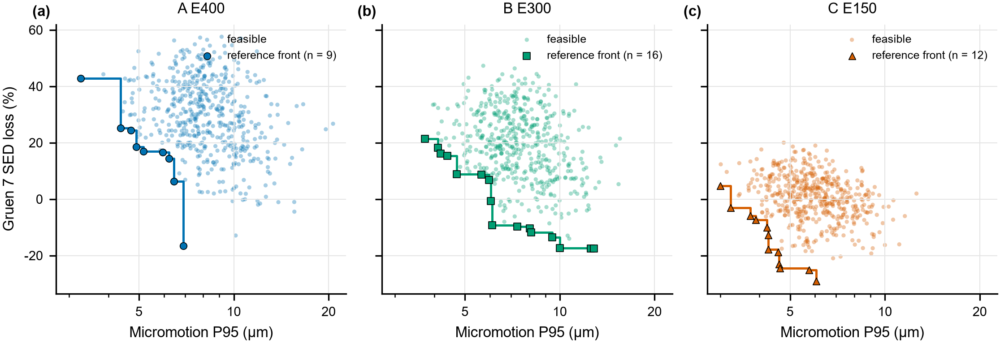

### 2.5 BO 结果（S5，报告 R5）

- 每型 3 个种子，各 60 次 FE。最终超体积比中位 A 0.886、B 0.957、C 0.899；同预算 Sobol 0.568 / 0.652 / 0.647。三型 × 三种子全部胜过 Sobol；IGD 低 4–6 倍。
- A、C 略低于 0.90（R5-A1 不通过）。
- 代理：f2 留出集 R² 约 0.9，log f1 0.6–0.8；90% 区间实际覆盖 0.85–0.99，偏保守（R5-A3 不通过，上限 0.97）。
- 单个种子相对 256 点参考扫描节省 FE 机时 88–89%。

#### 数据：每个种子在 60 次 FE 时的超体积比（R5-F01）

| Dorr | 方法 | 种子 0 | 种子 1 | 种子 2 | 中位 | 首次达到 0.90 的 FE 次数（各种子） |
|---|---|---|---|---|---|---|
| A | Sobol | 0.516 | 0.568 | 0.582 | 0.568 | 未达到 / 未达到 / 未达到 |
| A | qNEHVI | 0.790 | 0.958 | 0.886 | 0.886 | 未达到 / 52 / 未达到 |
| B | Sobol | 0.632 | 0.652 | 0.713 | 0.652 | 未达到 / 未达到 / 未达到 |
| B | qNEHVI | 0.959 | 0.957 | 0.917 | 0.957 | 60 / 40 / 56 |
| C | Sobol | 0.788 | 0.592 | 0.647 | 0.647 | 未达到 / 未达到 / 未达到 |
| C | qNEHVI | 0.899 | 0.981 | 0.891 | 0.899 | 未达到 / 36 / 未达到 |

#### 数据：代理指标（留出集约 500 个设计；三个种子的范围，R5-T01）

| Dorr | 输出 | 训练 / 测试点数 | R² | 秩相关 | 90% 区间覆盖率 |
|---|---|---|---|---|---|
| A | log10 f1 | 59 / 510 | 0.63 – 0.78 | 0.87 – 0.91 | 0.96 – 0.99 |
| A | f2 (%) | 59 / 510 | 0.91 – 0.94 | 0.96 – 0.97 | 0.89 – 0.95 |
| A | vm P99 (MPa) | 59 / 510 | 0.65 – 0.75 | 0.87 – 0.90 | 0.89 – 0.95 |
| B | log10 f1 | 58 / 507 | 0.73 – 0.81 | 0.88 – 0.92 | 0.95 – 0.95 |
| B | f2 (%) | 58 / 507 | 0.91 – 0.95 | 0.96 – 0.98 | 0.94 – 0.98 |
| B | vm P99 (MPa) | 58 / 507 | 0.63 – 0.69 | 0.82 – 0.85 | 0.88 – 0.93 |
| C | log10 f1 | 60 / 505 | 0.61 – 0.67 | 0.77 – 0.84 | 0.85 – 0.96 |
| C | f2 (%) | 60 / 505 | 0.88 – 0.94 | 0.96 – 0.97 | 0.92 – 0.99 |
| C | vm P99 (MPa) | 60 / 505 | 0.39 – 0.47 | 0.61 – 0.73 | 0.88 – 0.90 |

#### 数据：成本账本（三个种子合计，R5-T02）

| Dorr | 方法 | FE 设计数 | FE 机时 (h) | 选点耗时 (h) | 参考扫描机时 (h) | 相对参考扫描节省 |
|---|---|---|---|---|---|---|
| A | qnehvi | 180 | 1.45 | 0.14 | 4.01 | 88.0% |
| A | sobol | 180 | 1.32 | 0.00 | 4.01 | 89.0% |
| B | qnehvi | 180 | 1.38 | 0.10 | 3.87 | 88.1% |
| B | sobol | 180 | 1.27 | 0.00 | 3.87 | 89.1% |
| C | qnehvi | 180 | 1.40 | 0.09 | 4.29 | 89.1% |
| C | sobol | 180 | 1.24 | 0.00 | 4.29 | 90.3% |

#### 图题

- R5-F01：BO reaches a median HV ratio of 0.89 / 0.96 / 0.90 (A / B / C) within 60 FE runs
- R5-F02：Median final IGD: BO 0.063 / 0.056 / 0.094 vs Sobol 0.252 / 0.344 / 0.260 (A / B / C)
- R5-F03：42% of the final BO non-dominated points are members of the reference front
- R5-F04：BO's 50 % attainment surface is at or below Sobol's on 100% / 100% / 100% of the grid (A / B / C)
- R5-F05：Mean distance from BO designs to the nearest reference-front design: 0.66 in the initial design, 0.34 in the last three rounds (unit cube, seed 0)
- R5-F06：Held-out R² of the seed-0 GPs: log10 f1 0.68, f2 0.92, vm P99 0.60
- R5-F07：Empirical 90 % coverage ranges 0.85–0.99 across types, seeds and objectives (acceptance 0.80–0.97)
- R5-F08：Lowest micromotion 2.3 / 3.2 / 2.8 µm and lowest shielding -18 / -28 / -30 % on the reference fronts (A / B / C)
- R5-F09：With cancellous bone at 300 MPa the lowest micromotion changes from 3.3 to 3.0 µm in Dorr A and from 3.0 to 3.1 µm in Dorr C
- R5-F10：Knee-point designs: f1 6.9 / 5.6 / 3.6 µm, f2 -17 / -17 / -21 % (A / B / C)
- R5-F11：Front designs differ most between Dorr types in proximal width (normalised medians 0.07 / 0.83 / 0.60, A / B / C)
- R5-F12：GP relevance and R4 total Sobol indices agree with Spearman ρ = 0.64

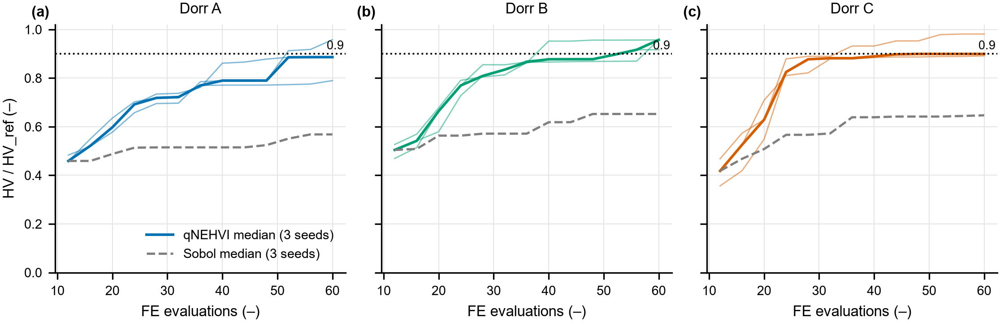

### 2.6 3D 抽检（S7，报告 R6）
理想化 3D 模型（无侧板）对前沿抽检设计的排序与 2D 的秩相关：三型合并 f1 0.35、f2 0.76；型内 A 0.80 / 0.40，B 1.00 / 0.90，C 1.00 / 0.80。3D 网格 2.0 → 1.4 mm 最大变化 34%。结论：2D 排序只在型内大体保持，跨分型比较不成立。

#### 数据：抽检设计的 2D 与 3D 目标值（R6-T01）

| Dorr | 设计 | f1 2D (µm) | f1 3D (µm) | f2 2D (%) | f2 3D (%) |
|---|---|---|---|---|---|
| A | d011218_7279 | 2.32 | 4.03 | 22.7 | 17.7 |
| A | d011184_28bb | 5.52 | 4.91 | 9.7 | 15.8 |
| A | d011088_5fa5 | 5.86 | 4.44 | 0.4 | 30.2 |
| A | d011187_346a | 13.33 | 6.33 | -17.8 | 14.3 |
| B | d011448_705c | 3.23 | 4.20 | 7.2 | 35.1 |
| B | d011518_b94d | 4.32 | 5.28 | 0.9 | 24.5 |
| B | d011509_077b | 5.27 | 5.82 | -11.3 | 16.5 |
| B | d011618_1e53 | 7.31 | 6.89 | -22.3 | 3.3 |
| B | d011629_d73d | 13.24 | 7.22 | -28.1 | 5.6 |
| C | d004807_809c | 3.24 | 8.01 | -3.1 | -9.9 |
| C | d011737_ccea | 4.32 | 11.72 | -20.9 | -33.0 |
| C | d011963_5be3 | 5.50 | 12.03 | -25.0 | -21.7 |
| C | d011934_3669 | 6.52 | 14.68 | -30.0 | -57.4 |

C 型在 3D 里的微动是 2D 的 2–3 倍（8.0–14.7 对 3.2–6.5 µm），A、B 两型量级接近。

### 2.7 v1 收尾（报告 R7）
24 项验收 16 项通过。处置已获同意的不通过项：R1-A4、R2-A2、R2-A3。待用户决定的：R4-A1、R5-A1、R5-A3、R6-A1、R6-A2。数据：`results/runs.csv` 12,013 行，`runs/` 13 GB。

#### 数据：局限清单与在真实模型中的处置（R7-T03）

| 局限 | 影响 | 真实模型中的处置 |
|---|---|---|
| 2D 平面应力 + 侧板厚度假设 | f1 对侧板厚度敏感（R2-F04） | 3D 真实股骨，无需侧板 |
| f1 未网格收敛 | f1 绝对值偏低，排序一致（R2-F10） | 3D 网格收敛研究，或改用对网格不敏感的微动指标 |
| 单一上楼工况、无肌力；方向由源模型的内下方改为生理外下方 | 载荷方向对 f2 符号影响很大（R2-F04） | 按 Bergmann 标准工况 + 肌力 |
| 2D 与 3D 跨分型比较不一致 | 型内排序大体保持，三型合并的 f1 秩相关只有约 0.35（R6） | 分型比较只在 3D 或真实股骨上做 |
| 松质骨分型模量为假设 | 对照组分离（R5-F09） | CT 灰度映射 |
| 外轮廓三型相同导致 C 型近端皮质偏厚 | 三型差异含人为成分（R1 局限） | 真实分型股骨 |
| 无实验确认 | 只做方法层面的结论 | DIC/应变片台架（课题计划） |

#### 数据：R0–R6 验收逐项（R7-T04）

| 编号 | 判定 | 实测 |
|---|---|---|
| R0-A1 | PASS | 0.054 % |
| R0-A2 | PASS | 2.9106698036193848 vs 2.9106698036193848 mm（并发组 2.9106698036193848） |
| R0-A3 | PASS | 4/4 导出成功 |
| R1-A1 | PASS | 最大偏差 0.002；三型实测均落在对应 Dorr 区间 |
| R1-A2 | PASS | 最大 0.0000 %（30 个设计） |
| R1-A3 | PASS | 14 passed in 7.48s |
| R1-A4 | FAIL | A 42.0%；B 37.2%；C 16.4% |
| R2-A1 | PASS | cortical ring 3.19 %；cancellous ring 3.56 % |
| R2-A2 | FAIL | 最细两套网格最大相对变化 47.31 %；GCI 见 R2-T02 |
| R2-A3 | FAIL | 5/7 方向正确 |
| R2-A4 | PASS | 三型 4 个 QoI 全部逐位相同 |
| R2-A5 | PASS | f1 相对 3.255 %；f2 0.0332 百分点 |
| R2-A6 | PASS | 80/80 |
| R3-A1 | PASS | BraninCurrin (d = 2): 0.9687；ZDT1 (d = 5): 0.9644 |
| R3-A2 | PASS | BraninCurrin (d = 2): 全部高于 Sobol 中位；ZDT1 (d = 5): 全部高于 Sobol 中位 |
| R4-A1 | FAIL | A_E400 9；B_E300 16；C_E150 12 |
| R4-A2 | PASS | 每组 runs.csv 行数 = 尝试数（含几何门失败行） |
| R4-A3 | PASS | 最大 2.0 % |
| R5-A1 | FAIL | A 0.886；B 0.957；C 0.899 |
| R5-A2 | PASS | A 3/3；B 3/3；C 3/3 |
| R5-A3 | FAIL | A 0.89–0.99；B 0.94–0.98；C 0.85–0.99 |
| R5-A4 | PASS | 重叠 0 |
| R6-A1 | FAIL | f1 ρ = 0.35，f2 ρ = 0.76（n = 13，三型合并） |
| R6-A2 | FAIL | A 17.7 %；B 4.7 %；C 33.6 % |

## 3 柄型变更（09-27 晚）

用户看过 v1 后提出：圆弧柄不对，应是**直柄、直线插入、内外侧轮廓各自独立、用绝对尺寸定义、从大目录里按分型选**。随后的要求依次是：

1. "再缩短一些" → 柄长 40–90 mm。
2. 以**长度、截面积降低曲线、截面形状**为主要变量重新设计测试。
3. 加**插入角**。
4. 截面**不要关于前后侧中线对称**。
5. 考察 Linux 工作站的算力。
6. 本机只做求解；先做一个 Dorr 型出一版报告；评估 `G:\hip\260429 test 2bones` 的股骨能否用。

**探索**（`explore/`，提交 4b3fad8）：6 变量直柄目录，1024 根柄模板化进三型，可放入 A 1020、B 1017、C 844 根；零过切已验证。

**v2 测试设计**（`v2/TEST_DESIGN.md` v0.2，提交 9f33d52、785ccdc）：11 个变量，尺寸与入口偏移由模板化给出，3D 为主，加扭转载荷。过程中发现三件事：

- **v1 的 Dorr C 干骺端皮质最厚**（小转子上 20 mm 壁厚 C 9.9 / 8.0 mm，A 3.3 / 2.6 mm），与 Dorr C"皮质薄"相反。v1 的跨型结论受影响。建议的修正值 CFI 4.87 / 3.78 / 2.89、皮质指数 0.65 / 0.53 / 0.36。
- 理想化 3D 股骨的体网格要 200–630 秒，太慢。
- 扭转分量约 ±800 N（按 Bergmann 2016 上楼扭矩 47 N·m 等比缩放）。

**Linux 工作站**：6 核 12 线程，31 GB 内存，RTX 5060 Ti 16 GB，空闲，无 FE 求解器；局域网密钥 ssh 可用。

**用户 09-27 夜的三个决定**：用真实股骨的两个 STEP 件；以 v2 代码为准在本会话实现（另一会话的 `straight3d/` 停下，只读借用其解剖标志算法）；允许柄贴皮质。

## 4 V2A：真实股骨（09-28 00:08 – 12:04）

### 4.1 股骨

- 目录里的 CAE 与 Job-1.inp 不能用：皮质件是"实心整根股骨 + 髓腔塞"，髓腔被占三次。STL 非流形。只有两个 STEP 干净：皮质件是中空实体（287,059 mm³，286 个面），松质件是实体（197,040 mm³）。
- 解剖标志从外膜面顶点算：头心球拟合并迭代剔除；干轴取近端下 150–330 mm 各层质心的直线；后髁连线；颈轴由截面质心迭代；小转子取凸出去趋势后的峰。
- 结果：头半径 25.34 mm，颈干角 137.5°，前倾 6.1°，偏距 39.5 mm。与另一实现相差 +0.74 mm、+0.9°、+0.2°。
- 模型坐标：原点在干轴上的小转子高度，+x 内侧，+y 后方，+z 近端。
- 距离场：0.5 mm 体素，射线奇偶判内外，壁附近 3 mm 用 KD 树精修。体积对 CAD 相差 −0.06%（髓腔）、−0.04%（外形）。
- 分型：皮质指数 0.68；CFI 按全宽 5.40，按过干轴的弦 2.93（髓腔偏后）。Dorr A。

### 4.2 柄与模板化

- 截面积 A(s) = A0·[ρ_tip + (1 − ρ_tip)(1 − s/L)^q]。
- 截面是四象限超椭圆加楔形，前半与后半各有方正度与楔形斜度。七个形状量：宽厚比、内侧占比、前方占比、前后方正度、前后楔形。
- 截面沿长度只缩放不变形，所以直线插入零过切。CAD 复核 20 个设计：968,723 个采样点 0 个越界；柄与皮质重叠体积最大占柄体积 1.62%、中位 0.04%。
- 插入角在颈平面内相对干轴，5–40°。
- 模板化：入口偏移 ±8 mm 每 2 mm 一档，对每档二分求皮质穿透 ≤ 0.25 mm 的最大肩部面积，取最大者。可行条件：能放进、尖端面积 ≥ 12 mm²、肩部面积 ≥ 假体颈截面 154 mm²。
- 8192 个随机设计的可行率：柄长 40–90 mm 时 35%，扩到 20–90 mm 后 51.9%。

### 4.3 FE 模型

- 保留域：小转子下 150 mm 以上、截骨面以下。锉腔为柄内缩 0.1 mm。C3D10 直边二次四面体，界面 2.0 mm、远场 6 mm，中位 26,594 个单元。
- 皮质 16.8 GPa，松质 400 MPa，钛合金 110 GPa，泊松比 0.3。
- 摩擦模型三步；粘接模型 `*TIE`。
- 载荷方向取 Bergmann 2016 表 5 的方向角（额状面 20°、矢状面 18°），大小 2391 N，模型坐标下 (−782, +698, −2149) N。截断面固支。
- 关注量：f1 界面滑移增量 P95；f2 Gruen 7 区应变能密度相对完整股骨的变化；柄应力 P99 ≤ 440 MPa。

### 4.4 流水线
Linux 做模板化、建模、后处理、代理与选点；本机 worker 只求解。作业是 Linux 上的一个目录，用标记文件流转（NEW → READY → CLAIMED → SOLVED → DONE / FAILED）。作业号含设计、变体、网格与代码的哈希，重复提交命中缓存。本机只留 4 个 CSV，odb 用后即删。

### 4.5 过夜验证
| 项 | 结果 |
|---|---|
| 端到端 | 完整股骨 57 s；基准设计粘接 36 s、摩擦 247 s；f1 7.34 µm，ΔSED −5.3%，柄应力 66.5 MPa |
| 去扭转 | f1 6.52 µm（降，对）|
| 过盈 0 | f1 24.32 µm（升，对）|
| 摩擦 0.8 | f1 3.38 µm（降，对）|
| 重跑 | 逐位相同 |
| 网格 2.0 / 1.4 / 1.0 mm | f1 7.34 / 7.70 / 7.00 µm；柄应力 66.5 / 67.0 / 68.6 MPa |
| 12 设计排序保持 | 秩相关 f1 0.916、f2 0.993 |

网格判定按"排序保持"一条通过，生产网格定 2.0 mm。1.0 mm 完整股骨两次内存不足（约需 90 GB），用 1.4 mm 代替。

### 4.6 参考集、敏感性、BO

- 64 点参考集全部求解成功。柄应力约束从不起作用。多数设计 Gruen 7 区显示为过载，用户同意把 f2 改为偏离的绝对值。
- 全局敏感性（64 点上的代理）：插入角总效应指数 0.6–0.7，截面形状其次，面积曲线最小。
- 按柄长（12:00 中期，132 个设计）：40–50 mm 最差（微动中位 12.7 µm），55–64 mm 最好；≥ 70 mm 因髓腔窄只能放小号，微动回升。全部 272 个设计的分箱统计见本节末的数据表。
- BO 种子 0 完成 56 个时超体积比 0.987，同预算随机采样 0.984，持平。种子 1 完成 16 个，种子 2 完成 2 个。

### 4.7 12:00 暂停
用户上午要求 12 点暂停看结果。定时任务 11:59 触发，12:04:45 求解器排空，交中期总结（132 个已解设计）。

#### 数据：符号检查与重跑（V2A-T04）

| 检查 | 结果 |
|---|---|
| torque raises micromotion | True |
| no interference raises micromotion | True |
| higher friction lowers micromotion | True |
| rerun identical | True |
| torque_off: f1 / f2 / vm | 6.52 µm / 64.3% / 50.7 MPa (base 7.34 / -5.33 / 66.5) |
| delta_0: f1 / f2 / vm | 24.3 µm / -4.77% / 66 MPa (base 7.34 / -5.33 / 66.5) |
| mu_0.8: f1 / f2 / vm | 3.38 µm / -5.33% / 66.5 MPa (base 7.34 / -5.33 / 66.5) |
| rerun: f1 / f2 / vm | 7.34 µm / -5.33% / 66.5 MPa (base 7.34 / -5.33 / 66.5) |

#### 数据：网格收敛（基准设计，V2A-T05）

| 量 | 1.0 mm | 1.4 mm | 2.0 mm | 程序给出的表观阶 | 细网格 GCI | 2.0 对 1.0 相对差 |
|---|---|---|---|---|---|---|
| f1_p95_um | 7.0048 | 7.6992 | 7.3398 | 1.9572 | 13.3% | 4.8% |
| f2_g7_loss_pct | -4.1784 | -3.8222 | -5.3253 | 4.2788 | 3.3% | 27.5% |
| vm_p99 | 68.624 | 67.0227 | 66.5066 | 3.3651 | 1.4% | 3.1% |

微动三档非单调（7.00 / 7.70 / 7.34），表观阶与 GCI 没有意义；保留这张表是为了记录当时程序的输出。

#### 数据：全局敏感性（64 点参考集上的代理，总效应指数，V2A-F11）

| 层级 | 变量或变量组 | y1_log10_f1 | y2_g7_abs_dsed |
|---|---|---|---|
| variable | L | 0.116 | 0.260 |
| variable | rho_tip | 0.059 | 0.045 |
| variable | q | 0.015 | 0.034 |
| variable | lam | 0.066 | 0.042 |
| variable | g_ml | 0.034 | 0.046 |
| variable | g_ap | 0.037 | 0.255 |
| variable | n_a | 0.042 | 0.018 |
| variable | n_p | 0.348 | 0.023 |
| variable | tau_a | 0.013 | 0.038 |
| variable | tau_p | 0.061 | 0.021 |
| variable | alpha | 0.608 | 0.679 |
| group | length | 0.116 | 0.260 |
| group | area curve | 0.074 | 0.079 |
| group | section shape | 0.476 | 0.377 |
| group | insertion angle | 0.608 | 0.679 |

代理没有做过交叉验证，且一半以上的单位立方体不可行，这些指数只能作定性排序。

#### 数据：BO 对同预算 Sobol（V2A-T06）

| 系列 | 评估数 | 成功数 | 超体积比 | 同预算 Sobol 中位 | 说明 |
|---|---|---|---|---|---|
| bo_s0 (original box, L 40–90) | 58 | 54 | 0.987 | 0.984 | stopped 12:30 (user decision) |
| bo_s1 (original box, L 40–90) | 16 | 16 | 0.927 | 0.928 | stopped 12:30 (user decision) |
| bo_s2 (original box, L 40–90) | 2 | 0 | 0.0 | 0.586 | stopped 12:30 (user decision) |
| sobol (median of 200 orders of the 64-point reference set) | 64 | 64 | 0.984 | — | — |

#### 数据：V2A 当时的前沿设计（微动对偏离绝对值，V2A-T07；已撤回，留作记录）

| 来源 | L | ρ_tip | q | λ | γ_ml | γ_ap | n_a | n_p | τ_a | τ_p | α | A0 (mm²) | f1 (µm) | 偏离 (%) |
|---|---|---|---|---|---|---|---|---|---|---|---|---|---|---|
| reference | 57.6 | 0.212 | 1.065 | 1.138 | 0.643 | 0.417 | 3.255 | 5.177 | -0.087 | -0.095 | 30.6 | 227 | 5.59 | 8.77 |
| bo | 57.0 | 0.167 | 1.526 | 1.435 | 0.458 | 0.409 | 4.333 | 2.373 | 0.01 | -0.079 | 27.9 | 356 | 5.73 | 5.59 |
| reference | 55.7 | 0.399 | 2.879 | 2.046 | 0.357 | 0.5 | 2.744 | 2.875 | -0.007 | 0.242 | 29.4 | 198 | 5.92 | 2.39 |
| reference | 59.9 | 0.184 | 2.317 | 1.261 | 0.614 | 0.507 | 3.103 | 4.28 | 0.17 | -0.242 | 25.7 | 329 | 6.36 | 0.92 |
| bo | 54.8 | 0.222 | 2.254 | 1.719 | 0.426 | 0.391 | 4.898 | 3.919 | 0.036 | 0.009 | 33.4 | 273 | 6.93 | 0.62 |
| bo | 64.3 | 0.418 | 2.555 | 1.523 | 0.4 | 0.469 | 3.55 | 4.048 | -0.258 | 0.171 | 23.9 | 162 | 8.86 | 0.05 |

#### 数据：旧界面模型下全部 272 个已解设计的统计

这些微动值的数值地板约 10 µm，低于 10 µm 的读数不能用来排序；“偏离”是旧约束量（固定区、皮质与松质骨混合）的绝对值。

按阶段：

| 分组 | 设计数 | 微动中位 (µm) | 四分位 | 范围 | 偏离中位 (%) | 柄应力中位 (MPa) | 微动 < 10 µm | 偏离 > 30% |
|---|---|---|---|---|---|---|---|---|
| 参考集 ref | 63 | 10.9 | 7.9 – 14.7 | 5.6 – 36 | 18.4 | 87 | 44% | 16% |
| V2A 的 BO | 76 | 8.8 | 7.5 – 14.1 | 5.7 – 69 | 6.3 | 132 | 57% | 8% |
| 收敛研究 conv | 2 | 10.1 | 8.7 – 11.5 | 7.3 – 13 | 4.5 | 74 | 50% | 0% |
| 20–40 mm 探针 | 32 | 33.5 | 19.2 – 64.0 | 9.8 – 140 | 52.2 | 125 | 3% | 91% |
| 留 1 mm：参考 cref | 16 | 21.3 | 16.3 – 33.0 | 12.2 – 39 | 41.7 | 133 | 0% | 81% |
| 留 1 mm：探针 cprobe | 5 | 76.5 | 73.8 – 124.8 | 18.0 – 125 | 122.9 | 145 | 0% | 100% |
| V3 | 78 | 15.6 | 10.6 – 20.7 | 6.6 – 40 | 26.7 | 170 | 22% | 41% |

按柄长：

| 分组 | 设计数 | 微动中位 (µm) | 四分位 | 范围 | 偏离中位 (%) | 柄应力中位 (MPa) | 微动 < 10 µm | 偏离 > 30% |
|---|---|---|---|---|---|---|---|---|
| 20–30 mm | 21 | 65.6 | 26.2 – 101.6 | 15.9 – 137 | 70.5 | 128 | 0% | 100% |
| 30–40 mm | 23 | 18.8 | 16.5 – 31.4 | 9.8 – 140 | 42.9 | 140 | 4% | 83% |
| 40–50 mm | 97 | 15.7 | 11.3 – 21.4 | 5.6 – 69 | 28.8 | 126 | 18% | 44% |
| 50–60 mm | 96 | 8.7 | 7.5 – 12.4 | 5.6 – 36 | 9.7 | 135 | 58% | 8% |
| 60–70 mm | 29 | 9.6 | 7.9 – 21.0 | 6.3 – 40 | 9.1 | 123 | 52% | 14% |
| 70–91 mm | 6 | 17.1 | 13.3 – 23.4 | 7.9 – 29 | 8.9 | 145 | 17% | 0% |

按插入角：

| 分组 | 设计数 | 微动中位 (µm) | 四分位 | 范围 | 偏离中位 (%) | 柄应力中位 (MPa) | 微动 < 10 µm | 偏离 > 30% |
|---|---|---|---|---|---|---|---|---|
| 5–15° | 24 | 38.8 | 23.5 – 70.1 | 6.6 – 140 | 44.8 | 175 | 8% | 75% |
| 15–25° | 83 | 16.9 | 11.3 – 24.1 | 7.3 – 137 | 23.1 | 126 | 19% | 35% |
| 25–35° | 114 | 9.9 | 7.6 – 15.4 | 5.6 – 33 | 14.5 | 125 | 51% | 18% |
| 35–41° | 51 | 13.1 | 9.8 – 19.3 | 5.6 – 77 | 32.8 | 136 | 27% | 53% |

按皮质余量：

| 分组 | 设计数 | 微动中位 (µm) | 四分位 | 范围 | 偏离中位 (%) | 柄应力中位 (MPa) | 微动 < 10 µm | 偏离 > 30% |
|---|---|---|---|---|---|---|---|---|
| m < 0（贴皮质） | 191 | 11.3 | 7.9 – 19.7 | 5.6 – 140 | 16.3 | 122 | 41% | 26% |
| 0 – 0.5 mm | 20 | 13.7 | 9.1 – 19.2 | 6.8 – 40 | 20.8 | 169 | 35% | 35% |
| 0.5 – 1.0 mm | 14 | 17.3 | 13.5 – 20.7 | 8.1 – 27 | 27.1 | 167 | 14% | 43% |
| ≥ 1.0 mm | 47 | 18.9 | 14.8 – 29.4 | 9.2 – 125 | 38.3 | 158 | 4% | 70% |

按模型版本（假体颈起点修正前后）：

| 分组 | 设计数 | 微动中位 (µm) | 四分位 | 范围 | 偏离中位 (%) | 柄应力中位 (MPa) | 微动 < 10 µm | 偏离 > 30% |
|---|---|---|---|---|---|---|---|---|
| 修正前 | 62 | 10.6 | 7.9 – 14.5 | 5.6 – 36 | 18.3 | 83 | 47% | 16% |
| 修正后 | 210 | 15.2 | 9.2 – 22.8 | 5.7 – 140 | 24.1 | 145 | 29% | 40% |

#### 图题

- V2A-F01：Real right femur (STEP): head r 25.3 mm, neck–shaft 137.5°, anteversion 6.1°, offset 39.5 mm
- V2A-F02：Dorr A by cortical index (0.68); canal flare index 5.40 by full width vs 2.93 by the chord through the shaft axis
- V2A-F05：52% of 8192 random designs fit the real femur; short stems at 15–25° fit best
- V2A-F07：Sign checks: 3 of 3 micromotion responses go the expected way; rerun identical
- V2A-F08：Mesh convergence: f1 changes by up to 5% between 2.0 and 1.0 mm interface elements
- V2A-F09：Ranking is preserved between meshes: Spearman f1 0.92, f2 0.99 (n = 12)
- V2A-F10：Reference set: 3 non-dominated designs among 64 solved (0 violate the stress limit)
- V2A-F11：Global sensitivity: micromotion is driven mostly by insertion angle, deviation of proximal SED from intact by insertion angle
- V2A-F12：BO seed 0 reaches 0.99 of the best-known hypervolume of the original design space in 58 FE runs; same-budget Sobol median 0.98
- V2A-F13：Best-known front has 7 points, 0 of them from the extended-length campaign (hypervolume 1.000× the original-space best)
- V2A-F15：6 designs along the best-known front; front lengths span 55–64 mm

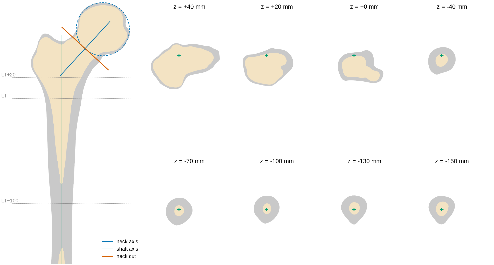

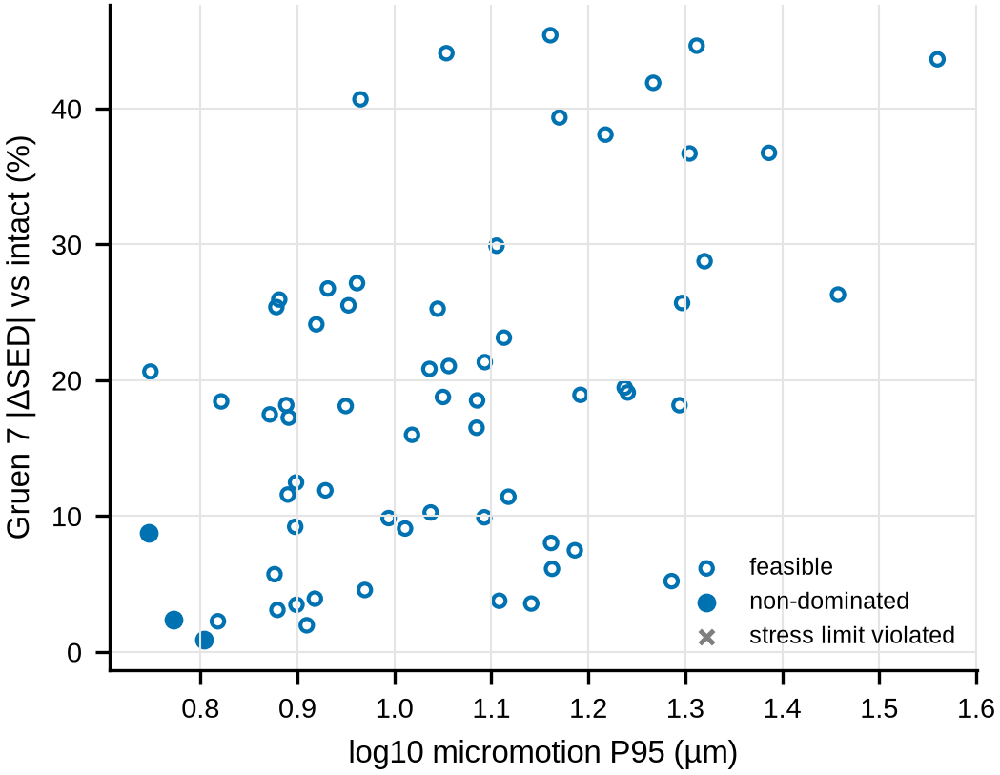

## 5 09-28 中午到傍晚的三次转向

### 5.1 柄长下限 20 mm（V2A-2，12:30）
用户问"有没有测试更短的柄"，随后要求下限扩到 20 mm。采纳的方案：停种子 1、2；种子 0 跑完；32 个 20–40 mm 探针；改为热启动 BO（代理用全部已解设计训练）。探针结果：可行率 94%，尺寸全由颈部髓腔决定。32 个探针全部解完后的微动中位：20–25 mm 78 µm，25–30 mm 49 µm，30–35 mm 24 µm，35–40 mm 19 µm（逐档见下面的数据表）。我在 12:20 只解完 5 个探针时说过“20–25 mm 为 60–140 µm、30–40 mm 为 15–40 µm”，那是中期数。

**热启动 BO 没有产生任何已解设计。** 它的驱动起跑后一直在等探针和配对重跑排队，随后被皮质余量变量和 V3 先后取代，日志是空的。后来的 12 维 BO 同样没有完成任何评估。09-28 日报里“12 维热启动 BO 跑了 2 轮”“其已解点并入热启动集”的说法有误。

### 5.2 原始数据包（13:25）
用户要"原始数据，不进行统计"。交付：202 行设计表、轮廓与截面图册、变量两两散点、146 个柄体 STL、10 个设计的场图（柄应力、骨应变能、接触压力、滑移、接触状态）与对应 CSV。

### 5.3 皮质余量（13:30 – 13:52）

- 用户问"是否有贴皮质骨的要求"：尺寸规则就是贴皮质的最大号。
- 用户要"不直接接触皮质的设计"：实现为留 1 mm 松质层的规则，配对重跑 43 个提交里 27 个放不进，可行率 37%；55–65 mm 的设计大多不可行。
- 用户问"两类不能放在一个规则里吗"：合并为第 12 个变量，皮质余量 m 取 −0.25 至 +2 mm。为它写的 12 维 BO 没有完成任何评估，就被 V3 取代。

### 5.4 V3：稳定性对去骨体积（14:00）
用户认为目标松散，要求聚焦"短柄、短截骨量"。重新提法：

- 目标：微动 P95（对数）与去骨体积。
- **去骨体积** = 截骨面以上到头颈交界之间的骨体积（体素计数）+ 柄体积（面积曲线积分加尖端帽）。头本身不计；截骨在头颈交界时截骨项为 0；截骨每下移 5 mm 约多 4–5 cm³。不按密度加权，不计过锉。
- 约束：Gruen 7 偏离 ≤ 30%，柄应力 ≤ 440 MPa。
- 9 个变量：柄长 20–70、截骨高度 25–45 mm、插入角、余量、宽厚比、内侧占比、前方占比、方正度、楔形；面积曲线两个量固定为 0.3 与 1.5。
- 机时估到 18:00 约 80 次 FE，据此裁剪队列。

#### 数据：20–40 mm 探针逐档（旧界面模型）

| 分组 | 设计数 | 微动中位 (µm) | 四分位 | 范围 | 偏离中位 (%) | 柄应力中位 (MPa) | 微动 < 10 µm | 偏离 > 30% |
|---|---|---|---|---|---|---|---|---|
| 20–25 mm | 8 | 77.6 | 32.9 – 134.1 | 19.9 – 137 | 93.0 | 132 | 0% | 100% |
| 25–30 mm | 8 | 49.2 | 20.7 – 67.5 | 19.3 – 102 | 58.6 | 124 | 0% | 100% |
| 30–35 mm | 8 | 24.3 | 17.2 – 52.3 | 10.9 – 140 | 49.0 | 144 | 0% | 88% |
| 35–41 mm | 8 | 18.7 | 15.9 – 33.3 | 9.8 – 59 | 34.9 | 120 | 12% | 75% |

#### 数据：留 1 mm 松质层的配对设计（cref、cprobe）

| 阶段 | L (mm) | α (°) | A0 (mm²) | f1 (µm) | 旧约束量 (%) | 柄应力 (MPa) |
|---|---|---|---|---|---|---|
| cprobe | 20.3 | 38.7 | 257 | 73.8 | -178.2 | 142 |
| cprobe | 21.3 | 23.9 | 280 | 124.8 | -134.9 | 145 |
| cprobe | 25.4 | 36.9 | 224 | 76.5 | -122.9 | 128 |
| cprobe | 25.7 | 6.9 | 234 | 125.2 | -118.2 | 168 |
| cprobe | 30.5 | 35.8 | 245 | 18.0 | -99.1 | 188 |
| cref | 40.3 | 18.6 | 164 | 39.4 | -51.0 | 239 |
| cref | 40.5 | 31.7 | 304 | 12.7 | -37.2 | 113 |
| cref | 40.6 | 36.8 | 175 | 32.9 | -67.4 | 146 |
| cref | 40.9 | 30.3 | 304 | 13.5 | -28.5 | 113 |
| cref | 41.0 | 25.1 | 211 | 33.2 | -49.8 | 132 |
| cref | 41.7 | 32.6 | 254 | 20.6 | -36.4 | 107 |
| cref | 41.8 | 35.9 | 270 | 12.2 | -45.9 | 143 |
| cref | 42.2 | 19.5 | 249 | 35.0 | -59.7 | 156 |
| cref | 42.9 | 29.2 | 272 | 21.9 | -39.4 | 99 |
| cref | 43.3 | 23.8 | 172 | 34.4 | -55.9 | 158 |
| cref | 43.4 | 27.2 | 308 | 16.6 | -28.4 | 97 |
| cref | 44.0 | 21.5 | 232 | 22.9 | -43.9 | 187 |
| cref | 44.5 | 38.3 | 234 | 24.5 | -51.2 | 129 |
| cref | 44.6 | 34.6 | 221 | 20.2 | -26.0 | 121 |
| cref | 45.2 | 22.5 | 219 | 18.4 | -37.0 | 150 |
| cref | 45.3 | 28.5 | 203 | 15.4 | -34.7 | 134 |

43 + 6 个提交里 28 个模板化不可行（L1），上表是能放进去并解完的 21 个。

## 6 V3 的结果与敏感性

| 项 | 种子 0（16:00 – 17:29） | 种子 1（18:50 – 21:18） |
|---|---|---|
| 评估 / 成功 | 40 / 39 | 40 / 39 |
| 满足约束 | 23 | 23 |
| 违反原因 | 16 个偏离 > 30%，0 个应力 | 同 |
| 微动最低（可行） | 6.6 µm | 7.4 µm |
| 去骨体积最少（可行） | 5.39 cm³ | 5.69 cm³ |
| 超体积 | 6989，10 轮不变 | 6989，10 轮不变 |

- 全部 272 个设计里 177 个可行，前沿仍是 4 个旧设计（柄长 53 / 62 / 48 / 58 mm，头颈交界截骨，贴皮质）。
- 读数：微动 ≤ 40 与 ≤ 150 µm 的最少去骨体积设计相同——柄长 53 mm、插入角 39°、贴皮质、4.4 cm³、16.6 µm。
- 截骨 ≥ 30 mm 的 6 个只有 1 个可行。
- **敏感性补跑**（8 个设计 × 2 个变体）：松质骨模量 400 → 200 MPa，微动中位 ×2.3，秩相关 0.79；过盈 0.10 → 0.05 mm，×2.4，秩相关 0.76。为此给作业系统加了松质骨模量变体通道，参照只匹配同模量。

18:00 交初版报告，22:00 交晚间版。验收 V3-A1（前沿点数 ≥ 5）不通过，V3-A2（约束通过率 ≥ 50%）通过。

#### 数据：V3 种子 0 逐个评估（热启动 162 个设计，候选池 4078 个，参考点 (log10 f1, 去骨体积) = (1.553, 13286 mm³)）

| 轮 | L (mm) | 截骨 (mm) | α (°) | 余量 (mm) | f1 (µm) | 去骨体积 (cm³) | 满足约束 | 归一化违反量 |
|---|---|---|---|---|---|---|---|---|
| 1 | 59.0 | 27.2 | 25.1 | 0.18 | 12.3 | 7.95 | 是 | -0.52 |
| 1 | 58.2 | 27.6 | 29.0 | -0.01 | 9.9 | 7.80 | 是 | -0.50 |
| 1 | 60.3 | 25.9 | 26.1 | -0.14 | 6.6 | 8.30 | 是 | -0.65 |
| 1 | 51.1 | 27.9 | 32.2 | -0.20 | 8.5 | 7.60 | 是 | -0.53 |
| 2 | 55.7 | 31.0 | 19.2 | 0.01 | 12.3 | 12.10 | 是 | -0.19 |
| 2 | 56.3 | 25.0 | 31.9 | 0.12 | 6.8 | 6.28 | 是 | -0.61 |
| 2 | 35.9 | 26.8 | 36.7 | 0.24 | 15.4 | 7.56 | 否 | 0.34 |
| 2 | 53.0 | 25.4 | 37.2 | -0.01 | 11.0 | 5.96 | 是 | -0.57 |
| 3 | 51.0 | 26.7 | 33.7 | 1.03 | 9.2 | 6.57 | 是 | -0.27 |
| 3 | 40.8 | 27.2 | 39.8 | 0.30 | 15.2 | 7.55 | 否 | 0.35 |
| 3 | 47.8 | 26.3 | 39.8 | 1.18 | 11.9 | 6.23 | 否 | 0.12 |
| 3 | 50.6 | 25.8 | 36.0 | 0.36 | 9.8 | 6.75 | 是 | -0.36 |
| 4 | 49.5 | 25.2 | 34.7 | 1.26 | 15.0 | 6.63 | 是 | -0.37 |
| 4 | 51.3 | 25.1 | 28.7 | 0.71 | 8.1 | 6.82 | 是 | -0.69 |
| 4 | 66.1 | 26.0 | 18.2 | 0.91 | 21.2 | 7.22 | 是 | -0.40 |
| 4 | 60.5 | 25.1 | 20.6 | 0.86 | 20.7 | 6.43 | 是 | -0.39 |
| 5 | 50.9 | 25.5 | 26.8 | 1.67 | 14.3 | 5.64 | 是 | -0.11 |
| 5 | 49.6 | 26.4 | 25.7 | 1.78 | 18.8 | 6.62 | 否 | 0.22 |
| 5 | 49.2 | 26.1 | 27.4 | 0.20 | 9.2 | 8.59 | 是 | -0.71 |
| 5 | 67.0 | 31.5 | 12.7 | 0.06 | 40.3 | 12.08 | 否 | 0.48 |
| 6 | 44.1 | 27.4 | 29.6 | 1.41 | 14.8 | 7.78 | 是 | -0.03 |
| 6 | 43.5 | 25.7 | 19.3 | -0.01 | 19.1 | 7.31 | 是 | -0.00 |
| 6 | 49.0 | 25.9 | 32.1 | 0.90 | 16.3 | 7.57 | 是 | -0.13 |
| 6 | 40.0 | 28.9 | 28.2 | 1.10 | 16.8 | 9.12 | 否 | 0.25 |
| 7 | 52.4 | 25.4 | 26.0 | 1.97 | 14.1 | 5.39 | 是 | -0.12 |
| 7 | 37.5 | 37.0 | 40.0 | -0.23 | 20.7 | 16.86 | 否 | 1.45 |
| 7 | 35.7 | 36.1 | 38.8 | 0.30 | 31.1 | 16.21 | 否 | 1.60 |
| 7 | 39.9 | 35.1 | 39.7 | 0.61 | 17.4 | 13.68 | 否 | 1.20 |
| 8 | 47.9 | 25.3 | 29.1 | 1.79 | 16.2 | 5.85 | 是 | -0.04 |
| 8 | 46.5 | 25.6 | 38.7 | 1.15 | 14.8 | 6.43 | 否 | 0.11 |
| 8 | 49.7 | 25.2 | 28.4 | 0.41 | 8.6 | 6.75 | 是 | -0.60 |
| 8 | 42.3 | 25.1 | 27.5 | 1.28 | 25.7 | 5.23 | 否 | 0.74 |
| 9 | 32.7 | 25.1 | 23.4 | 0.44 | 22.8 | 5.74 | 否 | 0.44 |
| 9 | 48.7 | 25.2 | 21.5 | 1.58 | 31.5 | 5.12 | 否 | 0.66 |
| 9 | 46.8 | 25.1 | 36.5 | 1.52 | 21.4 | 4.72 | 否 | 0.51 |
| 9 | 58.3 | 25.4 | 25.4 | 0.78 | 12.4 | 6.49 | 是 | -0.59 |
| 10 | 55.1 | 26.1 | 26.5 | 0.74 | 19.2 | 6.67 | 否 | 0.02 |
| 10 | 63.0 | 27.2 | 17.4 | -0.17 | 失败 | — | — | — |
| 10 | 62.0 | 25.5 | 21.6 | 0.97 | 27.2 | 6.09 | 否 | 0.10 |
| 10 | 49.0 | 25.6 | 15.4 | 0.32 | 24.4 | 5.89 | 是 | -0.01 |

选点耗时每轮 25–32 s。

#### 数据：V3 种子 1 逐个评估（热启动 233 个设计，候选池 4105 个，参考点 (log10 f1, 去骨体积) = (1.553, 13286 mm³)）

| 轮 | L (mm) | 截骨 (mm) | α (°) | 余量 (mm) | f1 (µm) | 去骨体积 (cm³) | 满足约束 | 归一化违反量 |
|---|---|---|---|---|---|---|---|---|
| 1 | 48.8 | 25.5 | 39.9 | 0.17 | 19.4 | 5.53 | 否 | 0.21 |
| 1 | 64.8 | 25.2 | 17.3 | -0.03 | 21.0 | 6.58 | 是 | -0.41 |
| 1 | 52.7 | 25.5 | 35.6 | 0.36 | 7.8 | 5.97 | 是 | -0.56 |
| 1 | 52.6 | 25.1 | 26.9 | 1.24 | 19.2 | 4.96 | 否 | 0.28 |
| 2 | 49.8 | 25.1 | 36.3 | 0.49 | 8.5 | 6.10 | 是 | -0.58 |
| 2 | 38.9 | 25.1 | 25.0 | -0.14 | 11.8 | 6.63 | 是 | -0.35 |
| 2 | 54.8 | 27.8 | 28.0 | -0.22 | 7.4 | 9.35 | 是 | -0.69 |
| 2 | 48.6 | 25.1 | 31.1 | 1.69 | 13.8 | 5.73 | 是 | -0.26 |
| 3 | 59.2 | 25.1 | 18.1 | 0.18 | 16.9 | 6.26 | 是 | -0.49 |
| 3 | 68.4 | 29.0 | 12.9 | -0.14 | 21.5 | 12.12 | 是 | -0.55 |
| 3 | 51.0 | 25.4 | 33.0 | 1.02 | 9.9 | 5.69 | 是 | -0.31 |
| 3 | 54.0 | 26.2 | 34.1 | -0.19 | 7.7 | 6.77 | 是 | -0.60 |
| 4 | 50.2 | 25.4 | 19.7 | 1.64 | 23.9 | 5.03 | 否 | 0.34 |
| 4 | 53.6 | 25.2 | 28.5 | -0.17 | 10.2 | 8.68 | 是 | -0.73 |
| 4 | 45.7 | 26.0 | 33.7 | 0.16 | 18.3 | 7.82 | 是 | -0.38 |
| 4 | 47.0 | 28.1 | 39.4 | 0.27 | 19.2 | 7.42 | 否 | 0.53 |
| 5 | 56.7 | 25.2 | 21.2 | 1.13 | 失败 | — | — | — |
| 5 | 50.9 | 26.4 | 29.5 | 1.83 | 10.3 | 6.18 | 是 | -0.14 |
| 5 | 42.8 | 25.0 | 23.6 | 1.87 | 27.4 | 5.51 | 否 | 0.42 |
| 5 | 44.8 | 25.1 | 35.1 | 0.86 | 17.2 | 6.06 | 否 | 0.09 |
| 6 | 42.1 | 26.0 | 39.9 | 1.98 | 23.1 | 5.72 | 否 | 0.72 |
| 6 | 52.8 | 25.0 | 18.7 | 0.61 | 20.5 | 6.60 | 是 | -0.06 |
| 6 | 61.0 | 42.3 | 13.2 | -0.24 | 24.2 | 25.02 | 否 | 0.79 |
| 6 | 50.7 | 28.6 | 31.0 | -0.16 | 9.3 | 9.97 | 是 | -0.65 |
| 7 | 58.9 | 26.0 | 22.0 | 1.30 | 16.5 | 6.69 | 是 | -0.19 |
| 7 | 58.6 | 25.2 | 19.9 | 1.02 | 31.5 | 5.66 | 否 | 0.37 |
| 7 | 52.3 | 27.4 | 29.2 | -0.02 | 10.5 | 7.61 | 是 | -0.20 |
| 7 | 51.3 | 25.4 | 30.2 | 0.69 | 12.6 | 6.77 | 是 | -0.25 |
| 8 | 40.5 | 25.4 | 14.6 | -0.19 | 37.3 | 4.57 | 否 | 0.25 |
| 8 | 49.3 | 26.7 | 28.1 | 1.01 | 15.2 | 7.98 | 是 | -0.07 |
| 8 | 44.0 | 25.9 | 36.3 | 1.14 | 14.9 | 5.83 | 否 | 0.40 |
| 8 | 27.0 | 25.7 | 32.8 | -0.03 | 15.9 | 6.26 | 否 | 0.19 |
| 9 | 42.8 | 26.8 | 38.9 | 0.99 | 15.9 | 6.91 | 否 | 0.12 |
| 9 | 41.8 | 27.0 | 33.3 | 1.86 | 33.2 | 6.23 | 否 | 1.27 |
| 9 | 51.7 | 28.3 | 23.2 | -0.00 | 12.6 | 11.04 | 是 | -0.65 |
| 9 | 40.7 | 25.7 | 26.0 | 0.45 | 8.4 | 8.04 | 是 | -0.50 |
| 10 | 47.5 | 26.8 | 24.5 | 1.60 | 18.9 | 7.30 | 否 | 0.07 |
| 10 | 47.9 | 26.2 | 35.9 | 1.00 | 22.6 | 5.68 | 否 | 0.78 |
| 10 | 54.1 | 27.0 | 28.4 | 0.82 | 8.5 | 8.11 | 是 | -0.57 |
| 10 | 50.7 | 27.1 | 36.2 | 0.04 | 11.1 | 7.59 | 是 | -0.25 |

选点耗时每轮 38–50 s。

#### 数据：V3 报告里的前沿设计（V3-T01；已撤回，留作记录）

| 作业 | L | 截骨 | α | 余量 | λ | γ_ml | γ_ap | n | τ | A0 | f1 (µm) | 偏离 (%) | 柄应力 | 锉骨 (mm³) | 去骨体积 (mm³) |
|---|---|---|---|---|---|---|---|---|---|---|---|---|---|---|---|
| bo_qnehvi_s1_r0_62bbf7 | 53.236 | 25.0 | 39.406 | -0.25 | 1.771 | 0.372 | 0.54 | 4.098 | 0.075 | 196.664 | 16.558 | 29.883 | 134.563 | 4,383 | 4,383 |
| ref_r51_h2_944c4554 | 62.322 | 25.0 | 27.932 | -0.25 | 1.928 | 0.584 | 0.422 | 4.588 | 0.224 | 169.255 | 7.781 | 17.252 | 109.622 | 4,664 | 4,664 |
| ref_r2_h2_2dce8f64 | 48.49 | 25.0 | 38.486 | -0.25 | 1.436 | 0.637 | 0.628 | 2.832 | -0.096 | 174.932 | 5.603 | 20.641 | 106.298 | 4,979 | 4,979 |
| ref_r9_h2_e3e0f7ad | 57.581 | 25.0 | 30.584 | -0.25 | 1.138 | 0.643 | 0.416 | 4.216 | -0.091 | 227.347 | 5.586 | 8.775 | 61.477 | 7,885 | 7,885 |

#### 数据：敏感性补跑逐设计（旧界面模型，V3-T02）

| 设计 | 前沿 | L | 截骨 | 余量 | f1 基线 | f1 E 200 | f1 δ 0.05 | 偏离 基线 | 偏离 E 200 | 偏离 δ 0.05 | 柄应力 基线 | 柄应力 E 200 |
|---|---|---|---|---|---|---|---|---|---|---|---|---|
| ref_r9_h2_e3e0f7ad | 是 | 57.58 | 25.0 | -0.25 | 5.59 | 14.54 | 16.69 | 8.8 | 7.9 | 9.9 | 61.5 | 135.7 |
| ref_r2_h2_2dce8f64 | 是 | 48.49 | 25.0 | -0.25 | 5.6 | 21.5 | 17.47 | 20.6 | 20.9 | 17.3 | 106.3 | 153.9 |
| v3_s0_r1_2ab38e9b | 否 | 60.33 | 25.93 | -0.136 | 6.62 | 12.38 | 13.28 | 6.5 | 4.6 | 6.8 | 152.8 | 153.6 |
| v3_s0_r2_a9c5d265 | 否 | 56.32 | 25.01 | 0.117 | 6.84 | 15.72 | 16.66 | 2.6 | 9.7 | 2.5 | 171.3 | 172.4 |
| ref_r51_h2_944c4554 | 是 | 62.32 | 25.0 | -0.25 | 7.78 | 17.63 | 21.16 | 17.3 | 19.6 | 14.7 | 109.6 | 202.4 |
| v3_s0_r2_56a27dbc | 否 | 53.02 | 25.4 | -0.01 | 11.01 | 25.31 | 19.47 | 9.7 | 17.3 | 8.1 | 190.6 | 193.4 |
| v3_s0_r7_aafe769f | 否 | 52.43 | 25.43 | 1.973 | 14.1 | 43.64 | 33.81 | 26.5 | 48.3 | 26.8 | 199.7 | 200.8 |
| bo_qnehvi_s1_r0_62bb | 是 | 53.24 | 25.0 | -0.25 | 16.56 | 34.64 | 30.34 | 29.9 | 38.9 | 28.5 | 134.6 | 136.4 |

柄应力在基线与变体之间从 61–110 跳到 134–202 MPa 的三行，就是假体颈修正前解的参考设计。

#### 图题

- V3-F01：Stability vs bone loss: least bone loss with micromotion ≤ 40 µm: 4.4 cm³ (L 53, cut 25); ≤ 150 µm: 4.4 cm³ (L 53, cut 25) (4 front points, 78 V3 evaluations so far)
- V3-F02：Front designs span L 48–62 mm, cut 25–25 mm from head centre, cortical margin -0.25–-0.25 mm
- V3-F03：Halving cancellous modulus or interference raises micromotion ×2.3 / ×2.4 (median) with Spearman 0.79 / 0.76 over 8 designs

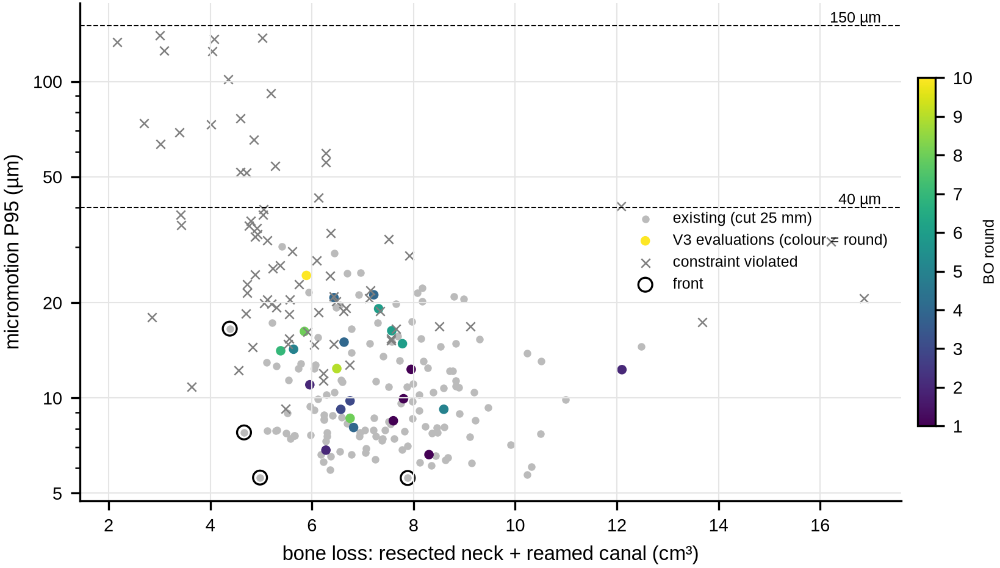

## 7 文献核对与 Methods（09-28 14:30 – 16:30）

- **常识核对**：趋势与文献一致（长度、扭转、过盈、摩擦、超短柄失稳）；绝对微动比 Reimeringer 2013、Kanaizumi 2022 低 3–10 倍。
- **Methods 初稿**：英文 2.1–2.7 七节，10 篇经 Crossref 核实的参考文献（Reimeringer 2013、Abdul-Kadir 2008、Bieger 2012、Viceconti 2000、Huiskes 1992、Bergmann 2016、Cilla 2017、Kanaizumi 2022、Erdemir 2012、Ament 2023）。
- **参考文献合集**：用户先要原文原页，再改为只要 Methods 部分，再要求去掉分隔页。最终 51 页。
- **取文献的三个坑**：EndNote 里标为 Cilla 2017 的附件实际是 Borgiani 2015；Erdemir 2012 的 PDF 被拦，用 PMC 的全文 XML 排版；Viceconti 2000 没有原文。三篇开放获取 PDF 的下载事先征得同意。

## 8 外部评估与修改方案 V4（09-28 22:40 – 23:38）

用户贴来两份评估（结果层面、方法层面）。我用原始数据重算了其中 10 条关键论断，全部成立：

| 问题 | 复核结果 |
|---|---|
| V3 够不到省骨的设计 | 固定面积曲线把柄体积系数锁在 0.58；前沿最省骨两点是 0.41、0.44；9 个旧可行设计比 V3 最好的更省骨 |
| 数据混了两个模型版本 | 64 个参考设计里 61 个是假体颈修正前解的（柄应力中位 78–83 MPa，修正后 131–170 MPa） |
| 10 µm 以下的微动是数值量 | 摩擦弹性滑移上限 0.005 × 2 mm = 10 µm；粘着节点滑移 P95 实测 5.6–6.0 µm；276 个设计里 93 个 f1 < 10 µm |
| 压配没压上 | 压配结束时 27–50% 界面节点张开，间隙 P95 62–234 µm |
| 过盈不是 0.10 mm | 代码从缩放系数里减 0.10，实际径向 0.035–0.08 mm |
| 接触压力过高 | 最大 370–2900 MPa |
| 约束口径可疑 | 95 个违反者全部是过载 |
| 前沿设计尖端顶皮质 | 4 点中 2 点最紧处在尖端 |
| 去扭转的应变能对比不可解读 | 参照是带扭转的完整股骨 |
| 验收记录有错 | V2A-A4 实为不通过；35% 与 51.9% 是两个空间；A10 只有 1 个完整种子；A12 未做 |

**修改方案 V4**：先修界面（P1）、补验证（P2），通过之前不做优化；然后改应变能口径与载荷、松质骨材料（P3）、设计空间（P4），冻结版本后重跑参考集（P5）再优化（P6）。

**用户 23:30 的决定**：松质骨分区赋值；只接触松质骨不是硬要求；暂不加压溃上限；先只修界面；应变能约束要先了解再决定；另要应力分布对比图与应力屏蔽统计。

## 9 应力屏蔽分析（09-28 23:55）

- 数据：210 个当前版本设计的粘接模型，对 1 个新解的完整股骨参照（带应力导出，53 s）。
- Gruen 分区按柄自身坐标定义；皮质与松质骨分开；只比较两个模型里都存在的骨。

| Gruen 区 | 皮质应力变化中位 | 皮质应变能密度变化中位 |
|---|---|---|
| 1 近端外侧 | −23% | −52% |
| 2 中段外侧 | −11% | −29% |
| 3 – 5 远段与柄尖 | ±3% 以内 | ±5% 以内 |
| 6 中段内侧 | −10% | −27% |
| 7 近端内侧（股骨距） | −45% | −71% |

- 股骨距皮质应力降幅 5–69%，没有一个设计高于完整股骨。
- 与插入角的秩相关 +0.67，与柄长 −0.10。插入角 35–40° 时中位 −32%，15–25° 时 −52%。这是分区跟着柄走时的结果；固定解剖区里主导因素是柄长（见第 10A 节的更正）。
- 柄周松质骨全部过载，7 区应力中位 +379%。
- **旧约束量的符号反了**：固定区里松质骨存了 44% 的应变能；旧约束量 85 个超过 30% 全为过载，同一区域只看皮质则 210 个全是遮挡；符号相反的 182 个。
- Huiskes 1992 的骨重建死区是 ±75%（本地原文核对）。

**用户 09-29 00:00 的决定**：应力屏蔽只报告，不进优化。

#### 数据：Gruen 分区统计，皮质与松质骨（210 个设计）

变化量 = (植入 − 完整) / 完整。

| 分区 | 骨质 | 区域体积中位 (mm³) | 完整股骨应力中位 (MPa) | 应力变化 中位 [四分位] (%) | 应力变化范围 (%) | 应变能密度变化 中位 [四分位] (%) | 应变能密度降 > 30 / 50 / 75% 的设计 | 升 > 30% 的设计 |
|---|---|---|---|---|---|---|---|---|
| 1 区 | 皮质 | 4,823 | 5.00 | -22 [-35, -6] | -49 – 76 | -52 [-69, -19] | 69% / 53% / 12% | 14% |
| 1 区 | 松质 | 11,353 | 0.32 | 77 [37, 135] | -5 – 541 | 472 [262, 807] | 0% / 0% / 0% | 100% |
| 2 区 | 皮质 | 3,397 | 5.48 | -11 [-17, -4] | -28 – 36 | -29 [-36, -16] | 47% / 0% / 0% | 2% |
| 2 区 | 松质 | 17,758 | 0.43 | -6 [-20, 10] | -36 – 345 | -6 [-33, 32] | 27% / 0% / 0% | 25% |
| 3 区 | 皮质 | 3,350 | 6.10 | 3 [-1, 7] | -15 – 22 | 3 [-4, 9] | 0% / 0% / 0% | 6% |
| 3 区 | 松质 | 10,117 | 0.53 | 26 [19, 36] | -6 – 193 | 59 [40, 89] | 0% / 0% / 0% | 86% |
| 4 区 | 皮质 | 8,128 | 13.83 | 1 [1, 2] | -3 – 10 | 3 [2, 5] | 0% / 0% / 0% | 0% |
| 4 区 | 松质 | 7,128 | 0.51 | 43 [32, 52] | 16 – 143 | 152 [94, 208] | 0% / 0% / 0% | 99% |
| 5 区 | 皮质 | 4,938 | 12.93 | -0 [-1, 1] | -24 – 8 | -5 [-7, -3] | 2% / 0% / 0% | 0% |
| 5 区 | 松质 | 4,827 | 1.13 | 9 [2, 24] | -5 – 1,365 | 10 [-3, 55] | 0% / 0% / 0% | 30% |
| 6 区 | 皮质 | 3,756 | 12.89 | -10 [-15, -6] | -54 – 6 | -27 [-37, -20] | 40% / 12% / 3% | 0% |
| 6 区 | 松质 | 2,102 | 0.86 | 75 [14, 360] | -11 – 1,018 | 172 [30, 1,733] | 0% / 0% / 0% | 75% |
| 7 区 | 皮质 | 2,307 | 13.73 | -45 [-52, -37] | -69 – -5 | -71 [-77, -58] | 93% / 83% / 33% | 1% |
| 7 区 | 松质 | 1,509 | 0.53 | 379 [306, 483] | 152 – 926 | 2,397 [1,593, 3,475] | 0% / 0% / 0% | 100% |
| 固定区 | 皮质 | 16,116 | 12.57 | -12 [-15, -9] | -22 – -1 | -24 [-28, -18] | 15% / 0% / 0% | 0% |
| 固定区 | 松质 | 24,451 | 0.79 | 48 [25, 65] | 2 – 154 | 147 [77, 217] | 0% / 0% / 0% | 96% |

#### 数据：股骨距皮质应力变化按设计变量分箱

| 变量 | 范围 | 设计数 | 应力变化中位 (%) | 应变能密度变化中位 (%) |
|---|---|---|---|---|
| 插入角 (°) | 5 – 15 | 18 | -46 | -74 |
| 插入角 (°) | 15 – 25 | 55 | -52 | -79 |
| 插入角 (°) | 25 – 35 | 94 | -44 | -70 |
| 插入角 (°) | 35 – 41 | 43 | -32 | -57 |
| 柄长 (mm) | 20 – 30 | 21 | -37 | -53 |
| 柄长 (mm) | 30 – 40 | 23 | -42 | -63 |
| 柄长 (mm) | 40 – 50 | 70 | -47 | -74 |
| 柄长 (mm) | 50 – 60 | 74 | -42 | -67 |
| 柄长 (mm) | 60 – 91 | 22 | -49 | -75 |
| 皮质余量 (mm) | -1 – 0 | 129 | -47 | -70 |
| 皮质余量 (mm) | 0 – 0.5 | 20 | -40 | -64 |
| 皮质余量 (mm) | 0.5 – 1 | 14 | -44 | -71 |
| 皮质余量 (mm) | 1 – 3 | 47 | -44 | -71 |
| 截骨高度 (mm) | 24 – 26 | 176 | -47 | -72 |
| 截骨高度 (mm) | 26 – 30 | 28 | -39 | -66 |
| 截骨高度 (mm) | 30 – 46 | 6 | -21 | -50 |

#### 数据：旧约束量对皮质口径（固定区）

| 项 | 值 |
|---|---|
| 比较的设计数 | 210 |
| 区域应变能中松质骨所占份额（中位） | 44.4% |
| 区域内皮质体积中位 | 16,116 mm³ |
| 旧约束量超过 30% 的设计 | 85（其中过载 85，遮挡 0） |
| 同一区域皮质口径超过 30% 的设计 | 32（其中过载 0，遮挡 32） |
| 两种口径符号相反的设计 | 182 |

#### 数据：出对比图的六个设计

| 选取理由 | L (mm) | α (°) | 余量 (mm) | A0 (mm²) | 7 区皮质应力变化 | 7 区皮质应变能密度变化 | 1 区皮质应力变化 |
|---|---|---|---|---|---|---|---|
| 股骨距遮挡最重 | 54.5 | 21.8 | -0.25 | 281 | -69% | -91% | -31% |
| 中位 | 48.6 | 31.1 | 1.69 | 195 | -45% | -73% | -34% |
| 股骨距遮挡最轻 | 20.3 | 38.7 | -0.25 | 324 | -5% | 70% | -19% |
| 最短的柄 | 20.3 | 38.7 | 1.00 | 257 | -31% | -51% | 18% |
| 最长的柄 | 83.2 | 15.5 | -0.25 | 232 | -50% | -76% | -10% |
| 原读数设计 | 53.2 | 39.4 | -0.25 | 197 | -24% | -45% | -26% |

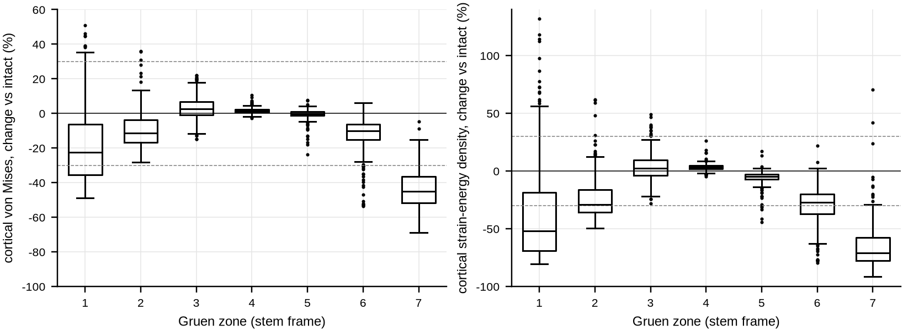

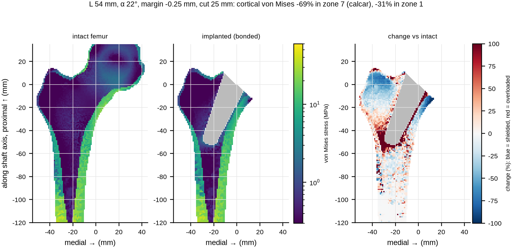

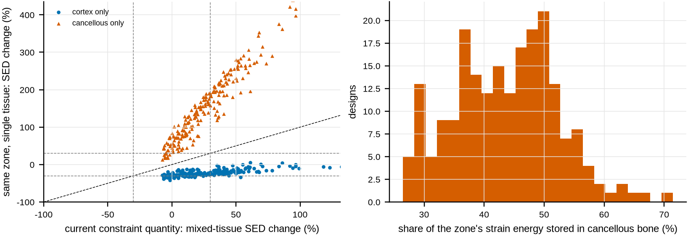

## 10 M1 界面模型与七小时验证（09-29 00:00 – 06:32）

### 10.1 改了什么
| 项 | 旧 | 新 |
|---|---|---|
| 界面网格 | 两套网格分面不重合 | 一起碎片化，界面只划一次；界面节点复制给柄侧 |
| 过盈 | 实际径向 0.035–0.08 mm | 逐节点给定法向值；皮质相邻节点为 0 |
| 摩擦弹性滑移上限 | 10 µm | 0.5 µm |
| 加载 | 压配、释放、加载 | 再加卸载、再加载 |
| 微动 | 接触滑移增量 | 节点对相对切向位移；主指标取第二循环可恢复量 |

00:10 基准设计在 Linux 上一次建模成功（41 s，4354 个界面节点对，与皮质相邻的面积占 1.7%）。

### 10.2 结果
| 项 | 结果 | 判定 |
|---|---|---|
| Lamé 解析对照 | 无摩擦 −0.2% / −0.1%；摩擦 0.3 时 −4.5% | 通过 |
| 压配后张开 | 间隙 > 1 µm 面积 6.2%；> 5 µm 面积中位 1.4%、最大 3.9% | 按 1 µm 不通过，按 5 µm 通过 |
| 粘着节点滑移 | 最大 0.46 µm | 通过 |
| 摩擦容差 | 基准设计 3.78 / 1.01 / 0.45 / 0.37 µm（容差 0.005 / 0.001 / 0.00025 / 0.0001）；Lagrange 不收敛 | 不通过，地板定 1 µm |
| 噪声底 | 变异系数 2.8–5.6%（可恢复），1.7–2.0%（首次加载） | 通过 |
| 新旧对比 | 12 个设计，秩相关 0.98 / 0.96 | 已报告 |
| 方向性 | 过盈、摩擦、扭转都对 | 通过 |
| 网格 2.0 对 1.4 mm | 首次加载微动 0%、−10%、−13% | 不通过（短柄） |

**过盈量扫描**（可恢复微动 P95，µm）：

| 设计 | 0.10 | 0.05 | 0.025 | 0.01 mm |
|---|---|---|---|---|
| 基准（L 60，α 20°） | 0.45 | 0.69 | 7.4 | 31 |
| 原读数设计（L 53，α 39°） | 0.69 | 2.5 | 19 | 44 |
| 短柄（L 25） | 4.6 | 30 | 89 | 134 |

### 10.3 过程中的发现与处置

- **节点接触压力输出不可靠**：同一力学状态下两种过盈写法的压力均值分别偏 −24% 与 +11%。改用套筒外表面膨胀反推压力。
- **过盈 0 不能算**：卸载到零后柄松脱，第二次加载不收敛。最低档改为 0.01 mm，两个已排队的作业标记跳过。
- **同一模型重复求解一次**，结果逐位相同。
- **低于地板的读数随单元尺寸缩放**：2.0 对 1.4 mm 相差 +44%、+51%，与尺寸比 1.43 一致。
- **完整股骨参照查找的缺陷**：网格 2.03、2.06 mm 的作业解完后卡住，因为只会找更粗的参照。已修。
- **求解器从两槽改为三槽**：两槽时处理器占用约 26%；改后无许可错误。
- 接触压力中位 5.7–9.5 MPa（过盈 0.10 mm），松质骨抗压强度的文献范围是 2–12 MPa。
- 求解时间：摩擦模型每个设计 9–26 分钟，旧模型约 4.5 分钟；1.4 mm 网格 28–45 分钟。

#### 数据：解析对照 8 个作业

| 过盈写法 | 摩擦 | 网格 (mm) | 解析解 (MPa) | 反推压力 (MPa) | 误差 | 节点接触压力均值 [最小, 最大] (MPa) | 其偏差 | 骨侧法向位移 均值 ± 标准差 (µm) | 节点对数 | 求解 (s) |
|---|---|---|---|---|---|---|---|---|---|---|
| 几何平移 | 0 | 2 | 2.970 | 2.954 | -0.55% | 2.26 [1.14, 3.39] | -24.0% | 99.32 ± 0.86 | 545 | 34 |
| 几何平移 | 0 | 1.4 | 2.970 | 2.960 | -0.34% | 2.36 [1.75, 3.54] | -20.7% | 99.53 ± 0.37 | 999 | 38 |
| 几何平移 | 0.3 | 2 | 2.970 | 2.826 | -4.84% | 2.36 [1.21, 3.58] | -20.7% | 99.33 ± 0.86 | 545 | 41 |
| 几何平移 | 0.3 | 1.4 | 2.970 | 2.832 | -4.64% | 2.45 [1.79, 3.39] | -17.4% | 99.54 ± 0.37 | 999 | 66 |
| 逐节点给定 | 0 | 2 | 2.970 | 2.965 | -0.18% | 3.30 [3.09, 3.81] | +11.2% | 99.91 ± 0.07 | 545 | 32 |
| 逐节点给定 | 0 | 1.4 | 2.970 | 2.966 | -0.13% | 3.17 [2.78, 3.81] | +6.9% | 99.88 ± 0.07 | 999 | 38 |
| 逐节点给定 | 0.3 | 2 | 2.970 | 2.837 | -4.48% | 3.43 [3.17, 4.18] | +15.6% | 99.92 ± 0.07 | 545 | 40 |
| 逐节点给定 | 0.3 | 1.4 | 2.970 | 2.838 | -4.44% | 3.29 [3.01, 3.71] | +10.8% | 99.90 ± 0.03 | 999 | 65 |

解析的骨侧法向位移是 99.85 µm（过盈 100 µm 里钛柱只压缩 0.15 µm）。

#### 数据：M1 全部 47 个已解设计作业

列说明：可恢复 = 第二循环可恢复切向相对位移 P95；首次 = 首次加载 P95；旧定义 = 同一模型上按接触滑移增量算；张开 = 压配后间隙 > 5 µm 的面积；粘着滑移 = 粘着节点的滑移 P95。

| 设计 | L | α | 余量 | 网格 | 过盈 | 摩擦 | 扭转 | 容差 | 可恢复 (µm) | 中位 (µm) | 首次 (µm) | 旧定义 (µm) | > 40 µm 面积 | 张开 | 粘着滑移 (µm) | 压力中位 / P95 (MPa) | 柄应力 (MPa) | 摩擦求解 (s) |
|---|---|---|---|---|---|---|---|---|---|---|---|---|---|---|---|---|---|---|
| 基准 | 60 | 20 | -0.25 | 1.4 | 0.1 | 0.3 | 有 | 0.00025 | 0.31 | 0.10 | 6.0 | 5.4 | 0% | 1.8% | 0.14 | 9.3 / 27.4 | 130 | 2,053 |
| 基准 | 60 | 20 | -0.25 | 1.94 | 0.1 | 0.3 | 有 | 0.00025 | 0.46 | 0.13 | 5.8 | 5.0 | 0% | 2.2% | 0.17 | 9.4 / 27.7 | 129 | 825 |
| 基准 | 60 | 20 | -0.25 | 1.97 | 0.1 | 0.3 | 有 | 0.00025 | 0.46 | 0.13 | 6.0 | 5.1 | 0% | 2.3% | 0.18 | 9.4 / 27.6 | 124 | 912 |
| 基准 | 60 | 20 | -0.25 | 2 | 0.1 | 0.3 | 有 | 0.005 | 3.78 | 1.48 | 6.9 | 5.7 | 0% | 2.3% | 3.32 | 9.4 / 27.4 | 123 | 459 |
| 基准 | 60 | 20 | -0.25 | 2 | 0.1 | 0.3 | 有 | 0.001 | 1.01 | 0.37 | 6.1 | 5.1 | 0% | 2.3% | 0.67 | 9.4 / 27.7 | 123 | 576 |
| 基准 | 60 | 20 | -0.25 | 2 | 0.1 | 0.3 | 有 | 0.00025 | 0.45 | 0.13 | 6.1 | 5.2 | 0% | 2.3% | 0.17 | 9.5 / 27.7 | 123 | 627 |
| 基准 | 60 | 20 | -0.25 | 2 | 0.1 | 0.3 | 无 | 0.00025 | 0.39 | 0.08 | 1.6 | 0.8 | 0% | 2.3% | 0.14 | 9.5 / 27.7 | 61 | 620 |
| 基准 | 60 | 20 | -0.25 | 2 | 0.1 | 0.6 | 有 | 0.00025 | 0.32 | 0.07 | 3.0 | 0.8 | 0% | 2.3% | 0.09 | 9.6 / 30.9 | 123 | 1,013 |
| 基准 | 60 | 20 | -0.25 | 2 | 0.1 | 0.3 | 有 | 0.0001 | 0.37 | 0.08 | 6.0 | 5.2 | 0% | 2.3% | 0.07 | 9.5 / 27.7 | 123 | 931 |
| 基准 | 60 | 20 | -0.25 | 2 | 0.05 | 0.3 | 有 | 0.00025 | 0.69 | 0.22 | 9.2 | 8.6 | 0% | 2.0% | 0.27 | 4.7 / 13.8 | 123 | 632 |
| 基准 | 60 | 20 | -0.25 | 2 | 0.025 | 0.3 | 有 | 0.00025 | 7.44 | 0.52 | 19.1 | 16.7 | 0% | 1.7% | 0.28 | 2.4 / 6.9 | 123 | 1,010 |
| 基准 | 60 | 20 | -0.25 | 2 | 0.01 | 0.3 | 有 | 0.00025 | 31.08 | 18.11 | 56.9 | 56.6 | 0% | 1.7% | 0.40 | 0.9 / 2.8 | 123 | 1,316 |
| 基准 | 60 | 20 | -0.25 | 2.03 | 0.1 | 0.3 | 有 | 0.00025 | 0.50 | 0.14 | 6.0 | 5.1 | 0% | 2.3% | 0.18 | 9.3 / 28.4 | 126 | 922 |
| 基准 | 60 | 20 | -0.25 | 2.06 | 0.1 | 0.3 | 有 | 0.00025 | 0.49 | 0.14 | 5.9 | 4.8 | 0% | 2.4% | 0.18 | 9.4 / 28.5 | 128 | 697 |
| 原读数 | 53 | 39 | -0.25 | 1.4 | 0.1 | 0.3 | 有 | 0.00025 | 0.46 | 0.14 | 6.6 | 5.6 | 0% | 0.5% | 0.22 | 8.1 / 21.9 | 140 | 1,683 |
| 原读数 | 53 | 39 | -0.25 | 1.94 | 0.1 | 0.3 | 有 | 0.00025 | 0.67 | 0.20 | 6.1 | 5.0 | 0% | 0.9% | 0.27 | 8.2 / 21.8 | 132 | 787 |
| 原读数 | 53 | 39 | -0.25 | 1.97 | 0.1 | 0.3 | 有 | 0.00025 | 0.68 | 0.21 | 6.0 | 4.8 | 0% | 0.9% | 0.27 | 8.2 / 21.8 | 135 | 841 |
| 原读数 | 53 | 39 | -0.25 | 2 | 0.1 | 0.3 | 有 | 0.005 | 5.10 | 2.08 | 7.1 | 6.0 | 0% | 1.0% | 4.72 | 8.0 / 21.4 | 134 | 356 |
| 原读数 | 53 | 39 | -0.25 | 2 | 0.1 | 0.3 | 有 | 0.001 | 1.44 | 0.54 | 6.1 | 4.8 | 0% | 1.0% | 1.02 | 8.0 / 21.7 | 134 | 371 |
| 原读数 | 53 | 39 | -0.25 | 2 | 0.1 | 0.3 | 有 | 0.00025 | 0.69 | 0.21 | 5.9 | 4.6 | 0% | 1.0% | 0.27 | 8.0 / 21.8 | 134 | 519 |
| 原读数 | 53 | 39 | -0.25 | 2 | 0.1 | 0.3 | 有 | 0.0001 | 0.53 | 0.12 | 6.0 | 4.6 | 0% | 1.0% | 0.12 | 8.0 / 21.8 | 134 | 807 |
| 原读数 | 53 | 39 | -0.25 | 2 | 0.05 | 0.3 | 有 | 0.00025 | 2.47 | 0.34 | 13.2 | 9.9 | 0% | 0.6% | 0.39 | 4.0 / 10.9 | 134 | 557 |
| 原读数 | 53 | 39 | -0.25 | 2 | 0.025 | 0.3 | 有 | 0.00025 | 18.73 | 1.35 | 29.1 | 26.6 | 0% | 0.4% | 0.30 | 2.0 / 5.4 | 134 | 817 |
| 原读数 | 53 | 39 | -0.25 | 2 | 0.01 | 0.3 | 有 | 0.00025 | 44.06 | 20.06 | 56.4 | 54.6 | 11% | 0.3% | 0.44 | 0.8 / 2.2 | 134 | 886 |
| 原读数 | 53 | 39 | -0.25 | 2.03 | 0.1 | 0.3 | 有 | 0.00025 | 0.73 | 0.22 | 5.9 | 4.3 | 0% | 1.3% | 0.28 | 8.2 / 21.7 | 132 | 500 |
| 原读数 | 53 | 39 | -0.25 | 2.06 | 0.1 | 0.3 | 有 | 0.00025 | 0.76 | 0.22 | 5.7 | 4.3 | 0% | 1.2% | 0.28 | 8.1 / 21.3 | 137 | 520 |
| 短柄 | 25 | 37 | -0.25 | 1.4 | 0.1 | 0.3 | 有 | 0.00025 | 4.93 | 0.70 | 33.6 | 32.6 | 0% | 1.3% | 0.26 | 5.8 / 16.1 | 111 | 2,670 |
| 短柄 | 25 | 37 | -0.25 | 1.94 | 0.1 | 0.3 | 有 | 0.00025 | 4.65 | 0.74 | 29.9 | 28.4 | 0% | 1.5% | 0.31 | 5.7 / 15.4 | 107 | 2,351 |
| 短柄 | 25 | 37 | -0.25 | 1.97 | 0.1 | 0.3 | 有 | 0.00025 | 4.56 | 0.70 | 29.0 | 27.7 | 0% | 1.7% | 0.31 | 5.6 / 16.1 | 107 | 1,774 |
| 短柄 | 25 | 37 | -0.25 | 2 | 0.1 | 0.3 | 有 | 0.00025 | 4.60 | 0.72 | 29.2 | 28.1 | 0% | 1.6% | 0.31 | 5.7 / 15.4 | 109 | 1,427 |
| 短柄 | 25 | 37 | -0.25 | 2 | 0.05 | 0.3 | 有 | 0.00025 | 30.04 | 4.25 | 54.8 | 46.1 | 1% | 1.4% | 0.40 | 2.9 / 7.7 | 109 | 1,574 |
| 短柄 | 25 | 37 | -0.25 | 2 | 0.025 | 0.3 | 有 | 0.00025 | 89.46 | 44.05 | 99.8 | 91.6 | 53% | 1.4% | 0.30 | 1.4 / 3.8 | 109 | 1,295 |
| 短柄 | 25 | 37 | -0.25 | 2 | 0.01 | 0.3 | 有 | 0.00025 | 134.07 | 74.95 | 138.8 | 128.8 | 79% | 1.4% | 0.26 | 0.6 / 1.5 | 109 | 1,382 |
| 短柄 | 25 | 37 | -0.25 | 2.03 | 0.1 | 0.3 | 有 | 0.00025 | 4.38 | 0.75 | 29.9 | 28.4 | 0% | 1.6% | 0.31 | 5.7 / 15.6 | 109 | 1,628 |
| 短柄 | 25 | 37 | -0.25 | 2.06 | 0.1 | 0.3 | 有 | 0.00025 | 4.38 | 0.71 | 28.9 | 27.4 | 0% | 1.7% | 0.31 | 5.7 / 15.3 | 113 | 1,350 |
| 对比 054ecc9d | 72 | 16 | -0.25 | 2 | 0.05 | 0.3 | 有 | 0.00025 | 9.36 | 0.40 | 40.4 | 26.3 | 0% | 2.1% | 0.33 | 4.9 / 13.5 | 184 | 984 |
| 对比 1a9293e5 | 57 | 28 | -0.25 | 2 | 0.05 | 0.3 | 有 | 0.00025 | 0.45 | 0.16 | 1.8 | 1.3 | 0% | 1.3% | 0.32 | 4.3 / 11.6 | 92 | 1,109 |
| 对比 1efaf59f | 49 | 32 | 0.90 | 2 | 0.05 | 0.3 | 有 | 0.00025 | 2.92 | 0.38 | 17.7 | 15.8 | 0% | 0.1% | 0.46 | 3.3 / 9.2 | 128 | 1,191 |
| 对比 20b95a89 | 55 | 26 | 0.74 | 2 | 0.05 | 0.3 | 有 | 0.00025 | 6.10 | 0.35 | 25.6 | 18.2 | 0% | 0.1% | 0.39 | 3.9 / 11.7 | 138 | 1,125 |
| 对比 2536dd7d | 51 | 36 | 0.36 | 2 | 0.05 | 0.3 | 有 | 0.00025 | 0.79 | 0.31 | 6.1 | 5.3 | 0% | 0.1% | 0.41 | 3.9 / 9.8 | 146 | 675 |
| 对比 2713dd0c | 31 | 6 | -0.25 | 2 | 0.05 | 0.3 | 有 | 0.00025 | 141.88 | 49.80 | 222.0 | 110.1 | 64% | 3.9% | 0.29 | 3.2 / 11.1 | 286 | 815 |
| 对比 46834f6b | 39 | 25 | -0.14 | 2 | 0.05 | 0.3 | 有 | 0.00025 | 1.38 | 0.30 | 11.9 | 10.2 | 0% | 1.4% | 0.37 | 3.8 / 10.8 | 141 | 745 |
| 对比 50f2f8c3 | 68 | 18 | -0.25 | 2 | 0.05 | 0.3 | 有 | 0.00025 | 5.81 | 0.32 | 26.8 | 19.7 | 0% | 2.3% | 0.37 | 4.4 / 13.1 | 103 | 862 |
| 对比 85fee18e | 55 | 28 | -0.22 | 2 | 0.05 | 0.3 | 有 | 0.00025 | 0.97 | 0.18 | 7.4 | 6.9 | 0% | 1.7% | 0.26 | 5.7 / 13.9 | 134 | 815 |
| 对比 bf153a61 | 41 | 26 | 0.45 | 2 | 0.05 | 0.3 | 有 | 0.00025 | 1.39 | 0.33 | 11.5 | 11.3 | 0% | 0.2% | 0.31 | 4.4 / 10.9 | 131 | 928 |
| 对比 d5fb1517 | 51 | 27 | 1.67 | 2 | 0.05 | 0.3 | 有 | 0.00025 | 1.71 | 0.37 | 15.9 | 13.6 | 0% | 0.4% | 0.38 | 4.2 / 10.7 | 168 | 741 |
| 对比 e265f0bf | 25 | 37 | -0.25 | 2 | 0.05 | 0.3 | 有 | 0.00025 | 30.04 | 4.25 | 54.8 | 46.1 | 1% | 1.4% | 0.40 | 2.9 / 7.7 | 109 | 1,919 |

#### 数据：失败或跳过的 M1 作业

| 设计 | 过盈 | 摩擦设置 | 等级 | 原因 |
|---|---|---|---|---|
| 基准 | 0.1 | Lagrange | L4 | m_fric: TOO MANY ATTEMPTS MADE FOR THIS INCREMENT ANALYSIS SUMMARY: TOTAL OF 6 INCREMENTS 5 CUTBACKS IN AUTOMA |
| 基准 | 0 | 容差 0.00025 | L4 | m_fric: TOO MANY ATTEMPTS MADE FOR THIS INCREMENT ANALYSIS SUMMARY: TOTAL OF 17 INCREMENTS 5 CUTBACKS IN AUTOM |
| 原读数 | 0.1 | Lagrange | L4 | m_fric: TOO MANY ATTEMPTS MADE FOR THIS INCREMENT ANALYSIS SUMMARY: TOTAL OF 1 INCREMENTS 5 CUTBACKS IN AUTOMA |
| 原读数 | 0 | 容差 0.00025 | SKIP | skipped on purpose 2026-09-29 01:32: with zero interference the stem is fully released after unloading to zero |
| 短柄 | 0 | 容差 0.00025 | SKIP | skipped on purpose 2026-09-29 01:32: with zero interference the stem is fully released after unloading to zero |

#### 数据：噪声底逐网格

| 设计 | 量 | 1.94 | 1.97 | 2.00 | 2.03 | 2.06 mm | 均值 | 标准差 | 变异系数 |
|---|---|---|---|---|---|---|---|---|---|
| 基准 | 可恢复微动 (µm) | 0.46 | 0.46 | 0.45 | 0.50 | 0.49 | 0.47 | 0.021 | 4.5% |
| 基准 | 首次加载微动 (µm) | 5.82 | 6.00 | 6.06 | 5.99 | 5.86 | 5.94 | 0.102 | 1.7% |
| 基准 | 旧定义微动 (µm) | 5.02 | 5.14 | 5.19 | 5.10 | 4.83 | 5.06 | 0.142 | 2.8% |
| 基准 | 旧约束量 (%) | -5.05 | -4.44 | -4.11 | -5.03 | -5.22 | -4.77 | 0.475 | 10.0% |
| 基准 | 柄应力 (MPa) | 128.51 | 123.88 | 123.15 | 125.80 | 128.10 | 125.89 | 2.413 | 1.9% |
| 基准 | 间隙 > 1 µm 面积 | 0.062 | 0.061 | 0.062 | 0.069 | 0.067 | 0.06 | 0.004 | 5.8% |
| 原读数 | 可恢复微动 (µm) | 0.67 | 0.68 | 0.69 | 0.73 | 0.76 | 0.71 | 0.039 | 5.6% |
| 原读数 | 首次加载微动 (µm) | 6.07 | 6.01 | 5.94 | 5.93 | 5.75 | 5.94 | 0.121 | 2.0% |
| 原读数 | 旧定义微动 (µm) | 4.99 | 4.78 | 4.58 | 4.30 | 4.29 | 4.59 | 0.305 | 6.6% |
| 原读数 | 旧约束量 (%) | -28.87 | -27.96 | -28.26 | -29.20 | -29.27 | -28.71 | 0.579 | 2.0% |
| 原读数 | 柄应力 (MPa) | 131.85 | 135.26 | 133.54 | 132.20 | 137.05 | 133.98 | 2.177 | 1.6% |
| 原读数 | 间隙 > 1 µm 面积 | 0.073 | 0.067 | 0.072 | 0.085 | 0.081 | 0.08 | 0.007 | 9.4% |
| 短柄 | 可恢复微动 (µm) | 4.65 | 4.56 | 4.60 | 4.38 | 4.38 | 4.51 | 0.125 | 2.8% |
| 短柄 | 首次加载微动 (µm) | 29.87 | 28.97 | 29.22 | 29.90 | 28.86 | 29.36 | 0.493 | 1.7% |
| 短柄 | 旧定义微动 (µm) | 28.42 | 27.65 | 28.06 | 28.39 | 27.41 | 27.99 | 0.446 | 1.6% |
| 短柄 | 旧约束量 (%) | -58.46 | -56.74 | -56.81 | -58.28 | -58.18 | -57.69 | 0.845 | 1.5% |
| 短柄 | 柄应力 (MPa) | 107.19 | 107.18 | 108.81 | 108.90 | 113.37 | 109.09 | 2.535 | 2.3% |
| 短柄 | 间隙 > 1 µm 面积 | 0.041 | 0.047 | 0.041 | 0.046 | 0.052 | 0.05 | 0.005 | 10.4% |

新旧对比（12 个设计，过盈 0.05 mm）：旧微动对新可恢复微动秩相关 0.958、比值中位 0.17；对新首次加载微动秩相关 0.979、比值中位 1.18。

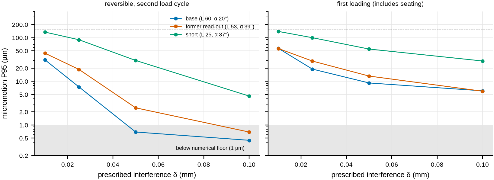

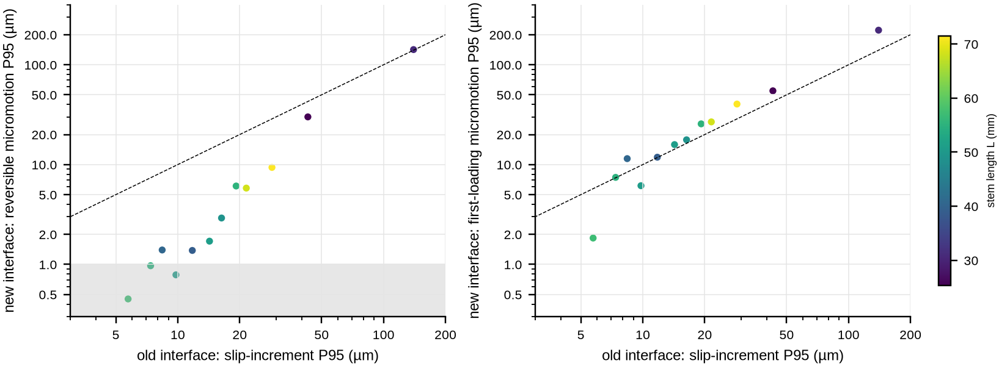

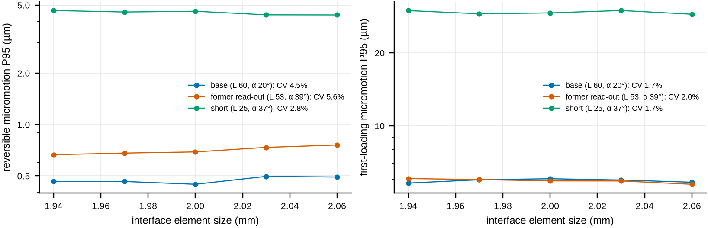

## 10A 第三份评估意见的复核（09-29 10:30）

用户贴来第三份评估，要求确认微动、实际压配状态、载荷与力矩、实际去骨体积四类数据，以及模型版本、超体积参考点、应力屏蔽分区。我只用已有结果重算，没有新解。详见 `v2/REVIEW3_AUDIT.pdf`。

**复核后要更正的三处**：

- **“插入角决定股骨距遮挡”只在随柄移动的分区里成立。** 固定解剖区里，股骨距皮质应力变化与插入角的秩相关只有 +0.13，与柄长是 −0.76。
- **绕柄轴的扭矩不是约 28 N·m。** 三个代表设计绕柄自身轴线的扭矩是 −8.2、+1.6、−5.2 N·m；28 N·m 是绕股骨干轴的。“去扭转”变体实际去掉的是前后向分力，合力从 2391 降到 2287 N。
- **V2A 的验证全部是在假体颈修正前的模型上做的**（85 个作业，含符号检查、网格收敛、排序保持、端到端试跑和 61 个参考设计），修正后没有重做。

**复核后站得住的**：

- 存档的微动值可以从节点对位移原样重算（12 个作业逐位一致）；逐节点求差后取 P95；张开节点留在分母里。
- 只有节点力，没有附加力矩；载荷作用点偏离头心 0.37 mm，附带力矩 0.3 N·m。坐标变换与 Bergmann 2016 原文一致。
- 去骨体积：272 个设计用体素独立计算，与旧定义的比值中位 1.004，90% 的设计在 0.97–1.04，极端 0.90 与 1.15；排序秩相关 0.997。三种算法（解析、体素、CAD 布尔）之间相差 ±5%，与原前沿点之间的骨量差（6–7%）同量级。
- 超体积参考点的微动坐标是 35.7 µm。旧模型里微动超过它的 26 个设计没有一个满足旧约束。

**新发现**：

- **粘着为主时循环还没稳定**：过盈 0.10 mm 下，再加载的可恢复量比首次卸载小 36–45%。滑动为主时两者相差 7% 以内，但峰值位置每循环还漂移 1–6 µm。
- **P95 对权重敏感**：微动 > 5 µm 时两种面积权重相差 2% 以内；低于地板时相差 12–22%；不加权最多差 5 倍。
- **高微动的位置随过盈变化**：短柄在过盈 0.10 mm 时集中在近段，降到 0.025 mm 后转到远段、内侧、后方。
- **峰值载荷下界面张开随过盈减小而增多**：短柄过盈 0.025 mm 时 34%。

**缺的数据**：反力、接触合力与力矩、骨主应变当时没有导出。补齐这些加上第三循环、保持绝对弹性滑移的网格加密、短柄阈值工况的噪声底，共 23 个作业，约 3–4 小时。

五个代表工况的原始数据包在 `v2/results/audit3/packages/`，每个约 10 MB。

## 10B 第三份评估后的 23 个验证作业（09-29 10:37 – 14:54）

用户同意后立即开跑。23 个作业全部解完，没有失败；三槽并行，用时 4 小时 17 分。详见 `v2/REVIEW3_RUNS.pdf`。为此给导出加了反力、节点接触力与接触面积、单元主应变，给模型加了第三个加载循环的选项。

| 问题 | 结果 |
|---|---|
| 循环是否稳定 | 过盈 0.025 mm：第三循环与第二循环相差 −1.2%、−0.4%、+1.3%（基准、原读数、短柄）。过盈 0.10 mm：−4.6%、−2.1%、−20.4%，短柄还没稳定 |
| 网格加密（保持绝对弹性滑移 0.5 µm） | 短柄在 1.4 mm 下可恢复微动比 2.0 mm 高 8–9%，首次加载高 7–15%；低于地板的两个设计仍低约 20% |
| 短柄阈值工况的噪声底 | 5 个网格的变异系数：过盈 0.05 mm 2.1%（均值 29.7 µm），过盈 0.025 mm 1.1%（均值 89.2 µm） |
| 反力与接触合力 | 支座反力与载荷之和的残差 0.00 N；骨面接触合力与载荷之差最大 0.19 N |
| 平均接触压力（接触力 ÷ 几何面积） | 过盈 0.10 mm：基准 11.7、原读数 10.2、短柄 7.6 MPa；过盈 0.025 mm：2.9、2.5、1.9 MPa |
| 柄周 2 mm 内松质骨的压缩主应变（压配后） | 过盈 0.10 mm：中位 1.4–1.9%，97% 以上的体积超过 0.7%。过盈 0.05 mm（短柄）：中位 0.70%，50% 超过。过盈 0.025 mm：中位 0.35–0.47%，4–15% 超过 |
| 同上，峰值载荷下（过盈 0.025 mm） | 超过 0.7% 的体积：基准 30%、原读数 27%、短柄 43% |
| 跨代码版本 | 4 个代表工况按原规格重解，微动、首次加载微动、柄应力逐位相同 |

开跑前用解析对照验证了新导出：节点接触力的径向合力除以几何面积得 2.980 MPa，解析解 2.970 MPa。Abaqus 给的节点接触面积之和比几何面积大 9.5%，这是此前节点压力均值偏高的来源。

**由此改变的建议**：过盈量从 0.05 mm 改为 0.025 mm 作生产值、0.05 mm 作对照。依据是应变：0.10 mm 下柄周松质骨几乎全部超过屈服应变的常用量级，线弹性模型不成立。

同日应用户要求写了项目整体评估与后续试验计划（`v2/PROJECT_ASSESSMENT_2026-09-29.pdf`）：各环节可信度、已成立 / 已撤回 / 未验证的结论、需要用户先定的 7 件事、四个阶段的试验计划（定标约 45 个作业、冻结与参考集约 70 个、优化约 165 个、推广）。

## 10C 对照 Naghavi 博士论文（09-29 15:05 – 17:10）

用户要求参考 Ata 的博士论文检查本项目。Ata 是 Seyed Ataollah Naghavi，论文 2023 年在 UCL 提交，Jia Hua 教授是第二导师之一。本地有全文 PDF，347 页。

### 10C.1 对照（15:05 – 15:15）

抽出全文文字，读了第 5 章的方法、结果、讨论、局限和后续工作，并对照了本地的 Reimeringer 2013 原文。

- 论文用 Sawbones 人工股骨做了应变片、刚度和疲劳试验，模型里所有界面都绑定，载荷是 ISO 7206-4 的竖直力。
- 论文没有做压配、摩擦和界面微动，也没有做设计搜索，并把它们列为后续工作。
- 对照结论是本项目有 3 处需要改正、6 处可以提高，见 `v2/ATA_THESIS_COMPARISON_2026-09-29.pdf`。

### 10C.2 零求解的四项（15:25 – 15:40）

用户回复“继续”。先做不需要求解的四项，代码是 `v2/resorption.py`，结果见 `v2/ATA_FOLLOWUP_2026-09-29.pdf`。

- **骨吸收质量分数。** 在骨内每 1.5 mm 取一个采样点，完整股骨和植入股骨用同一组点，逐点比较应变能密度。死区取 0.4、0.6、0.75 三档。
- **分区。** 在原有的柄坐标系分区之外，加了论文用的“股骨坐标系、随柄定位”和一套不随设计变化的固定分区，并补了按体积加权的总值。
- **柄应力。** 把柄分成柄体、交界、假体颈三段统计。最大值都落在截骨面上颈与柄体的交界，那里是模型的尖角，数值不能用。现行约束没有覆盖假体颈。
- **名称。** 截骨与锉骨去掉的骨体积统一叫“去骨体积”，“骨吸收”只指按死区规则算出的量。现行文档和报告规范已改，带日期的旧报告和结果文件的字段名没有改。

空白对照用完整股骨的两套网格互相比较，得到网格和映射造成的本底。

### 10C.3 三组求解对照（15:41 – 17:01）

我把“继续”理解为同意跑上一份文档列出的求解项，只跑了不需要另作决定、也不需要下载的三组，共 27 个作业。结果见 `v2/ATA_RUNS_2026-09-29.pdf`。

- **网格检查**：3 个设计 × 4 档网格，只解粘接模型。
- **2300 N 工况**：3 个设计，力与股骨干轴线的夹角取 10° 和 9°，方向符号沿用上楼工况。
- **柄模量**：3 个设计 × 95、55、20 GPa，新界面模型，过盈 0.025 mm。

做法上有三点。

- 新作业的类型记为“变体”，带配置覆盖、只解粘接模型、指定参照三个选项。所有常规数据集只收类型为“设计”的作业，所以变体不会混进去。
- 改动都在 `v2/jobs.py`、`v2/stage_v2a.py`、`v2/solve_worker.py` 里，它们不进作业代码哈希。建模文件没有动，已有结果的代码版本不变。
- 带配置覆盖的完整股骨参照用了单独的阶段名，不会被选作标准参照。

求解中有两个作业在 16:22 同时失败，原因是求解器申请不到内存。当时一个远场加密的完整股骨正在求解，本机又开着很多别的程序。小的那个原样重跑通过。大的那个限制内存 12 GB 后重跑通过，办法是在作业目录里放一个只对它生效的 Abaqus 设置文件。

没有做的三项：肌力与步行工况需要肌肉附着点和载荷表；Reimeringer 2013 对标需要 Sawbones 几何；水泥包埋工况的强度校核需要新的建模和标准原文。

### 10C.4 论文图表总结（15:45 – 15:55）

用户要求总结论文里用有限元评估柄的图和表，并提取原页。共 20 项，全部在第 5 章。抽出 28 页原页，放在不进 git 的文献目录里。总结见 `v2/ATA_FE_FIGURES_2026-09-29.pdf`。

读图时发现：论文图 5-31 在这份 PDF 里只有图题；论文的完整股骨模型在十个测点上都低于自己的应变片读数；图 5-32 的侧标写错了柄的名称；安全系数表的各行是同一个结果按载荷缩放得到的。

### 10C.5 这一段里我出的错

- 第一份对照文档的生成时间写成了 17:40，实际是 15:14。时间是我估的，没有查系统时钟。此后每次都取系统时间。
- 我把论文的 95 GPa 说成多孔柄的等效模量。论文的多孔柄按晶格几何直接建模，95 GPa 是材料模量。看到网格规模和正文后更正。
- 对照文档里“19% 和 72% 的设计超限”是用含交界的柄体 P99 粗估的。分段统计后以交界以外的最大值为准。
- 补丁脚本里的反斜杠又被命令行吃掉一次，生成器出现语法错误。此后补丁一律写成文件再运行。
- 三组对照一起提交时，两个大的完整股骨和摩擦作业同时启动，挤占了内存。大模型应当错开提交。

#### 数据：骨吸收与应力屏蔽（210 个现行版本设计，皮质骨，中位数与范围）

| 分区 | 吸收，死区 0.4 (%) | 死区 0.6 (%) | 死区 0.75 (%) | 屏蔽，柄坐标系 (%) | 屏蔽，股骨坐标系随柄 (%) | 屏蔽，固定分区 (%) |
|---|---|---|---|---|---|---|
| 1 区 | 32（3 到 62） | 17（1 到 45） | 7（0 到 28） | 24（-70 到 49） | 20（-64 到 43） | -1（-20 到 9） |
| 2 区 | 11（2 到 33） | 2（0 到 11） | 0（0 到 2） | 12（-38 到 28） | 3（-27 到 18） | 1（-3 到 2） |
| 3 区 | 1（0 到 13） | 0（0 到 3） | 0（0 到 1） | -2（-22 到 16） | -5（-75 到 5） | -0（-1 到 0） |
| 4 区 | 5（2 到 15） | 1（0 到 6） | 0（0 到 2） | -1（-11 到 4） | 0（-4 到 4） | -0（-1 到 0） |
| 5 区 | 14（1 到 35） | 5（0 到 20） | 1（0 到 12） | 2（-5 到 23） | 3（-8 到 16） | -0（-1 到 0） |
| 6 区 | 43（18 到 76） | 25（6 到 61） | 11（1 到 50） | 11（-4 到 53） | 17（2 到 52） | -1（-1 到 -0） |
| 7 区 | 77（21 到 99） | 65（11 到 95） | 50（7 到 81） | 45（4 到 69） | 48（-24 到 69） | 13（1 到 24） |
| 总值 | 22（13 到 31） | 12（7 到 20） | 6（3 到 13） | 9（-12 到 19） | 10（-14 到 19） | 3（-2 到 6） |

吸收按“股骨坐标系、随柄定位”分区。空白对照（完整股骨 1.4 mm 对 2.0 mm 网格）的本底：死区 0.6 下总值 0.3%，单区最高 1.0%；死区 0.4 下单区最高 4.1%。
采样网格与原有逐单元统计的差：1463 个分区，中位 -0.5 个百分点，P5 到 P95 为 -2.2 到 +0.9。

#### 数据：柄应力分段（单元质心 von Mises，载荷 2391 N，MPa）

| 部位 | P99 中位 | P99 范围 | 最大值中位 | 最大值范围 |
|---|---|---|---|---|
| 柄体，离交界 3 mm 以上 | 98 | 59 – 210 | 161 | 81 – 322 |
| 交界，截骨面两侧各 3 mm | 241 | 183 – 511 | 732 | 355 – 1,779 |
| 假体颈，离交界 3 mm 以上 | 127 | 115 – 202 | 163 | 130 – 275 |

#### 数据：网格检查（粘接模型，皮质骨，%）

| 设计 | 界面 / 远场 (mm) | 皮质单元 | 总单元 | 1 区屏蔽 | 6 区屏蔽 | 7 区屏蔽 | 屏蔽总值 | 7 区吸收 | 吸收总值 | 求解 (s) |
|---|---|---|---|---|---|---|---|---|---|---|
| 基准 | 2.0 / 6 | 8390 | 26997 | 22.8 | 11.2 | 54.3 | 10.9 | 77.6 | 11.7 | 39 |
| 基准 | 1.4 / 6 | 10386 | 45710 | 25.0 | 11.3 | 54.3 | 11.7 | 77.9 | 11.9 | 45 |
| 基准 | 1.4 / 4 | 18809 | 64475 | 24.0 | 11.0 | 54.6 | 11.0 | 77.3 | 11.6 | 51 |
| 基准 | 1.0 / 6 | 13292 | 83830 | 24.6 | 11.3 | 54.3 | 11.4 | 77.5 | 11.7 | 65 |
| 原读数 | 2.0 / 6 | 7262 | 23981 | 19.9 | 4.5 | 31.2 | 5.9 | 52.3 | 10.1 | 37 |
| 原读数 | 1.4 / 6 | 8227 | 39481 | 21.4 | 5.2 | 31.6 | 6.8 | 51.0 | 10.2 | 43 |
| 原读数 | 1.4 / 4 | 15882 | 57171 | 20.6 | 4.8 | 32.0 | 6.1 | 52.3 | 10.1 | 47 |
| 原读数 | 1.0 / 6 | 9340 | 72754 | 21.2 | 5.4 | 31.2 | 6.7 | 52.3 | 10.5 | 59 |
| 短柄 | 2.0 / 6 | 7269 | 26312 | -38.8 | 15.8 | 48.2 | -13.7 | 57.0 | 9.7 | 39 |
| 短柄 | 1.4 / 6 | 8171 | 39967 | -35.3 | 14.9 | 48.2 | -12.1 | 58.2 | 10.1 | 43 |
| 短柄 | 1.4 / 4 | 15426 | 57389 | -35.3 | 14.7 | 47.4 | -12.3 | 55.7 | 10.4 | 49 |
| 短柄 | 1.0 / 6 | 9358 | 67785 | -35.8 | 14.9 | 47.5 | -12.7 | 62.0 | 10.0 | 55 |

#### 数据：2300 N 工况对上楼工况（粘接模型，皮质应力屏蔽，%）

| 分区 | 基准，上楼 | 基准，2300 N | 原读数，上楼 | 原读数，2300 N | 短柄，上楼 | 短柄，2300 N |
|---|---|---|---|---|---|---|
| 1 区 | 23 | 28 | 20 | 24 | -39 | -13 |
| 2 区 | 7 | 4 | -9 | -3 | -24 | -7 |
| 3 区 | 1 | -4 | -28 | -10 | -22 | -3 |
| 4 区 | -0 | -1 | 1 | -1 | -1 | -2 |
| 5 区 | 2 | 1 | 3 | 0 | 1 | -3 |
| 6 区 | 11 | 16 | 5 | 8 | 16 | 11 |
| 7 区 | 54 | 58 | 31 | 29 | 48 | 59 |
| 总值 | 11 | 12 | 6 | 8 | -14 | -4 |

#### 数据：柄模量（过盈 0.025 mm）

| 设计 | 柄模量 (GPa) | 可恢复微动 (µm) | 首次加载微动 (µm) | > 40 µm 面积 (%) | 7 区屏蔽 (%) | 屏蔽总值 (%) | 7 区吸收 (%) | 吸收总值 (%) | 柄体最大应力 (MPa) | 颈部最大应力 (MPa) | 摩擦求解 (s) |
|---|---|---|---|---|---|---|---|---|---|---|---|
| 基准 | 110 | 7.4 | 19.1 | 0 | 54 | 11 | 77 | 12 | 141 | 160 | 1,010 |
| 基准 | 95 | 8.5 | 20.9 | 0 | 53 | 11 | 75 | 11 | 140 | 160 | 1,087 |
| 基准 | 55 | 13.8 | 30.1 | 0 | 47 | 9 | 68 | 9 | 137 | 160 | 1,256 |
| 基准 | 20 | 32.6 | 56.0 | 3 | 38 | 6 | 57 | 6 | 130 | 159 | 1,385 |
| 原读数 | 110 | 18.7 | 29.1 | 0 | 31 | 6 | 52 | 10 | 134 | 158 | 817 |
| 原读数 | 95 | 20.6 | 31.4 | 0 | 30 | 5 | 50 | 10 | 133 | 158 | 838 |
| 原读数 | 55 | 28.4 | 42.3 | 2 | 26 | 4 | 44 | 9 | 131 | 158 | 1,081 |
| 原读数 | 20 | 56.9 | 74.2 | 15 | 20 | 3 | 36 | 7 | 124 | 157 | 936 |
| 短柄 | 110 | 89.5 | 99.8 | 53 | 49 | -14 | 59 | 10 | 172 | 144 | 1,508 |
| 短柄 | 95 | 89.4 | 99.9 | 53 | 48 | -14 | 59 | 10 | 169 | 144 | 1,646 |
| 短柄 | 55 | 88.4 | 100.8 | 54 | 45 | -13 | 57 | 9 | 156 | 144 | 1,204 |
| 短柄 | 20 | 91.7 | 105.3 | 56 | 33 | -11 | 49 | 8 | 123 | 144 | 1,363 |

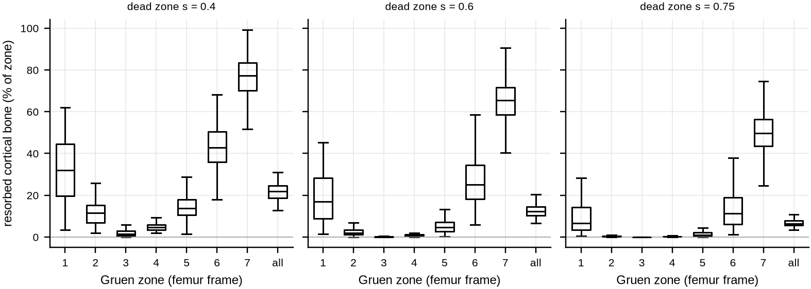

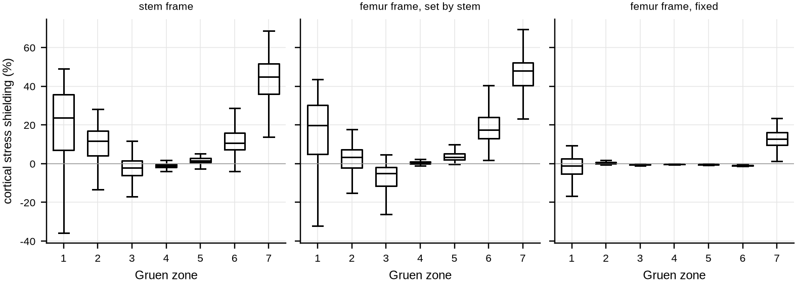

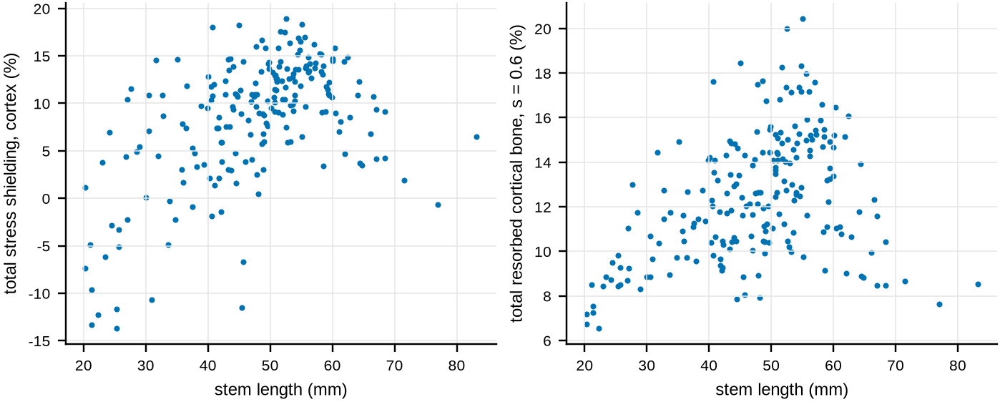

## 11 当前状态

### 11.1 验收汇总
| 报告 | 通过 | 不通过 | 说明 |
|---|---|---|---|
| v1 R0–R7 | 16 / 24 | 8 | 3 项处置已获同意；5 项待定 |
| V2A | A1–A3、A5–A9 | A4、A11 | A11 处置已获同意；A4 无处置；A10 只有 1 个种子；A12 未做 |
| V3 | A2 | A1 | 结论已撤回，A1 判据暂不改 |
| M1 | 5 项 | 3 项 | 文献对标未做 |
| 对照论文后的检查 | 空白对照、新旧统计一致性、网格检查 | — | 没有设验收门槛，只报告数值 |

### 11.2 待用户决定

1. 过盈量取值（我现在建议 0.025 mm 作生产值、0.05 mm 作对照；依据见第 10B 节的应变数据）。
2. 卸载到零，还是保留约 10% 峰值载荷。
3. 优化用的微动定义：可恢复量、首次加载量，或"微动不超过 40 µm 所需的最小过盈"。
4. 短柄的生产网格是否改为 1.4 mm。
5. 分区模量的取值：需要 Morgan 2003 原文；我记得的股骨颈约 3230 MPa、大转子约 622 MPa 未能核实。
6. v1 的五项待定验收。
7. 柄强度的许用值。取决于制造方式：增材制造可以沿用论文的 375 MPa，锻造或机加工需要另找出处。
8. 柄强度约束是否改为“交界以外的最大应力，柄体与假体颈都算”。
9. 是否把柄的刚度加进设计变量。
10. 是否允许下载 Sawbones 几何，用来对标 Reimeringer 2013 和论文的应变片数据。

### 11.3 还没做的事
文献对标；假体颈与柄肩交界的圆角建模；水泥包埋工况的强度校核；实验验证；微动的 1.0 mm 网格；肌力与步行工况；松质骨分区；设计空间修订（恢复面积曲线变量、位姿加两个自由度、填充比例）；代理交叉验证；冻结版本后重跑参考集；V2A 最终版报告；Viceconti 2000 原文。

### 11.4 运行状态
Linux 的 serve 与本机 worker（三槽）在运行，队列为空，定时任务已全部取消。

#### 数据：本机求解时间（取自 worker 日志）

| 阶段 | 模型 | 次数 | 中位 (s) | 范围 (s) | 累计 (h) |
|---|---|---|---|---|---|
| ata | 完整股骨 | 3 | 162 | 59 – 181 | 0.1 |
| ata | 摩擦 | 9 | 1,204 | 838 – 1646 | 3.0 |
| ata | 粘接 | 25 | 39 | 35 – 65 | 0.3 |
| bo | 摩擦 | 76 | 287 | 177 – 458 | 6.2 |
| bo | 粘接 | 76 | 37 | 34 – 69 | 0.8 |
| conv | 摩擦 | 18 | 726 | 251 – 2093 | 4.1 |
| conv | 粘接 | 20 | 43 | 35 – 59 | 0.3 |
| cprobe | 摩擦 | 5 | 215 | 159 – 354 | 0.3 |
| cprobe | 粘接 | 5 | 34 | 34 – 37 | 0.0 |
| cref | 摩擦 | 16 | 236 | 173 – 375 | 1.1 |
| cref | 粘接 | 16 | 36 | 34 – 37 | 0.2 |
| e2e | 摩擦 | 1 | 247 | 247 – 247 | 0.1 |
| e2e | 粘接 | 1 | 36 | 36 – 36 | 0.0 |
| m1 解析对照 | 摩擦 | 24 | 38 | 32 – 71 | 0.3 |
| m1 设计 | 摩擦 | 70 | 1,061 | 356 – 3726 | 25.3 |
| m1 设计 | 粘接 | 73 | 35 | 32 – 39 | 0.7 |
| probe | 摩擦 | 32 | 280 | 193 – 387 | 2.5 |
| probe | 粘接 | 32 | 47 | 34 – 67 | 0.4 |
| ref | 完整股骨 | 10 | 57 | 53 – 188 | 0.2 |
| ref | 摩擦 | 64 | 270 | 199 – 596 | 5.2 |
| ref | 粘接 | 64 | 36 | 34 – 39 | 0.7 |
| signs | 摩擦 | 5 | 247 | 235 – 278 | 0.4 |
| signs | 粘接 | 5 | 37 | 34 – 37 | 0.1 |
| v3 | 摩擦 | 78 | 261 | 167 – 390 | 5.6 |
| v3 | 粘接 | 78 | 37 | 34 – 39 | 0.8 |
| v3sens | 摩擦 | 16 | 270 | 205 – 533 | 1.3 |
| v3sens | 粘接 | 16 | 37 | 35 – 41 | 0.2 |

合计 838 次求解，累计 60.2 h 求解时间（多槽并行，墙钟更短）。

## 12 经验教训

**建模**

- 名义参数要用结果反查。过盈写的是 0.10，实际 0.035–0.08；直到有人看场数据才发现。
- 目标量低于数值分辨率时，优化器照样会给出"前沿"。先测地板，再谈排序。
- 约束量要分骨质看。混合口径被柄周松质骨主导，符号与皮质相反。
- 固定变量之前先算它对目标的直接贡献。面积曲线对微动不敏感，却直接决定去骨体积。
- 求解器输出的节点量不一定可积。解析对照要用积分量或平衡量。

**流程**

- 模型版本要冻结。中途修几何后，新旧数据混在一起做比较是错的。
- "重跑逐位相同"只检验确定性，不检验噪声。要换网格重跑。
- 验收门槛的阈值要事先写全，包括"张开"按多大间隙算。
- 验收记录要对着文件写，不能凭记忆。V2A-A4 的错就是这样来的。
- 每次用户转向都会改变代码哈希，重复提交要清理。

**工程**

- Bash 的 heredoc 会吞反斜杠，补丁脚本一律写成文件再执行。
- 经 ssh 用 `pkill -f` 会杀掉 ssh 自己；杀主进程会留下进程池孤儿。
- Windows 上子进程超时要等孙进程，短超时会把已解完的作业误判失败。
- 认领顺序按名字排会让多个种子串行。
- 被打开的 PDF 无法覆盖，另起带时间戳的文件名。

## 附录 A 文件地图

| 位置 | 内容 |
|---|---|
| `REPORTING_SPEC.md`、`report.py`、`plotstyle.py` | 报告规范与工具 |
| `femur2d.py`、`stem2d.py`、`fe_model.py`、`stage_s0.py` – `stage_s7.py` | v1 |
| `mobo.py` | 代理与采集 |
| `reports/R0 – R7` | v1 报告 |
| `explore/` | 直柄目录探索 |
| `v2/TEST_DESIGN.md` | v2 测试设计 |
| `v2/femur_real.py`、`geom3d.py`、`fe3d_geom.py` | 真实股骨、柄几何、CAD |
| `v2/model3d_v2.py`、`post.py` | 旧界面模型与后处理 |
| `v2/model3d_m1.py`、`post_m1.py` | 新界面模型与后处理 |
| `v2/jobs.py`、`solve_worker.py`、`remote.py`、`maint.py` | 队列、求解、远程 |
| `v2/stage_v2a.py`、`stage_v2a2.py`、`stage_v2ac.py`、`stage_v2au.py` | V2A 各阶段 |
| `v2/stage_v3.py`、`stage_v3sens.py`、`report_v3.py` | V3 |
| `v2/shielding.py` | 应力屏蔽分析 |
| `v2/stage_m1.py`、`report_m1.py`、`build_m1_doc.py` | M1 验证 |
| `v2/reports/V2A_real_femur/`、`V3_short_stem/` | V2A、V3 报告 |
| `v2/DAILY_REPORT_2026-09-28.pdf` | 09-28 日报（含评审后更正） |
| `v2/REVISION_PLAN_V4.pdf` | 修改方案 |
| `v2/STRESS_SHIELDING_2026-09-28.pdf` | 应力屏蔽与约束说明 |
| `v2/M1_VERIFICATION.pdf`、`M1_RUN_STATE.md` | M1 验证报告与运行记录 |
| `v2/METHODS_draft.pdf`、`METHODS_with_reference_methods.pdf` | Methods 初稿与合集 |
| `v2/results/raw/`、`shielding/`、`m1_report/` | 原始数据包与分析结果 |
| `v2/ATA_THESIS_COMPARISON_2026-09-29.pdf` | 对照 Naghavi 博士论文 |
| `v2/ATA_FOLLOWUP_2026-09-29.pdf`、`v2/resorption.py`、`v2/results/resorption/` | 骨吸收、分区、柄应力的零求解统计 |
| `v2/ATA_RUNS_2026-09-29.pdf`、`v2/stage_ata.py`、`v2/results/ata/` | 网格、2300 N 工况、柄模量三组求解对照 |
| `v2/ATA_FE_FIGURES_2026-09-29.pdf`、`v2/refs_pdf/11_Naghavi_2023_*.pdf` | 论文有限元图表总结与原页摘录（原页不进 git） |
| Linux `~/mobo_toy_v2/{code, queue, results, logs}` | 队列 2.9 GB 以上，全部作业目录 |

## 附录 B 用户决定记录

| 时间 | 决定 |
|---|---|
| 09-26 | 确认报告规范 |
| 09-27 上午 | 载荷改为外下方；保留 0.75 mm 网格；C 型候选池 40,000；侧板按 2D–3D 秩相关校准；尖端位置参数化与三步压配保留 |
| 09-27 晚 | 圆弧柄改直柄；再缩短；以长度、面积曲线、截面形状为主变量；加插入角；截面前后不对称 |
| 09-27 夜 | 本机只求解；先做一个 Dorr 型；用真实股骨 STEP；v2 为准；允许贴皮质；加扭转分量 |
| 09-28 上午 | 12 点暂停；f2 改为偏离绝对值 |
| 09-28 12:30 | 柄长下限 20 mm，采纳推荐方案 |
| 09-28 13:25 | 要原始数据，不做统计 |
| 09-28 13:50 | 皮质余量并入设计变量 |
| 09-28 14:00 | 目标改为稳定性对去骨体积；按 18:00 日程 |
| 09-28 下午 | 文献核对；Methods 与参考文献合集（三次修改格式）；允许下载 3 篇 |
| 09-28 18:15 | 继续晚间方案 |
| 09-28 23:30 | 分区赋值；不贴皮质非硬要求；不加压溃上限；只修界面；要应力对比图 |
| 09-29 00:00 | 应力屏蔽只报告；七小时实验 |
| 09-29 10:30 | 要求复核第三份评估意见 |
| 09-29 10:37 | 同意跑 23 个验证作业 |
| 09-29 14:55 | 要求整体评估并计划后续试验 |
| 09-29 15:05 | 要求参考 Ata 的博士论文检查本项目 |
| 09-29 15:25 | “继续”。我理解为同意做零求解四项和已列出的求解项 |
| 09-29 15:45 | 要求总结论文里的有限元图表并提取原页 |

## 附录 C 失败作业统计（V2A 起）

| 阶段 | 完成 | 失败 | 原因 |
|---|---|---|---|
| 验证与参考集 | 97 | 2 | 1.0 mm 完整股骨内存不足 |
| V2A 的 BO | 76 | 6 | 建网失败 |
| 20–40 mm 探针 | 32 | 0 | — |
| 留 1 mm 松质层 | 21 | 28 | 模板化不可行（预期内） |
| V3 | 78 | 2 | 建网失败 |
| V3 敏感性 | 16 | 0 | — |
| M1 设计 | 47 | 5 | Lagrange 不收敛 2，过盈 0 不收敛 1、据此跳过 2 |
| M1 解析对照 | 16 | 0 | 两轮各 8 个 |
| 第三份评估后的验证 | 23 | 0 | — |
| 对照论文后的三组 | 27 | 0 | 其中 2 个第一次因内存申请失败，重跑通过 |
