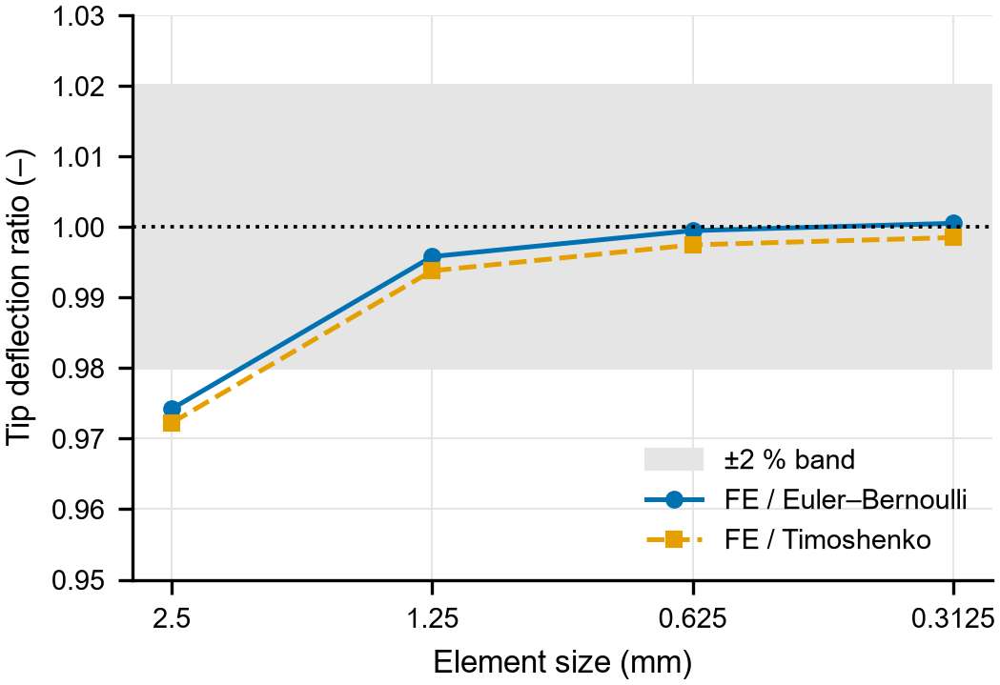
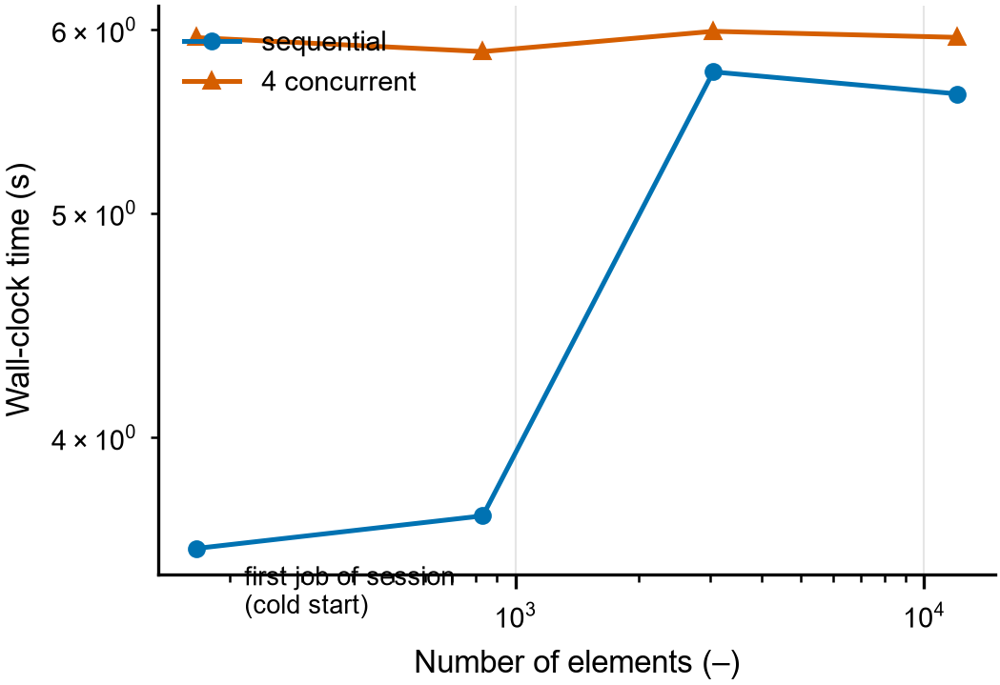

# R0 环境与冒烟

阶段 S0 · 生成 2026-09-26 23:41 · 规范 reports/spec.yaml (sha 46732ae7) · 总判定 PASS

## 0 结论摘要

Abaqus 2025 批处理链路可用：CPS6M 悬臂梁在最细网格（12050 单元）上端部挠度与 Euler–Bernoulli 解析解相差 0.05 %，与 Timoshenko 解相差 0.15 %；同一 .inp 重跑结果逐位相同；四个作业同时提交全部完成，未触发许可重试。单个小型 2D 作业约 5 s，主要是启动开销。可以进入 S1。

## 1 使用情境与问题

| 项 | 内容 |
|---|---|
| 使用情境（COU） | 确认 Abaqus 2025 批处理链路、单位制与平面应力单元在已知解上数值正确，作为后续全部 FE 结果的前提。 |
| 本阶段要回答 | 求解器、.inp 模板、odb 导出这条链在最简单的问题上是否给出正确数值，单次作业要多久？ |
| 本阶段不回答 | 不涉及股骨、柄或接触。 |
| 依据规范 | Erdemir 2012 Simulation Structure；Erdemir 2012 Verification；V&V 40 代码验证 |

## 2 输入与版本

| 项 | 值 |
|---|---|
| config.yaml | sha 48035220 |
| spec.yaml | sha 46732ae7 |
| Abaqus | Abaqus 2025 |
| 运行目录 | runs/S0/ |
| 作业数 | 9 |
| 并发总耗时_s | 7.2 |
| license_ok | True |
| updated | 2026-09-26T23:41:16 |
| 脚本 `stage_s0.py` | sha 30271c52 |
| 软件包 | Python 3.12.10；numpy 2.5.3；scipy 1.18.1；matplotlib 3.11.2；shapely 2.1.2；PyYAML 6.0.3；markdown 3.11；torch 2.14.0+cpu；botorch 0.18.1；gpytorch 1.15.2；gmsh 4.15.2；meshio 5.3.5；scikit-learn 1.9.1；pymoo 0.6.2 |

## 3 方法

**模型**：矩形悬臂梁，x = 0 端全部节点固支（U1 = U2 = 0），x = L 端全部节点经分布耦合（均匀权重）连到参考点，参考点加 z 向 −10 N。线弹性、小变形、隐式静力单步，软件默认求解与收敛设置（Erdemir 2012 仿真结构项）。

**网格**：gmsh 2D，二阶 6 节点三角形 CPS6M，单元尺寸 2.5, 1.25, 0.625, 0.3125 mm，边界节点由 mesh2d 共形重采样。

**解析解**：Euler–Bernoulli 端部挠度 PL³/(3EI)，I = t h³/12；Timoshenko 加剪切项 PL/(κGA)，κ = 5/6。

**流程**：`inp_writer.write_cantilever` 写 .inp → `run_abaqus.run_and_export` 调用 abq2025.bat 求解 → `abaqus/odb_export.py` 在 Abaqus 内置 Python 下只用标准库导 CSV → 本脚本读参考点 U2。并发测试把四个网格的 .inp 复制到新目录同时提交；确定性测试把最细网格再跑一次逐位比较。

**运行器的失败处理**：许可失败排队重试；求解器未启动的启动器瞬时故障（本阶段实测出现过一次：并发作业刚结束时 Abaqus 驱动加载 win32file DLL 遇到 Windows 文件锁）判为可重试，不记 L4；其余未完成作业记 L4 并保留原因。

## 4 结果

### 4.1 图

**图 1（R0-F01）CPS6M cantilever tip deflection is within 0.05 % of Euler–Bernoulli at the finest mesh**　悬臂梁 L = 100 mm、h = 5 mm（L/h = 20）、平面应力厚 1 mm、E = 110000 MPa、ν = 0.35、端部经分布耦合加 10 N。纵轴为 FE 端部挠度与解析解之比；灰带为 ±2 % 验收带。Timoshenko 解含剪切变形，本长细比下比 Euler–Bernoulli 大约 0.2 %。

数据 reports/R0_env_smoke/figures/R0-F01.csv（sha 3b2f5915）· 作图 stage_s0.py:plot_r0_f01 · 生成脚本 stage_s0.py（sha 30271c52） · 单位 h_mm: mm；tip_mm: mm

**图 2（R0-F02）A 2D job with 12050 elements takes 6 s including start-up**　墙钟时间含 Abaqus 启动、预处理与求解（不含 odb 导出）。并发组为四个网格同时提交，总耗时 7 s。会话内第一个作业含冷启动（约 4 s），之后每个作业约 5–6 s，启动开销占主导，单元数对耗时影响很小。

数据 reports/R0_env_smoke/figures/R0-F02.csv（sha a48d2b0c）· 作图 stage_s0.py:plot_r0_f02 · 生成脚本 stage_s0.py（sha 30271c52） · 单位 wall_s: s

### 4.2 表

**表 1（R0-T01）软件、版本、许可与单位制**

| item | value |
|---|---|
| Abaqus | Abaqus 2025 |
| Abaqus launcher | D:\SIMULIA\Commands\abq2025.bat |
| Abaqus embedded Python | 3.10.5 |
| Venv Python | 3.12.10 |
| torch | 2.14.0+cpu |
| botorch | 0.18.1 |
| gpytorch | 1.15.2 |
| gmsh | 4.15.2 |
| shapely | 2.1.2 |
| numpy | 2.5.3 |
| scipy | 1.18.1 |
| matplotlib | 3.11.2 |
| scikit-learn | 1.9.1 |
| pymoo | 0.6.2 |
| License | FlexNet 27800@DESKTOP-LQNAMNB (from abaqus information=environment) |
| Concurrency test | 4 jobs submitted together: 4/4 OK, license retries = 0 |
| Units | mm, N, MPa, t, s (CLAUDE.md §7) |

包版本取自 .venv-mobo；完整锁定清单见 requirements-lock.txt。  数据 `reports/R0_env_smoke/tables/R0-T01.csv`（sha b8272a55），生成脚本 `stage_s0.py`。

## 5 验收

| ID | 判据 | 门槛 | 实测 | 状态 | 原因与处置 |
|---|---|---|---|---|---|
| R0-A1 | 最细网格端部挠度相对 Euler–Bernoulli 解析解的误差（L/h = 20） | < 2% | 0.054 % | PASS |  |
| R0-A2 | 同一 .inp 重跑两次，端部挠度逐位相同 | 相同 | 2.9106698036193848 vs 2.9106698036193848 mm（并发组 2.9106698036193848） | PASS |  |
| R0-A3 | odb_export.py 在 Abaqus 内置 Python 下只用标准库运行成功 | 成功 | 4/4 导出成功 | PASS |  |

总判定：PASS（全部 PASS 或写明理由的 NA 才算通过；有 PENDING 或缺项为 INCOMPLETE）。

## 6 局限与下一阶段输入

**通用局限**

- 2D 冠状面平面应力，无侧板，前后皮质的连接被忽略；力学量只用于定性比较与排序，不下绝对值结论。

- 无外展肌力，单一上楼工况（3D 模型峰值载荷投影到冠状面）。

- 松质骨模量随 Dorr 分型取 400/300/150 MPa 是假设（源 3D 模型为 155 MPa）；另设三型同为 300 MPa 的对照组。

- 压配量 δ = 0.10 mm 与摩擦系数 μ = 0.3 固定，只在 R2 符号检查中改变。

- 无实验数据，本测试不做 ASME V&V 40 意义上的确认（validation），2D–3D 比较只算模型形式比较。

- 本测试检验代理 + 多目标 BO 能否在少量 FE 内找到正确前沿，不对柄设计下临床结论。

**本阶段局限**

- 冒烟问题不含接触、过盈与材料分区，这些在 R2 用 Lamé 压配与网格收敛单独验证。
- 固支端的泊松约束使 FE 略硬于梁理论，L/h = 20 时影响在 0.1 % 量级。

**下一阶段输入**

- 可用的 Abaqus 调用方式、并发数与许可重试参数

- 单次 2D 作业耗时基准（用于排程 S4、S5）

## 附录 A 溯源

| 图/表 | 数据 sha | 作图函数 | 生成脚本 sha | 合成 | 来源 |
|---|---|---|---|---|---|
| R0-F01 | 3b2f5915 | `stage_s0.py:plot_r0_f01` | 30271c52 | 否 | runs=runs/S0/；analytic=Euler–Bernoulli PL³/3EI; Timoshenko + PL/(κGA), κ = 5/6 |
| R0-F02 | a48d2b0c | `stage_s0.py:plot_r0_f02` | 30271c52 | 否 | runs=runs/S0/；analytic=Euler–Bernoulli PL³/3EI; Timoshenko + PL/(κGA), κ = 5/6 |
| R0-T01 | b8272a55 | `—` | 30271c52 | 否 |  |
