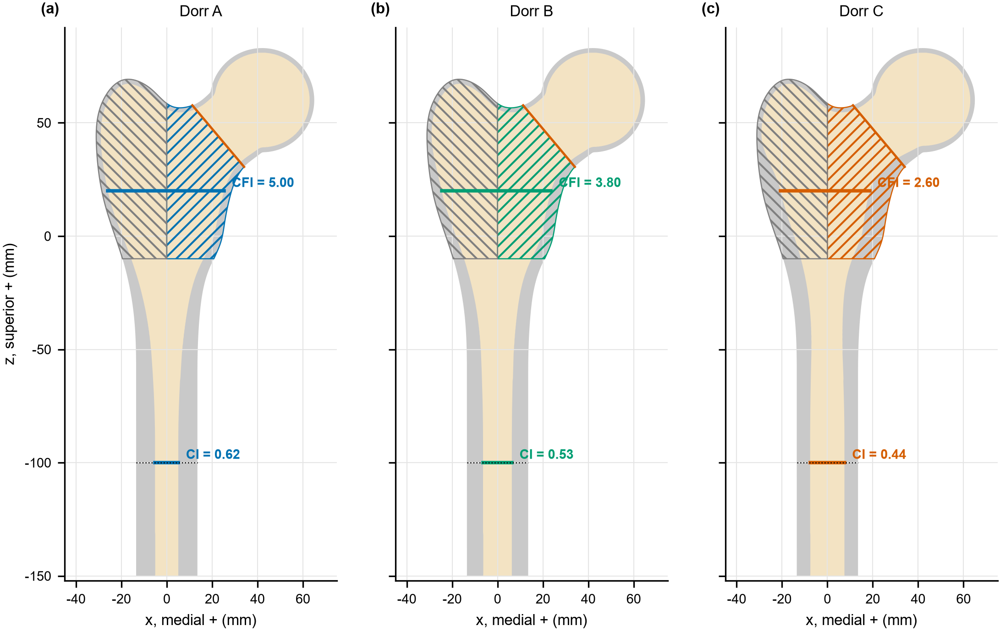
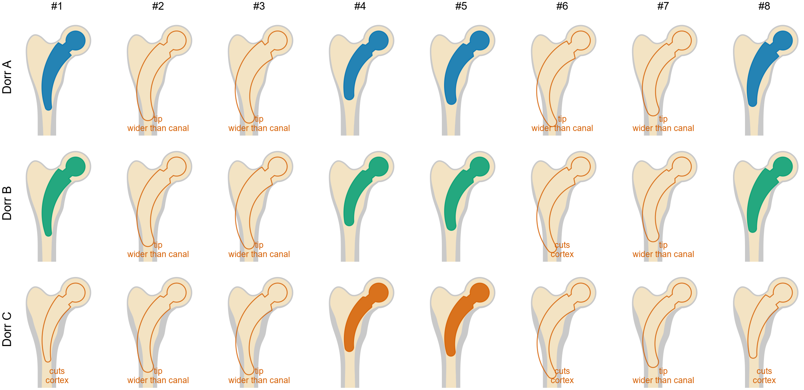
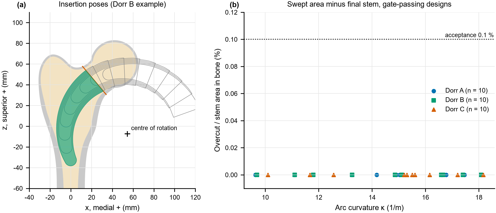
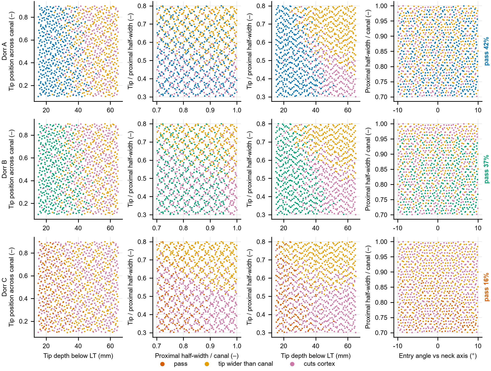
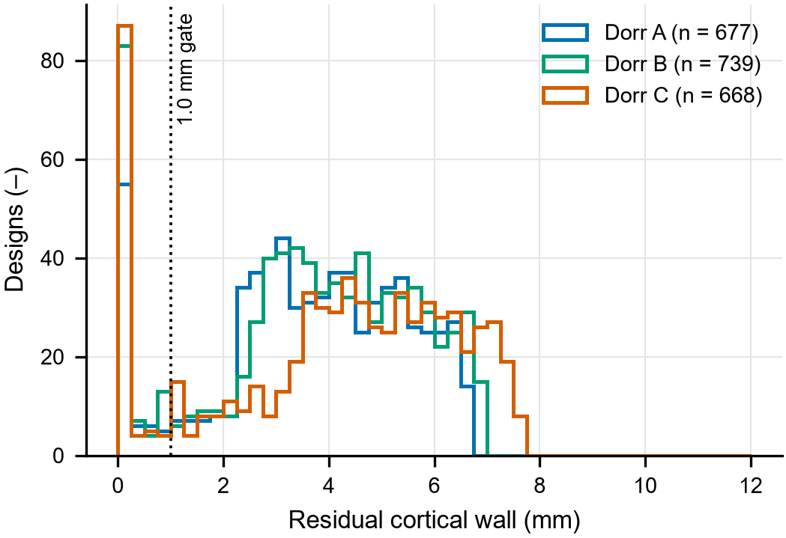

# R1 几何与设计空间

阶段 S1 · 生成 2026-09-26 23:52 · 规范 reports/spec.yaml (sha 46732ae7) · 总判定 FAIL

## 0 结论摘要

三型股骨共用一个外轮廓，只改内轮廓；实测 CFI 为 5.00 / 3.80 / 2.60、皮质指数为 0.62 / 0.53 / 0.44，与预设值偏差不超过 0.003，均落在各自 Dorr 区间。圆弧柄绕曲率中心旋转插入的数值复核给出最大过切 0.000 %，零过切结论成立。几何门通过率 A 42%、B 37%、C 16%；C 型低于 20 % 验收线，R1-A4 不通过，处置见验收表，需要用户确认。**设计变量相对已批准计划有修订**：原计划的 (弧长, 曲率) 参数化通过率只有 0.4–2 %，改为由尖端位置定义圆弧，其余三个变量不变（见第 3 节）。

## 1 使用情境与问题

| 项 | 内容 |
|---|---|
| 使用情境（COU） | 确认三型 2D 股骨满足 Dorr 判据、柄族可构造插入、几何门判定正确，让设计空间可以复核。 |
| 本阶段要回答 | 三型股骨的 CFI 与皮质指数是否落在目标区间？设计空间中多大比例能过几何门？圆弧柄插入是否零过切？ |
| 本阶段不回答 | 不涉及力学响应。 |
| 依据规范 | Erdemir 2012 Model Structure（几何项）；Dorr 1993 分型判据 |

## 2 输入与版本

| 项 | 值 |
|---|---|
| config.yaml | sha 93dca8e4 |
| spec.yaml | sha 46732ae7 |
| config_design_space | tip_depth, tip_lat, w_prox, taper, theta_in（2026-09-26 修订） |
| sobol_map | seed 1, n = 1024/型 |
| atlas | seed 2, 8 个 |
| overcut_check | seed 11, 每型前 10 个通过者 |
| updated | 2026-09-26T23:52:07 |
| 脚本 `stage_s1.py` | sha d0ff68c5 |
| 软件包 | Python 3.12.10；numpy 2.5.3；scipy 1.18.1；matplotlib 3.11.2；shapely 2.1.2；PyYAML 6.0.3；markdown 3.11；torch 2.14.0+cpu；botorch 0.18.1；gpytorch 1.15.2；gmsh 4.15.2；meshio 5.3.5；scikit-learn 1.9.1；pymoo 0.6.2 |

## 3 方法

**股骨（`femur2d.py`）**：冠状面，x 向内侧为正、z 向上为正，原点在干部轴线、小转子中点高度。外轮廓 = 近端 21 个控制点的参数三次样条（小转子、股骨距、颈下缘、大转子、颈上缘）+ 头部圆（心 (42, 60) mm、半径 23 mm）+ 外径 27 mm 的直干部，闭运算（2 mm）圆滑后截于小转子下 150 mm。颈干角 130°。内轮廓为外轮廓的变厚度内偏移：皮质厚度场在峡部（小转子下 90 mm 以下）由皮质指数给出，在小转子上 20 mm 由 CFI 给出（内侧股骨距占两侧总壁厚 55 %），两者之间 smoothstep 过渡，再向上 25 mm 内过渡到 2 mm 的颈/头/大转子薄壳；变厚度偏移用 0.1 mm 栅格的欧氏距离变换加零等值线实现，CFI 高度的壁厚迭代校准到实测 CFI 误差 < 0.02 mm。髓腔全程视为松质骨。

**截骨与 ROI**：颈中段截骨，截骨线垂直颈轴、中心距头心 25 mm（头颈交界约 15 mm 与颈基底约 35 mm 的中点）。Gruen 7 ROI = 截骨线以下、x ≥ 0、z ≥ −10 mm 的骨；Gruen 1 ROI = x < 0、z ≥ −10 mm 的骨。

**柄（`stem2d.py`）与设计变量修订**：柄体中轴为圆弧，起点为截骨中心，初始方向为颈轴反向再转 θ_in；截面半宽从近端 w_p 线性收窄到尖端 w_t，尖端半圆帽；柄体向上延伸越过截骨线，所以骨内部分上界即截骨面。已批准计划以弧长 L（70–120 mm）与曲率 κ（0–1/80 mm⁻¹）为变量；实测 1,024 个 Sobol 设计的通过率 A 2.1 %、B 1.8 %、C 0.4 %，73 % 的柄尖从外侧皮质穿出——沿颈轴进入的圆弧需要半径约 90 mm 以下才能在碰到外侧壁前转向远端。因此改为用尖端位置定义圆弧：尖端在小转子下 tip_depth（15–65 mm）、在该高度髓腔内的相对位置 tip_lat（0.1–0.9，0 贴内侧壁、1 贴外侧壁，按尖端半宽留贴壁余量）；过截骨中心、在该点与入柄方向相切、终于尖端点的圆弧唯一，由此导出 κ = 2 sin α / |c| 与 L = |c| α / sin α（c 为弦，α 为入柄方向到弦的夹角）。w_prox、taper、θ_in 的定义与范围不变。导出的 κ 与 L 范围见 R1-T02，L 与原计划的 70–120 mm 基本一致。

**几何门（L1/L2）**：L1 = 变量越界、尖端半宽超过该高度髓腔半宽、曲率半径小于近端半宽、颈长不在 25–45 mm；L2 = 柄体自交、尖端不在骨内或穿出皮质、骨内柄体与皮质相交 > 0.5 mm²、剩余壁厚 < 1.0 mm、尖端距远端截面 < 20 mm。

**零过切复核**：绕曲率中心按 0.25 mm 弧长步长离散插入，扫掠并集与保留骨求交后减去最终柄体，得过切面积。

## 4 结果

### 4.1 图

**图 1（R1-F01）The three femora share one outer contour and hit their Dorr targets (CFI 5.00 / 3.80 / 2.60)**　深灰为皮质骨、浅黄为松质骨（髓腔）。彩色横线为 CFI 的分子（小转子上 20 mm 的髓腔宽）与峡部髓腔宽（小转子下 100 mm），黑色点线为该高度外径；红线为颈中段截骨线；斜线填充为 Gruen 7 区（彩色）与 Gruen 1 区（灰色）ROI。外轮廓三型完全相同，只有内轮廓按 Dorr 预设值变化。

数据 reports/R1_geometry/figures/R1-F01.csv（sha fa237e63）· 作图 stage_s1.py:plot_r1_f01 · 生成脚本 stage_s1.py（sha d0ff68c5） · 单位 x: mm；z: mm

**图 2（R1-F02）The same eight normalised designs produce different stems and gate outcomes in each Dorr type**　每列是同一个归一化设计向量在三型中的实例；实心为通过几何门，红色空心为未通过（注明原因）。图中柄包括截骨线以上的假体颈与头。

数据 reports/R1_geometry/figures/R1-F02.csv（sha 94c5ac15）· 作图 stage_s1.py:plot_r1_f02 · 生成脚本 stage_s1.py（sha d0ff68c5）

**图 3（R1-F03）Rotating the stem about its arc centre removes no bone beyond the stem (max overcut 0.000 %)**　(a) Dorr B 一个设计的插入过程：灰线为绕曲率中心（+）旋转的中间位姿，彩色为最终位姿的骨内部分。(b) 每型 10 个通过几何门的设计：以 0.25 mm 弧长步长离散插入，扫掠并集 ∩ 保留骨 − 最终柄体 的面积占柄体骨内面积的比例；点线为 0.1 % 验收线。

数据 reports/R1_geometry/figures/R1-F03.csv（sha 58d87559）· 作图 stage_s1.py:plot_r1_f03 · 生成脚本 stage_s1.py（sha d0ff68c5） · 单位 kappa: 1/m (plotted ×1000)；overcut_pct: %

**图 4（R1-F04）Gate pass rate falls from 42% (A) to 16% (C); failures are tips wider than the canal and stems that cut cortex**　每型 1,024 个 Sobol 设计在四组变量对上的投影。彩色点通过几何门；橙色为尖端半宽超过该高度髓腔半宽（L1），紫色为柄体切入皮质超过 0.5 mm²（L2）。同一组 Sobol 点用于三型，差异只来自髓腔形态。

数据 reports/R1_geometry/figures/R1-F04.csv（sha 2a71946c）· 作图 stage_s1.py:plot_r1_f04 · 生成脚本 stage_s1.py（sha d0ff68c5） · 单位 tip_depth: mm；theta_in: deg

**图 5（R1-F05）No gate-evaluated design leaves less than 1 mm of cortex without also cutting it**　进入 L2 判定的设计（L1 被拒的不算）的剩余皮质壁厚：骨内柄体到外轮廓（截骨面以下 0.5 mm 起算）的最小距离。点线为 1.0 mm 门槛。

数据 reports/R1_geometry/figures/R1-F05.csv（sha ef025853）· 作图 stage_s1.py:plot_r1_f05 · 生成脚本 stage_s1.py（sha d0ff68c5） · 单位 wall: mm

### 4.2 表

**表 1（R1-T01）三型 CFI 与皮质指数：预设、实测、所属 Dorr 区间，及关键尺寸**

| dorr | CFI_preset | CFI_measured | CFI_band | CI_preset | CI_measured | CI_band | canal_LT20_mm | canal_isthmus_mm | wall_LT20_medial_mm | wall_LT20_lateral_mm | min_cortex_mm | canal_halfwidth_cut_mm | E_cancellous_MPa |
|---|---|---|---|---|---|---|---|---|---|---|---|---|---|
| A | 5 | 5 | A | 0.62 | 0.62 | A | 51.3 | 10.3 | 3.29 | 2.64 | 1.97 | 15.4 | 400 |
| B | 3.8 | 3.8 | B | 0.53 | 0.53 | B | 48.2 | 12.7 | 4.98 | 4.02 | 1.97 | 15 | 300 |
| C | 2.6 | 2.6 | C | 0.44 | 0.44 | C | 39.3 | 15.1 | 9.91 | 8 | 1.97 | 14.2 | 150 |

实测值由最终多边形在指定高度的水平截线计算；band 为实测值按 Dorr 判据所属型别。 单位 canal_LT20_mm: mm；E_cancellous_MPa: MPa。 数据 `reports/R1_geometry/tables/R1-T01.csv`（sha dac24804），生成脚本 `stage_s1.py`。

**表 2（R1-T02）设计变量定义、范围与归一化（含导出的曲率与弧长范围）**

| variable | lower | upper | unit | definition | normalisation |
|---|---|---|---|---|---|
| tip_depth | 15 | 65 | mm | tip depth below the lesser-trochanter mid-level | (v − lower) / (upper − lower) ∈ [0, 1] |
| tip_lat | 0.1 | 0.9 | - | tip position across the canal at the tip level (0 = medial wall, 1 = lateral wall) | (v − lower) / (upper − lower) ∈ [0, 1] |
| w_prox | 0.7 | 1 | - | proximal half-width / canal half-width at the cut | (v − lower) / (upper − lower) ∈ [0, 1] |
| taper | 0.3 | 0.8 | - | tip half-width / proximal half-width | (v − lower) / (upper − lower) ∈ [0, 1] |
| theta_in | -10 | 10 | deg | entry angle vs neck axis (+ = towards distal) | (v − lower) / (upper − lower) ∈ [0, 1] |
| derived κ, L (Dorr A, passing) | 8.5 1/m; 64 mm | 21.2 1/m; 108 mm |  | arc through the cut centre tangent to the entry direction and ending at the tip point | not a design variable |
| derived κ, L (Dorr B, passing) | 8.6 1/m; 65 mm | 20.9 1/m; 108 mm |  | arc through the cut centre tangent to the entry direction and ending at the tip point | not a design variable |
| derived κ, L (Dorr C, passing) | 9.1 1/m; 65 mm | 20.3 1/m; 102 mm |  | arc through the cut centre tangent to the entry direction and ending at the tip point | not a design variable |

固定参数：过盈 δ = 0.10 mm、μ = 0.3、截骨线距头心 25 mm、假体颈半宽 7 mm。  数据 `reports/R1_geometry/tables/R1-T02.csv`（sha 1e18dec2），生成脚本 `stage_s1.py`。

**表 3（R1-T03）几何门结果计数（每型 1,024 个 Sobol 设计）**

| level | reason | Dorr_A | Dorr_B | Dorr_C |
|---|---|---|---|---|
| L1 | tip wider than canal | 347 | 285 | 356 |
| L2 | cuts cortex | 247 | 358 | 500 |
| OK | PASS | 430 | 381 | 168 |
|  | pass rate | 42.0% | 37.2% | 16.4% |

L1 为参数层拒绝（含尖端比髓腔宽），L2 为几何层拒绝。  数据 `reports/R1_geometry/tables/R1-T03.csv`（sha 7284b092），生成脚本 `stage_s1.py`。

## 5 验收

| ID | 判据 | 门槛 | 实测 | 状态 | 原因与处置 |
|---|---|---|---|---|---|
| R1-A1 | 三型实测 CFI、皮质指数与预设值之差，且落在对应 Dorr 区间 | ≤ 0.05 且在区间内 | 最大偏差 0.003；三型实测均落在对应 Dorr 区间 | PASS |  |
| R1-A2 | 单调圆弧柄插入过切面积（离散容差） | ≤ 0.1% 柄面积 | 最大 0.0000 %（30 个设计） | PASS |  |
| R1-A3 | 几何与几何门单元测试 | pytest 全部通过 | 14 passed in 5.78s | PASS |  |
| R1-A4 | 每型几何门通过率（保证 BO 候选池不空） | ≥ 20% | A 42.0%；B 37.2%；C 16.4% | FAIL | Dorr C 通过率低于 20 %。失败主要是柄体切入股骨距皮质（C 型近端皮质厚）与尖端比髓腔宽。处置建议：不改设计空间；把 C 型 BO 候选池从 20,000 加到 40,000，使可行候选约 6,562 个，与 A、B 型同量级。此项需用户同意后才在 S5 生效；S2–S4 不受影响。 |

总判定：FAIL（全部 PASS 或写明理由的 NA 才算通过；有 PENDING 或缺项为 INCOMPLETE）。

## 6 局限与下一阶段输入

**通用局限**

- 2D 冠状面平面应力，无侧板，前后皮质的连接被忽略；力学量只用于定性比较与排序，不下绝对值结论。

- 无外展肌力，单一上楼工况（3D 模型峰值载荷投影到冠状面）。

- 松质骨模量随 Dorr 分型取 400/300/150 MPa 是假设（源 3D 模型为 155 MPa）；另设三型同为 300 MPa 的对照组。

- 压配量 δ = 0.10 mm 与摩擦系数 μ = 0.3 固定，只在 R2 符号检查中改变。

- 无实验数据，本测试不做 ASME V&V 40 意义上的确认（validation），2D–3D 比较只算模型形式比较。

- 本测试检验代理 + 多目标 BO 能否在少量 FE 内找到正确前沿，不对柄设计下临床结论。

**本阶段局限**

- 外轮廓三型相同时，Dorr 判据迫使 C 型近端髓腔比 A 型窄约 12 mm（小转子上 20 mm 处髓腔宽 39.3 对 51.3 mm），即 C 型近端皮质偏厚（内/外侧 9.9/8.0 mm）。真实的 C 型股骨通常外径也更大、近端皮质更薄。三型的力学差异因此同时含髓腔形态与这一人为的近端壁厚差异，在 R5 解读时要注意。
- 设计变量相对已批准计划修订（见方法），BO 与参考扫描都在修订后的空间里进行。
- 髓腔全程按松质骨处理（真实干部为骨髓，刚度可忽略）。
- 几何门的皮质相交容差 0.5 mm² 与壁厚 1 mm 是计划值，未做敏感性分析。

**下一阶段输入**

- 三型股骨几何与 ROI（Gruen 1、7 区）定义

- 几何门函数与候选池

## 附录 A 溯源

| 图/表 | 数据 sha | 作图函数 | 生成脚本 sha | 合成 | 来源 |
|---|---|---|---|---|---|
| R1-F01 | fa237e63 | `stage_s1.py:plot_r1_f01` | d0ff68c5 | 否 | generator=femur2d.build / stem2d.gate；sobol=scrambled Sobol, seed 1, n = 1024 per type |
| R1-F02 | 94c5ac15 | `stage_s1.py:plot_r1_f02` | d0ff68c5 | 否 | sobol=scrambled Sobol, seed 2, first 8 points |
| R1-F03 | 58d87559 | `stage_s1.py:plot_r1_f03` | d0ff68c5 | 否 | designs=first 10 gate-passing scrambled Sobol (seed 11) designs per type |
| R1-F04 | 2a71946c | `stage_s1.py:plot_r1_f04` | d0ff68c5 | 否 | generator=femur2d.build / stem2d.gate；sobol=scrambled Sobol, seed 1, n = 1024 per type |
| R1-F05 | ef025853 | `stage_s1.py:plot_r1_f05` | d0ff68c5 | 否 | generator=femur2d.build / stem2d.gate；sobol=scrambled Sobol, seed 1, n = 1024 per type |
| R1-T01 | dac24804 | `—` | d0ff68c5 | 否 |  |
| R1-T02 | 1e18dec2 | `—` | d0ff68c5 | 否 |  |
| R1-T03 | 7284b092 | `—` | d0ff68c5 | 否 |  |
