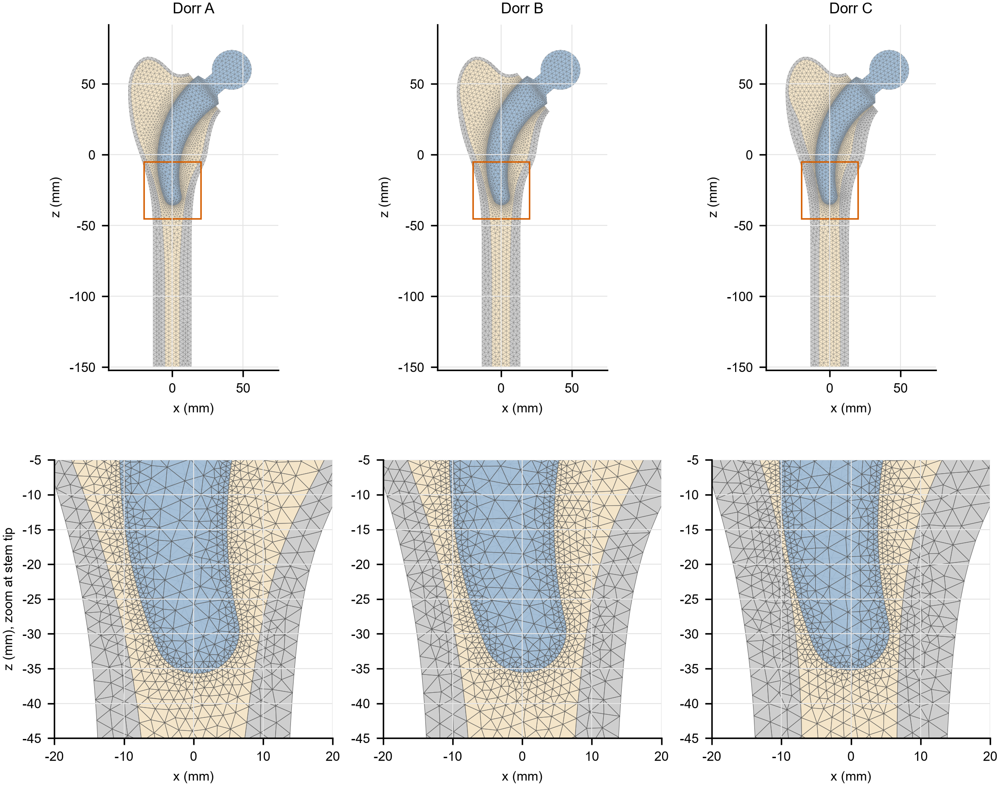
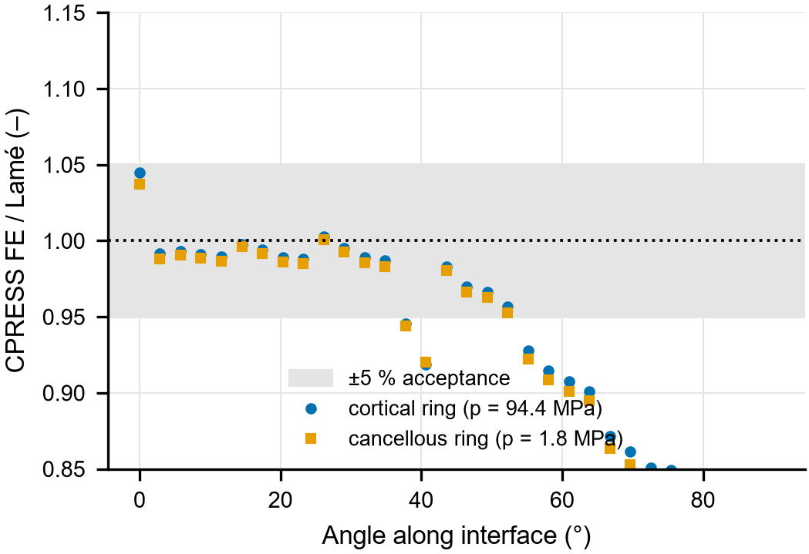
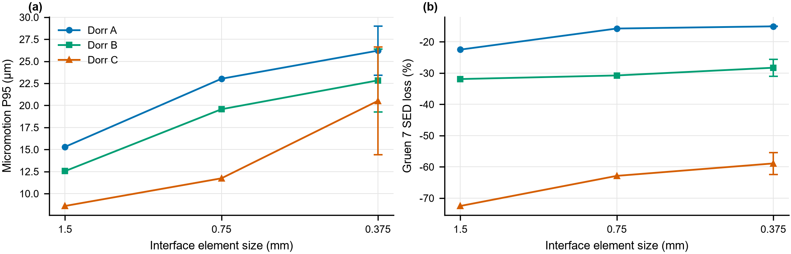
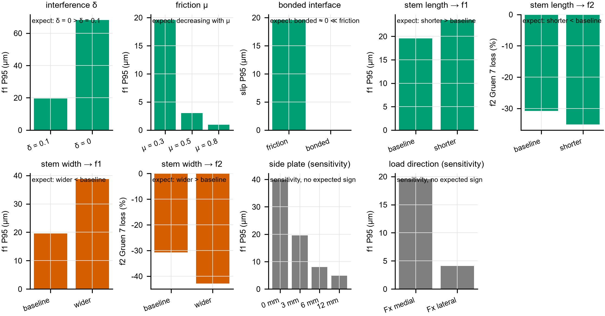
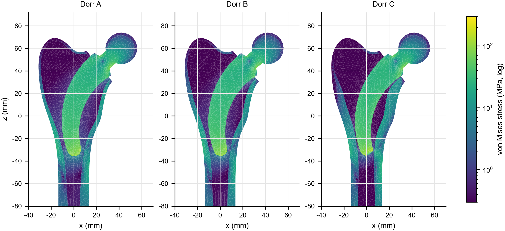
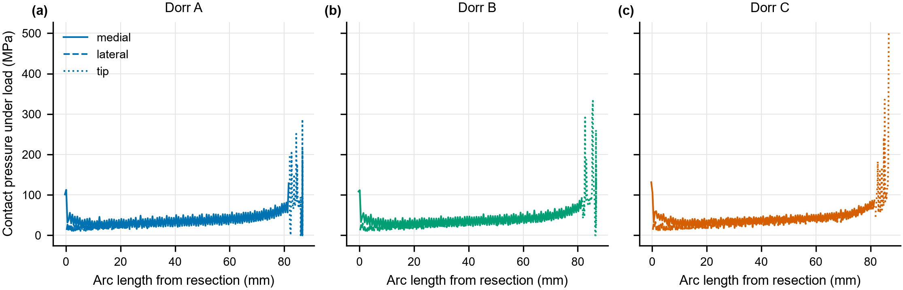
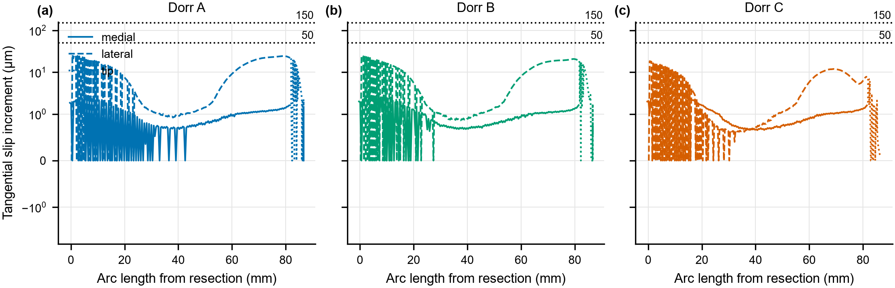
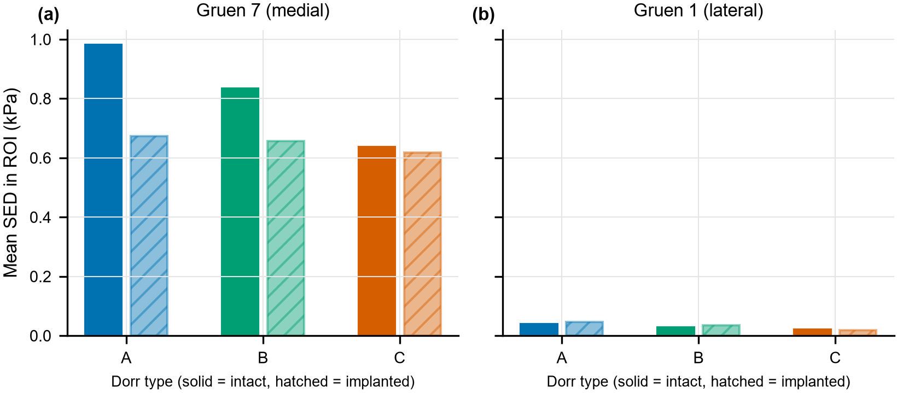
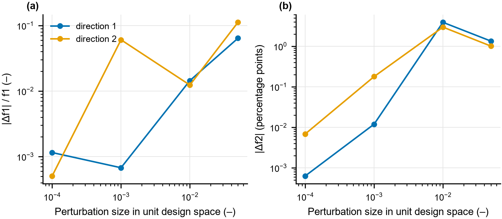
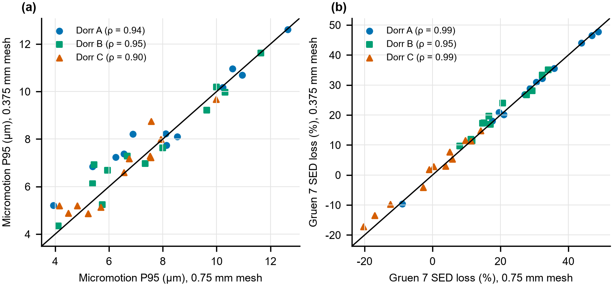

# R2 FE 模型与验证

阶段 S2 · 生成 2026-09-27 02:17 · 规范 reports/spec.yaml (sha 46732ae7) · 总判定 FAIL

## 0 结论摘要

Lamé 压配接触压力误差 3.6 %；**网格收敛不通过**：界面单元从 0.75 mm 减半到 0.375 mm，f1 最多变 43 %（细网格解出更大的滑移区，生产网格系统性低估 f1；f2 变化 5–9 %），但两套网格对设计的排序一致（R2-F10），处置需用户决定；5/7 项符号检查方向正确；同一设计重跑逐位相同；重新网格化噪声底 f1 约 3.03 %、f2 约 0.089 个百分点。三型基线设计的 f1（P95 微动）为 A 23.0、B 19.6、C 11.7 µm，f2（Gruen 7 SED 下降率）为 -16 / -31 / -63 %（负值表示股骨距应变能升高）。初步 3D 核对显示 2D 对柄宽的响应方向与 3D 相反，Gruen 7 的符号也相反（见 R2-A3 与局限），2D 模型形式需要用户决定如何处理。**相对已批准计划有两处模型修改**：加了 3 mm 前后皮质侧板（无侧板时压配后 90 % 界面张开，见方法），压配改为三步（固定假体头压配 → 释放 → 加载）。侧板厚度对 f1 影响大（R2-F04），在 R7 列为主要模型形式不确定性。

## 1 使用情境与问题

| 项 | 内容 |
|---|---|
| 使用情境（COU） | 确认 2D 压配摩擦模型与粘接模型的数值正确、网格无关、对输入变化方向合理，并量化噪声底，作为代理训练数据的质量证明。 |
| 本阶段要回答 | f1（微动）与 f2（近端遮挡）的数值误差多大？网格收敛吗？对 δ、μ、柄尺寸的响应方向对吗？同输入重跑是否一致？ |
| 本阶段不回答 | 不回答模型是否符合真实股骨（无实验确认）。 |
| 依据规范 | Erdemir 2012 全部 80 项；Oefner 2021 报告表（待获取）；Celik 2008 GCI；ASTM F2996 应力口径 |

## 2 输入与版本

| 项 | 值 |
|---|---|
| config.yaml | sha 151b9cb3 |
| spec.yaml | sha 46732ae7 |
| runs_csv_campaigns | S2_baseline, S2_rerun, S2_convergence, S2_signcheck, S2_noise, S2_meshrank |
| baseline_design | {'tip_depth': 29.55, 'tip_lat': 0.416, 'w_prox': 0.803, 'taper': 0.502, 'theta_in': -1.42} |
| side_plate_mm | 3.0 |
| Abaqus | 2025 |
| updated | 2026-09-27T02:17:12 |
| 脚本 `stage_s2.py` | sha 1eb90304 |
| 软件包 | Python 3.12.10；numpy 2.5.3；scipy 1.18.1；matplotlib 3.11.2；shapely 2.1.2；PyYAML 6.0.3；markdown 3.11；torch 2.14.0+cpu；botorch 0.18.1；gpytorch 1.15.2；gmsh 4.15.2；meshio 5.3.5；scikit-learn 1.9.1；pymoo 0.6.2 |

## 3 方法

**几何到网格（`fe_model.py`、`mesh2d.py`）**：保留骨 = 外轮廓 ∩ 截骨线以下；锉刀腔 = 柄体半宽内缩 δ 后与保留骨的交；保留骨、锉刀腔、髓腔三条边界先吸附到 0.001 mm 网格再一次性打断、polygonize 成平面剖分，每个面按代表点分为皮质、松质、锉刀腔，厚度 < 0.25 mm 的松质骨细条改标为皮质；这样共享边界逐点一致。gmsh 二阶三角形（CPS6M），界面 0.75 mm、距界面 12 mm 内线性过渡到 3 mm（骨）/ 3 mm（柄内部）。

**侧板（相对计划新增）**：无侧板时冠状面骨在截骨面处是开口的 U 形，楔形柄的过盈被内外侧两条骨臂张开吸收——Dorr B 基线压配后 90 % 界面张开、平均接触压力 0.3 MPa（R2-F04 的 0 mm 一组）。按 Huiskes/Weinans 的 2D 柄模型做法，加一层覆盖保留骨与锉刀腔的皮质侧板（与骨共节点，跨过柄连接内外侧壁，提供环向刚度），代表前后皮质；默认厚度 3 mm（近端干骺端前后壁每侧约 1–2 mm），侧板与柄之间不定义接触。有侧板后界面 92 % 闭合。侧板厚度 0/3/6/12 mm 的 f1 为 40.2 / 19.6 / 8.0 / 4.9 µm。

**材料与载荷**：皮质 16,800 MPa / 0.3，松质骨 A/B/C 400/300/150 MPa / 0.3，Ti6Al4V 110,000 MPa / 0.35；平面应力厚度骨 30 mm、柄 12 mm、侧板 3 mm，接触面外厚度 12 mm。载荷 Fx = +668 N（与源 3D 模型同号，+x 为内侧）、Fz = −2,296 N，均分到头心 14 mm 圆盘内全部节点（等价 UNIFORM 分布耦合；分布耦合的约束方程使摩擦模型求解慢 5 倍，结果差 < 1 %）；远端截面全固支。载荷方向改为外侧（Fx = −668 N）的敏感性见 R2-F04。

**两个模型（CLAUDE.md §5.2）**：`_fric` 面面小滑移摩擦接触，骨为从面、柄为主面，从面只取锉刀腔切出的骨边界；三步：PRESSFIT（*CONTACT INTERFERENCE, SHRINK，同时固定假体头节点——锥形柄在全量过盈下会被挤出，相当于术中压住打入）、RELEASE（撤去假体头约束、不加载，柄在摩擦下回弹平衡）、LOAD（加载）。`_bond` 用 *TIE, ADJUST=NO（位置容差 0.3 mm 覆盖 0.1 mm 过盈），单步加载。完整股骨参照模型同网格规则、同侧板、同载荷。

**关注量（`qoi.py`）**：f1 = 从面节点 |CSLIP1(LOAD) − CSLIP1(RELEASE)| 按 Simpson 权重的界面长度加权 P95（µm）；f2 = 粘接模型 Gruen 7 ROI 内骨单元平均 SED 相对完整股骨的下降率（%）；约束 = 粘接模型柄单元（除假体头圆盘）面积加权 von Mises P99。

**验证**：V1 四分之一 Lamé 模型（皮质环与 300 MPa 松质环两种）；V2 界面单元 1.5/0.75/0.375 mm 三套网格，Celik 2008 GCI；V3 Dorr B 基线的单因素改动（δ、μ、柄长、柄宽、粘接对摩擦），另做侧板厚度与载荷方向敏感性；V4 三型基线各独立重跑一次（重新网格化与求解）逐位比较；V5 沿两个随机方向在单位立方体中扰动 1e-4 至 5e-2。增量设置敏感性（Erdemir 2012 E64）：初始增量 0.25、0.5、1.0 三种设置下 Dorr B 基线 f1 完全相同（19.462 µm，开发阶段测试）。

## 4 结果

### 4.1 图

**图 1（R2-F01）Meshes use 0.75 mm elements at the interface and 3 mm far away (6,157 bone + 2,055 stem elements for Dorr B)**　上排为全模型，下排为柄尖附近放大（上排红框）。灰色为皮质、浅黄为松质、白色半透明为锉刀腔处的侧板单元、蓝色为柄。骨与柄网格独立（接触或 TIE 连接），皮质、松质与侧板共节点。单元均为 CPS6M。

数据 reports/R2_fe_verification/figures/R2-F01.csv（sha f267b4ae）· 作图 stage_s2.py:plot_r2_f01 · 生成脚本 stage_s2.py（sha 1eb90304）

**图 2（R2-F02）Press-fit contact pressure matches the Lamé solution within 3.6 %**　四分之一模型：钛合金实心圆盘（半径 10 mm）压入外径 25 mm 的圆环，径向过盈 0.1 mm，*CONTACT INTERFERENCE, SHRINK、小滑移面面接触、μ = 0.3，平面应力厚度 1 mm。纵轴为各接触节点 CPRESS 与平面应力 Lamé 解之比。

数据 reports/R2_fe_verification/figures/R2-F02.csv（sha 83c38e35）· 作图 stage_s2.py:plot_r2_f02 · 生成脚本 stage_s2.py（sha 1eb90304） · 单位 cpress: MPa；angle_deg: deg

**图 3（R2-F03）Halving the interface element size from 0.75 to 0.375 mm changes f1 and f2 by at most 42.8 %**　三套网格（界面 1.5、0.75、0.375 mm，远场同比例缩放，细化比 r = 2）。最细网格上的误差棒为 Celik 2008 的 GCI_fine × |φ|。生产网格为 0.75 mm。

数据 reports/R2_fe_verification/figures/R2-F03.csv（sha 532d57db）· 作图 stage_s2.py:plot_r2_f03 · 生成脚本 stage_s2.py（sha 1eb90304） · 单位 h_mm: mm；f1: µm；f2: %

**图 4（R2-F04）5 of 7 sign checks go the expected way**　Dorr B 基线设计的单因素改动。绿色 = 方向符合预期，红色 = 不符合，灰色 = 只做敏感性、无预设方向。侧板厚度与载荷方向两组是模型假设的敏感性。

数据 reports/R2_fe_verification/figures/R2-F04.csv（sha 4ade9739）· 作图 stage_s2.py:plot_r2_f04 · 生成脚本 stage_s2.py（sha 1eb90304） · 单位 value: µm or %

**图 5（R2-F05）Stem stresses peak in the prosthetic neck; bone stress concentrates in the calcar and lateral cortex**　摩擦模型加载步末的单元形心 von Mises 应力（对数色标，0.3–300 MPa 截断），只画小转子下 85 mm 以上。骨为冠状面切片（侧板单元未画）。

数据 reports/R2_fe_verification/figures/R2-F05.csv（sha c550e96d）· 作图 stage_s2.py:plot_r2_f05 · 生成脚本 stage_s2.py（sha 1eb90304） · 单位 mises: MPa

**图 6（R2-F06）Under load the medial flank carries the contact pressure near the resection and the lateral flank near the tip**　加载步末骨从面节点的接触压力，按节点在柄中轴上的弧长位置排列；实线内侧、虚线外侧、点线尖端帽。

数据 reports/R2_fe_verification/figures/R2-F06.csv（sha d8eef5f3）· 作图 stage_s2.py:plot_r2_f06 · 生成脚本 stage_s2.py（sha 1eb90304） · 单位 s_arc: mm；cpress_load: MPa

**图 7（R2-F07）Micromotion stays below 50 µm along the whole interface for all three baselines**　加载步相对释放步的切向滑移增量（µm，对称对数轴）。点线为 50 与 150 µm 骨长入阈值。

数据 reports/R2_fe_verification/figures/R2-F07.csv（sha d8eef5f3）· 作图 stage_s2.py:plot_r2_f07 · 生成脚本 stage_s2.py（sha 1eb90304） · 单位 s_arc: mm；slip_um: µm

**图 8（R2-F08）The neck-preserving stem raises calcar (Gruen 7) strain energy and shields the greater-trochanter region (Gruen 1)**　粘接模型与完整股骨在同一 ROI 内的平均应变能密度（kPa = kJ/m³）。f2 = 1 − 植入/完整（Gruen 7）。

数据 reports/R2_fe_verification/figures/R2-F08.csv（sha 3714cc6c）· 作图 stage_s2.py:plot_r2_f08 · 生成脚本 stage_s2.py（sha 1eb90304） · 单位 sed_kPa: kPa

**图 9（R2-F09）Re-meshing noise (RMS for perturbations ≤ 1e-3) is 3.0 % in f1 and 0.09 points in f2**　Dorr B 基线沿两个随机方向扰动（单位立方体坐标），每个扰动都重新生成网格。扰动很小时输出变化来自重新网格化的数值噪声；噪声底取扰动 ≤ 1e-3 各点变化的均方根，作为 GP 观测噪声的先验下限。个别小扰动出现数个百分点的跳变，说明网格拓扑变化会带来偶发噪声。

数据 reports/R2_fe_verification/figures/R2-F09.csv（sha f8dfaa6e）· 作图 stage_s2.py:plot_r2_f09 · 生成脚本 stage_s2.py（sha 1eb90304） · 单位 eps: –

**图 10（R2-F10）The 0.75 mm mesh underestimates micromotion but ranks designs like the 0.375 mm mesh (Spearman ρ for f1 ≥ 0.96, f2 ≥ 0.95)**　附加验证（为 R2-A2 的处置提供证据）：每型 12 个通过几何门的 Sobol 设计分别用生产网格（界面 0.75 mm）与细网格（0.375 mm）计算。黑线为 y = x；ρ 为 Spearman 秩相关。

数据 reports/R2_fe_verification/figures/R2-F10.csv（sha 2d2c7e50）· 作图 stage_s2.py:plot_r2_f10 · 生成脚本 stage_s2.py（sha 1eb90304）

### 4.2 表

**表 1（R2-T01）Erdemir 2012 FEA 报告清单 80 项（取得 Oefner 2021 后换为其报告表）**

| code | section | item | answer | where | status |
|---|---|---|---|---|---|
| E01 | Model Identification | Model name | mobo_toy 2D 冠状面股骨–保颈斜插短柄模型（Dorr A/B/C） | R2 §3 | 已填写 |
| E02 | Model Identification | Model keywords | 股骨；短柄；保颈；压配；初始微动；应力遮挡；平面应力；贝叶斯多目标优化 | R2 §3 | 已填写 |
| E03 | Model Identification | Version | config.yaml 与脚本 sha256（每份报告第 2 节自动列出） | 全部报告 §2 | 已填写 |
| E04 | Model Identification | Physiological domain | 术后即刻股骨–柄承载（无骨长入） | R2 §3 | 已填写 |
| E05 | Model Identification | Mechanical domain | 线弹性；准静态；小变形；接触非线性 | R2 §3 | 已填写 |
| E06 | Model Identification | Structure of interest | 近端股骨（颈中段截骨）与短柄 | R2 §3 | 已填写 |
| E07 | Model Identification | Demographics | 无个体；理想化成人股骨按 Dorr A/B/C 参数化 | R1 §3 | 已填写 |
| E08 | Model Identification | State of represented organism | 在体、术后即刻 | R2 §3 | 已填写 |
| E09 | Model Identification | Disease state | Dorr 分型代表髓腔形态与骨质差异（C 型为宽髓腔、薄皮质） | R1 §3 | 已填写 |
| E10 | Model Identification | Spatial scale | 器官级 mm；界面单元 0.75 mm | R2 §3 | 已填写 |
| E11 | Model Identification | Time scale | 准静态两步（压配、加载），与时间无关 | R2 §3 | 已填写 |
| E12 | Model Identification | Primary utility | 检验 FE→GP→qNEHVI 能否在 ≤60 次 FE 内找到正确 Pareto 前沿 | R2 §1；R5 §1 | 已填写 |
| E13 | Model Identification | Secondary utility | 定性比较三型前沿差异 | R5 §1 | 已填写 |
| E14 | Model Identification | Primary highlight | 零过切构造的圆弧斜插柄族，保证可插入 | R1 | 已填写 |
| E15 | Model Identification | Secondary highlight | 每阶段可复现报告与参考前沿对照 | R7 | 已填写 |
| E16 | Model Identification | Primary limitation | 2D 平面应力：绝对值不可信，只看排序 | 全部报告 §6 | 已填写 |
| E17 | Model Identification | Secondary limitation | 单一工况、无肌力、无实验确认 | 全部报告 §6 | 已填写 |
| E18 | Model Identification | Reference to publication(s) | 无（内部方法测试） | — | N/A：未发表 |
| E19 | Model Identification | Pointer to publication | 无 | — | N/A：未发表 |
| E20 | Model Identification | Related models | sandbox/sweep_viz 插入扫掠模型；D:\temp\Job-Stair.inp 3D 模型（材料与载荷来源） | R2 §3 | 已填写 |
| E21 | Model Structure | Loading and boundary conditions | 头心集中力 + 远端固支 + 压配过盈 | R2 §3 | 已填写 |
| E22 | Model Structure | Type | 头部圆盘（半径 14 mm）内全部节点均分头心载荷（等价 UNIFORM 分布耦合，未用约束方程以减少变量）；远端截面全固支；压配为接触过盈 SHRINK，压配步固定假体头节点 | R2 §3 | 已定稿（S2） |
| E23 | Model Structure | Region | 头部圆盘节点（植入：假体头；完整：股骨头内）；远端截面（小转子下 150 mm） | R2 §3 | 已定稿（S2） |
| E24 | Model Structure | Magnitude and direction | Fx 668 N；Fz −2296 N（上楼峰值投影到冠状面，源自 Job-Stair.inp；丢弃平面外第 2 分量 9.46 N） | R2 §3 | 已填写 |
| E25 | Model Structure | Time history | Step1 压配无外载；Step2 保持压配并线性加载到峰值（非线性静力的伪时间） | R2 §3 | 已填写 |
| E26 | Model Structure | Primary output variables | f1 界面切向滑移增量长度加权 P95（µm）；f2 Gruen 7 区 SED 相对完整股骨下降率（%） | R2 §3 | 已填写 |
| E27 | Model Structure | Secondary output variables | >50 与 >150 µm 界面占比；Gruen 1 区 SED；柄 von Mises P99；接触压力分布 | R2 §3 | 已填写 |
| E28 | Model Structure | Source of anatomy | 解析参数化轮廓（无影像） | R1 §3 | 已填写 |
| E29 | Model Structure | Modality | 无影像 | — | N/A：解析几何 |
| E30 | Model Structure | Resolution | 无影像；轮廓折线逼近弦高误差 ≤ 0.05 mm | R1 §3 | 已填写 |
| E31 | Model Structure | Reference configuration | 无初始应力；过盈在 Step1 由接触引入 | R2 §3 | 已填写 |
| E32 | Model Structure | Subcomponents (subsidiary models) | 皮质骨、松质骨、柄 3 个部件 | R2 §3 | 已填写 |
| E33 | Model Structure | Name | cortex / cancellous / stem | R2 §3 | 已填写 |
| E34 | Model Structure | Geometric representation | 2D 多边形（shapely）；外轮廓三型相同，内轮廓按 Dorr 参数 | R1 §3 | 已填写 |
| E35 | Model Structure | Source | femur2d.py 与 stem2d.py 解析构造 | R1 §3 | 已填写 |
| E36 | Model Structure | Resolution | 边界离散间距 ≤ 0.5 mm | R1 §3 | 已填写 |
| E37 | Model Structure | Segmentation procedure | 无分割 | — | N/A：非影像 |
| E38 | Model Structure | Representative geometry | R1-F01；R1-F02 | R1 | 已填写 |
| E39 | Model Structure | Mesh | gmsh 2D 三角网格；骨（皮质与松质共节点）与柄分别划分 | R2 §3 | 已填写 |
| E40 | Model Structure | Element name | CPS6M | R2 §3 | 已填写 |
| E41 | Model Structure | Element shape | 三角形 | R2 §3 | 已填写 |
| E42 | Model Structure | Element formulation | 6 节点修正二次平面应力（适用于接触） | R2 §3 | 已填写 |
| E43 | Model Structure | Mesh density | 界面 0.75 mm、远场 3 mm；三档收敛研究见 R2-F03 与 R2-T02 | R2 | 已填写 |
| E44 | Model Structure | Constitutive representation | 三种材料均为各向同性线弹性 | R2 §3 | 已填写 |
| E45 | Model Structure | Formulation | 各向同性线弹性 | R2 §3 | 已填写 |
| E46 | Model Structure | Coefficients | 皮质 E 16800 MPa ν 0.3；松质 E 400/300/150 MPa（A/B/C）ν 0.3；Ti6Al4V E 110000 MPa ν 0.35 | R2 §3 | 已填写 |
| E47 | Model Structure | Source | 皮质与钛取自 Job-Stair.inp；松质骨源模型为 155 MPa，分型取值为假设并设 300 MPa 对照 | R2 §3；R5-F09 | 已填写 |
| E48 | Model Structure | Reference configuration | 无预应力 | R2 §3 | 已填写 |
| E49 | Model Structure | Other properties | 平面应力厚度：骨 30 mm、柄 12 mm | R2 §3 | 已填写 |
| E50 | Model Structure | Interactions | 柄–骨界面；皮质–松质共节点 | R2 §3 | 已填写 |
| E51 | Model Structure | Interacting components | 柄外表面对骨腔表面（皮质与松质） | R2 §3 | 已填写 |
| E52 | Model Structure | Interaction type | _fric：面面摩擦接触；_bond：*TIE ADJUST=NO | R2 §3 | 已填写 |
| E53 | Model Structure | Interaction formulation | 面面离散、小滑移；骨为从面、柄为主面；罚函数摩擦（slip tolerance 0.005）；硬接触；另加前后皮质侧板（3 mm） | R2 §3 | 已定稿（S2） |
| E54 | Model Structure | Interaction properties | μ 0.3（符号检查扫 0.5/0.8）；过盈 δ 0.10 mm | R2 §3 | 已填写 |
| E55 | Simulation Structure | Name of simulation software | Abaqus/Standard | R0-T01 | 已填写 |
| E56 | Simulation Structure | Version of simulation software | Abaqus 2025（D:\SIMULIA\Commands\abq2025.bat；内置 Python 3.10.5） | R0-T01 | 已填写 |
| E57 | Simulation Structure | Solution strategy | 隐式静力；三步（PRESSFIT 固定假体头 → RELEASE 释放 → LOAD）；初始增量 0.25、最大 1.0，自动增量；增量设置敏感性见方法 | R2 §3 | 已定稿（S2） |
| E58 | Simulation Structure | Numerical algorithms | 完全牛顿法与直接稀疏求解器（软件默认） | R2 §3 | 已填写 |
| E59 | Simulation Structure | Convergence criteria | 软件默认残差与位移修正准则 | R2 §3 | 已填写 |
| E60 | Simulation Structure | Post-processing | odb_export.py（Abaqus Python 仅标准库）导 CSV → qoi.py 计算 f1、f2、约束 | R2 §3 | 已填写 |

*仅显示前 60 行，共 80 行；全表见 `reports/R2_fe_verification/tables/R2-T01.csv`。*

N/A 项注明理由。全表 80 行，报告内只显示前 60 行，完整见 CSV。  数据 `reports/R2_fe_verification/tables/R2-T01.csv`（sha ca56e00e），生成脚本 `stage_s2.py`。

**表 2（R2-T02）网格收敛指数（Celik 2008）**

| dorr | quantity | N1 | N2 | N3 | r21 | r32 | phi1 | phi2 | phi3 | p | phi_ext | e_a21_pct | e_ext21_pct | GCI_fine_pct | behaviour |
|---|---|---|---|---|---|---|---|---|---|---|---|---|---|---|---|
| A | f1 (µm) | 3.05e+04 | 8.18e+03 | 2.39e+03 | 2 | 2 | 26.2 | 23 | 15.3 | 1.28 | 28.4 | 12.2 | 7.85 | 10.7 | monotonic |
| A | f2 (%) | 3.05e+04 | 8.18e+03 | 2.39e+03 | 2 | 2 | -15 | -15.7 | -22.5 | 3.27 | -15 | 4.64 | 0.539 | 0.67 | monotonic |
| B | f1 (µm) | 3.04e+04 | 8.21e+03 | 2.42e+03 | 2 | 2 | 22.8 | 19.6 | 12.5 | 1.1 | 25.7 | 14.3 | 11.1 | 15.6 | monotonic |
| B | f2 (%) | 3.04e+04 | 8.21e+03 | 2.42e+03 | 2 | 2 | -28.3 | -30.8 | -31.9 | 1.09 | -26.1 | 8.72 | 8.33 | 9.61 | monotonic |
| C | f1 (µm) | 3.01e+04 | 8.1e+03 | 2.34e+03 | 2 | 2 | 20.5 | 11.7 | 8.6 | 1.49 | 25.4 | 42.8 | 19.2 | 29.7 | monotonic |
| C | f2 (%) | 3.01e+04 | 8.1e+03 | 2.34e+03 | 2 | 2 | -58.9 | -62.9 | -72.5 | 1.28 | -56.1 | 6.75 | 4.97 | 5.92 | monotonic |

φ1 最细、φ3 最粗；p 为表观阶数；e_a21 为最细两套网格的相对差；GCI_fine 为最细网格的离散不确定度。 单位 phi1: µm 或 %。 数据 `reports/R2_fe_verification/tables/R2-T02.csv`（sha 2b8d4d93），生成脚本 `stage_s2.py`。

**表 3（R2-T03）确定性：同一设计两次独立运行（重新网格化与求解）**

| dorr | quantity | run_1 | run_2 | identical | design_ids |
|---|---|---|---|---|---|
| A | f1_p95_um | 23 | 23 | yes | d000111_4375 / d000385_4375 |
| A | f2_g7_loss_pct | -15.7 | -15.7 | yes | d000111_4375 / d000385_4375 |
| A | f2_g1_loss_pct | 43.6 | 43.6 | yes | d000111_4375 / d000385_4375 |
| A | vm_p99 | 80.4 | 80.4 | yes | d000111_4375 / d000385_4375 |
| B | f1_p95_um | 19.6 | 19.6 | yes | d000112_89d3 / d000386_89d3 |
| B | f2_g7_loss_pct | -30.8 | -30.8 | yes | d000112_89d3 / d000386_89d3 |
| B | f2_g1_loss_pct | 44.2 | 44.2 | yes | d000112_89d3 / d000386_89d3 |
| B | vm_p99 | 78.6 | 78.6 | yes | d000112_89d3 / d000386_89d3 |
| C | f1_p95_um | 11.7 | 11.7 | yes | d000113_4e43 / d000387_4e43 |
| C | f2_g7_loss_pct | -62.9 | -62.9 | yes | d000113_4e43 / d000387_4e43 |
| C | f2_g1_loss_pct | 60.3 | 60.3 | yes | d000113_4e43 / d000387_4e43 |
| C | vm_p99 | 79.5 | 79.5 | yes | d000113_4e43 / d000387_4e43 |

两次运行各自从几何重新生成网格与 .inp；比较 QoI 的完整双精度值。  数据 `reports/R2_fe_verification/tables/R2-T03.csv`（sha 231b94bd），生成脚本 `stage_s2.py`。

## 5 验收

| ID | 判据 | 门槛 | 实测 | 状态 | 原因与处置 |
|---|---|---|---|---|---|
| R2-A1 | V1 Lamé 压配接触压力相对解析解误差 | < 5% | cortical ring 3.19 %；cancellous ring 3.56 % | PASS |  |
| R2-A2 | V2 最细两档网格 f1、f2 相对变化，并报出 GCI | < 5% | 最细两套网格最大相对变化 42.81 %；GCI 见 R2-T02 | FAIL | f1（P95 微动）未收敛：细网格解出更大的滑移区，生产网格系统性低估 f1；换摩擦列式（Lagrange、滑移容差 0.0005）不改变结论。f2 变化 8.7 %。但生产网格与细网格对设计的排序一致（R2-F10：每型 12 个设计，f1 的 Spearman ρ = A 0.96、B 0.99、C 0.97）。处置建议：BO 与参考扫描用同一生产网格，本测试检验的是"在同一模型上 BO 能否找到前沿"，系统偏差不影响这一结论；f1 绝对值不作解释，R7 把离散误差列为可信度缺口。备选：生产网格改 0.375 mm，S4–S5 机时约增 4 倍（约 20 h）。需用户决定。 |
| R2-A3 | V3 符号检查：δ=0 微动大于 δ=0.1；μ 升高微动下降；粘接滑移为零；柄更长更宽则微动降、遮挡升 | 全部方向正确 | 5/7 方向正确 | FAIL | 不符合的两项都是"柄更宽"（w_prox 0.80 → 0.95）：f1 19.6 → 38.8 µm（预期下降），f2 -30.8 → -42.8 %（预期升高）。初步 3D 核对（同一基线与加宽设计，理想化 3D 股骨，无侧板）：加宽使 3D 的 f1 17.5 → 16.2 µm、Gruen 7 20 → 35 %，符合常规预期；2D 方向相反。基线本身 2D 的 Gruen 7 为股骨距加载（负值）而 3D 为遮挡（正值），3D 压配接触压力约 6 MPa、2D 约 60 MPa。结论：这是 2D 侧板模型的形式问题（侧板过硬、近端传载方式失真），不是保颈柄机理。处置需用户决定：(1) 按原计划继续 2D（本测试检验的是 BO 能否找到给定模型的前沿，物理解释受限，R6 会量化）；(2) 先用 2D 对 3D 的秩相关校准侧板厚度再继续；(3) 改以 3D 为主模型（机时约增 20 倍以上）。 |
| R2-A4 | V4 同设计重跑 f1、f2 逐位相同 | 相同 | 三型 4 个 QoI 全部逐位相同 | PASS |  |
| R2-A5 | V5 噪声底已量化并写入 GP 噪声先验 | 给出数值 | f1 相对 3.029 %；f2 0.0895 百分点 | PASS |  |
| R2-A6 | Erdemir 2012 清单 80 项全部填写，N/A 须写理由 | 80/80 | 80/80 | PASS |  |

总判定：FAIL（全部 PASS 或写明理由的 NA 才算通过；有 PENDING 或缺项为 INCOMPLETE）。

## 6 局限与下一阶段输入

**通用局限**

- 2D 冠状面平面应力，无侧板，前后皮质的连接被忽略；力学量只用于定性比较与排序，不下绝对值结论。

- 无外展肌力，单一上楼工况（3D 模型峰值载荷投影到冠状面）。

- 松质骨模量随 Dorr 分型取 400/300/150 MPa 是假设（源 3D 模型为 155 MPa）；另设三型同为 300 MPa 的对照组。

- 压配量 δ = 0.10 mm 与摩擦系数 μ = 0.3 固定，只在 R2 符号检查中改变。

- 无实验数据，本测试不做 ASME V&V 40 意义上的确认（validation），2D–3D 比较只算模型形式比较。

- 本测试检验代理 + 多目标 BO 能否在少量 FE 内找到正确前沿，不对柄设计下临床结论。

**本阶段局限**

- 近截骨处内侧的节点滑移呈锯齿（二次单元角节点与中点节点交替，R2-F07），P95 对此不敏感但单点最大值不可信。
- f1（P95 微动）在生产网格上未网格收敛：细网格解出更大的滑移区，f1 绝对值偏低；换摩擦列式（Lagrange 乘子、滑移容差 0.0005）不改变这一点（开发测试：C 型基线 12.6 → 21.0 µm）。排序在两套网格间一致（R2-F10），所以只把 f1 用于同一网格上的相对比较。
- 2D 与 3D 的形式差异：同一基线 2D 的 Gruen 7 为股骨距加载、3D 为遮挡；加宽柄的响应方向 2D 与 3D 相反（results/S2_3d_probe.json）。
- 侧板厚度是本模型最大的形式假设：3 → 12 mm 时 f1 下降约 4 倍（R2-F04）。优化只比较同一侧板厚度下的设计，排序是否随侧板厚度改变未检验。
- 压配接触压力量级（数十 MPa）高于真实松质骨能承受的水平；模型为线弹性，无骨屈服或压溃。
- f2 在三型基线上都是负值（股骨距 SED 升高），Gruen 7 下降率作为目标时"越小越好"即"股骨距加载越多越好"。
- 载荷方向沿用源 3D 模型的号（内下方），与单腿站立关节力通常的外下方向相反，需用户确认；外侧方向的结果见 R2-F04。
- Oefner 2021 报告表未取得，R2-T01 暂用 Erdemir 2012 清单。

**下一阶段输入**

- evaluate(design, dorr) 可批量调用

- GP 噪声先验

- 单设计耗时（排程 S4）

## 附录 A 溯源

| 图/表 | 数据 sha | 作图函数 | 生成脚本 sha | 合成 | 来源 |
|---|---|---|---|---|---|
| R2-F01 | f267b4ae | `stage_s2.py:plot_r2_f01` | 1eb90304 | 否 | runs_csv=results/runs.csv campaign S2_*；baseline_u=[0.291, 0.395, 0.342, 0.403, 0.429] |
| R2-F02 | 83c38e35 | `stage_s2.py:plot_r2_f02` | 1eb90304 | 否 | runs=runs/S2_lame/ |
| R2-F03 | 532d57db | `stage_s2.py:plot_r2_f03` | 1eb90304 | 否 | runs_csv=results/runs.csv campaign S2_*；baseline_u=[0.291, 0.395, 0.342, 0.403, 0.429] |
| R2-F04 | 4ade9739 | `stage_s2.py:plot_r2_f04` | 1eb90304 | 否 | runs_csv=results/runs.csv campaign S2_*；baseline_u=[0.291, 0.395, 0.342, 0.403, 0.429] |
| R2-F05 | c550e96d | `stage_s2.py:plot_r2_f05` | 1eb90304 | 否 | runs_csv=results/runs.csv campaign S2_*；baseline_u=[0.291, 0.395, 0.342, 0.403, 0.429] |
| R2-F06 | d8eef5f3 | `stage_s2.py:plot_r2_f06` | 1eb90304 | 否 | runs_csv=results/runs.csv campaign S2_*；baseline_u=[0.291, 0.395, 0.342, 0.403, 0.429] |
| R2-F07 | d8eef5f3 | `stage_s2.py:plot_r2_f07` | 1eb90304 | 否 | runs_csv=results/runs.csv campaign S2_*；baseline_u=[0.291, 0.395, 0.342, 0.403, 0.429] |
| R2-F08 | 3714cc6c | `stage_s2.py:plot_r2_f08` | 1eb90304 | 否 | runs_csv=results/runs.csv campaign S2_*；baseline_u=[0.291, 0.395, 0.342, 0.403, 0.429] |
| R2-F09 | f8dfaa6e | `stage_s2.py:plot_r2_f09` | 1eb90304 | 否 | runs_csv=results/runs.csv campaign S2_*；baseline_u=[0.291, 0.395, 0.342, 0.403, 0.429] |
| R2-F10 | 2d2c7e50 | `stage_s2.py:plot_r2_f10` | 1eb90304 | 否 | runs_csv=results/runs.csv campaign S2_*；baseline_u=[0.291, 0.395, 0.342, 0.403, 0.429] |
| R2-T01 | ca56e00e | `—` | 1eb90304 | 否 |  |
| R2-T02 | 2b8d4d93 | `—` | 1eb90304 | 否 |  |
| R2-T03 | 231b94bd | `—` | 1eb90304 | 否 |  |
