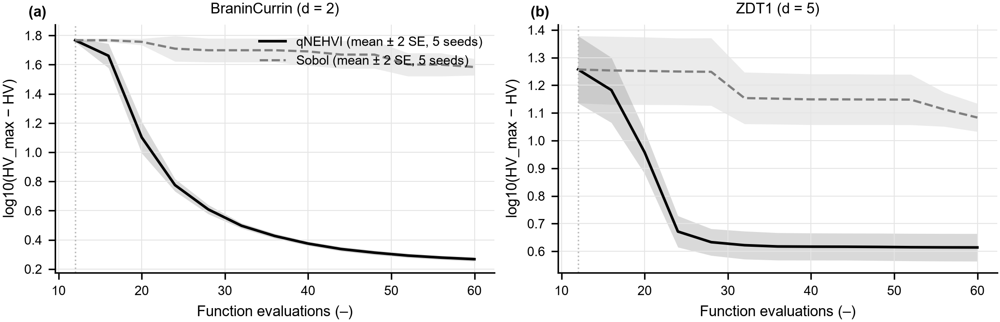
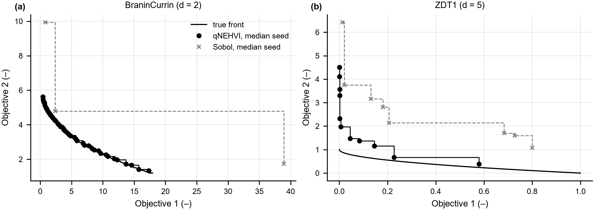
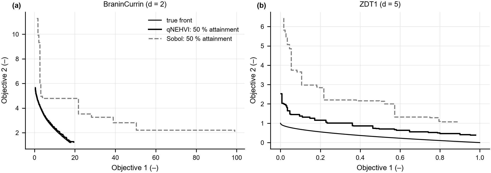

# R3 优化器自检

阶段 S3 · 生成 2026-09-27 01:39 · 规范 reports/spec.yaml (sha 46732ae7) · 总判定 PASS

## 0 结论摘要

在两个解析基准上，同一套 BO 代码（20,000 点离散候选池、q = 4、12 + 12×4 = 60 次评估）的中位最终超体积比为 BraninCurrin (d = 2) 0.969、ZDT1 (d = 5) 0.964，达到 95 % 验收线；qLogNEHVI 在每个种子上都胜过同预算 Sobol 的中位。可以进入 FE 阶段。

## 1 使用情境与问题

| 项 | 内容 |
|---|---|
| 使用情境（COU） | 在前沿已知的解析基准上确认 qNEHVI 实现与超参数设置正确，否则不进入 FE 阶段。 |
| 本阶段要回答 | 同样 60 次评估，BO 能否逼近已知前沿并稳定优于 Sobol 随机抽样？ |
| 本阶段不回答 | 不说明在 FE 问题上的表现。 |
| 依据规范 | Zitzler 2003 性能指标与达成函数；Daulton 2020 作图惯例 |

## 2 输入与版本

| 项 | 值 |
|---|---|
| config.yaml | sha 151b9cb3 |
| spec.yaml | sha 46732ae7 |
| seeds | [0, 1, 2, 3, 4] |
| candidate_pool | 20000 |
| q | 4 |
| n_init | 12 |
| n_rounds | 12 |
| acquisition | qLogNoisyExpectedHypervolumeImprovement（BoTorch 0.18.1），128 个 Sobol QMC 样本 |
| gp | SingleTaskGP，ARD Matérn 5/2，Gamma(3, 6) 长度尺度先验，输入归一化、输出标准化 |
| acq_time_median_s | 29.2 |
| updated | 2026-09-27T01:39:48 |
| 脚本 `stage_s3.py` | sha 512dd3a0 |
| 软件包 | Python 3.12.10；numpy 2.5.3；scipy 1.18.1；matplotlib 3.11.2；shapely 2.1.2；PyYAML 6.0.3；markdown 3.11；torch 2.14.0+cpu；botorch 0.18.1；gpytorch 1.15.2；gmsh 4.15.2；meshio 5.3.5；scikit-learn 1.9.1；pymoo 0.6.2 |

## 3 方法

**基准**：BraninCurrin（d = 2）与 ZDT1（d = 5，与 FE 问题同维），均为双目标最小化，已知最大超体积取 BoTorch 给出的值（参考点 [18, 6] 与 [11, 11]）。

**方法**：与 FE 阶段相同的 `mobo.run`。每个种子先生成打乱的 Sobol 候选池 20,000 点；BO 与 Sobol 基线用同一候选池，BO 以池的前 12 点为初始设计，之后 12 轮每轮拟合每个目标一个 GP（ARD Matérn 5/2，Gamma(3, 6) 长度尺度先验，Gamma(2, 0.15) 输出尺度先验，噪声下界 1e-6），在未评估的候选点上用 qLogNEHVI（128 个 QMC 样本）序贯贪心选 4 个。Sobol 基线取池的前 60 点。

**指标**：超体积（最小化空间，参考点固定）、IGD（参考前沿每点到所得前沿最近点的平均距离，按真前沿范围归一化）、50 % 经验达成面。标准参考点离前沿较远，HV 比的区分度有限，因此同时画 log 超体积差（Daulton 2020）。

## 4 结果

### 4.1 图

**图 1（R3-F01）qLogNEHVI closes the hypervolume gap faster than Sobol on both benchmarks (median final HV ratio 0.964–0.969)**　纵轴为已知最大超体积与当前超体积之差的常用对数（Daulton 2020 作图惯例），5 个种子的均值 ± 2 标准误；点线处为 12 个初始点结束。参考点用 BoTorch 标准值：BraninCurrin [18, 6]，ZDT1 [11, 11]。

数据 reports/R3_optimizer_selftest/figures/R3-F01.csv（sha 0e1c4297）· 作图 stage_s3.py:plot_r3_f01 · 生成脚本 stage_s3.py（sha 512dd3a0）

**图 2（R3-F02）BO reaches the true front on BraninCurrin; on ZDT1 the discrete candidate pool keeps both methods above it**　各方法取最终超体积为中位数的那个种子的非支配点；黑线为真前沿（BraninCurrin 为 2^18 个 Sobol 点的非支配集，ZDT1 为解析解）。

数据 reports/R3_optimizer_selftest/figures/R3-F02.csv（sha 80c0f7e4）· 作图 stage_s3.py:plot_r3_f02 · 生成脚本 stage_s3.py（sha 512dd3a0）

**图 3（R3-F03）The 50 % attainment surface of qLogNEHVI dominates that of Sobol**　经验达成函数的 50 % 等值线（Zitzler 2003）：5 个种子中至少 3 个达到的目标区域边界。

数据 reports/R3_optimizer_selftest/figures/R3-F03.csv（sha 8eb48b7d）· 作图 stage_s3.py:plot_r3_f03 · 生成脚本 stage_s3.py（sha 512dd3a0）

### 4.2 表

**表 1（R3-T01）60 次评估时的超体积比与 IGD（5 个种子）**

| benchmark | method | HV_ratio_median | HV_ratio_mean | HV_ratio_sd | IGD_mean | IGD_sd | pool_oracle_HV_ratio | seeds |
|---|---|---|---|---|---|---|---|---|
| BraninCurrin (d = 2) | qNEHVI | 0.969 | 0.969 | 0.00115 | 0.0101 | 0.000446 | 0.97 | 5 |
| BraninCurrin (d = 2) | Sobol | 0.318 | 0.348 | 0.0922 | 0.259 | 0.0359 | 0.97 | 5 |
| ZDT1 (d = 5) | qNEHVI | 0.964 | 0.966 | 0.00436 | 0.287 | 0.0346 | 0.964 | 5 |
| ZDT1 (d = 5) | Sobol | 0.895 | 0.899 | 0.0127 | 0.826 | 0.123 | 0.964 | 5 |

HV 比 = 最终超体积 / 已知最大超体积；IGD 以真前沿范围归一化。pool_oracle 为整个 20,000 点候选池非支配集的超体积比，即离散候选池能达到的上限。  数据 `reports/R3_optimizer_selftest/tables/R3-T01.csv`（sha 743bed28），生成脚本 `stage_s3.py`。

## 5 验收

| ID | 判据 | 门槛 | 实测 | 状态 | 原因与处置 |
|---|---|---|---|---|---|
| R3-A1 | 60 次评估时 qNEHVI 中位 HV 达到已知前沿 HV 的比例（两个基准） | ≥ 95% | BraninCurrin (d = 2): 0.9687；ZDT1 (d = 5): 0.9644 | PASS |  |
| R3-A2 | 60 次评估时每个种子的 qNEHVI HV 高于 Sobol 中位 | 全部种子 | BraninCurrin (d = 2): 全部高于 Sobol 中位；ZDT1 (d = 5): 全部高于 Sobol 中位 | PASS |  |

总判定：PASS（全部 PASS 或写明理由的 NA 才算通过；有 PENDING 或缺项为 INCOMPLETE）。

## 6 局限与下一阶段输入

**通用局限**

- 2D 冠状面平面应力，无侧板，前后皮质的连接被忽略；力学量只用于定性比较与排序，不下绝对值结论。

- 无外展肌力，单一上楼工况（3D 模型峰值载荷投影到冠状面）。

- 松质骨模量随 Dorr 分型取 400/300/150 MPa 是假设（源 3D 模型为 155 MPa）；另设三型同为 300 MPa 的对照组。

- 压配量 δ = 0.10 mm 与摩擦系数 μ = 0.3 固定，只在 R2 符号检查中改变。

- 无实验数据，本测试不做 ASME V&V 40 意义上的确认（validation），2D–3D 比较只算模型形式比较。

- 本测试检验代理 + 多目标 BO 能否在少量 FE 内找到正确前沿，不对柄设计下临床结论。

**本阶段局限**

- 离散候选池限制了可达的最优：ZDT1 的真前沿要求 x2…x5 = 0，池中没有这样的点，pool_oracle 列给出池能达到的上限。
- 基准无噪声、无约束；FE 问题有重新网格化噪声与柄应力约束，这两点只在 R5 检验。

**下一阶段输入**

- mobo.py 的采集设置（参考点规则、q、候选池大小）

## 附录 A 溯源

| 图/表 | 数据 sha | 作图函数 | 生成脚本 sha | 合成 | 来源 |
|---|---|---|---|---|---|
| R3-F01 | 0e1c4297 | `stage_s3.py:plot_r3_f01` | 512dd3a0 | 否 | results=results/S3_selftest.json；seeds=[0, 1, 2, 3, 4]；pool=scrambled Sobol n = 20000 |
| R3-F02 | 80c0f7e4 | `stage_s3.py:plot_r3_f02` | 512dd3a0 | 否 | results=results/S3_selftest.json；seeds=[0, 1, 2, 3, 4]；pool=scrambled Sobol n = 20000 |
| R3-F03 | 8eb48b7d | `stage_s3.py:plot_r3_f03` | 512dd3a0 | 否 | results=results/S3_selftest.json；seeds=[0, 1, 2, 3, 4]；pool=scrambled Sobol n = 20000 |
| R3-T01 | 743bed28 | `—` | 512dd3a0 | 否 |  |
