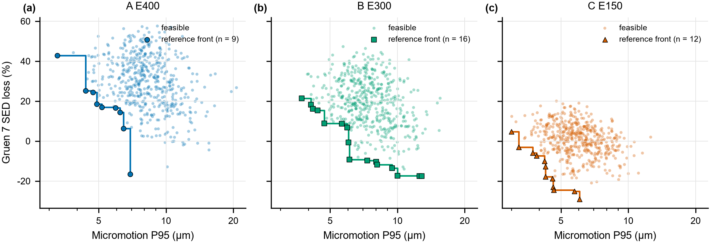
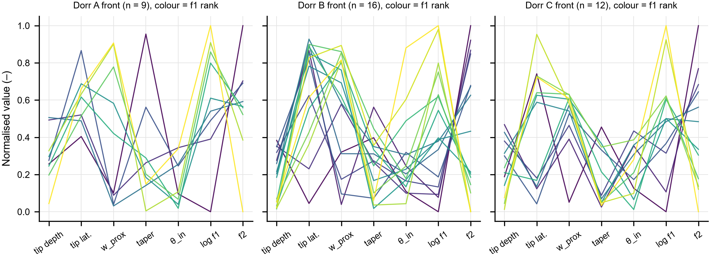
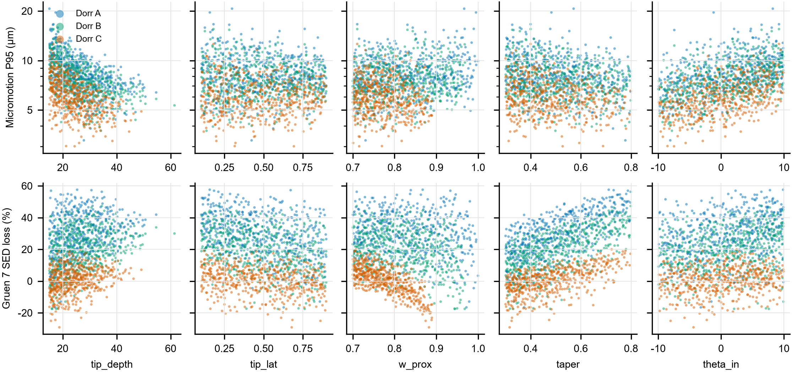
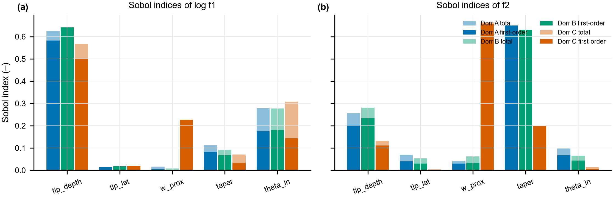
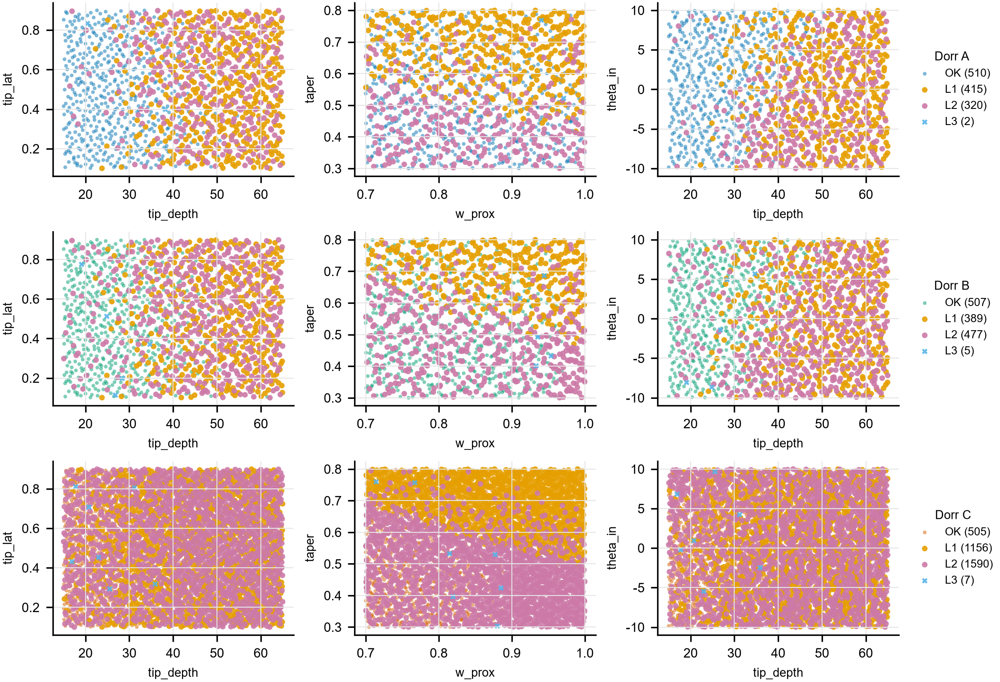
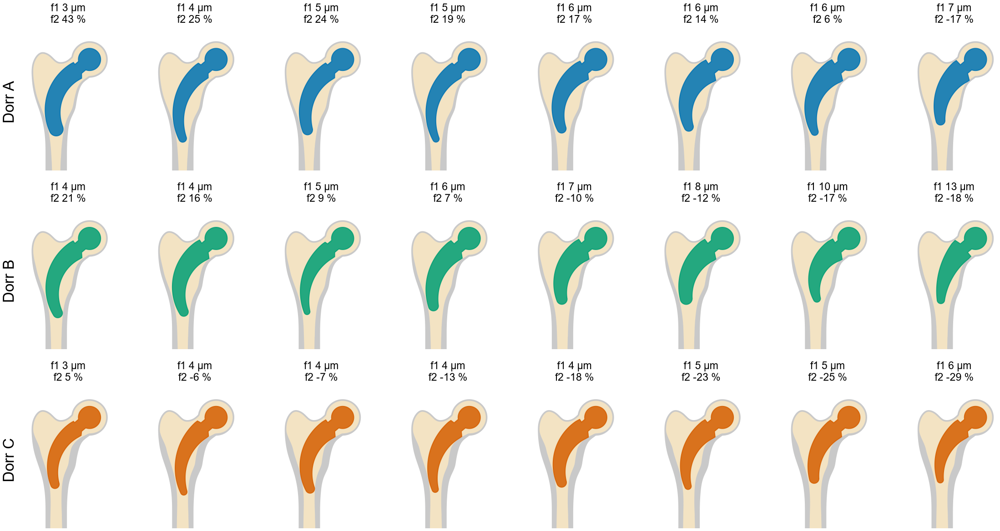

# R4 参考扫描（真前沿）

阶段 S4 · 生成 2026-09-27 16:05 · 规范 reports/spec.yaml (sha 724e892d) · 总判定 FAIL

## 0 结论摘要

参考扫描：A_E400 尝试 1247 个、前沿 9 点；B_E300 尝试 1378 个、前沿 16 点；C_E150 尝试 3258 个、前沿 12 点；A_ctrl300 尝试 618 个、前沿 — 点；C_ctrl300 尝试 1650 个、前沿 — 点。FE 失败率最高 2.0 %。前沿与敏感性见图。

## 1 使用情境与问题

| 项 | 内容 |
|---|---|
| 使用情境（COU） | 用大样本 Sobol FE 扫描给出每型参考前沿，作为 R5 判断 BO 是否找对的标尺，同时刻画设计空间。 |
| 本阶段要回答 | 每型的参考前沿长什么样、由哪些设计组成？哪些设计变量最影响 f1、f2？失败集中在哪里？ |
| 本阶段不回答 | 不评价 BO；不外推到 3D。 |
| 依据规范 | Saltelli 2019（全局敏感性）；CLAUDE.md §9–10 运行记录与失败分级 |

## 2 输入与版本

| 项 | 值 |
|---|---|
| config.yaml | sha 5bee68dc |
| spec.yaml | sha 724e892d |
| groups | ['A_E400', 'B_E300', 'C_E150', 'A_ctrl300', 'C_ctrl300'] |
| attempts | {'A_E400': 1247, 'B_E300': 1378, 'C_E150': 3258, 'A_ctrl300': 618, 'C_ctrl300': 1650} |
| sweep_seed | 4242 |
| updated | 2026-09-27T16:05:42 |
| 脚本 `stage_s4.py` | sha 6d25b649 |
| 软件包 | Python 3.12.10；numpy 2.5.3；scipy 1.18.1；matplotlib 3.11.2；shapely 2.1.2；PyYAML 6.0.3；markdown 3.11；torch 2.14.0+cpu；botorch 0.18.1；gpytorch 1.15.2；gmsh 4.15.2；meshio 5.3.5；scikit-learn 1.9.1；pymoo 0.6.2 |

## 3 方法

每组按打乱 Sobol 序列（种子 4242）逐个尝试设计，先过几何门，通过者全部跑 FE（摩擦 + 粘接两个作业），直到 256 个设计通过几何门；前沿不足 15 点则扩到 512。对照组（A、C 型松质骨改为 300 MPa）用与该型相同的尝试序列。目标：y1 = log10(f1)，y2 = f2，均最小化；可行 = 柄 von Mises P99 ≤ 440 MPa。参考前沿 = 可行设计的非支配集。全局敏感性：对每型每个目标拟合 GP，在后验均值上用 Saltelli 2010 一阶与 Jansen 1999 总效应估计量。

## 4 结果

### 4.1 图

**图 1（R4-F01）Reference fronts hold 9, 16, 12 feasible non-dominated designs (Dorr A, B, C)**　每型全部 FE 成功设计的目标空间（横轴对数）。彩色阶梯线与黑边标记为参考前沿（可行设计的非支配集），灰叉为柄应力约束（vm P99 ≤ 440 MPa）不满足者；微动超过 40 µm 时画出 50 µm 点线。

数据 reports/R4_reference_sweep/figures/R4-F01.csv（sha dde56f7a）· 作图 stage_s4.py:plot_r4_f01 · 生成脚本 stage_s4.py（sha 6d25b649）

**图 2（R4-F02）Along the fronts, lower micromotion comes with smaller proximal width (mean ρ +0.85) and larger tip depth (mean ρ -0.69)**　各型参考前沿设计的平行坐标图：设计变量按其范围归一化，目标按前沿内范围归一化；颜色按 f1 从小（紫）到大（黄）。

数据 reports/R4_reference_sweep/figures/R4-F02.csv（sha ff49fc8a）· 作图 stage_s4.py:plot_r4_f02 · 生成脚本 stage_s4.py（sha 6d25b649）

**图 3（R4-F03）Micromotion falls most with tip depth (mean ρ -0.54); shielding rises most with tip-to-proximal width ratio (mean ρ +0.64)**　参考扫描全部 FE 成功设计的目标对单个设计变量的散点（Saltelli 2019：先看散点再看指数）。

数据 reports/R4_reference_sweep/figures/R4-F03.csv（sha 6e4eea01）· 作图 stage_s4.py:plot_r4_f03 · 生成脚本 stage_s4.py（sha 6d25b649）

**图 4（R4-F04）Micromotion is driven by tip depth and entry angle; shielding by tip-to-proximal width ratio and proximal width**　由参考数据拟合 GP（ARD Matérn 5/2），在其后验均值上用 Saltelli/Jansen 估计量（每组 4,096 基样本）计算一阶（实心）与总效应（浅色）Sobol 指数。输入在整个单位立方体上均匀分布，含几何门不可行区（GP 外推），见局限。

数据 reports/R4_reference_sweep/figures/R4-F04.csv（sha abc6bee5）· 作图 stage_s4.py:plot_r4_f04 · 生成脚本 stage_s4.py（sha 6d25b649）

**图 5（R4-F05）74% of attempts fail the geometry gate; 0.9% of gate-passing designs fail in meshing or solving**　全部尝试设计按失败等级着色（L1/L2 几何门，L3 网格，L4 求解，L5 导出/QoI）。

数据 reports/R4_reference_sweep/figures/R4-F05.csv（sha 9fea2d01）· 作图 stage_s4.py:plot_r4_f05 · 生成脚本 stage_s4.py（sha 6d25b649）

**图 6（R4-F06）Front stems of each Dorr type, ordered from lowest to highest micromotion**　每型参考前沿按 f1 由小到大等距取至多 8 个设计的柄轮廓（含截骨线以上的假体颈与头）。

数据 reports/R4_reference_sweep/figures/R4-F06.csv（sha 07932c22）· 作图 stage_s4.py:plot_r4_f06 · 生成脚本 stage_s4.py（sha 6d25b649）

### 4.2 表

**表 1（R4-T01）参考前沿设计清单**

| group | design_id | tip_depth | tip_lat | w_prox | taper | theta_in | f1_um | f2_pct | vm_p99 |
|---|---|---|---|---|---|---|---|---|---|
| A_E400 | d001101_6d9e | 27.8 | 0.423 | 0.731 | 0.777 | -8.08 | 3.27 | 42.8 | 48 |
| A_E400 | d002266_c495 | 39.6 | 0.516 | 0.727 | 0.432 | -3.11 | 4.38 | 25.2 | 51.1 |
| A_E400 | d001016_4f4b | 28.8 | 0.793 | 0.712 | 0.581 | -5.08 | 4.72 | 24.5 | 51.9 |
| A_E400 | d002053_ba1c | 40.3 | 0.491 | 0.709 | 0.371 | -4.9 | 4.9 | 18.6 | 52.6 |
| A_E400 | d000984_d7ff | 29.8 | 0.65 | 0.875 | 0.392 | -9.21 | 5.16 | 17 | 45.3 |
| A_E400 | d002142_66cb | 27.3 | 0.593 | 0.826 | 0.445 | -9.63 | 5.95 | 16.6 | 47.7 |
| A_E400 | d001854_ef14 | 24.9 | 0.512 | 0.933 | 0.401 | -8.66 | 6.22 | 14.4 | 45.7 |
| A_E400 | d001714_c600 | 31.4 | 0.605 | 0.97 | 0.302 | -7.85 | 6.46 | 6.28 | 45.2 |
| A_E400 | d001100_be59 | 17.2 | 0.628 | 0.972 | 0.374 | -3.22 | 6.91 | -16.6 | 50.4 |
| B_E300 | d003509_ec79 | 34.2 | 0.136 | 0.796 | 0.499 | -7.82 | 3.74 | 21.3 | 48.5 |
| B_E300 | d002625_0cad | 28.8 | 0.793 | 0.712 | 0.581 | -5.08 | 4.11 | 18.3 | 52.3 |
| B_E300 | d003917_29c2 | 32.6 | 0.284 | 0.873 | 0.433 | -8 | 4.19 | 16.2 | 46.9 |
| B_E300 | d003512_6bbf | 30.9 | 0.599 | 0.752 | 0.437 | -6.69 | 4.4 | 15.4 | 52 |
| B_E300 | d003736_acf6 | 32.5 | 0.753 | 0.729 | 0.336 | -3.62 | 4.71 | 8.81 | 53.5 |
| B_E300 | d004008_31a2 | 27.9 | 0.817 | 0.794 | 0.456 | -5.93 | 5.65 | 8.59 | 51.5 |
| B_E300 | d004100_d3a9 | 25.2 | 0.842 | 0.875 | 0.475 | -3.87 | 5.96 | 6.78 | 51.2 |
| B_E300 | d002781_63c4 | 25.8 | 0.726 | 0.908 | 0.384 | -5.43 | 6.03 | -0.743 | 50.1 |
| B_E300 | d002893_f824 | 24.3 | 0.781 | 0.928 | 0.309 | -6.58 | 6.1 | -9.26 | 48.3 |
| B_E300 | d004028_988e | 16.6 | 0.543 | 0.94 | 0.467 | -7.32 | 7.32 | -9.69 | 51 |
| B_E300 | d003580_7894 | 17.8 | 0.811 | 0.885 | 0.424 | -0.229 | 8.02 | -10.4 | 52.7 |
| B_E300 | d002677_d79e | 15.8 | 0.819 | 0.958 | 0.524 | -6.45 | 8.13 | -11.9 | 47.6 |
| B_E300 | d003993_705b | 18.5 | 0.441 | 0.957 | 0.35 | -5.1 | 9.45 | -13.6 | 51.6 |
| B_E300 | d002786_5354 | 16 | 0.39 | 0.944 | 0.318 | -9.13 | 10 | -17.4 | 49.9 |
| B_E300 | d003548_c247 | 16.1 | 0.762 | 0.968 | 0.478 | 2.08 | 12.5 | -17.5 | 51.4 |
| B_E300 | d003708_ee47 | 17.6 | 0.591 | 0.945 | 0.331 | 7.61 | 12.8 | -17.5 | 54.7 |
| C_E150 | d004774_070d | 24.4 | 0.693 | 0.715 | 0.528 | -7.48 | 3.01 | 4.76 | 53.1 |
| C_E150 | d004807_809c | 38.4 | 0.199 | 0.817 | 0.313 | -2.91 | 3.24 | -3.08 | 51.9 |
| C_E150 | d007438_264e | 34 | 0.245 | 0.839 | 0.344 | -1.32 | 3.75 | -5.98 | 51.3 |
| C_E150 | d004543_19df | 30 | 0.134 | 0.858 | 0.466 | -6.54 | 3.89 | -7.3 | 52.3 |
| C_E150 | d008238_6b47 | 36.3 | 0.208 | 0.872 | 0.335 | -3.84 | 4.22 | -10.1 | 52.1 |
| C_E150 | d008593_22ac | 30.7 | 0.571 | 0.863 | 0.325 | -2.83 | 4.27 | -12.7 | 53.2 |
| C_E150 | d008621_2729 | 22.1 | 0.601 | 0.881 | 0.483 | -8.7 | 4.27 | -17.8 | 51 |
| C_E150 | d007994_621d | 25.5 | 0.235 | 0.883 | 0.407 | -9.76 | 4.59 | -18.8 | 52.2 |
| C_E150 | d005574_1413 | 26.8 | 0.612 | 0.889 | 0.326 | -5.81 | 4.61 | -23.1 | 53.5 |
| C_E150 | d008469_89d5 | 17.3 | 0.684 | 0.889 | 0.474 | -2.27 | 4.65 | -24.5 | 54 |
| C_E150 | d008437_f670 | 15.6 | 0.863 | 0.874 | 0.324 | -8.03 | 5.74 | -25.1 | 53.9 |
| C_E150 | d004654_dcff | 18.8 | 0.679 | 0.882 | 0.316 | -4.38 | 6.05 | -29.2 | 54.5 |

每型可行设计的非支配集，按 f1 升序。 单位 f1_um: µm；f2_pct: %；vm_p99: MPa。 数据 `reports/R4_reference_sweep/tables/R4-T01.csv`（sha 86d86fa4），生成脚本 `stage_s4.py`。

**表 2（R4-T02）失败分级计数**

| group | attempts | OK | L1 | L2 | L3 | L4 | L5 | gate_passed | fe_fail_rate_pct |
|---|---|---|---|---|---|---|---|---|---|
| A_E400 | 1.25e+03 | 510 | 415 | 320 | 2 | 0.0 | 0.0 | 512 | 0.391 |
| B_E300 | 1.38e+03 | 507 | 389 | 477 | 5 | 0.0 | 0.0 | 512 | 0.977 |
| C_E150 | 3.26e+03 | 505 | 1.16e+03 | 1.59e+03 | 7 | 0.0 | 0.0 | 512 | 1.37 |
| A_ctrl300 | 618 | 252 | 207 | 155 | 0.0 | 4 | 0.0 | 256 | 1.56 |
| C_ctrl300 | 1.65e+03 | 251 | 585 | 809 | 5 | 0.0 | 0.0 | 256 | 1.95 |

gate_passed = 通过几何门进入 FE 的设计数；fe_fail_rate 为其中 L3–L5 的比例。  数据 `reports/R4_reference_sweep/tables/R4-T02.csv`（sha 39e85de1），生成脚本 `stage_s4.py`。

**表 3（R4-T03）单设计耗时（网格 + 两个 Abaqus 作业 + QoI）**

| group | n | median_s | p95_s | total_machine_h |
|---|---|---|---|---|
| A_E400 | 510 | 27.7 | 35.5 | 4.01 |
| B_E300 | 507 | 26.5 | 32.6 | 3.87 |
| C_E150 | 505 | 29.3 | 37.2 | 4.29 |
| A_ctrl300 | 252 | 29.1 | 35.3 | 2.08 |
| C_ctrl300 | 251 | 28.8 | 35.6 | 2 |

墙钟时间；4 个设计并行，总机时 ≈ 总和，墙钟约为其 1/4。 单位 median_s: s。 数据 `reports/R4_reference_sweep/tables/R4-T03.csv`（sha 894a6da0），生成脚本 `stage_s4.py`。

## 5 验收

| ID | 判据 | 门槛 | 实测 | 状态 | 原因与处置 |
|---|---|---|---|---|---|
| R4-A1 | 每型参考前沿点数（不足则加到 512） | ≥ 15 | A_E400 9；B_E300 16；C_E150 12 | FAIL | 按计划把不足 15 点的组扩到 512 个设计后仍不足：数百个可行设计里只有个位数非支配点，说明两个目标在本设计空间里强相关、权衡面短，而不是采样不足。影响：R5 的 HV 比与 IGD 以 R4 + R5 全部可行评估的非支配集为参考，点数会多于此处；处置建议：接受稀疏前沿，不再加样；该处置尚待用户同意（S5 已按此假设运行）。 |
| R4-A2 | runs.csv 行数等于尝试设计数，失败全部入账 | 相等 | 每组 runs.csv 行数 = 尝试数（含几何门失败行） | PASS |  |
| R4-A3 | 过几何门设计中 FE 失败（L3–L5）比例 | ≤ 5% | 最大 2.0 % | PASS |  |

总判定：FAIL（全部 PASS 或写明理由的 NA 才算通过；不通过项的处置全部获用户同意时为 FAIL-APPROVED，可进入下一阶段；有 PENDING 或缺项为 INCOMPLETE）。

## 6 局限与下一阶段输入

**通用局限**

- 2D 冠状面平面应力，无侧板，前后皮质的连接被忽略；力学量只用于定性比较与排序，不下绝对值结论。

- 无外展肌力，单一上楼工况（3D 模型峰值载荷投影到冠状面）。

- 松质骨模量随 Dorr 分型取 400/300/150 MPa 是假设（源 3D 模型为 155 MPa）；另设三型同为 300 MPa 的对照组。

- 压配量 δ = 0.10 mm 与摩擦系数 μ = 0.3 固定，只在 R2 符号检查中改变。

- 无实验数据，本测试不做 ASME V&V 40 意义上的确认（validation），2D–3D 比较只算模型形式比较。

- 本测试检验代理 + 多目标 BO 能否在少量 FE 内找到正确前沿，不对柄设计下临床结论。

**本阶段局限**

- Sobol 指数假设输入在整个单位立方体上独立均匀，而几何门可行域不是长方体；不可行区上的值是 GP 外推，指数只作定性排序。
- 参考前沿本身是有限样本的非支配集，不是真前沿；R5 用 R4 + R5 全部评估的并集作参考。
- 扩到 512 个设计时，前一轮中几何门失败的尝试在 runs.csv 里被重复记录（设计相同、design_id 不同）；本报告的计数以本阶段返回的尝试序列为准，不受重复行影响。之后的阶段已改为复用几何门结果。

**下一阶段输入**

- 每型参考前沿与 HV_ref

- 目标归一化范围与 HV 参考点

## 附录 A 溯源

| 图/表 | 数据 sha | 作图函数 | 生成脚本 sha | 合成 | 来源 |
|---|---|---|---|---|---|
| R4-F01 | dde56f7a | `stage_s4.py:plot_r4_f01` | 6d25b649 | 否 | runs_csv=campaign S4_ref / S4_control；sweep_seed=4242 |
| R4-F02 | ff49fc8a | `stage_s4.py:plot_r4_f02` | 6d25b649 | 否 | runs_csv=campaign S4_ref / S4_control；sweep_seed=4242 |
| R4-F03 | 6e4eea01 | `stage_s4.py:plot_r4_f03` | 6d25b649 | 否 | runs_csv=campaign S4_ref / S4_control；sweep_seed=4242 |
| R4-F04 | abc6bee5 | `stage_s4.py:plot_r4_f04` | 6d25b649 | 否 | runs_csv=campaign S4_ref / S4_control；sweep_seed=4242 |
| R4-F05 | 9fea2d01 | `stage_s4.py:plot_r4_f05` | 6d25b649 | 否 | runs_csv=campaign S4_ref / S4_control；sweep_seed=4242 |
| R4-F06 | 07932c22 | `stage_s4.py:plot_r4_f06` | 6d25b649 | 否 | runs_csv=campaign S4_ref / S4_control；sweep_seed=4242 |
| R4-T01 | 86d86fa4 | `—` | 6d25b649 | 否 |  |
| R4-T02 | 39e85de1 | `—` | 6d25b649 | 否 |  |
| R4-T03 | 894a6da0 | `—` | 6d25b649 | 否 |  |
