# R5 BO 结果与代理诊断

阶段 S5 · 生成 2026-09-27 18:32 · 规范 reports/spec.yaml (sha 724e892d) · 总判定 FAIL

## 0 结论摘要

BO（GP + qLogNEHVI，q = 4，12 + 12×4 = 60 次 FE）在三型上的最终 HV 比中位为 A 0.886、B 0.957、C 0.899（参考前沿 = R4 + R5 全部可行评估的非支配集），同预算 Sobol 中位为 A 0.568、B 0.652、C 0.647。验收：HV 比 ≥ 0.90 未全部通过；三个种子都胜过 Sobol 是；GP 90 % 区间覆盖率 不在 0.80–0.97 内；训练与测试集重叠 0。单个种子相对 256 点参考扫描节省 FE 机时 A 88 %、B 88 %、C 89 %。

## 1 使用情境与问题

| 项 | 内容 |
|---|---|
| 使用情境（COU） | 判断 GP 代理 + qNEHVI 在每型 ≤ 60 次 FE 内能否找到参考前沿，以及代理的不确定性是否可信。 |
| 本阶段要回答 | BO 用多少次 FE 达到参考前沿 HV 的 90%？是否每个种子都胜过同预算 Sobol？GP 的 90% 区间覆盖率是否名副其实？三型前沿差在哪？ |
| 本阶段不回答 | 不对 3D 或真实股骨下结论；不做跨分型稳健优化。 |
| 依据规范 | Zitzler 2003；Daulton 2020；Kuleshov 2018 校准；REFORMS 2024；Aldieri 2025；250 问 §C |

## 2 输入与版本

| 项 | 值 |
|---|---|
| config.yaml | sha 5bee68dc |
| spec.yaml | sha 724e892d |
| ref_points | {'A': [1.2502286189914458, 60.2554987233457], 'B': [1.2180067807897204, 46.97807118122178], 'C': [1.0643213820600348, 15.913440061934168]} |
| pool_sizes | {'A': {'0': 8340, '1': 8348, '2': 8322}, 'B': {'0': 7406, '1': 7399, '2': 7422}, 'C': {'0': 6386, '1': 6333, '2': 6388}} |
| noise_sd | [0.014137052488212641, 0.03316220987852743, 0.1] |
| updated | 2026-09-27T18:32:41 |
| 脚本 `stage_s5.py` | sha 3358aa7d |
| 软件包 | Python 3.12.10；numpy 2.5.3；scipy 1.18.1；matplotlib 3.11.2；shapely 2.1.2；PyYAML 6.0.3；markdown 3.11；torch 2.14.0+cpu；botorch 0.18.1；gpytorch 1.15.2；gmsh 4.15.2；meshio 5.3.5；scikit-learn 1.9.1；pymoo 0.6.2 |

## 3 方法

**问题**：每型独立的双目标最小化，y1 = log10(P95 微动 µm)，y2 = Gruen 7 SED 下降率（%），约束 vm P99 ≤ 440 MPa。设计变量 5 个（R1-T02），候选池为每个种子一个打乱 Sobol 序列（A、B 型 20,000 点，C 型 40,000 点，按 R1-A4 处置）中过几何门者（保持序列顺序）。

**BO**：`mobo.run`，初始设计 = 池的前 12 点；每轮为两个目标与约束各拟合一个 SingleTaskGP（ARD Matérn 5/2，Gamma(3, 6) 长度尺度先验，输入归一化、输出标准化，观测噪声下界来自 R2 噪声底），qLogNEHVI（128 个 QMC 样本，参考点每型固定）在未评估候选点上序贯贪心选 4 个；共 12 轮。Sobol 基线取池的前 60 点（与 BO 共享前 12 点）。

**参考点**：三个种子的初始 12 点合并，可行者各目标最大值 + 10 % 极差。**参考前沿**：该型 R4 扫描 + R5 全部 FE 评估的可行非支配集。**代理诊断**：每个 BO 种子最终 60 点训练的 GP 在 R4 扫描设计（测试集，与训练集按 cache_key 无重叠）上预测，含观测噪声的预测区间；R²、Spearman、90 % 覆盖率、锐度（平均区间宽 / 测试集标准差），校准曲线按 Kuleshov 2018。

## 4 结果

### 4.1 图

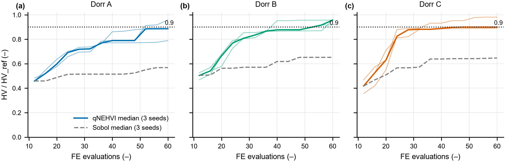

**图 1（R5-F01）BO reaches a median HV ratio of 0.89 / 0.96 / 0.90 (A / B / C) within 60 FE runs**　HV 比 = 已评估可行设计的超体积 / 参考前沿超体积（参考前沿 = R4 扫描 + R5 全部评估的可行非支配集），目标空间 (log10 f1, f2)，参考点每型固定。细线为单个 BO 种子，粗实线为 BO 中位，虚线为同预算 Sobol 中位。

数据 reports/R5_bo_results/figures/R5-F01.csv（sha 744e8b2c）· 作图 stage_s5.py:plot_r5_f01 · 生成脚本 stage_s5.py（sha 3358aa7d）

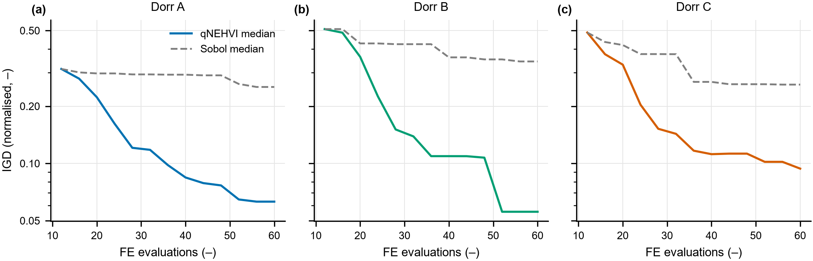

**图 2（R5-F02）Median final IGD: BO 0.063 / 0.056 / 0.094 vs Sobol 0.252 / 0.344 / 0.260 (A / B / C)**　IGD：参考前沿每点到已评估可行非支配集最近点的平均距离（按参考前沿范围归一化），三个种子的中位。

数据 reports/R5_bo_results/figures/R5-F02.csv（sha ad7ef082）· 作图 stage_s5.py:plot_r5_f02 · 生成脚本 stage_s5.py（sha 3358aa7d）

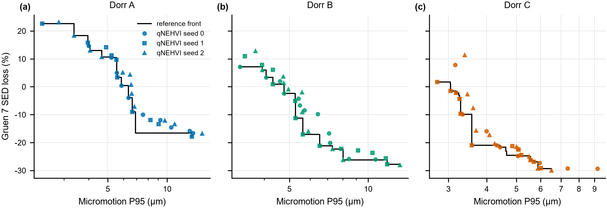

**图 3（R5-F03）42% of the final BO non-dominated points are members of the reference front**　黑线为参考前沿；彩色标记为各 BO 种子 60 次评估后的可行非支配点。

数据 reports/R5_bo_results/figures/R5-F03.csv（sha f7c0c9a6）· 作图 stage_s5.py:plot_r5_f03 · 生成脚本 stage_s5.py（sha 3358aa7d）

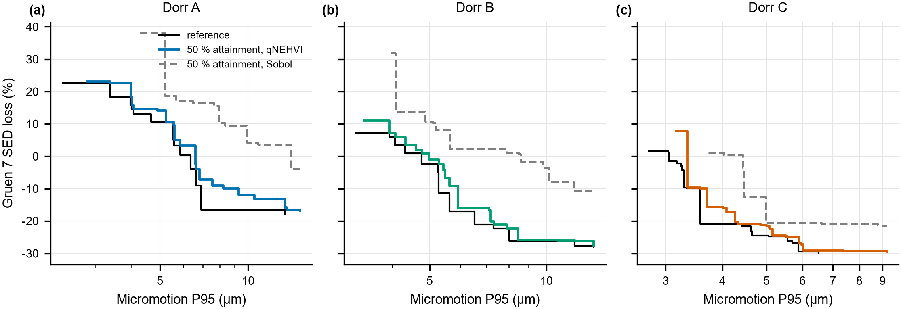

**图 4（R5-F04）BO's 50 % attainment surface is at or below Sobol's on 100% / 100% / 100% of the grid (A / B / C)**　经验达成函数 50 % 等值线（三个种子中至少两个达到的区域边界）。

数据 reports/R5_bo_results/figures/R5-F04.csv（sha d71cabb6）· 作图 stage_s5.py:plot_r5_f04 · 生成脚本 stage_s5.py（sha 3358aa7d）

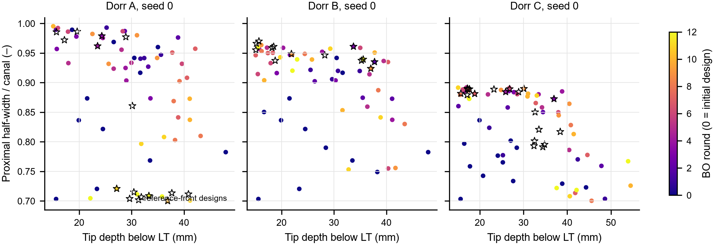

**图 5（R5-F05）Mean distance from BO designs to the nearest reference-front design: 0.66 in the initial design, 0.34 in the last three rounds (unit cube, seed 0)**　种子 0 的全部评估点在 (尖端深度, 近端半宽) 平面上的位置，颜色为轮次；黑星为参考前沿设计。

数据 reports/R5_bo_results/figures/R5-F05.csv（sha bd6ff762）· 作图 stage_s5.py:plot_r5_f05 · 生成脚本 stage_s5.py（sha 3358aa7d）

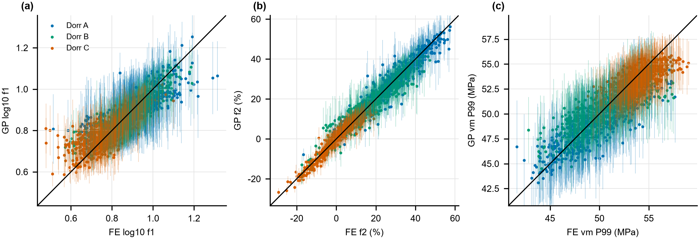

**图 6（R5-F06）Held-out R² of the seed-0 GPs: log10 f1 0.68, f2 0.92, vm P99 0.60**　种子 0 最终 GP（60 个 BO 设计训练）在 R4 参考扫描设计上的预测（含观测噪声的 90 % 区间）对 FE 真值。测试集与训练集按 cache_key 不重叠。

数据 reports/R5_bo_results/figures/R5-F06.csv（sha 29ab038a）· 作图 stage_s5.py:plot_r5_f06 · 生成脚本 stage_s5.py（sha 3358aa7d）

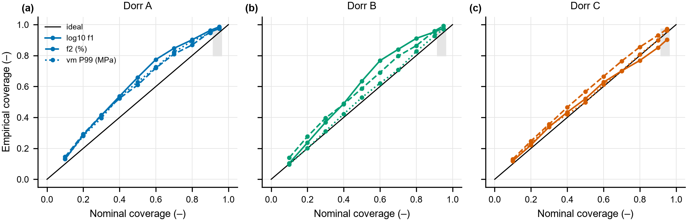

**图 7（R5-F07）Empirical 90 % coverage ranges 0.85–0.99 across types, seeds and objectives (acceptance 0.80–0.97)**　校准曲线（Kuleshov 2018）：名义中心区间覆盖率对实际覆盖率；灰色小带为 90 % 名义处的 0.80–0.97 验收带。

数据 reports/R5_bo_results/figures/R5-F07.csv（sha d42ed6ba）· 作图 stage_s5.py:plot_r5_f07 · 生成脚本 stage_s5.py（sha 3358aa7d）

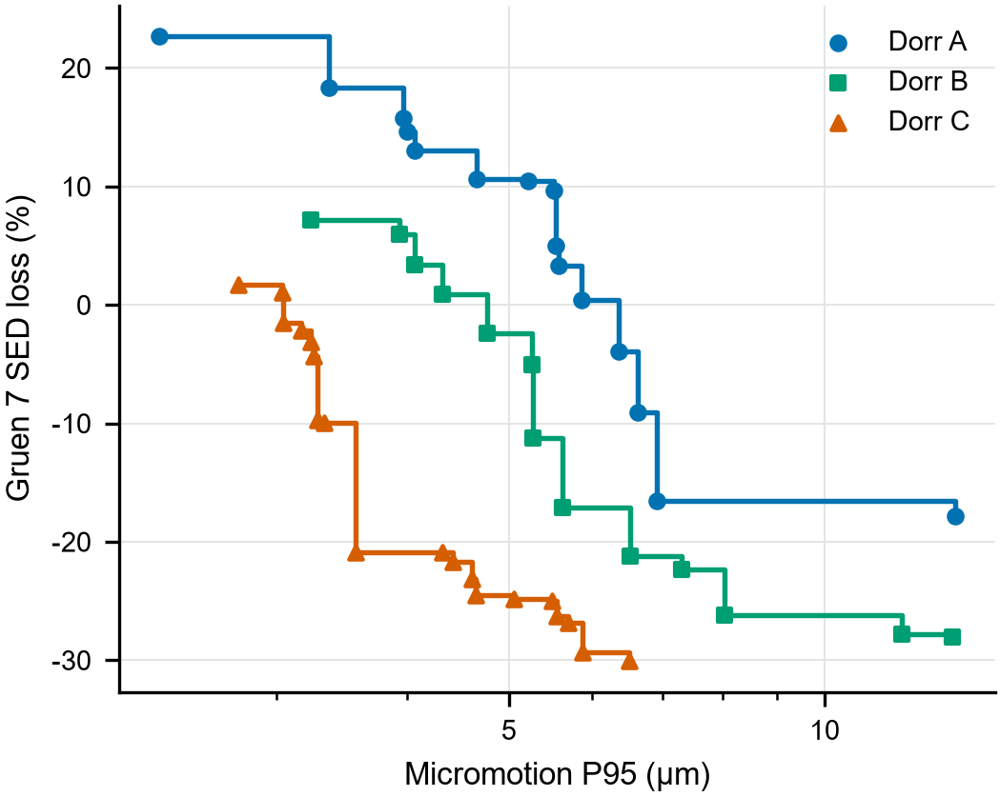

**图 8（R5-F08）Lowest micromotion 2.3 / 3.2 / 2.8 µm and lowest shielding -18 / -28 / -30 % on the reference fronts (A / B / C)**　各型参考前沿（R4 + R5 可行非支配集），共用坐标。

数据 reports/R5_bo_results/figures/R5-F08.csv（sha 8739ea31）· 作图 stage_s5.py:plot_r5_f08 · 生成脚本 stage_s5.py（sha 3358aa7d）

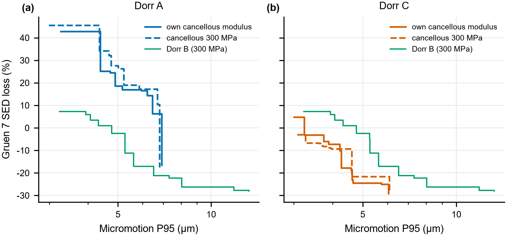

**图 9（R5-F09）With cancellous bone at 300 MPa the lowest micromotion changes from 3.3 to 3.0 µm in Dorr A and from 3.0 to 3.1 µm in Dorr C**　实线为本型松质骨模量（A 400 / C 150 MPa），虚线为 300 MPa 对照（同一尝试序列的 R4 扫描），B 型（300 MPa）为参照。

数据 reports/R5_bo_results/figures/R5-F09.csv（sha a626a7a6）· 作图 stage_s5.py:plot_r5_f09 · 生成脚本 stage_s5.py（sha 3358aa7d）

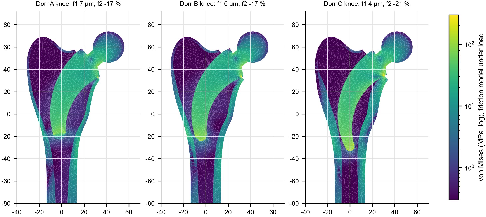

**图 10（R5-F10）Knee-point designs: f1 6.9 / 5.6 / 3.6 µm, f2 -17 / -17 / -21 % (A / B / C)**　各型参考前沿的膝点（归一化后离理想点最近）设计：摩擦模型加载步 von Mises 应力（对数色标）。

数据 reports/R5_bo_results/figures/R5-F10.csv（sha 26090476）· 作图 stage_s5.py:plot_r5_f10 · 生成脚本 stage_s5.py（sha 3358aa7d）

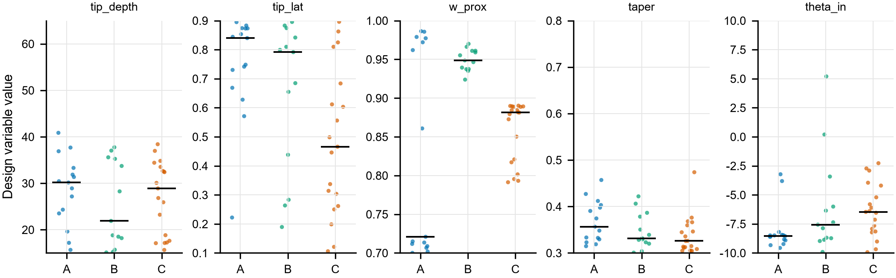

**图 11（R5-F11）Front designs differ most between Dorr types in proximal width (normalised medians 0.07 / 0.83 / 0.60, A / B / C)**　各型参考前沿设计的五个设计变量取值（抖动散点），黑线为中位；纵轴为各变量的完整范围。

数据 reports/R5_bo_results/figures/R5-F11.csv（sha 4c8c8688）· 作图 stage_s5.py:plot_r5_f11 · 生成脚本 stage_s5.py（sha 3358aa7d）

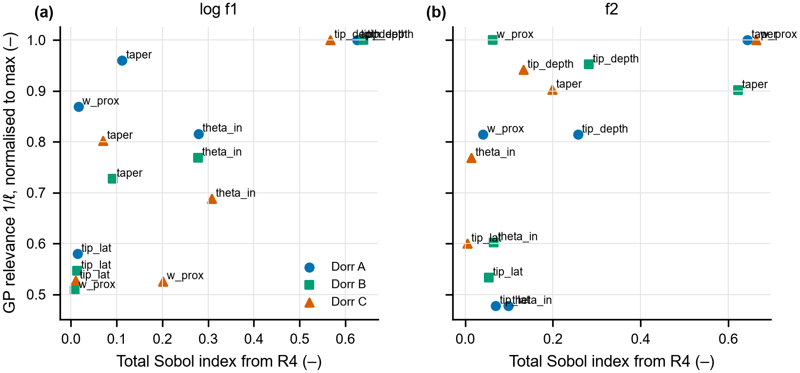

**图 12（R5-F12）GP relevance and R4 total Sobol indices agree with Spearman ρ = 0.64**　种子 0 最终 GP 的 ARD 长度尺度倒数（归一化到最大值）对 R4 的总效应 Sobol 指数。

数据 reports/R5_bo_results/figures/R5-F12.csv（sha e7f04a8e）· 作图 stage_s5.py:plot_r5_f12 · 生成脚本 stage_s5.py（sha 3358aa7d）

### 4.2 表

**表 1（R5-T01）代理指标（每型、每种子、每个输出）与泄漏检查**

| dorr | seed | output | n_train | n_test | R2 | spearman | coverage90 | sharpness | leakage_overlap |
|---|---|---|---|---|---|---|---|---|---|
| A | 0.0 | log10 f1 | 59 | 510 | 0.629 | 0.869 | 0.963 | 2.55 | 0.0 |
| A | 0.0 | f2 (%) | 59 | 510 | 0.917 | 0.956 | 0.953 | 1.06 | 0.0 |
| A | 0.0 | vm P99 (MPa) | 59 | 510 | 0.708 | 0.886 | 0.947 | 2.17 | 0.0 |
| A | 1 | log10 f1 | 60 | 510 | 0.755 | 0.882 | 0.994 | 3.11 | 0.0 |
| A | 1 | f2 (%) | 60 | 510 | 0.943 | 0.975 | 0.939 | 0.819 | 0.0 |
| A | 1 | vm P99 (MPa) | 60 | 510 | 0.652 | 0.873 | 0.892 | 1.81 | 0.0 |
| A | 2 | log10 f1 | 60 | 510 | 0.785 | 0.914 | 0.982 | 2.75 | 0.0 |
| A | 2 | f2 (%) | 60 | 510 | 0.909 | 0.957 | 0.89 | 0.854 | 0.0 |
| A | 2 | vm P99 (MPa) | 60 | 510 | 0.751 | 0.896 | 0.894 | 1.72 | 0.0 |
| B | 0.0 | log10 f1 | 58 | 507 | 0.813 | 0.92 | 0.953 | 1.81 | 0.0 |
| B | 0.0 | f2 (%) | 58 | 507 | 0.905 | 0.96 | 0.959 | 1.17 | 0.0 |
| B | 0.0 | vm P99 (MPa) | 58 | 507 | 0.646 | 0.849 | 0.927 | 2.02 | 0.0 |
| B | 1 | log10 f1 | 60 | 507 | 0.734 | 0.883 | 0.955 | 2.16 | 0.0 |
| B | 1 | f2 (%) | 60 | 507 | 0.924 | 0.963 | 0.976 | 1.11 | 0.0 |
| B | 1 | vm P99 (MPa) | 60 | 507 | 0.628 | 0.822 | 0.884 | 1.88 | 0.0 |
| B | 2 | log10 f1 | 60 | 507 | 0.812 | 0.909 | 0.955 | 1.84 | 0.0 |
| B | 2 | f2 (%) | 60 | 507 | 0.946 | 0.977 | 0.937 | 0.878 | 0.0 |
| B | 2 | vm P99 (MPa) | 60 | 507 | 0.689 | 0.835 | 0.913 | 1.77 | 0.0 |
| C | 0.0 | log10 f1 | 60 | 505 | 0.611 | 0.778 | 0.851 | 1.73 | 0.0 |
| C | 0.0 | f2 (%) | 60 | 505 | 0.931 | 0.969 | 0.931 | 0.962 | 0.0 |
| C | 0.0 | vm P99 (MPa) | 60 | 505 | 0.448 | 0.733 | 0.899 | 2.45 | 0.0 |
| C | 1 | log10 f1 | 60 | 505 | 0.668 | 0.84 | 0.962 | 2.43 | 0.0 |
| C | 1 | f2 (%) | 60 | 505 | 0.881 | 0.957 | 0.921 | 1.13 | 0.0 |
| C | 1 | vm P99 (MPa) | 60 | 505 | 0.387 | 0.607 | 0.879 | 2.44 | 0.0 |
| C | 2 | log10 f1 | 60 | 505 | 0.628 | 0.773 | 0.861 | 1.83 | 0.0 |
| C | 2 | f2 (%) | 60 | 505 | 0.943 | 0.973 | 0.99 | 1.05 | 0.0 |
| C | 2 | vm P99 (MPa) | 60 | 505 | 0.472 | 0.689 | 0.905 | 2.41 | 0.0 |

训练集 = 该种子 BO 的 60 个设计；测试集 = R4 参考扫描的 FE 成功设计。锐度 = 平均 90 % 区间宽度 / 测试集标准差。  数据 `reports/R5_bo_results/tables/R5-T01.csv`（sha 4630ff6e），生成脚本 `stage_s5.py`。

**表 2（R5-T02）成本账本**

| dorr | method | fe_designs_3_seeds | fe_machine_h | acquisition_h | reference_sweep_machine_h | fe_saving_vs_sweep_pct |
|---|---|---|---|---|---|---|
| A | qnehvi | 180 | 1.45 | 0.135 | 4.01 | 88 |
| A | sobol | 180 | 1.32 | 0.0 | 4.01 | 89 |
| B | qnehvi | 180 | 1.38 | 0.0999 | 3.87 | 88.1 |
| B | sobol | 180 | 1.27 | 0.0 | 3.87 | 89.1 |
| C | qnehvi | 180 | 1.4 | 0.095 | 4.29 | 89.1 |
| C | sobol | 180 | 1.24 | 0.0 | 4.29 | 90.3 |

机时为单设计墙钟之和（4 个设计并行）；节省比按单个种子（60 次）对参考扫描计算。  数据 `reports/R5_bo_results/tables/R5-T02.csv`（sha 8b6c0d8d），生成脚本 `stage_s5.py`。

**表 3（R5-T03）可复现包清单**

| item | value |
|---|---|
| config.yaml sha256 | 5bee68dc0f18c709998b102a269d181c2127e256912f3de46cfa64e206ad17a4 |
| seeds | [0, 1, 2] |
| candidate pools | results/pools/*.npy |
| BO records | results/S5_runs.json |
| runs.csv campaigns | S5_init, S5_qnehvi, S5_sobol, S4_ref, S4_control |
| noise floor | results/noise_floor.json |
| scripts | mobo.py: ad13a7dc; mobo_fe.py: 62c284e5; evaluate.py: c8795675; fe_model.py: f9ce9fd5; qoi.py: 105a72dc; stage_s5.py: 3358aa7d |

  数据 `reports/R5_bo_results/tables/R5-T03.csv`（sha 90f2edbe），生成脚本 `stage_s5.py`。

## 5 验收

| ID | 判据 | 门槛 | 实测 | 状态 | 原因与处置 |
|---|---|---|---|---|---|
| R5-A1 | 每型 ≤ 60 次 FE 时 BO 中位 HV 比（参考前沿 = 该型全部 FE 评估的非支配集） | ≥ 0.90 | A 0.886；B 0.957；C 0.899 | FAIL | 未达 0.90 的型别见 R5-F01 |
| R5-A2 | 60 次 FE 时三个种子的 HV 比都高于同预算 Sobol 中位 | 3/3（每型） | A 3/3；B 3/3；C 3/3 | PASS |  |
| R5-A3 | 最终 GP 在参考 256 点上 90% 区间的实际覆盖率 | 0.80–0.97 | A 0.89–0.99；B 0.94–0.98；C 0.85–0.99 | FAIL | 区间偏窄或偏宽，见 R5-F07 |
| R5-A4 | 代理测试集与训练集按 design_id 无重叠（泄漏检查） | 重叠 0 | 重叠 0 | PASS |  |

总判定：FAIL（全部 PASS 或写明理由的 NA 才算通过；不通过项的处置全部获用户同意时为 FAIL-APPROVED，可进入下一阶段；有 PENDING 或缺项为 INCOMPLETE）。

## 6 局限与下一阶段输入

**通用局限**

- 2D 冠状面平面应力，无侧板，前后皮质的连接被忽略；力学量只用于定性比较与排序，不下绝对值结论。

- 无外展肌力，单一上楼工况（3D 模型峰值载荷投影到冠状面）。

- 松质骨模量随 Dorr 分型取 400/300/150 MPa 是假设（源 3D 模型为 155 MPa）；另设三型同为 300 MPa 的对照组。

- 压配量 δ = 0.10 mm 与摩擦系数 μ = 0.3 固定，只在 R2 符号检查中改变。

- 无实验数据，本测试不做 ASME V&V 40 意义上的确认（validation），2D–3D 比较只算模型形式比较。

- 本测试检验代理 + 多目标 BO 能否在少量 FE 内找到正确前沿，不对柄设计下临床结论。

**本阶段局限**

- 所有结论只对本 2D 模型（含侧板假设与生产网格）成立；f1 绝对值因网格未收敛而偏低（R2），排序一致。
- 参考前沿由有限样本得到，不是真前沿；HV 比可能略高估。
- 每型只 3 个种子，中位与"全部胜过"判定的统计力有限。
- 未做跨分型稳健优化（按用户选择）。

**下一阶段输入**

- 每型 3–5 个前沿设计（含膝点）送 3D 抽检

## 附录 A 溯源

| 图/表 | 数据 sha | 作图函数 | 生成脚本 sha | 合成 | 来源 |
|---|---|---|---|---|---|
| R5-F01 | 744e8b2c | `stage_s5.py:plot_r5_f01` | 3358aa7d | 否 | results=results/S5_runs.json；runs_csv=campaign S5_* and S4_* |
| R5-F02 | ad7ef082 | `stage_s5.py:plot_r5_f02` | 3358aa7d | 否 | results=results/S5_runs.json；runs_csv=campaign S5_* and S4_* |
| R5-F03 | f7c0c9a6 | `stage_s5.py:plot_r5_f03` | 3358aa7d | 否 | results=results/S5_runs.json；runs_csv=campaign S5_* and S4_* |
| R5-F04 | d71cabb6 | `stage_s5.py:plot_r5_f04` | 3358aa7d | 否 | results=results/S5_runs.json；runs_csv=campaign S5_* and S4_* |
| R5-F05 | bd6ff762 | `stage_s5.py:plot_r5_f05` | 3358aa7d | 否 | results=results/S5_runs.json；runs_csv=campaign S5_* and S4_* |
| R5-F06 | 29ab038a | `stage_s5.py:plot_r5_f06` | 3358aa7d | 否 | results=results/S5_runs.json；runs_csv=campaign S5_* and S4_* |
| R5-F07 | d42ed6ba | `stage_s5.py:plot_r5_f07` | 3358aa7d | 否 | results=results/S5_runs.json；runs_csv=campaign S5_* and S4_* |
| R5-F08 | 8739ea31 | `stage_s5.py:plot_r5_f08` | 3358aa7d | 否 | results=results/S5_runs.json；runs_csv=campaign S5_* and S4_* |
| R5-F09 | a626a7a6 | `stage_s5.py:plot_r5_f09` | 3358aa7d | 否 | results=results/S5_runs.json；runs_csv=campaign S5_* and S4_* |
| R5-F10 | 26090476 | `stage_s5.py:plot_r5_f10` | 3358aa7d | 否 | results=results/S5_runs.json；runs_csv=campaign S5_* and S4_* |
| R5-F11 | 4c8c8688 | `stage_s5.py:plot_r5_f11` | 3358aa7d | 否 | results=results/S5_runs.json；runs_csv=campaign S5_* and S4_* |
| R5-F12 | e7f04a8e | `stage_s5.py:plot_r5_f12` | 3358aa7d | 否 | results=results/S5_runs.json；runs_csv=campaign S5_* and S4_* |
| R5-T01 | 4630ff6e | `—` | 3358aa7d | 否 |  |
| R5-T02 | 8b6c0d8d | `—` | 3358aa7d | 否 |  |
| R5-T03 | 90f2edbe | `—` | 3358aa7d | 否 |  |
