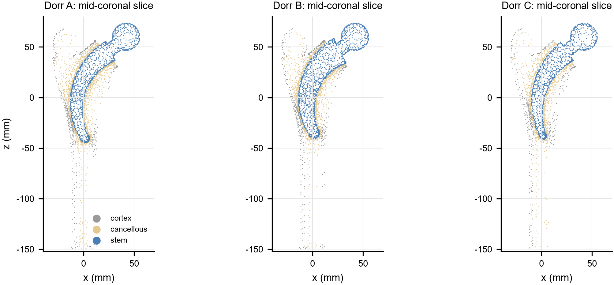
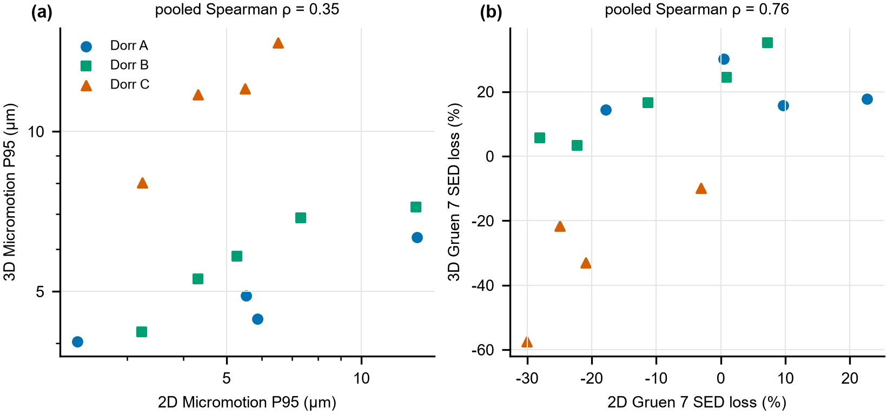
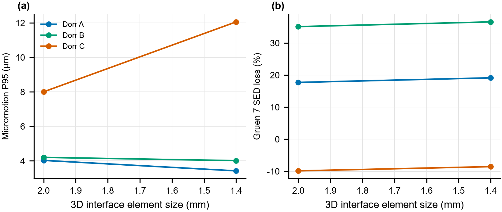

# R6 3D 抽检

阶段 S7 · 生成 2026-09-27 20:11 · 规范 reports/spec.yaml (sha 724e892d) · 总判定 FAIL

## 0 结论摘要

理想化 3D 模型（无侧板、自带环向刚度）对前沿抽检设计的排序与 2D 的 Spearman 秩相关（三型合并）：f1 ρ = 0.35，f2 ρ = 0.76；各型内：A f1 0.80、f2 0.40；B f1 1.00、f2 0.90；C f1 1.00、f2 0.80。未都达到 0.7，2D 的排序在 3D 中不完全保持，2D 结论只限 2D 模型。3D 网格加密（2.0 → 1.4 mm）的最大相对变化 34 %。

## 1 使用情境与问题

| 项 | 内容 |
|---|---|
| 使用情境（COU） | 检查 2D 模型给出的设计排序在理想化 3D 模型中是否保持，界定 2D 结论的适用范围。 |
| 本阶段要回答 | 前沿设计在 3D 中的 f1、f2 排序与 2D 一致吗？ |
| 本阶段不回答 | 不比较绝对值；不属于实验确认。 |
| 依据规范 | Erdemir 2012；V&V 40 模型形式比较 |

## 2 输入与版本

| 项 | 值 |
|---|---|
| config.yaml | sha 5bee68dc |
| spec.yaml | sha 724e892d |
| source | front |
| n_per_type | 5 |
| h_int | [2.0, 1.4] |
| side_plate_2d_mm | 2.0 |
| updated | 2026-09-27T20:11:03 |
| 脚本 `stage_s7.py` | sha 738aaa49 |
| 软件包 | Python 3.12.10；numpy 2.5.3；scipy 1.18.1；matplotlib 3.11.2；shapely 2.1.2；PyYAML 6.0.3；markdown 3.11；torch 2.14.0+cpu；botorch 0.18.1；gpytorch 1.15.2；gmsh 4.15.2；meshio 5.3.5；scikit-learn 1.9.1；pymoo 0.6.2 |

## 3 方法

**3D 模型（`spot3d/model3d.py`）**：股骨外形由 2D 外轮廓在 z = −150…+40 mm 每 5 mm 的椭圆截面放样（冠状半轴 = 2D 半弦长，矢状半轴 = 深度比 × 冠状半轴，干部 1.0、近端 0.72），并上颈部椭圆柱、头部球与大转子椭球；髓腔同法由 2D 内轮廓放样，矢状壁厚取冠状面平均壁厚。柄体沿与 2D 相同的圆弧放样 4 次超椭圆截面（冠状半宽 w(s)，矢状半厚 6 mm × w(s)/w_p），尖端椭球帽；锉刀腔为截面内缩 δ。直边二阶四面体 C3D10（gmsh Delaunay + Netgen 优化），界面 2 mm、远场 6 mm；每型第一个设计另用 1.4 mm。材料、载荷（Fx = −668 N、Fz = −2,296 N，Fy = 0）、三步压配、TIE 与 QoI 定义与 2D 相同；f1 用两个切向滑移分量的合成，Gruen ROI 取全部深度，SED 参照为同法建的完整 3D 股骨。抽检设计：各型参考前沿（R4 扫描 + R5 BO 的可行非支配集）按 f1 等距取 5 个；它们与侧板校准用的 36 个设计不重叠。

## 4 结果

### 4.1 图

**图 1（R6-F01）The idealised 3D femora share the outer contour and Dorr canal of the 2D models**　3D 模型中冠面（|y| < 1 mm）的单元形心：灰为皮质、黄为松质、蓝为柄。股骨由 2D 轮廓的椭圆截面放样，柄沿与 2D 相同的圆弧放样超椭圆截面。C3D10，界面 2 mm、远场 6 mm。

数据 reports/R6_spot3d/figures/R6-F01.csv（sha 2fad8c02）· 作图 stage_s7.py:plot_r6_f01 · 生成脚本 stage_s7.py（sha 738aaa49）

**图 2（R6-F02）2D vs 3D ranking of front designs: ρ = 0.35 for f1 and 0.76 for f2**　抽检设计（来源：各型参考前沿按 f1 等距）的 2D 与 3D 目标值；ρ 为三型合并的 Spearman 秩相关；各型内的 ρ 见 R6-T01 与摘要。

数据 reports/R6_spot3d/figures/R6-F02.csv（sha 48b97a03）· 作图 stage_s7.py:plot_r6_f02 · 生成脚本 stage_s7.py（sha 738aaa49）

**图 3（R6-F03）Refining the 3D interface mesh from 2.0 to 1.4 mm changes f1 or f2 by up to 34 %**　每型第一个抽检设计用两档 3D 网格计算；相对变化以细网格值为分母。

数据 reports/R6_spot3d/figures/R6-F03.csv（sha b90bcdb6）· 作图 stage_s7.py:plot_r6_f03 · 生成脚本 stage_s7.py（sha 738aaa49）

### 4.2 表

**表 1（R6-T01）抽检设计清单与 2D、3D 两套目标值**

| dorr | design_id_2d | f1_2d | f1_3d | f2_2d | f2_3d | rho_f1 | rho_f2 | rho_type_f1 | rho_type_f2 |
|---|---|---|---|---|---|---|---|---|---|
| A | d011218_7279 | 2.32 | 4.03 | 22.7 | 17.7 | 0.346 | 0.764 | 0.8 | 0.4 |
| A | d011184_28bb | 5.52 | 4.91 | 9.69 | 15.8 | 0.346 | 0.764 | 0.8 | 0.4 |
| A | d011088_5fa5 | 5.86 | 4.44 | 0.406 | 30.2 | 0.346 | 0.764 | 0.8 | 0.4 |
| A | d011187_346a | 13.3 | 6.33 | -17.8 | 14.3 | 0.346 | 0.764 | 0.8 | 0.4 |
| B | d011448_705c | 3.23 | 4.2 | 7.2 | 35.1 | 0.346 | 0.764 | 1 | 0.9 |
| B | d011518_b94d | 4.32 | 5.28 | 0.897 | 24.5 | 0.346 | 0.764 | 1 | 0.9 |
| B | d011509_077b | 5.27 | 5.82 | -11.3 | 16.5 | 0.346 | 0.764 | 1 | 0.9 |
| B | d011618_1e53 | 7.31 | 6.89 | -22.3 | 3.27 | 0.346 | 0.764 | 1 | 0.9 |
| B | d011629_d73d | 13.2 | 7.22 | -28.1 | 5.65 | 0.346 | 0.764 | 1 | 0.9 |
| C | d004807_809c | 3.24 | 8.01 | -3.08 | -9.86 | 0.346 | 0.764 | 1 | 0.8 |
| C | d011737_ccea | 4.32 | 11.7 | -20.9 | -33 | 0.346 | 0.764 | 1 | 0.8 |
| C | d011963_5be3 | 5.5 | 12 | -25 | -21.7 | 0.346 | 0.764 | 1 | 0.8 |
| C | d011934_3669 | 6.52 | 14.7 | -30 | -57.4 | 0.346 | 0.764 | 1 | 0.8 |

rho_type 为该型 5 个设计内的 Spearman ρ（样本小，仅供参考）。  数据 `reports/R6_spot3d/tables/R6-T01.csv`（sha 68f019e6），生成脚本 `stage_s7.py`。

## 5 验收

| ID | 判据 | 门槛 | 实测 | 状态 | 原因与处置 |
|---|---|---|---|---|---|
| R6-A1 | 抽检设计 2D 与 3D 的 f1、f2 Spearman 秩相关 | ≥ 0.7 | f1 ρ = 0.35，f2 ρ = 0.76（n = 13，三型合并） | FAIL | 2D 排序在 3D 中不完全保持：2D 的前沿与分型结论只限 2D 模型，迁移到真实股骨前需用 3D 或真实模型复核 |
| R6-A2 | 3D 两档网格 f1、f2 相对变化 | < 10% | A 17.7 %；B 4.7 %；C 33.6 % | FAIL | 3D 网格在 2 mm 时未收敛，3D 绝对值不作结论；排序比较仍可参考 |

总判定：FAIL（全部 PASS 或写明理由的 NA 才算通过；不通过项的处置全部获用户同意时为 FAIL-APPROVED，可进入下一阶段；有 PENDING 或缺项为 INCOMPLETE）。

## 6 局限与下一阶段输入

**通用局限**

- 2D 冠状面平面应力，无侧板，前后皮质的连接被忽略；力学量只用于定性比较与排序，不下绝对值结论。

- 无外展肌力，单一上楼工况（3D 模型峰值载荷投影到冠状面）。

- 松质骨模量随 Dorr 分型取 400/300/150 MPa 是假设（源 3D 模型为 155 MPa）；另设三型同为 300 MPa 的对照组。

- 压配量 δ = 0.10 mm 与摩擦系数 μ = 0.3 固定，只在 R2 符号检查中改变。

- 无实验数据，本测试不做 ASME V&V 40 意义上的确认（validation），2D–3D 比较只算模型形式比较。

- 本测试检验代理 + 多目标 BO 能否在少量 FE 内找到正确前沿，不对柄设计下临床结论。

**本阶段局限**

- 3D 股骨为解析放样的理想化形状，不是真实解剖；与 2D 的比较只检验排序，不是确认。
- 3D 网格较粗（受求解时间限制），绝对值不作结论。
- 每型只 5 个设计，型内秩相关的统计力很弱，验收用三型合并值。

**下一阶段输入**

- 2D 结论的适用范围说明

## 附录 A 溯源

| 图/表 | 数据 sha | 作图函数 | 生成脚本 sha | 合成 | 来源 |
|---|---|---|---|---|---|
| R6-F01 | 2fad8c02 | `stage_s7.py:plot_r6_f01` | 738aaa49 | 否 | runs3d=results/runs3d.jsonl (tag S7) |
| R6-F02 | 48b97a03 | `stage_s7.py:plot_r6_f02` | 738aaa49 | 否 | runs3d=results/runs3d.jsonl (tag S7) |
| R6-F03 | b90bcdb6 | `stage_s7.py:plot_r6_f03` | 738aaa49 | 否 |  |
| R6-T01 | 68f019e6 | `—` | 738aaa49 | 否 |  |
