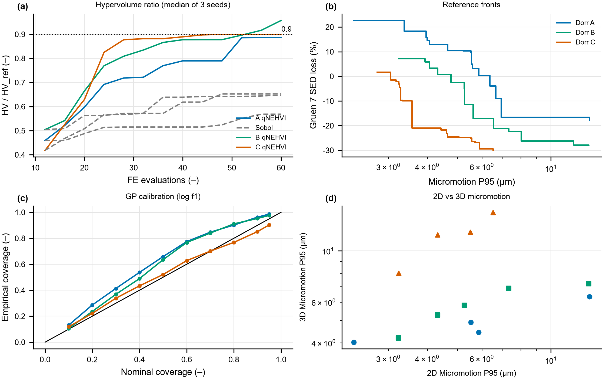

# R7 总结与可信度

阶段 close · 生成 2026-09-27 20:11 · 规范 reports/spec.yaml (sha 724e892d) · 总判定 FAIL

## 0 结论摘要

**方法层面的结论**：在同一 2D 模型上，GP 代理 + qLogNEHVI 在每型 60 次 FE 内找到的前沿明显优于同预算 Sobol：中位 HV 比 0.89 / 0.96 / 0.90（Sobol 0.57 / 0.65 / 0.65，A / B / C），三型 × 三种子全部胜过 Sobol；A、C 两型略低于 0.90 的预设线。解析基准上（R3）同一代码达到 0.96–0.97。

**代理**：f2（Gruen 7 SED 下降率）预测好（留出集 R² 约 0.9），log f1（P95 微动）一般（约 0.6–0.8）；90 % 区间实际覆盖 0.85–0.99，偏保守（R5-A3 上限 0.97 未满足）。

**模型可信度**：2D 模型需要前后皮质侧板才能保持压配；侧板厚度按 36 个设计上的 2D–3D 秩相关校准为 2 mm。f1 未网格收敛但排序对网格不敏感（R2）。

独立的 3D 抽检（前沿设计，与校准设计不重叠）显示 2D 的型内排序大体保持，但跨分型比较不成立：f1 ρ = 0.35，f2 ρ = 0.76（n = 13，三型合并）。因此本测试不支持用 2D 模型比较 Dorr 分型之间的柄设计。

**结论**：流程（FE 数据工厂 → 代理 → 多目标 BO → 复验）可以迁移到真实股骨（Gate 1），只需替换几何与网格层；迁移前要解决的是 3D 模型的网格收敛与分型间可比性，而不是优化器本身。仍待用户决定的不通过项：R4-A1, R5-A1, R5-A3, R6-A1, R6-A2。

## 1 使用情境与问题

| 项 | 内容 |
|---|---|
| 使用情境（COU） | 汇总本测试的结论与可信度，决定这套流程能否迁移到真实股骨（Gate 1）。 |
| 本阶段要回答 | 流程是否整体通过？可信度各因子达到什么水平？哪些局限必须在真实模型中解决？ |
| 本阶段不回答 | 不对柄设计下临床结论。 |
| 依据规范 | ASME V&V 40-2018；FDA 2023 CM&S 可信度指南；Erdemir 2020 十条规则 |

## 2 输入与版本

| 项 | 值 |
|---|---|
| config.yaml | sha 5bee68dc |
| spec.yaml | sha 724e892d |
| 脚本 `stage_r7.py` | sha de2cf626 |
| 软件包 | Python 3.12.10；numpy 2.5.3；scipy 1.18.1；matplotlib 3.11.2；shapely 2.1.2；PyYAML 6.0.3；markdown 3.11；torch 2.14.0+cpu；botorch 0.18.1；gpytorch 1.15.2；gmsh 4.15.2；meshio 5.3.5；scikit-learn 1.9.1；pymoo 0.6.2 |

## 3 方法

本报告不做新的计算，汇总 R0–R6：R7-T04 列出全部验收项及其状态（FAIL 项注明处置是否已获用户同意）；R7-T01 按 ASME V&V 40 的 13 个可信度因子列出本测试的活动、目标等级与达到等级（达到等级由相关验收项自动判定）；R7-T02 按 Erdemir 2020 十条规则逐条列出落实情况；R7-T03 列出局限及其在真实模型中的处置；R7-F01 一页仪表板取自 R5-F01、R5-F07、R5-F08 与 R6-F02 的数据。

## 4 结果

### 4.1 图

**图 1（R7-F01）One-page summary of the FE → GP → multi-objective BO test**　(a) 各型 BO 与 Sobol 的 HV 比中位曲线；(b) 三型参考前沿；(c) GP 校准（log f1）；(d) 2D 对 3D 微动。数据取自 R5、R6。

数据 reports/R7_summary/figures/R7-F01.csv（sha def9445e）· 作图 stage_r7.py:plot_r7_f01 · 生成脚本 stage_r7.py（sha de2cf626）

### 4.2 表

**表 1（R7-T01）ASME V&V 40 可信度因子：目标与达到等级**

| category | factor | activity | target | achieved |
|---|---|---|---|---|
| 代码验证 | 软件质量保证 | 商业软件 Abaqus 2025；自写脚本单元测试（tests/） | 低 | 低 |
| 代码验证 | 数值代码验证 | R0 悬臂梁、R2 Lamé 压配对解析解 | 中 | 中 |
| 计算验证 | 离散误差 | R2 GCI（2D）、R6 两档网格（3D） | 中 | 低（f1 未网格收敛，排序一致） |
| 计算验证 | 数值求解误差 | R2 噪声底、增量设置敏感性、摩擦列式对比 | 中 | 中 |
| 计算验证 | 使用错误 | 重跑逐位相同；.inp 由模板生成 | 中 | 中 |
| 确认 | 模型形式 | 2D 平面应力 + 侧板；R6 与 3D 比较排序 | 低 | 低 |
| 确认 | 模型输入 | 材料取自源 3D 模型；松质骨分型取值为假设 + 对照组 | 低 | 低 |
| 确认 | 比较对象：试样 | 无实验 | 不适用 | 不适用 |
| 确认 | 比较对象：试验条件 | 无实验 | 不适用 | 不适用 |
| 确认 | 评估：输入参数等效性 | 无实验 | 不适用 | 不适用 |
| 确认 | 评估：输出比较 | 无实验；只做 2D–3D 秩相关 | 不适用 | 不适用 |
| 适用性 | 关注量的相关性 | f1、f2 对应初始稳定与近端遮挡 | 中 | 中 |
| 适用性 | 确认活动与使用情境的相关性 | 无确认活动 | 低 | 低 |

模型风险：模型影响高、决策后果低（方法测试），目标为低到中等可信度。达到等级由 R0–R6 验收结果自动判定。  数据 `reports/R7_summary/tables/R7-T01.csv`（sha ec43bb0e），生成脚本 `stage_r7.py`。

**表 2（R7-T02）Erdemir 2020 十条规则合规表**

| rule | status | evidence |
|---|---|---|
| 1 明确定义使用情境 | 已落实 | 每份报告第 1 节 |
| 2 使用与情境相符的数据 | 部分 | 材料/载荷有来源；松质骨分型取值与载荷方向为假设（R2 局限） |
| 3 在情境内评估 | 已落实 | 验收门槛按测试问题设定（HV 比、覆盖率、秩相关） |
| 4 明列局限 | 已落实 | 每份报告第 6 节 |
| 5 使用版本控制 | 已落实 | 本地 git + 文件哈希 + history 副本 |
| 6 恰当记录 | 已落实 | REPORTING_SPEC、Erdemir 2012 80 项清单、各报告方法节 |
| 7 广泛传播 | 未落实 | 本地项目，未公开 |
| 8 获得独立评审 | 待定 | 交导师审阅 |
| 9 测试竞争实现 | 已落实 | BO 对 Sobol；2D 对 3D；两个解析基准；两种摩擦列式 |
| 10 遵从标准 | 部分 | Erdemir 2012、Celik 2008、Zitzler 2003；Oefner 2021 未取得 |

  数据 `reports/R7_summary/tables/R7-T02.csv`（sha 7739222e），生成脚本 `stage_r7.py`。

**表 3（R7-T03）局限清单与在真实模型中的处置**

| limitation | effect | in_real_model |
|---|---|---|
| 2D 平面应力 + 侧板厚度假设 | f1 对侧板厚度敏感（R2-F04） | 3D 真实股骨，无需侧板 |
| f1 未网格收敛 | f1 绝对值偏低，排序一致（R2-F10） | 3D 网格收敛研究，或改用对网格不敏感的微动指标 |
| 单一上楼工况、无肌力；方向由源模型的内下方改为生理外下方 | 载荷方向对 f2 符号影响很大（R2-F04） | 按 Bergmann 标准工况 + 肌力 |
| 2D 与 3D 跨分型比较不一致 | 型内排序大体保持，三型合并的 f1 秩相关只有约 0.35（R6） | 分型比较只在 3D 或真实股骨上做 |
| 松质骨分型模量为假设 | 对照组分离（R5-F09） | CT 灰度映射 |
| 外轮廓三型相同导致 C 型近端皮质偏厚 | 三型差异含人为成分（R1 局限） | 真实分型股骨 |
| 无实验确认 | 只做方法层面的结论 | DIC/应变片台架（课题计划） |

  数据 `reports/R7_summary/tables/R7-T03.csv`（sha 9ca26817），生成脚本 `stage_r7.py`。

**表 4（R7-T04）R0–R6 验收汇总**

| report | id | status | measured | note |
|---|---|---|---|---|
| R0 | R0-A1 | PASS | 0.054 % |  |
| R0 | R0-A2 | PASS | 2.9106698036193848 vs 2.9106698036193848 mm（并发组 2.9106698036193848） |  |
| R0 | R0-A3 | PASS | 4/4 导出成功 |  |
| R1 | R1-A1 | PASS | 最大偏差 0.002；三型实测均落在对应 Dorr 区间 |  |
| R1 | R1-A2 | PASS | 最大 0.0000 %（30 个设计） |  |
| R1 | R1-A3 | PASS | 14 passed in 7.48s |  |
| R1 | R1-A4 | FAIL | A 42.0%；B 37.2%；C 16.4% | Dorr C 通过率低于 20 %。失败主要是柄体切入股骨距皮质（C 型近端皮质厚）与尖端比髓腔宽。处置建议：不改设计空间；把 C 型 BO 候选池从 20,000 加到 40,000，使可行候选约 6,562 个，与 A、B 型同量级。用户 2026-09-27 同意此处置（config.yaml bo.n_candidates）。 |
| R2 | R2-A1 | PASS | cortical ring 3.19 %；cancellous ring 3.56 % |  |
| R2 | R2-A2 | FAIL | 最细两套网格最大相对变化 47.31 %；GCI 见 R2-T02 | f1（P95 微动）未收敛：细网格解出更大的滑移区，生产网格系统性低估 f1；换摩擦列式（Lagrange、滑移容差 0.0005）不改变结论。f2 变化 47.3 %。但生产网格与细网格对设计的排序一致（R2-F10：每型 12 个设计，f1 的 Spearman ρ = A 0.94、B 0.95、C 0.90）。处置建议：BO 与参考扫描用同一生产网格，本测试检验的是"在同一模型上 BO 能否找到前沿"，系统偏差不影响这一结论；f1 绝对值不作解释，R7 把离散误差列为可信度缺口。用户 2026-09-27 同意此处置（保留 0.75 mm 生产网格）。 |
| R2 | R2-A3 | FAIL | 5/7 方向正确 | 不符合的两项都是"柄更宽"（w_prox 0.80 → 0.95）：f1 6.0 → 6.6 µm（预期下降），f2 21.3 → 14.1 %（预期升高）。早先（源模型的内侧载荷、3 mm 侧板）的 3D 探针显示加宽柄在 3D 中微动降、遮挡升，与 2D 相反（results/S2_3d_probe.json）。用户 2026-09-27 同意改用生理载荷方向并按 2D–3D 秩相关校准侧板：选定 2 mm，36 个校准设计上 2D 与 3D 的平均 Spearman ρ = 0.78（最差 0.60，R2-F11）。本项若仍不通过，说明单因素方向检查与多设计排序一致性不完全等价；排序一致性由 R6 在前沿设计上再独立检验。 |
| R2 | R2-A4 | PASS | 三型 4 个 QoI 全部逐位相同 |  |
| R2 | R2-A5 | PASS | f1 相对 3.255 %；f2 0.0332 百分点 |  |
| R2 | R2-A6 | PASS | 80/80 |  |
| R3 | R3-A1 | PASS | BraninCurrin (d = 2): 0.9687；ZDT1 (d = 5): 0.9644 |  |
| R3 | R3-A2 | PASS | BraninCurrin (d = 2): 全部高于 Sobol 中位；ZDT1 (d = 5): 全部高于 Sobol 中位 |  |
| R4 | R4-A1 | FAIL | A_E400 9；B_E300 16；C_E150 12 | 按计划把不足 15 点的组扩到 512 个设计后仍不足：数百个可行设计里只有个位数非支配点，说明两个目标在本设计空间里强相关、权衡面短，而不是采样不足。影响：R5 的 HV 比与 IGD 以 R4 + R5 全部可行评估的非支配集为参考，点数会多于此处；处置建议：接受稀疏前沿，不再加样；该处置尚待用户同意（S5 已按此假设运行）。 |
| R4 | R4-A2 | PASS | 每组 runs.csv 行数 = 尝试数（含几何门失败行） |  |
| R4 | R4-A3 | PASS | 最大 2.0 % |  |
| R5 | R5-A1 | FAIL | A 0.886；B 0.957；C 0.899 | 未达 0.90 的型别见 R5-F01 |
| R5 | R5-A2 | PASS | A 3/3；B 3/3；C 3/3 |  |
| R5 | R5-A3 | FAIL | A 0.89–0.99；B 0.94–0.98；C 0.85–0.99 | 区间偏窄或偏宽，见 R5-F07 |
| R5 | R5-A4 | PASS | 重叠 0 |  |
| R6 | R6-A1 | FAIL | f1 ρ = 0.35，f2 ρ = 0.76（n = 13，三型合并） | 2D 排序在 3D 中不完全保持：2D 的前沿与分型结论只限 2D 模型，迁移到真实股骨前需用 3D 或真实模型复核 |
| R6 | R6-A2 | FAIL | A 17.7 %；B 4.7 %；C 33.6 % | 3D 网格在 2 mm 时未收敛，3D 绝对值不作结论；排序比较仍可参考 |

  数据 `reports/R7_summary/tables/R7-T04.csv`（sha 334a963e），生成脚本 `stage_r7.py`。

## 5 验收

| ID | 判据 | 门槛 | 实测 | 状态 | 原因与处置 |
|---|---|---|---|---|---|
| R7-A1 | R0–R6 全部验收项通过，或逐项写明豁免理由 | 全部 | 16/24 PASS；处置已获同意的 FAIL：R1-A4, R2-A2, R2-A3；待用户决定的 FAIL：R4-A1, R5-A1, R5-A3, R6-A1, R6-A2 | FAIL | 待决定的 FAIL 项见各报告验收表的原因与处置建议 |

总判定：FAIL（全部 PASS 或写明理由的 NA 才算通过；不通过项的处置全部获用户同意时为 FAIL-APPROVED，可进入下一阶段；有 PENDING 或缺项为 INCOMPLETE）。

## 6 局限与下一阶段输入

**通用局限**

- 2D 冠状面平面应力，无侧板，前后皮质的连接被忽略；力学量只用于定性比较与排序，不下绝对值结论。

- 无外展肌力，单一上楼工况（3D 模型峰值载荷投影到冠状面）。

- 松质骨模量随 Dorr 分型取 400/300/150 MPa 是假设（源 3D 模型为 155 MPa）；另设三型同为 300 MPa 的对照组。

- 压配量 δ = 0.10 mm 与摩擦系数 μ = 0.3 固定，只在 R2 符号检查中改变。

- 无实验数据，本测试不做 ASME V&V 40 意义上的确认（validation），2D–3D 比较只算模型形式比较。

- 本测试检验代理 + 多目标 BO 能否在少量 FE 内找到正确前沿，不对柄设计下临床结论。

**本阶段局限**

- 所有结论只对本 2D 模型与本设计空间成立；3D 为理想化放样股骨，也未做实验确认。
- 每型只有 3 个 BO 种子与 5 个 3D 抽检设计，统计力有限。

**下一阶段输入**

- Gate 1 迁移清单：只替换几何与网格层

## 附录 A 溯源

| 图/表 | 数据 sha | 作图函数 | 生成脚本 sha | 合成 | 来源 |
|---|---|---|---|---|---|
| R7-F01 | def9445e | `stage_r7.py:plot_r7_f01` | de2cf626 | 否 |  |
| R7-T01 | ec43bb0e | `—` | de2cf626 | 否 |  |
| R7-T02 | 7739222e | `—` | de2cf626 | 否 |  |
| R7-T03 | 9ca26817 | `—` | de2cf626 | 否 |  |
| R7-T04 | 334a963e | `—` | de2cf626 | 否 |  |
