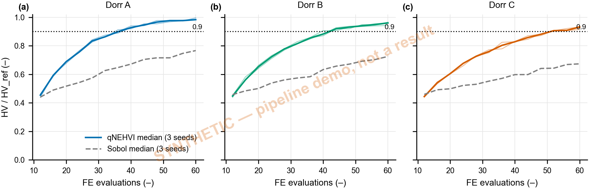
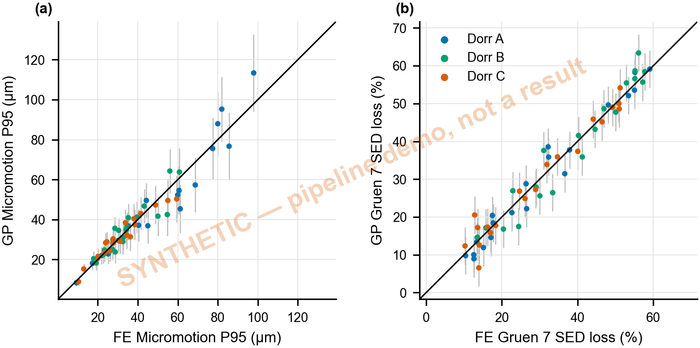
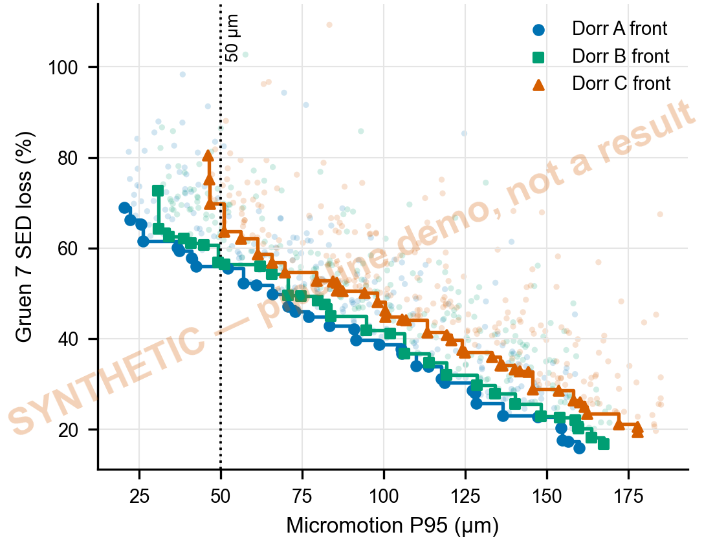

# RD 报告流水线演示（合成数据）

阶段 demo · 生成 2026-09-26 16:36 · 规范 reports/spec.yaml (sha 7e9773c7) · 总判定 INCOMPLETE

本报告含合成数据（synthetic=True），只用于演示流水线，不构成任何结果。

草稿：缺 1 项，见文末"缺项"附录。

## 0 结论摘要

本报告只演示报告流水线。三张图都由各自的 CSV 画出，可用 `python report.py --replot RD-F01` 重画；验收表演示了通过、不通过（必须写原因与处置）和待定三种状态。

## 1 使用情境与问题

| 项 | 内容 |
|---|---|
| 使用情境（COU） | 只演示报告流水线：图由 CSV 重画、溯源哈希、验收表、PDF 生成。图中数据全部为合成数据。 |
| 本阶段要回答 | 报告工具链能否按规范生成一份完整报告？ |
| 本阶段不回答 | 不含任何研究结果。 |
| 依据规范 | 本规范 |

## 2 输入与版本

| 项 | 值 |
|---|---|
| config.yaml | sha — |
| spec.yaml | sha 7e9773c7 |
| 数据来源 | 合成（numpy 种子 20260926） |
| Abaqus | 未使用 |
| runs_csv_rows | 无 |
| updated | 2026-09-26T16:36:27 |
| 脚本 `demo_report.py` | sha f25d6775 |
| 软件包 | Python 3.12.10；numpy 2.4.6；scipy 1.18.0；matplotlib 3.10.9；shapely 2.1.2；PyYAML 6.0.3；markdown 3.10.2；torch 2.12.0；botorch 未安装；gpytorch 未安装；gmsh 未安装；meshio 未安装；scikit-learn 未安装；pymoo 未安装 |

## 3 方法

合成数据由 `demo_report.make()` 用固定随机种子生成。作图遵守 `plotstyle.py`：Dorr A/B/C 固定色，方法用线型区分，门槛用点线，图内英文、正文中文，PNG 300 dpi + SVG。

## 4 结果

### 4.1 图

**图 1（RD-F01）[Synthetic] qNEHVI crosses 0.9 HV ratio before Sobol in every Dorr type**　细线为单个种子，粗线为中位；虚线为同预算 Sobol 中位；点线为 0.9 门槛。数据为合成。

数据 reports/_demo_pipeline/figures/RD-F01.csv（sha 08b5be73）· 作图 demo_report.py:plot_hv_curve · 生成脚本 demo_report.py（sha f25d6775） · 单位 n_fe: count；hv_ratio: – · 合成数据

**图 2（RD-F02）[Synthetic] GP predictions track FE values with 90% intervals**　点为测试设计，灰色竖线为 GP 90% 预测区间，黑线为 y = x。数据为合成。

数据 reports/_demo_pipeline/figures/RD-F02.csv（sha 534aaafc）· 作图 demo_report.py:plot_parity · 生成脚本 demo_report.py（sha f25d6775） · 单位 y_true: µm or %；y_pred: µm or % · 合成数据

**图 3（RD-F03）[Synthetic] Fronts shift towards higher micromotion from Dorr A to C**　浅色点为全部设计，阶梯线与实心标记为非支配前沿；共用坐标。数据为合成。

数据 reports/_demo_pipeline/figures/RD-F03.csv（sha 055cca70）· 作图 demo_report.py:plot_fronts · 生成脚本 demo_report.py（sha f25d6775） · 单位 f1: µm；f2: % · 合成数据

### 4.2 表

**表 1（RD-T01）合成：代理指标**（合成数据）

| objective | R2 | spearman | coverage90 | sharpness |
|---|---|---|---|---|
| f1 | 0.9 | 0.93 | 0.95 | 0.1 |
| f2 | 0.85 | 0.9 | 0.85 | 0.12 |

R² 与 Spearman 在测试集上计算；coverage90 为 90% 区间实际覆盖率；锐度为区间平均半宽（标准化）。 单位 R2: –；coverage90: –。 数据 `reports/_demo_pipeline/tables/RD-T01.csv`（sha 77cb0172），生成脚本 `demo_report.py`。

## 5 验收

| ID | 判据 | 门槛 | 实测 | 状态 | 原因与处置 |
|---|---|---|---|---|---|
| RD-A1 | 演示：通过项 | ≥ 0.90 | 0.96 | PASS |  |
| RD-A2 | 演示：不通过项 | 0.80–0.97 | 0.85 | FAIL | 演示不通过的写法：写明原因（区间过窄）与处置（调高噪声先验后重跑）。 |
| RD-A3 | 演示：未提交结果的项显示为待定 | — |  | PENDING | 尚未提交结果 |

总判定：INCOMPLETE（全部 PASS 或写明理由的 NA 才算通过；有 PENDING 或缺项为 INCOMPLETE）。

## 6 局限与下一阶段输入

**通用局限**

- 2D 冠状面平面应力，无侧板，前后皮质的连接被忽略；力学量只用于定性比较与排序，不下绝对值结论。

- 无外展肌力，单一上楼工况（3D 模型峰值载荷投影到冠状面）。

- 松质骨模量随 Dorr 分型取 400/300/150 MPa 是假设（源 3D 模型为 155 MPa）；另设三型同为 300 MPa 的对照组。

- 压配量 δ = 0.10 mm 与摩擦系数 μ = 0.3 固定，只在 R2 符号检查中改变。

- 无实验数据，本测试不做 ASME V&V 40 意义上的确认（validation），2D–3D 比较只算模型形式比较。

- 本测试检验代理 + 多目标 BO 能否在少量 FE 内找到正确前沿，不对柄设计下临床结论。

**本阶段局限**

- 全部数据为合成，不能引用。

**下一阶段输入**

- 无

## 附录 A 溯源

| 图/表 | 数据 sha | 作图函数 | 生成脚本 sha | 合成 | 来源 |
|---|---|---|---|---|---|
| RD-F01 | 08b5be73 | `demo_report.py:plot_hv_curve` | f25d6775 | 是 | generator=demo_report.make, seed 20260926 |
| RD-F02 | 534aaafc | `demo_report.py:plot_parity` | f25d6775 | 是 | generator=demo_report.make |
| RD-F03 | 055cca70 | `demo_report.py:plot_fronts` | f25d6775 | 是 | generator=demo_report.make |
| RD-T01 | 77cb0172 | `—` | f25d6775 | 是 |  |

## 附录 B 缺项

| 类别 | ID | 规范要求 |
|---|---|---|
| 验收 | RD-A3 | 演示：未提交结果的项显示为待定 |
