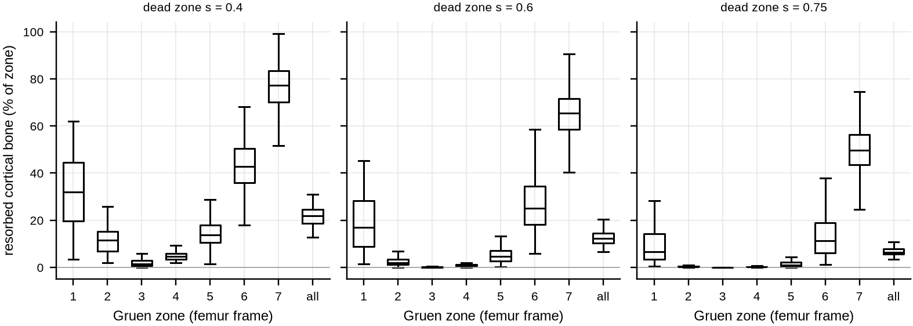
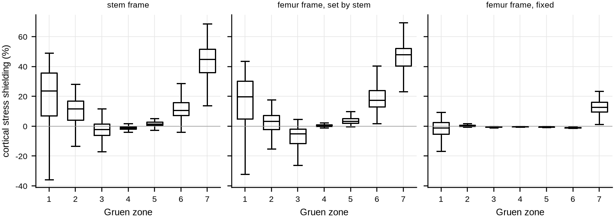

# 对照论文之后的四项改进：结果

生成时间：2026-09-29 15:44。没有新的求解。数据是 210 个现行版本设计的粘接模型结果，加一个完整股骨参照。论文指 Naghavi 2023 博士论文，对照本身见 `v2/ATA_THESIS_COMPARISON_2026-09-29.pdf`。

## 1 结论

1. **骨吸收**已按论文的口径算出。死区取 0.6 时，皮质骨被判为吸收的比例，210 个设计的中位数是：7 区 65%，6 区 25%，1 区 17%，总值 12%。
2. **分区口径**换成股骨坐标系之后，7 区的结果基本不变，2 区和 6 区变化明显。固定分区下只有 7 区有成规模的屏蔽。
3. **柄应力**的最大值都落在截骨面上颈与柄体的交界，那里是模型的尖角，数值不能用。离开交界 3 mm 之外，柄体最大 81–322 MPa，假体颈最大 130–275 MPa。现行约束没有覆盖假体颈。
4. **名称**已在现行文档里统一为“去骨体积”。带日期的旧报告没有改。

## 2 算法与本底

- 在骨内每 1.5 mm 取一个采样点，共 69886 个，按距离场判定皮质或松质。
- 每个点取同一骨质里最近单元的应变能密度和 von Mises 应力。完整股骨和植入股骨用同一组点，两套网格因此可以逐点比较。
- 逐点算应变能密度之比。比值低于 1 − s 判为吸收，高于 1 + s 判为增生，s 是死区。这是论文第 222–223 页的规则。
- 只统计两个模型里都存在的骨：截骨面以下，柄体之外。每个点代表相同体积，皮质骨内密度均匀，体积分数就是质量分数。

**空白对照。** 用完整股骨的 1.4 mm 网格对 2.0 mm 网格。两者是同一个模型，算出的比例就是网格和映射造成的本底。皮质骨，固定分区：

| 分区 | 平均应变能密度之差（%） | 吸收，死区 0.4（%） | 死区 0.6（%） | 死区 0.75（%） | 增生，死区 0.6（%） |
|---|---|---|---|---|---|
| 1 区 | +1.5 | 1.8 | 0.3 | 0.0 | 1.8 |
| 2 区 | +1.4 | 4.1 | 1.0 | 0.4 | 4.3 |
| 3 区 | +1.7 | 1.9 | 0.3 | 0.1 | 1.7 |
| 4 区 | +0.3 | 0.6 | 0.1 | 0.0 | 0.7 |
| 5 区 | +0.9 | 0.5 | 0.0 | 0.0 | 1.1 |
| 6 区 | +1.4 | 0.3 | 0.0 | 0.0 | 0.8 |
| 7 区 | +0.9 | 2.5 | 0.5 | 0.2 | 1.6 |
| 总值 | +0.8 | 1.7 | 0.3 | 0.1 | 1.6 |

死区 0.6 下本底不超过 1.0%，可以忽略。死区 0.4 下个别区达到 4.1%，读数时要留这个余量。

**与原有统计的一致性。** 采样网格算出的分区应力变化，与此前逐单元算的相比，1463 个分区的差的中位数是 -0.5 个百分点，P5 到 P95 是 -2.2 到 +0.9。两种算法一致。

**平滑的影响。** 每个点改取最近 6 个单元的平均，总值的中位变化 -1.8 个百分点，7 区 +0.7 个百分点。下文用不平滑的结果。

## 3 骨吸收质量分数

皮质骨，股骨坐标系分区，数字是被判为吸收的骨占该区的百分比：

| 分区 | 死区 0.4 中位 | 死区 0.6 中位 | 死区 0.6 范围 | 死区 0.75 中位 | 论文实心钛柄，死区 0.6 |
|---|---|---|---|---|---|
| 1 区 | 32 | 17 | 1 到 45 | 7 | 约 73 |
| 2 区 | 11 | 2 | 0 到 11 | 0 | 10–20 |
| 3 区 | 1 | 0 | 0 到 3 | 0 | 10–20 |
| 4 区 | 5 | 1 | 0 到 6 | 0 | — |
| 5 区 | 14 | 5 | 0 到 20 | 1 | 10–20 |
| 6 区 | 43 | 25 | 6 到 61 | 11 | 约 73 |
| 7 区 | 77 | 65 | 11 到 95 | 50 | 89 |
| 总值 | 22 | 12 | 7 到 20 | 6 | 41 |

论文的总值：实心钛 41%，多孔钛 16%，PEEK 12%（第 239 页）。

*各 Gruen 区被判为吸收的皮质骨比例，三个死区取值。箱体是四分位范围，须线不含离群点。*

读这张表要注意三点。

- 本项目的总值只有论文实心钛柄的三分之一左右，与论文的多孔钛柄相当。原因之一是柄短：分区跟着柄走，短柄的分区只覆盖近端一小段骨。两边的股骨、载荷、柄型都不同，这个比较只说明量级。
- 7 区在所有死区下都是吸收最重的区，这一点与论文一致。
- 每个区里同时有约两成的皮质骨被判为增生。论文没有统计增生。

固定分区下，哪些设计变量与总吸收量相关（Spearman 相关系数，死区 0.6）：

| 变量 | 总值 | 7 区 | 1 区 |
|---|---|---|---|
| 柄长 | +0.76 | +0.80 | +0.57 |
| 插入角 | +0.04 | -0.15 | +0.37 |
| 截骨高度 | +0.11 | +0.10 | +0.18 |
| 皮质余量 | -0.15 | -0.14 | -0.09 |
| 肩部面积 | -0.20 | -0.22 | -0.10 |

固定分区对所有设计统计的是同一块骨，所以这张表可以用来比较设计。

## 4 分区口径

三套分区：

- **柄坐标系**：沿柄轴三等分，按柄轴分内外侧。本项目此前一直用这一套。
- **股骨坐标系，随柄定位**：柄入口到柄尖的竖直范围三等分，水平切分，按柄轴线分内外侧。这是论文图 5-9 的做法。
- **股骨坐标系，固定**：以小转子为零点，分界在 −10、−40、−70、−100 mm，按股骨干轴线分内外侧。不随设计变化。分界是我定的，可以改。

皮质骨应力屏蔽的中位数与四分位范围，正值表示被屏蔽（%）：

| 分区 | 柄坐标系 | 股骨坐标系，随柄定位 | 股骨坐标系，固定 | 论文实心钛柄 |
|---|---|---|---|---|
| 1 区 | 24（7 到 36） | 20（5 到 30） | -1（-5 到 2） | 69 |
| 2 区 | 12（4 到 17） | 3（-2 到 7） | 1（0 到 1） | — |
| 3 区 | -2（-6 到 2） | -5（-12 到 -2） | 0（-1 到 0） | — |
| 4 区 | -1（-2 到 0） | 0（0 到 1） | 0（0 到 0） | — |
| 5 区 | 2（1 到 3） | 3（2 到 5） | 0（-1 到 0） | — |
| 6 区 | 11（7 到 16） | 17（13 到 24） | -1（-1 到 -1） | 45 |
| 7 区 | 45（36 到 52） | 48（40 到 52） | 13（10 到 16） | 68 |
| 总值，按体积加权 | 9（5 到 12） | 10（5 到 13） | 3（1 到 4） | 32 |

*三套分区下各 Gruen 区的皮质应力屏蔽。*

7 区应力屏蔽与设计变量的相关系数，三套分区对照：

| 分区口径 | 对柄长 | 对插入角 | 对截骨高度 |
|---|---|---|---|
| 柄坐标系 | +0.08 | -0.70 | -0.16 |
| 股骨坐标系，随柄定位 | +0.12 | -0.50 | -0.12 |
| 股骨坐标系，固定 | +0.78 | -0.18 | +0.09 |

随柄定位的两套分区里，7 区的骨随设计变化，相关系数混进了“统计范围变了”的影响。要回答“哪个变量控制股骨距的屏蔽”，应当看固定分区那一行。

建议：报告里用“股骨坐标系，随柄定位”与文献对照，用“固定”比较设计。柄坐标系的那一套不再作为主口径。

## 5 柄应力

现行约束用的是截骨面以下柄体的 von Mises P99。这次把柄分成三段分别统计，应力取单元质心值，载荷 2391 N：

| 部位 | P99 中位 | P99 范围 | 最大值中位 | 最大值范围 |
|---|---|---|---|---|
| 柄体，离交界 3 mm 以上 | 98 | 59–210 | 161 | 81–322 |
| 交界，截骨面两侧各 3 mm | 241 | 183–511 | 732 | 355–1779 |
| 假体颈，离交界 3 mm 以上 | 127 | 115–202 | 163 | 130–275 |

交界处最大应力的位置离截骨面只有 0.2 mm（中位）。那里是圆柱形假体颈与柄肩直接相接的尖角，同时是粘接界面的边缘，两者都会造成应力奇异。这个数值随网格加密会继续升高，不能当作强度依据。

按论文的判据重新判断。论文对增材制造钛合金取疲劳极限 375 MPa、屈服 788 MPa、抗拉 882 MPa，要求安全系数不低于 2（第 224–225 页）。下表用交界以外的最大应力，应力比取 0.1：

| 载荷 | 部位 | 疲劳安全系数中位 | 低于 2 的设计 | Soderberg 安全系数中位 | 低于 2 的设计 | 低于 1 的设计 |
|---|---|---|---|---|---|---|
| 本项目工况 2391 N | 柄体 | 2.3 | 31% | 3.3 | 2% | 0% |
| 本项目工况 2391 N | 假体颈 | 2.3 | 13% | 3.2 | 1% | 0% |
| 放大到上楼高载荷档 3606 N | 柄体 | 1.5 | 85% | 2.2 | 38% | 0% |
| 放大到上楼高载荷档 3606 N | 假体颈 | 1.5 | 100% | 2.1 | 26% | 0% |

疲劳安全系数是疲劳极限除以最大应力。Soderberg 安全系数把一个循环里的平均应力和交变应力分开计，数值更高。论文两个都给了，判定用 Soderberg。

对照文档第 4.2 节的 19% 和 72% 用的是含交界的柄体 P99 对 188 MPa，是粗估。这张表去掉了交界，改用最大值，以这张表为准。

放大到 3606 N 用的是线性比例，绑定模型是线弹性的，可以这样放大。载荷方向没有变。

由此得到四条。

1. 现行的 440 MPa 约束从不起作用，是因为许用值宽，而且只看柄体的 P99。
2. 假体颈的应力与柄体同量级，但不在现行约束里。截骨越低，露在骨外的颈越长，颈部应力越高。
   本批设计里骨外颈长 11–28 mm，颈部最大应力与它的相关系数是 +0.45。
3. 交界处的应力要等假体颈改成带圆角的真实形状之后才能评价。这需要改建模，也会改变代码版本。
4. 论文的多孔柄模型安全系数 4.7，疲劳试验却只撑了目标寿命的约 10%（第 254 页）。静力安全系数只能作筛选，不能当作疲劳寿命的证明。

许用值取多少，取决于你打算用的制造方式。增材制造可以沿用论文的 375 MPa。锻造或机加工的钛合金疲劳极限更高，需要另找出处。

## 6 名称

| 文件 | 处理 |
|---|---|
| `PROJECT_HISTORY_base.md` 与 `build_history.py` | “骨量损失”全部改为“去骨体积”，开头加了术语说明 |
| `v2/REVISION_PLAN_V4.md` | 同上 |
| `v2/METHODS_draft.md` | bone loss 改为 bone removal volume |
| `REPORTING_SPEC.md` | 加了一条术语规定，今后的报告都按它执行 |
| V3 报告、09-28 日报、应力屏蔽报告、第三份评估复核 | 没有改。它们是带日期的记录，其中 V3 的结论已经撤回 |
| 结果文件里的字段名 `bone_loss` | 没有改。改了会使已有结果读不出来 |

## 7 对后续计划的影响

- 应力屏蔽仍然只报告、不进优化，这是你此前的决定。报告的量增加两个：骨吸收质量分数，和按体积加权的总值。
- 柄强度约束建议改为：交界以外的最大应力，柄体与假体颈都算，许用值按制造方式定。这一条需要你决定。
- 假体颈与柄肩的交界需要重新建模。在那之前，强度结论只对交界以外的部分成立。

还需要新求解的事项，与对照文档第 8 节相同：

| 事项 | 作业数 | 状态 |
|---|---|---|
| 植入模型的皮质分区应力网格检查 | 约 8 个绑定作业 | 完整股骨的部分已由本文的空白对照覆盖，两套网格的分区平均值相差不到 2% |
| 2300 N 对照工况 | 约 4 个绑定作业 | 需要加一个载荷选项 |
| 柄模量敏感性 | 约 9 个 | 需要加一个柄模量选项 |
| 肌力与步行工况 | 8 个 | 需要肌肉附着点和载荷表 |
| Reimeringer 2013 对标 | 2–4 个 | 需要 Sawbones 几何 |
| 水泥包埋工况的强度校核 | 3 个 | 需要新的建模和标准原文 |

