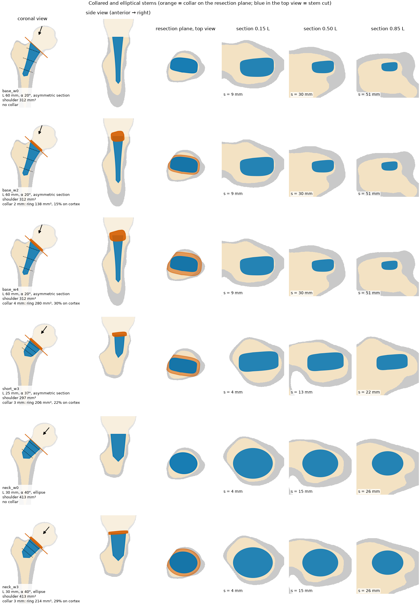

# 领与椭圆截面：实现与求解验证

生成时间：2026-10-02 12:18。依据用户 2026-10-02 的要求：把领的有无和尺寸加进柄的定义，加椭圆截面，带领的柄加入接触；并说明现在的截骨范围。

## 1 结论

1. **三项都已实现。** 椭圆截面是原截面公式的特例；领是平贴在截骨面上的一块板；领与截骨面之间是摩擦接触、不加过盈。最初的 6 个验证作业解完 6 个，没有失败。后来追加的 2 个（圆截面颈部柄，3 mm 领、非对称截面颈部柄，3 mm 领）还没有结果。
2. **无领的模型没有任何变化。** 基准设计按原设置重解，微动和柄应力与改动前逐位相同。
3. **领使柄身微动大幅下降。** 基准设计加 2、4 mm 领，柄身可恢复微动从 7.4 µm 降到 1.2 和 0.7 µm，首次加载微动从 19.1 降到 10.6 和 10.0 µm；领承担柄传给骨的接触合力的 32% 和 40%。
4. **短柄最受益。** 25 mm 短柄无领 89.5 µm（改动前已解），加 3 mm 领降到 33.2 µm，领承担 55% 的接触力。但领面自身滑移 45.2 µm、峰值载荷时 67% 的领面掀起，领在短柄上是主要承力件、也在明显移动。
5. **椭圆颈部柄。** 长 30 mm、插入角 40°，无领 44.6 µm（9% 的柄身面积超过 40 µm），加 3 mm 领 13.6 µm，领承担 51%。
6. **领面只有一部分在承压。** 峰值载荷时 58%–67% 的领面掀起（间隙超过 1 µm），领面滑移 15.8–45.2 µm。领面滑移不计入上面的柄身微动。
7. **股骨距的应力屏蔽减轻，但这一项高估了领的作用。** 7 区（随柄分区）应变能下降：基准 54% → 39% / 37%，椭圆颈部柄 49% → 15%。屏蔽来自粘接模型，领在其中与骨固结；而摩擦模型显示领面一半以上会掀起。
8. **柄颈与柄体交界的应力集中消失。** 无领时交界处最大 von Mises 应力 746 MPa（基准）、613 MPa（颈部柄），是尖角处的奇异值；加领后交界被填平，降到 115–242 MPa。
9. **查出一处原有的不一致。** 建模时实际切骨的平面与解析计算用的“垂直于颈轴的平面”相差 4.1°。领已按实际切骨面放置；其余影响见第 6 节。

## 2 改了什么

| 项目 | 做法 | 代码 |
|---|---|---|
| 椭圆截面 | 原截面公式取 n_a = n_p = 2、γ_ml = γ_ap = 0.5、τ_a = τ_p = 0，只剩宽厚比 λ（λ = 1 为圆）。数值核对：边界点满足椭圆方程，误差 1e-15 | `geom3d.ellipse_design`、`is_ellipse` |
| 领的参数 | collar_w：外伸宽度，0 为无领，建议范围 0–6 mm；collar_t：厚度，默认 2.5 mm。是柄的参数，没有放进原来的 12 维设计空间 | `geom3d.Stem3D`、`COLLAR` |
| 领的外形 | 柄在截骨面上的截口向外偏移 collar_w，再裁到骨外表面以内 0.5 mm，不悬出骨外 | `fe3d_geom.collar_outline` |
| 领的实体 | 外形沿截骨面法向向上拉伸 collar_t，与柄体、假体颈、头合成一个实体 | `fe3d_geom.collar_solid`、`model3d_m1` |
| 接触 | 领底面与截骨面重合，碎片化后自动成为界面，进同一个接触对，摩擦系数相同。落在截骨面上的界面节点记为领节点，过盈为 0 | `model3d_m1.node_pairs` |
| 粘接模型 | 领与骨共节点，即假定领也骨整合 | `model3d_m1` |
| 后处理 | 微动、张开、接触压力等只统计柄身，与无领设计可比；领另报滑移、掀起、承担的接触力比例 | `post_m1` |
| 旧界面模型 | 不支持领，带领的作业直接判几何不成立 | `jobs.prep` |

只建模不求解的检查：6 个组合都一次建成；每个带领设计进入接触的面积等于领的承压环面积（相差不到 5%）；领节点的过盈全部为 0；无领的基准模型与改动前的网格、节点对、法向、面积、过盈逐项相同。

## 3 截骨范围

截骨高度定义为截骨面中心到股骨头中心的距离，沿颈轴量。这根股骨的头半径 25.3 mm，颈轴到干轴的距离沿颈轴是 57.8 mm。

| 截骨高度 (mm) | 股骨距端高于小转子 (mm) | 外上端高于小转子 (mm) | 截面尺寸 (mm) | 截面积 (mm²) | 皮质占比 | 比 25 mm 多切 (cm³) | 说明 |
|---|---|---|---|---|---|---|---|
| 20 | 39 | 64 | 36 × 32 | 877 | 24% | 0.0 | 在头颈交界以上，切到股骨头 |
| 25 | 35 | 60 | 36 × 32 | 852 | 29% | 0.0 | 现行默认；V2A 与新界面模型的全部验证都用这一档 |
| 30 | 31 | 58 | 39 × 31 | 870 | 29% | 4.3 |  |
| 35 | 28 | 57 | 43 × 31 | 925 | 31% | 8.9 |  |
| 40 | 23 | 63 | 59 × 40 | 1520 | 39% | 15.1 |  |
| 45 | 18 | 60 | 61 × 43 | 1884 | 23% | 23.8 | V3 的上限 |
| 50 | 13 | 55 | 63 × 43 | 2002 | 24% | 33.6 |  |
| 55 | 3 | 50 | 70 × 41 | 2131 | 25% | 43.9 |  |

现在的范围：V3 的设计空间是 25 到 45 mm；V2A、新界面模型的验证和这次的领都固定在 25 mm，也就是头颈交界、最高的一种截法。35 到 40 mm 之间截面突然变大，因为截骨面开始切进转子区。常规全髋的截骨在小转子上方 1 到 1.5 cm，对应这里约 50 到 55 mm。

## 4 求解验证

新界面模型，过盈 0.025 mm，摩擦系数 0.3，生产网格。微动只统计柄身。

| 设计 | 可恢复微动 (µm) | 首次加载微动 (µm) | 超过 40 µm 的柄身面积 | 领承担的接触力 | 领面滑移 (µm) | 领掀起面积 | 7 区屏蔽，随柄分区 (%) | 7 区屏蔽，固定分区 (%) | 柄体最大应力，不含颈体交界 (MPa) |
|---|---|---|---|---|---|---|---|---|---|
| 基准，无领 | 7.4 | 19.1 | 0% | — | — | — | 54 | 15 | 141 |
| 基准，2 mm 领 | 1.2 | 10.6 | 0% | 32% | 17.2 | 66% | 39 | 13 | 54 |
| 基准，4 mm 领 | 0.7 | 10.0 | 0% | 40% | 15.8 | 58% | 37 | 13 | 50 |
| 短柄，无领（改动前已解） | 89.5 | 99.8 | 53% | — | — | — | — | — | — |
| 短柄，3 mm 领 | 33.2 | 53.1 | 1% | 55% | 45.2 | 67% | 46 | 2 | 73 |
| 椭圆颈部柄，无领 | 44.6 | 54.7 | 9% | — | — | — | 49 | 10 | 76 |
| 椭圆颈部柄，3 mm 领 | 13.6 | 21.7 | 0% | 51% | 22.3 | 59% | 15 | 7 | 35 |
| 圆截面颈部柄，3 mm 领 | 尚未解完 |  |  |  |  |  |  |  |  |
| 非对称截面颈部柄，3 mm 领 | 尚未解完 |  |  |  |  |  |  |  |  |

领承担的接触力：峰值载荷时领面节点的接触合力，在柄传给骨的接触合力方向上的分量所占比例。领掀起面积：峰值载荷时领面间隙超过 1 µm 的比例。应力屏蔽来自粘接模型，领在其中与骨固结。

回归检查，基准设计无领，改动前与改动后：f1_p95_um 7.442609 对 7.442609（逐位相同）；f1_first_p95_um 19.066356 对 19.066356（逐位相同）；vm_p99 123.154318 对 123.154318（逐位相同）。改动前的作业是 `m1_base_h2_tol0.00025_delta0.025_e710a153`。

## 5 各设计的领

| 设计 | 外伸宽度 (mm) | 柄的截口 (mm²) | 承压环 (mm²) | 承压环落在皮质上 | 进入接触的面积 (mm²) |
|---|---|---|---|---|---|
| 基准，2 mm 领 | 2 | 307 | 138 | 15% | 159 |
| 基准，4 mm 领 | 4 | 307 | 280 | 30% | 300 |
| 短柄，3 mm 领 | 3 | 297 | 206 | 22% | 218 |
| 椭圆颈部柄，3 mm 领 | 3 | 412 | 214 | 29% | 227 |

## 6 查出的不一致：两个截骨面

建模时切骨用的半空间由“颈平面内的方向 n3”和“全局前后方向”张成，它的法向与颈轴相差 4.1°，因为颈轴有一点前后分量。而模板化、截骨面以下的判定、去骨体积和应力屏蔽分区，用的都是垂直于颈轴的平面。两个平面在截骨中心相交，离中心 18 mm 处相差约 1.3 mm。

- 对领：已按建模实际切出的面放置，所以领贴合良好。
- 对已有结果：影响很小但确实存在，主要在截骨面附近 1 mm 左右的骨是否算“保留”。
- 建议：冻结模型时统一成垂直于颈轴的平面。这会改变所有有限元模型的几何，需要和其他设置一起冻结、重跑参考集。

## 7 还没做的

- 领的宽度和有无还没有放进优化的设计空间。原来的 12 维空间和候选池保持不变。
- 插入角上限仍是 40°。这根股骨的颈轴相对干轴约 42.5°，完全沿颈轴插入需要把上限提到 45° 左右。
- 领的厚度固定 2.5 mm，领与假体颈之间没有圆角。
- 粘接模型里领与骨固结，会高估领对股骨距的加载；更合理的做法是领在粘接模型里也用接触。
- 截骨高度在这次验证里固定 25 mm。领在更低的截骨面上会压到更大、更多皮质的截面。
