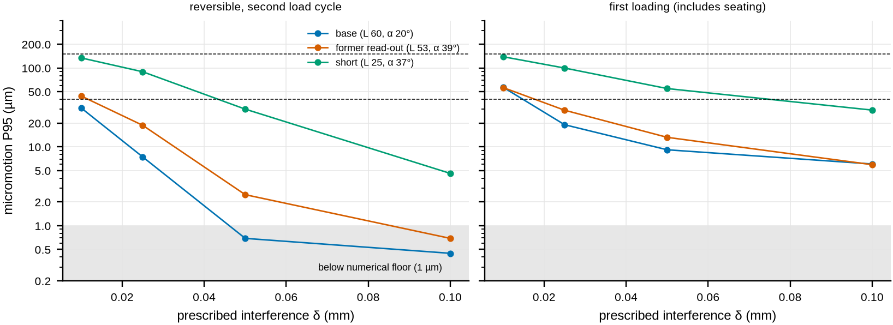
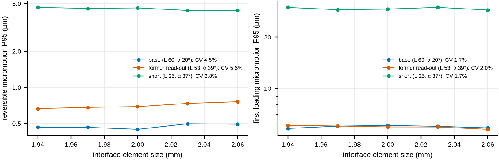
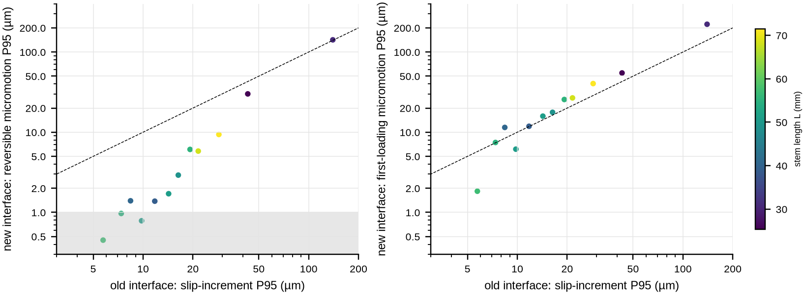

# M1 界面模型验证报告

2026-09-29 06:32。七小时实验（00:00–07:00）的结果：只修界面、不做优化。数据 `v2/results/m1_report/summary.json`，共 52 个设计作业（完成 47，失败或跳过 5，未解完 0）加 8 个解析对照作业。代码 `v2/model3d_m1.py`、`v2/post_m1.py`、`v2/stage_m1.py`、`v2/report_m1.py`。

## 1 结论

1. **新界面模型力学上是对的。** 圆柱压入套筒的解析对照，无摩擦时接触压力误差 -0.2%（2.0 mm 网格）和 -0.1%（1.4 mm）。真实股骨上压配后间隙超过 5 µm 的界面面积中位 1.4%（旧模型压配后约一半界面张开）。
2. **数值地板从约 10 µm 降到 1 µm，网格噪声只有 2–6%。** 2.0 对 1.4 mm 网格，首次加载微动相差 0–13%。但可恢复微动随摩擦容差没有平台，低于 1 µm 的读数只能报“< 1 µm”。
3. **旧结果的排序大体成立。** 12 个设计在新旧界面下的秩相关：旧微动对新首次加载微动 0.98，对新可恢复微动 0.96。旧模型量到的相当于首次加载的滑移（数值比中位 1.18），可恢复微动只有它的约 0.17 倍。
4. **微动首先取决于过盈量。** 过盈从 0.10 降到 0.01 mm，基准设计的可恢复微动从 0.45 升到 31.1 µm，短柄从 4.6 升到 134 µm。过盈 0.10 mm 时 3 个已解设计里 2 个低于 1 µm 地板，无法互相排序。
5. **0.10 mm 过盈在线弹性松质骨里夹得过紧。** 接触压力中位 9.5 MPa（基准设计），而文献库里松质骨抗压强度的范围是 2–12 MPa。不加压溃上限时，模型高估夹持力、低估微动。
6. **需要你决定三件事**（见第 7 节）：过盈量取多少；卸载到零还是保留一部分载荷；优化用哪个微动定义。

## 2 界面模型改了什么

| 项 | 旧模型 | 新模型（M1） |
|---|---|---|
| 界面网格 | 柄与锉腔各划各的，分面不重合 | 柄与骨一起碎片化，界面只划一次；界面节点复制一份给柄侧，两侧节点一一重合 |
| 过盈 | 从截面缩放系数里减 0.10，实际径向 0.035–0.08 mm | 逐节点给定法向过盈（`*CLEARANCE, TABULAR`），处处等于给定值 |
| 皮质接触处 | 同样施加过盈 | 与皮质相邻的界面节点过盈为 0 |
| 摩擦弹性滑移上限 | 0.005 × 2 mm = 10 µm | 0.00025 × 2 mm = 0.5 µm |
| 加载 | 压配 → 释放 → 加载 | 压配 → 释放 → 加载 → 卸载 → 再加载 |
| 微动定义 | 接触滑移增量（只在接触时累积） | 节点对相对切向位移；主指标取第二循环的可恢复量，另报首次加载量 |
| 粘接模型 | `*TIE` 绑定两套网格 | 共享节点，不需要绑定 |

## 3 验证项与判定

| 项 | 门槛 | 结果 | 判定 |
|---|---|---|---|
| 压配解析对照 | 误差 < 5% | 无摩擦 -0.2% / -0.1%；摩擦 0.3 时 -4.5% | 通过 |
| 压配后界面张开 | 面积 < 5% | 压配后间隙 > 1 µm 的面积中位 6.2%（阈值 1 µm 是事先写在代码里的）；间隙 > 5 µm 的面积中位 1.4%、最大 3.9%；加载状态下接触状态为张开的面积中位 6.2% | 按 1 µm **不通过**；按 5 µm 通过 |
| 粘着节点数值滑移 | P95 < 0.5 µm | 全部生产设置作业中最大 0.46 µm | 通过 |
| 摩擦容差收敛 | 最后两档差 < 5% | 无平台：0.00025 与 0.0001 两档相差 17–24%；Lagrange 不收敛 | **不通过**，处置：地板定为 1 µm |
| 噪声底 | 变异系数小于设计间差异的 1/3 | 可恢复微动 2.8–5.6%，首次加载 1.7–2.0%；设计之间相差数倍到数十倍 | 通过 |
| 新旧界面对比 | 报告秩相关 | 12 个设计：0.98（首次加载）、0.96（可恢复） | 已报告 |
| 方向性 | 方向全对 | 过盈减半微动升、摩擦加倍微动降、去扭转微动降；过盈 0 不可判定 | 可判定的 3 项通过 |
| 网格（2.0 对 1.4 mm） | 差 < 10% | 首次加载微动：基准 +0%；原读数设计 -10%；短柄 -13%（3/3 个设计解完） | **不通过**（短柄 13%） |

## 4 各项结果

### 4.1 压配解析对照

钛圆柱（半径 8 mm）压入松质骨套筒（外半径 20 mm，400 MPa），过盈 0.10 mm，四分之一模型，走与设计模型相同的界面代码。解析解（平面应力、无摩擦）2.970 MPa。FE 压力由套筒外表面的径向膨胀反推。

| 过盈写法 | 摩擦 | 网格 (mm) | 反推压力 (MPa) | 误差 | 节点接触压力均值 (MPa) | 其偏差 | 界面法向位移标准差 (µm) |
|---|---|---|---|---|---|---|---|
| 几何平移 | 0 | 2 | 2.954 | -0.6% | 2.26 | -24% | 0.86 |
| 几何平移 | 0 | 1.4 | 2.960 | -0.3% | 2.36 | -21% | 0.37 |
| 几何平移 | 0.3 | 2 | 2.826 | -4.8% | 2.36 | -21% | 0.86 |
| 几何平移 | 0.3 | 1.4 | 2.832 | -4.6% | 2.45 | -17% | 0.37 |
| 逐节点给定 | 0 | 2 | 2.965 | -0.2% | 3.30 | +11% | 0.07 |
| 逐节点给定 | 0 | 1.4 | 2.966 | -0.1% | 3.17 | +7% | 0.07 |
| 逐节点给定 | 0.3 | 2 | 2.837 | -4.5% | 3.43 | +16% | 0.07 |
| 逐节点给定 | 0.3 | 1.4 | 2.838 | -4.4% | 3.29 | +11% | 0.03 |

两种写法的力学状态都对；逐节点给定的界面位移更均匀，取为生产设置。摩擦 0.3 时的 −4.5% 是摩擦引起轴向剪力的物理差别。**Abaqus 输出的节点接触压力均值不可靠**（同一力学状态下偏 −24% 到 +16%），下文的接触压力只作量级参考。

### 4.2 摩擦容差

| 设计 | 容差 | 弹性滑移上限 (µm) | 可恢复微动 P95 (µm) | 首次加载 P95 (µm) | 粘着节点滑移 P95 (µm) | 摩擦模型求解 (s) |
|---|---|---|---|---|---|---|
| 基准（L 60，α 20°） | 0.005 | 10 | 3.78 | 6.93 | 3.32 | 459 |
| 基准（L 60，α 20°） | 0.001 | 2 | 1.01 | 6.12 | 0.67 | 576 |
| 基准（L 60，α 20°） | 0.00025 | 0.5 | 0.45 | 6.06 | 0.17 | 627 |
| 基准（L 60，α 20°） | 0.0001 | 0.2 | 0.37 | 6.03 | 0.07 | 931 |
| 基准（L 60，α 20°） | Lagrange | 0 | 不收敛 | — | — | — |
| 原读数设计（L 53，α 39°） | 0.005 | 10 | 5.10 | 7.06 | 4.72 | 356 |
| 原读数设计（L 53，α 39°） | 0.001 | 2 | 1.44 | 6.12 | 1.02 | 371 |
| 原读数设计（L 53，α 39°） | 0.00025 | 0.5 | 0.69 | 5.94 | 0.27 | 519 |
| 原读数设计（L 53，α 39°） | 0.0001 | 0.2 | 0.53 | 5.95 | 0.12 | 807 |
| 原读数设计（L 53，α 39°） | Lagrange | 0 | 不收敛 | — | — | — |

可恢复微动跟着容差走，说明过盈 0.10 mm 时界面几乎全部粘着，真实的可恢复滑移比弹性滑移还小。首次加载微动对容差不敏感。生产设置取 0.00025：再收紧只改变低于地板的读数，求解时间却多 50%。

### 4.3 过盈量扫描

| 设计 | 量 | δ 0.10 | δ 0.05 | δ 0.025 | δ 0.01 mm |
|---|---|---|---|---|---|
| 基准（L 60，α 20°） | 可恢复微动 (µm) | < 1 | < 1 | 7.4 | 31.1 |
| 基准（L 60，α 20°） | 首次加载微动 (µm) | 6.1 | 9.2 | 19.1 | 56.9 |
| 基准（L 60，α 20°） | 接触压力中位 (MPa) | 9.5 | 4.7 | 2.4 | 0.9 |
| 基准（L 60，α 20°） | 微动 > 40 µm 的面积 | 0% | 0% | 0% | 0% |
| 原读数设计（L 53，α 39°） | 可恢复微动 (µm) | < 1 | 2.5 | 18.7 | 44.1 |
| 原读数设计（L 53，α 39°） | 首次加载微动 (µm) | 5.9 | 13.2 | 29.1 | 56.4 |
| 原读数设计（L 53，α 39°） | 接触压力中位 (MPa) | 8.0 | 4.0 | 2.0 | 0.8 |
| 原读数设计（L 53，α 39°） | 微动 > 40 µm 的面积 | 0% | 0% | 0% | 11% |
| 短柄（L 25，α 37°） | 可恢复微动 (µm) | 4.6 | 30.0 | 89.5 | 134 |
| 短柄（L 25，α 37°） | 首次加载微动 (µm) | 29.2 | 54.8 | 99.8 | 139 |
| 短柄（L 25，α 37°） | 接触压力中位 (MPa) | 5.7 | 2.9 | 1.4 | 0.6 |
| 短柄（L 25，α 37°） | 微动 > 40 µm 的面积 | 0% | 1% | 53% | 79% |

三个设计的排序在四档过盈下都一致。过盈 0 没有结果：没有压配时卸载到零载荷后柄完全松开，第二次加载不收敛。

### 4.4 噪声底

同一设计把界面单元尺寸改为 1.94 / 1.97 / 2.00 / 2.03 / 2.06 mm 重新建网格求解，过盈 0.10 mm。

| 设计 | 完成 | 可恢复微动 均值 ± 标准差 (µm) | 变异系数 | 首次加载 均值 ± 标准差 (µm) | 变异系数 | 柄应力变异系数 |
|---|---|---|---|---|---|---|
| 基准（L 60，α 20°） | 5/5 | 0.47 ± 0.02 | 4.5% | 5.94 ± 0.10 | 1.7% | 1.9% |
| 原读数设计（L 53，α 39°） | 5/5 | 0.71 ± 0.04 | 5.6% | 5.94 ± 0.12 | 2.0% | 1.6% |
| 短柄（L 25，α 37°） | 5/5 | 4.51 ± 0.13 | 2.8% | 29.36 ± 0.49 | 1.7% | 2.3% |

### 4.5 新旧界面对比

12 个设计按旧微动的分位从当前版本的已解设计里取，过盈取 0.05 mm（旧模型名义 0.10 mm 的实际径向过盈中位约 0.055 mm）。

| 柄长 (mm) | 插入角 (°) | 余量 (mm) | 旧微动 (µm) | 新可恢复 (µm) | 新首次加载 (µm) | 旧张开比例 | 新张开比例 | 摩擦求解 旧/新 (s) |
|---|---|---|---|---|---|---|---|---|
| 57 | 28 | -0.25 | 5.7 | < 1 | 1.8 | 40% | 3% | 320 / 1109 |
| 55 | 28 | -0.22 | 7.4 | < 1 | 7.4 | 45% | 4% | 282 / 815 |
| 41 | 26 | +0.45 | 8.4 | 1.4 | 11.5 | 43% | 3% | 290 / 928 |
| 51 | 36 | +0.36 | 9.8 | < 1 | 6.1 | 58% | 4% | 265 / 675 |
| 39 | 25 | -0.14 | 11.8 | 1.4 | 11.9 | 49% | 5% | 254 / 745 |
| 51 | 27 | +1.67 | 14.3 | 1.7 | 15.9 | 58% | 7% | 221 / 741 |
| 49 | 32 | +0.90 | 16.3 | 2.9 | 17.7 | 52% | 5% | 304 / 1191 |
| 55 | 26 | +0.74 | 19.2 | 6.1 | 25.6 | 52% | 7% | 298 / 1125 |
| 68 | 18 | -0.25 | 21.5 | 5.8 | 26.8 | 38% | 8% | 332 / 862 |
| 72 | 16 | -0.25 | 28.7 | 9.4 | 40.4 | 48% | 12% | 251 / 984 |
| 25 | 37 | -0.25 | 42.9 | 30.0 | 54.8 | 60% | 32% | 387 / 1919 |
| 31 | 6 | -0.25 | 139.8 | 142 | 222 | 77% | 65% | 242 / 815 |

秩相关（n = 12）：旧微动对新首次加载 0.98，对新可恢复 0.96。
其中 L 25 的设计与 4.3 里的短柄是同一个模型，被求解了两次：可恢复微动 30.040 与 30.040 µm，逐位相同。

### 4.6 方向性检查

| 变体（基准设计） | 可恢复微动 (µm) | 首次加载微动 (µm) | 接触压力中位 (MPa) | 预期 | 结果 |
|---|---|---|---|---|---|
| 基准（过盈 0.10，摩擦 0.3） | 0.45 | 6.06 | 9.5 | — | — |
| 过盈 0.05 | 0.69 | 9.17 | 4.7 | 升 | ✓ |
| 摩擦 0.6 | 0.32 | 3.04 | 9.6 | 降 | ✓ |
| 去扭转 | 0.39 | 1.56 | 9.5 | 降 | ✓ |
| 过盈 0 | 不收敛 | — | — | 升 | 不可判定 |

### 4.7 网格 2.0 对 1.4 mm

| 设计 | 量 | 2.0 mm | 1.4 mm | 相对差 |
|---|---|---|---|---|
| 基准（L 60，α 20°） | 可恢复微动 (µm) | 0.45 | 0.31 | +44% |
| 基准（L 60，α 20°） | 首次加载微动 (µm) | 6.06 | 6.05 | +0% |
| 基准（L 60，α 20°） | 柄应力 P99 (MPa) | 123.15 | 129.55 | -5% |
| 原读数设计（L 53，α 39°） | 可恢复微动 (µm) | 0.69 | 0.46 | +51% |
| 原读数设计（L 53，α 39°） | 首次加载微动 (µm) | 5.94 | 6.57 | -10% |
| 原读数设计（L 53，α 39°） | 柄应力 P99 (MPa) | 133.54 | 140.24 | -5% |
| 短柄（L 25，α 37°） | 可恢复微动 (µm) | 4.60 | 4.93 | -7% |
| 短柄（L 25，α 37°） | 首次加载微动 (µm) | 29.22 | 33.64 | -13% |
| 短柄（L 25，α 37°） | 柄应力 P99 (MPa) | 108.81 | 111.10 | -2% |

基准、原读数设计的可恢复微动低于 1 µm 地板，2.0 mm 下比 1.4 mm 高 44–51%，与弹性滑移上限随单元尺寸的变化（2.0 / 1.4 = 1.43）一致，是数值量。短柄的可恢复微动在地板以上，两档相差 -7%。首次加载微动相差 -13% 到 +0%，有设计超过 10% 门槛；柄应力相差 2–5%。1.4 mm 的摩擦模型求解 2053、1683、2670 s，约为 2.0 mm 的 2–3 倍。1.0 mm 没有做。

### 4.8 求解时间

摩擦模型（2.0 mm，生产设置）：过盈 0.10 mm 时中位 627 s（519–1427）；全部过盈档中位 907 s。旧模型约 270 s。滑动越多越慢，短柄每个 20–26 分钟。粘接模型 35 s。本机改为三槽并行后无许可错误。

## 5 压配压力与松质骨强度

| 设计 | 过盈 (mm) | 接触压力中位 (MPa) | P95 (MPa) |
|---|---|---|---|
| 基准（L 60，α 20°） | 0.1 | 9.5 | 27.7 |
| 基准（L 60，α 20°） | 0.05 | 4.7 | 13.8 |
| 基准（L 60，α 20°） | 0.025 | 2.4 | 6.9 |
| 原读数设计（L 53，α 39°） | 0.1 | 8.0 | 21.8 |
| 原读数设计（L 53，α 39°） | 0.05 | 4.0 | 10.9 |
| 原读数设计（L 53，α 39°） | 0.025 | 2.0 | 5.4 |
| 短柄（L 25，α 37°） | 0.1 | 5.7 | 15.4 |
| 短柄（L 25，α 37°） | 0.05 | 2.9 | 7.7 |
| 短柄（L 25，α 37°） | 0.025 | 1.4 | 3.8 |

文献库里两篇给出的松质骨抗压强度范围是 2–12 MPa。过盈 0.10 mm 时三个设计的压力中位 5.7–9.5 MPa、P95 15.4–27.7 MPa，相当一部分界面已超过这个范围；0.05 mm 时中位 2.9–4.7 MPa；0.025 mm 时 1.4–2.4 MPa。节点接触压力本身有 +7% 到 +16% 的输出偏差，这里只看量级。按你的决定，这一轮没有加压溃上限。

## 6 没做的与限制

- **文献对标没做**：没有用新模型复现任何已发表案例的微动量级。
- **1.0 mm 网格没做**；1.4 mm 只有 3 个设计，其中短柄的首次加载微动相差超过 10%。
- **摩擦容差没有收敛**：低于 1 µm 的可恢复微动是数值量。
- **过盈 0 不能算**：卸载到零的两循环协议下，无压配的柄会松脱。
- **新旧对比只在过盈 0.05 mm 下做了一次**，12 个设计。
- 松质骨仍是全域 400 MPa、线弹性；没有肌力；只有上楼峰值一个工况；单一股骨。
- 与皮质相邻的界面节点不施过盈，占界面面积 0.0–3.2%；压配后张开的节点里这类节点占比高（基准设计 27%）。
- 完整股骨参照仍只按网格与材料匹配，没有按载荷工况匹配：去扭转变体的应变能对比仍不可解读。
- 失败或跳过的作业 5 个：Lagrange 摩擦 2 个（不收敛）；过盈 0 共 3 个（其中 2 个据此跳过、未求解）。

## 7 需要你决定

1. **过盈量取多少。** 这是影响最大的输入。0.10 mm 下几乎所有设计都粘着，微动目标失去区分力；0.025–0.05 mm 下设计之间拉开差距。可选做法：取一个固定值（我建议 0.05 mm，接触压力中位 3–5 MPa，落在松质骨强度范围内）；或把“微动不超过 40 µm 所需的最小过盈”作为稳定性指标。
2. **卸载到零还是保留部分载荷。** 现在卸到零，无压配或小过盈的设计会松脱。保留 10% 峰值载荷更接近步态里的摆动相，也能让过盈 0 可算。
3. **优化用哪个微动定义。** 可恢复微动（第二循环）是文献里的常用定义，但在大过盈下低于地板；首次加载微动区分力更好、与旧结果可比，但含一次性的就位位移。
4. 分区模量、肌力与步行工况、应力屏蔽只报告——这些已定或排在后面，不在本轮范围。

## 8 对修改方案的影响

- P1（界面模型）完成。P2（验证）六项里：解析对照、噪声底、摩擦容差（门槛未过、已有处置）已做；网格只做到 1.4 mm，短柄未过门槛；文献对标、参照按载荷工况匹配两项没做。
- 决策点 A 的答案：噪声底足够小，微动目标可以用来排序，前提是过盈量选在界面会滑动的范围内。
- 参考集重跑前要先定第 7 节的三件事，否则 64 个设计会再次落在地板以下。
