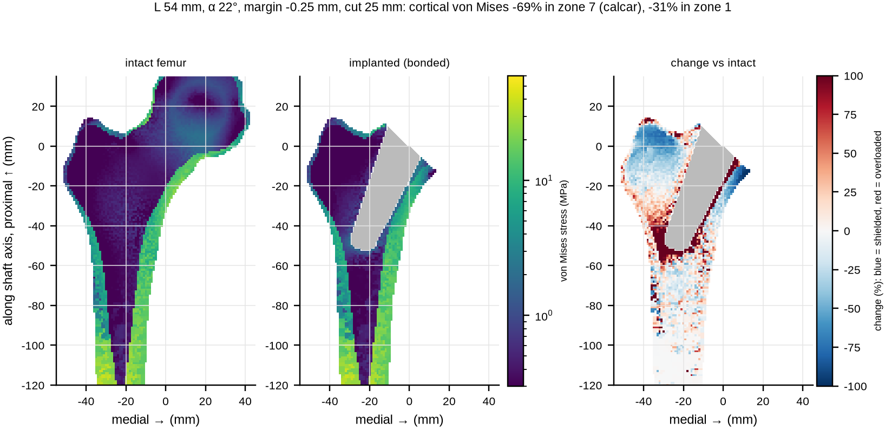
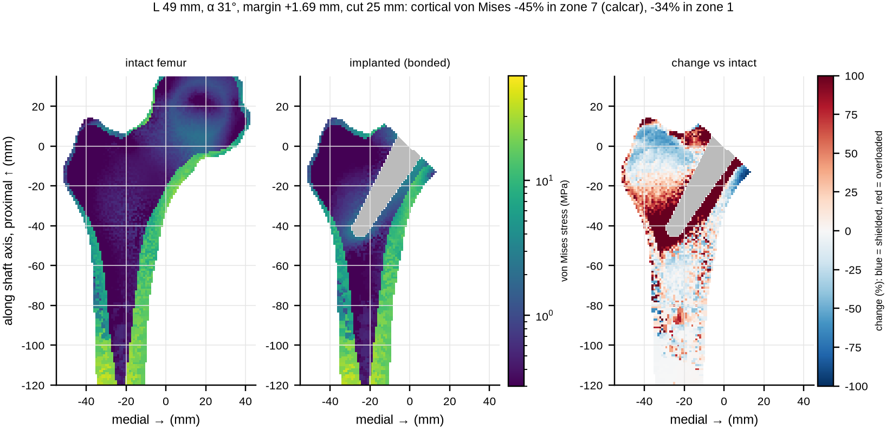
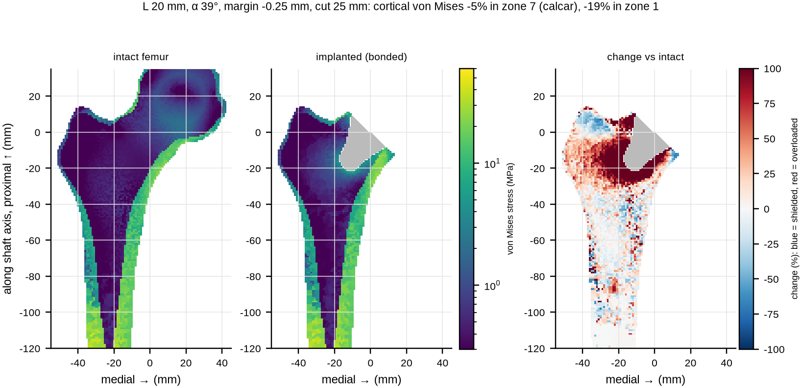
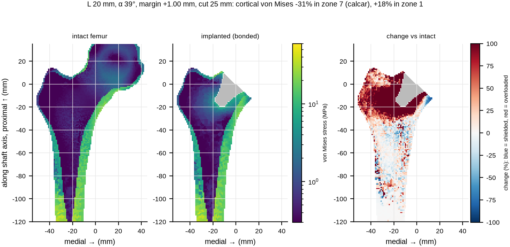
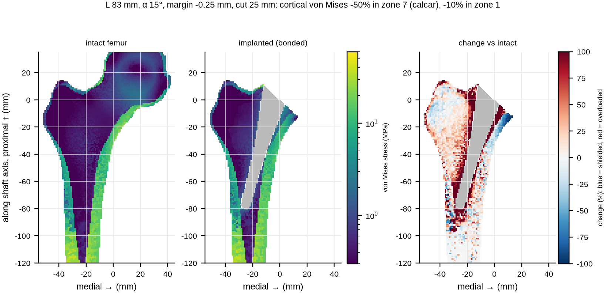
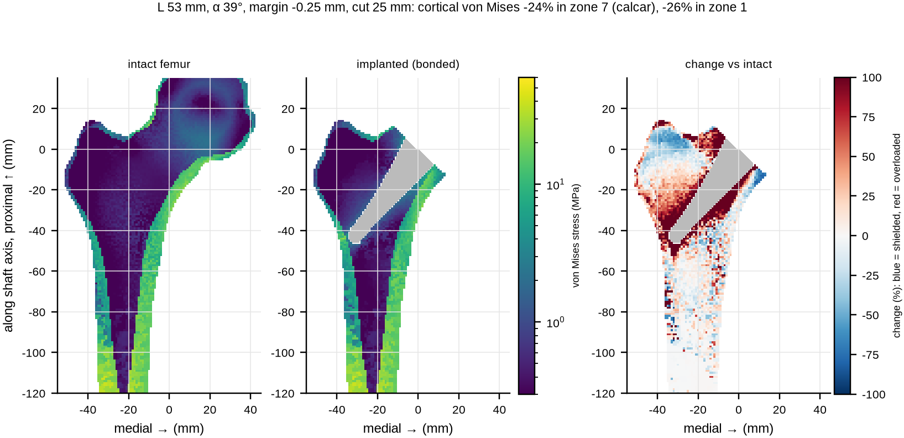
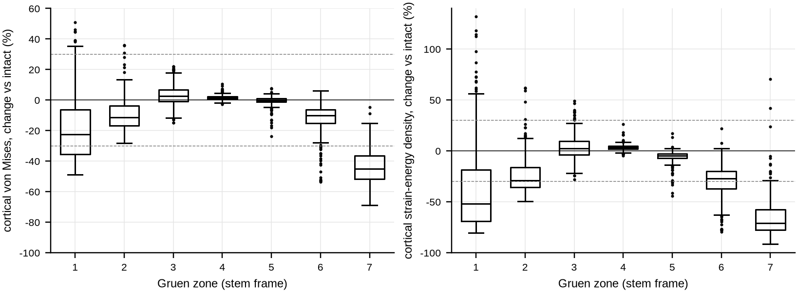
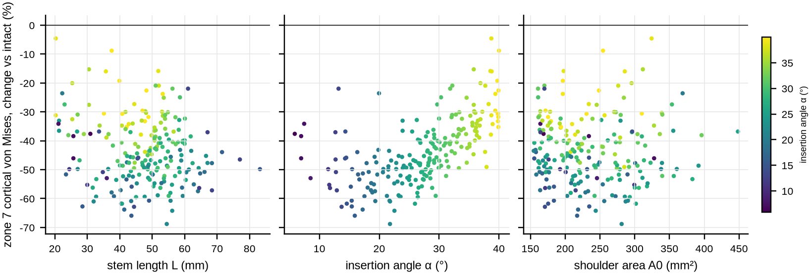
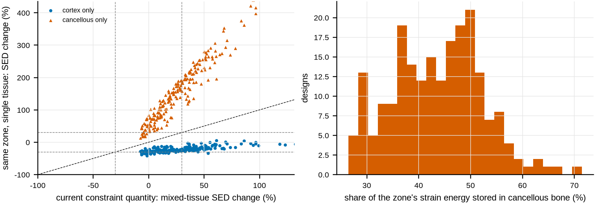

# 应力分布变化对比与应力屏蔽统计，以及 SED 约束的说明

2026-09-29 00:20。数据：210 个已解设计（当前模型版本）的粘接模型 + 1 个完整股骨参照（本次新解，带应力导出，53 s）。除这 1 个参照外没有新增 FE。脚本 `v2/shielding.py`，原始结果 `v2/results/shielding/`（`zones.csv` 每个设计 × 分区 × 骨质一行）。

## 1 先说结论

1. **所有设计都遮挡股骨距皮质。** 柄近端内侧（Gruen 7 区）皮质的 von Mises 应力比完整股骨低 5–69%，中位低 45%；换成应变能密度是中位低 71%。按区域平均应力，210 个设计里没有一个高于完整股骨；按应变能密度只有 3 个 20–30 mm 的超短柄因局部应力集中而升高（+24% 到 +70%）。
2. **遮挡集中在近端，远端不变。** 7 区 −45%、1 区 −23%、6 区 −10%、2 区 −11%；3、4、5 区在 ±3% 以内。这是短柄应有的样子：载荷在柄尖以下全部回到骨干。
3. **决定遮挡程度的是插入角，不是柄长。** 7 区皮质应力变化与插入角的秩相关 +0.67，与柄长 −0.10，与肩部面积 −0.08。插入角 35–40° 时中位 −32%，15–25° 时 −52%。
4. **现行的 SED 约束量反了。** 它把皮质和松质骨混在一起算，结果被柄周松质骨的应变能主导：85 个设计"超过 30%"，全部显示为过载；而同一区域只看皮质，210 个设计全部是遮挡。两者符号相反的有 182 个。V3 里被判"不可行"的设计，判的不是应力屏蔽。

## 2 怎么算的

- **模型**：粘接模型（柄与骨绑定，相当于完全骨长入），上楼峰值载荷 2391 N，界面单元 2 mm。应力屏蔽统计与压配、摩擦无关，所以不受界面模型那些问题影响。
- **完整股骨参照**：同一根股骨不截骨、不放柄，同样载荷。
- **变化量** = (植入 − 完整) / 完整 × 100%。负 = 遮挡，正 = 过载。
- **只比两个模型里都存在的骨**：完整股骨一侧去掉截骨面以上的骨和后来被锉掉的骨。
- **分区**：Gruen 分区按柄自身坐标定义。沿柄轴三等分，柄轴外侧为 1、2、3 区（近 → 远），内侧为 7、6、5 区，柄尖以下 max(L/3, 10 mm) 为 4 区。皮质与松质骨分开统计。
- **区域值**：von Mises 取体积加权平均；应变能密度取区域总应变能 / 区域体积。
- **样本**：只用当前模型版本的 210 个设计。假体颈修正前解的 62 个不进统计。

## 3 应力分布变化对比图

每张图三联：左为完整股骨，中为植入后，右为变化量。切面是颈平面（过干轴与颈轴），厚 ±3 mm；灰色是柄。左、中两图同一色标（对数）。

读图提示：远端骨干髓腔里的红蓝碎点是两套不同网格之间取最近单元造成的噪声（那里应力只有 0.3–0.5 MPa），不是真实变化。

## 4 应力屏蔽统计

### 4.1 皮质骨，按 Gruen 分区（n = 210）

| 区 | 位置 | 完整股骨应力中位 (MPa) | 应力变化中位 [四分位] | 应变能密度变化中位 [四分位] | 应变能密度降 > 30% 的设计 | 降 > 50% | 降 > 75% |
|---|---|---|---|---|---|---|---|
| 1 | 近端外侧 | 5.0 | −23% [−35, −6] | −52% [−69, −19] | 69% | 53% | 12% |
| 2 | 中段外侧 | 5.5 | −11% [−17, −4] | −29% [−36, −16] | 47% | 0% | 0% |
| 3 | 远段外侧 | 6.1 | +3% [−1, +7] | +3% [−4, +9] | 0% | 0% | 0% |
| 4 | 柄尖以下 | 13.8 | +1% [+1, +2] | +3% [+2, +5] | 0% | 0% | 0% |
| 5 | 远段内侧 | 12.9 | 0% [−1, +1] | −5% [−7, −3] | 2% | 0% | 0% |
| 6 | 中段内侧 | 12.9 | −10% [−15, −6] | −27% [−37, −20] | 40% | 12% | 3% |
| 7 | 近端内侧（股骨距） | 13.7 | **−45% [−52, −37]** | **−71% [−77, −58]** | 93% | 83% | 33% |

应变能密度的百分比大约是应力的两倍，因为应变能密度正比于应力的平方。1 区有 29 个设计（14%）过载超过 30%，多为短柄配小插入角（柄长中位 31 mm、插入角中位 15°）。

### 4.2 松质骨

柄周松质骨全部过载：7 区应力中位 +379%（完整股骨里只有 0.5 MPa），1 区 +77%，6 区 +75%，4 区 +43%，3 区 +26%。这不是应力屏蔽问题，而是松质骨承载问题，要在修界面模型时与压配压力一起核对。

### 4.3 遮挡程度取决于什么

| 设计变量 | 与 7 区皮质应力变化的秩相关 |
|---|---|
| 插入角 α | **+0.67**（角度越大遮挡越轻） |
| 截骨高度 | +0.15 |
| 皮质余量 m | +0.11 |
| 柄长 L | −0.10 |
| 肩部面积 A0 | −0.08 |

| 插入角 | 设计数 | 7 区皮质应力变化中位 | 柄长 | 设计数 | 7 区皮质应力变化中位 |
|---|---|---|---|---|---|
| 5–15° | 18 | −46% | 20–30 mm | 21 | −37% |
| 15–25° | 55 | −52% | 30–40 mm | 23 | −42% |
| 25–35° | 94 | −44% | 40–50 mm | 70 | −47% |
| 35–40° | 43 | −32% | 50–60 mm | 74 | −42% |
| | | | 60–90 mm | 22 | −49% |

1 区（近端外侧）则主要随柄长变化：与柄长的秩相关 −0.52，与插入角 −0.42。

## 5 SED 约束是什么

**SED（应变能密度）** 是单位体积骨里储存的弹性应变能，等于 ½ × 应力 × 应变，单位 MPa。它是骨重建理论里公认的"骨感受到的力学刺激"：

- 植入柄后，一部分载荷改由柄承担，近端骨的 SED 下降；
- SED 低于术前的一定比例，骨就会吸收变薄，这就是应力屏蔽导致的骨丢失；
- Huiskes 1992 用的规则是：SED 在术前值的 (1 ± s) 范围内骨不变化，这个范围叫"死区"，s 取 0.75；把 s 缩到 0.35 时，预测的骨丢失量从 23% 升到 41%（本地原文第 5、10 页核对过）。

**"SED 约束"是优化里的一条过滤规则**：某个区域的 SED 相对完整股骨偏离超过阈值的设计，直接判为不可行，优化器不会选。目的是不让优化器为了稳定性或省骨，选出会造成近端骨丢失的设计。

**现行约束是这样写的**（V3）：区域取模型坐标里固定的一块（内侧、小转子下 10 mm 以上、截骨面以下），皮质与松质骨一起算；偏离的绝对值 > 30% 判不可行。它有三个问题：

1. **量的不是它想量的东西。** 这块区域里松质骨存了 44% 的应变能（各设计 27–71%）。柄压在松质骨上使这块松质骨的 SED 中位升高 147%，盖过了皮质的下降（中位 −24%）。
2. **阈值 30% 没有出处**，是我自己定的。
3. **取绝对值把遮挡和过载当成一回事**，两者后果不同：遮挡导致骨丢失，过载涉及的是骨能否承受。

## 6 约束可以怎么写，各自在现有数据上的后果

下表是 210 个设计里**能通过**的个数。

| 口径 | 遮挡 ≤ 30% | 遮挡 ≤ 50% | 遮挡 ≤ 75% |
|---|---|---|---|
| 7 区皮质，应变能密度 | 14 | 35 | 141 |
| 7 区皮质，von Mises 应力 | 22 | 149 | 210 |
| 固定区皮质，应变能密度 | 178 | 210 | 210 |
| 固定区皮质，von Mises 应力 | 210 | 210 | 210 |
| 现行写法（固定区、混合、绝对值 ≤ 30%） | 125 | — | — |

三种做法：

- **A 作为约束**：7 区皮质应变能密度，只约束遮挡，阈值 75%（Huiskes 的死区）。筛掉 33% 的设计。阈值取 30% 或 50% 会筛掉 83–93%，几乎无设计可选。
- **B 作为目标**：不设阈值，把"7 区皮质遮挡"作为要最小化的目标之一，与微动、骨量损失一起做权衡。
- **C 只报告、不进优化**：每个设计都算并列在报告里，优化只看微动与骨量损失。

**我的建议是 B**。理由：遮挡在设计之间的差别很大（−5% 到 −69%），又主要受插入角控制，正是值得让优化器去权衡的量；而阈值的绝对数值在加肌力之前不可靠（见下）。如果你更想要一条硬线，就用 A。

## 7 这些数字的限制

- **没有肌力。** 外展肌拉在大转子上，会明显改变 1 区和 7 区的应力。加肌力后遮挡的绝对百分比会变，设计之间的排序预计变化较小，但没有验证过。
- **只有上楼峰值一个工况。** 骨重建由日常载荷驱动，应以步行为主。
- **松质骨全域 400 MPa。** 你已决定改为分区赋值，改完后这份统计要重算（零新增设计 FE 不成立，需要重解）。
- **粘接界面**代表完全骨长入，给出的是遮挡的上限；术后早期界面未长入时遮挡更轻。
- **单一股骨**，Dorr A。
- 7 区皮质体积中位只有 2.3 cm³，对网格较敏感；这一项的网格收敛还没单独做。

## 8 需要你决定

1. SED（或应力屏蔽）在优化里的角色：A 约束、B 目标、C 只报告。
2. 用应变能密度还是 von Mises 应力来表述。前者是骨重建理论的标准量，后者更直观；两者排序基本一致，百分比相差约一倍。
3. 如果选 A，阈值取多少。
