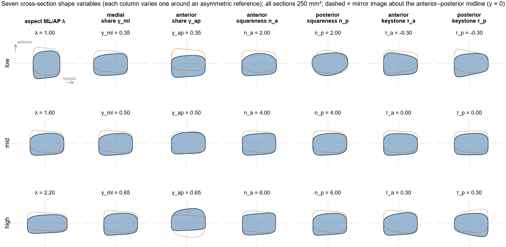
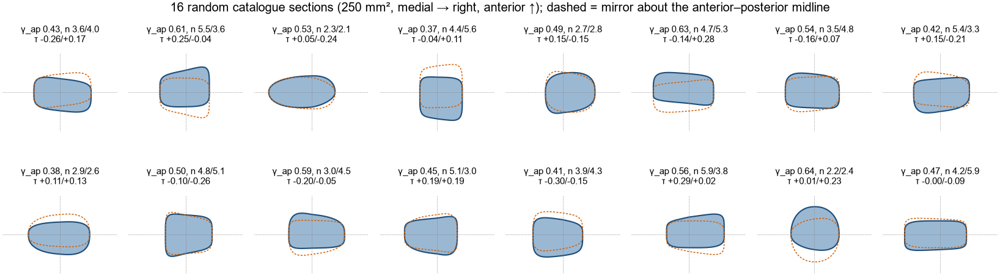
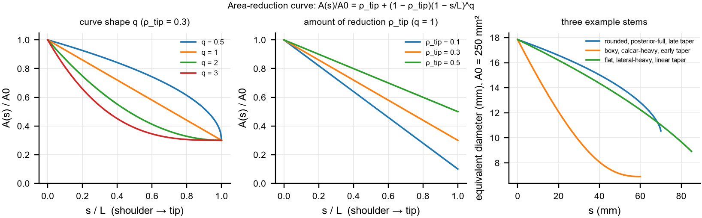
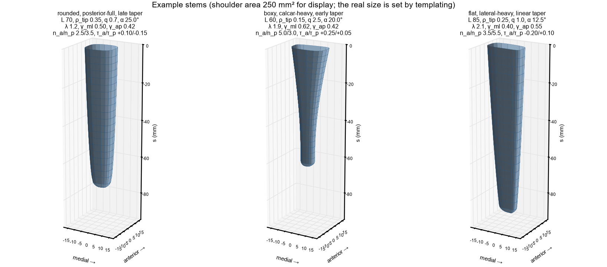
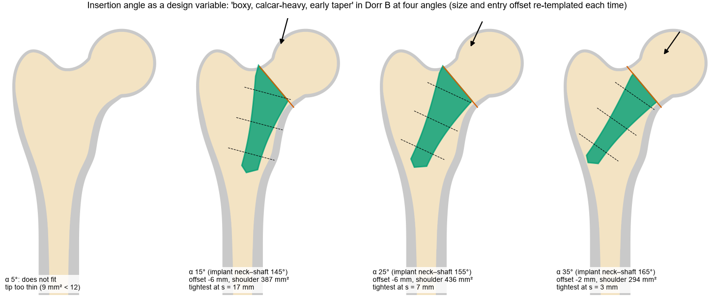
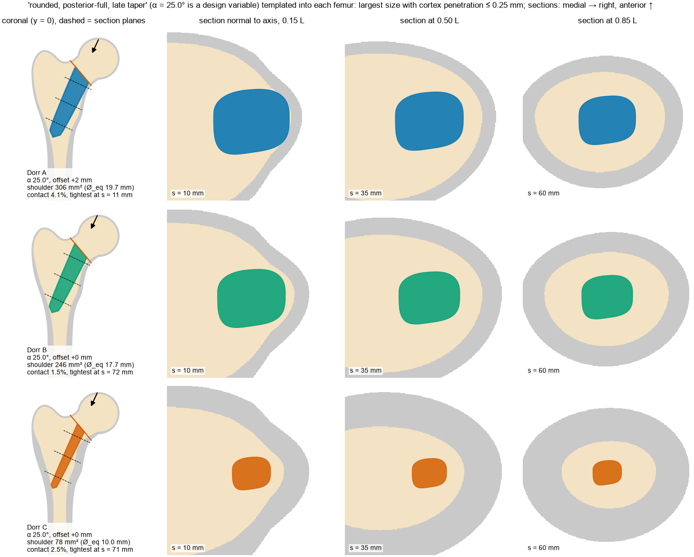
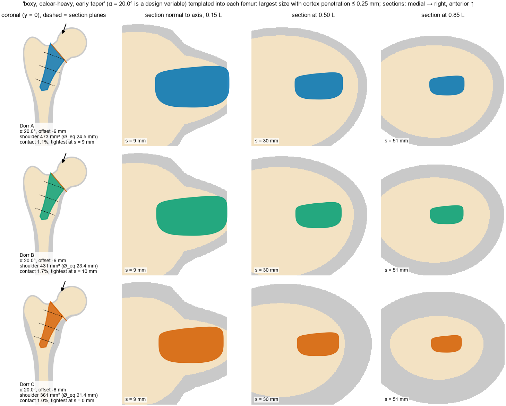
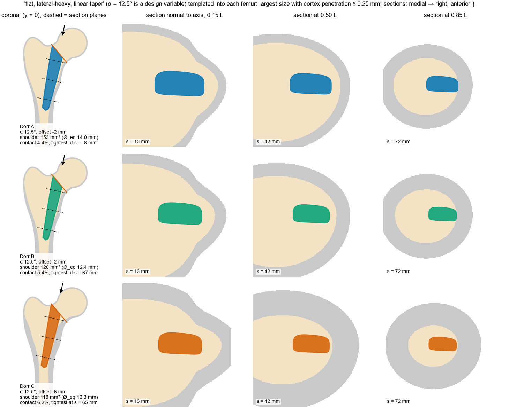
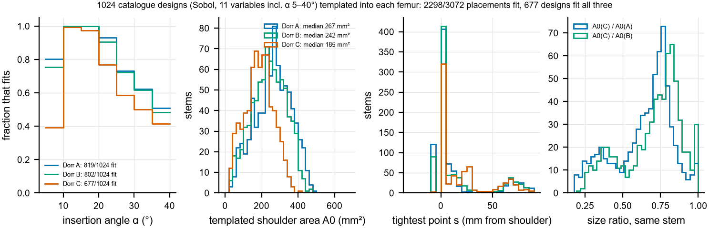
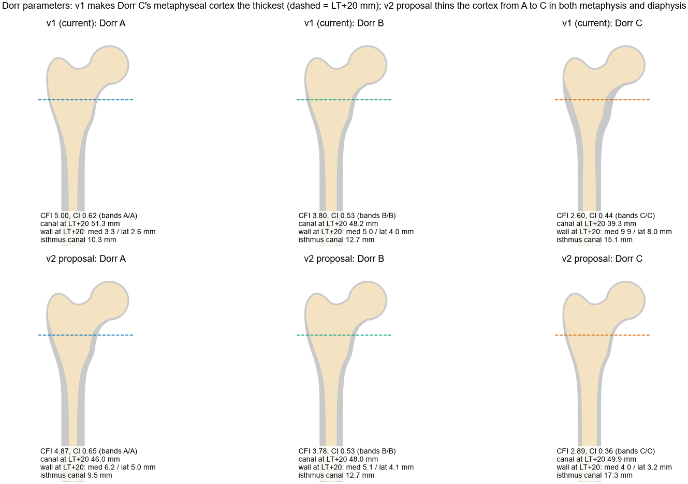

# v2 测试设计：直轴短柄（长度 × 截面积降低曲线 × 不规则不对称截面 × 插入角）

版本 v0.2 · 2026-09-27 · 状态：**草案，待用户确认后实施**（本文件只含几何、模板化与 3D 建模冒烟的案例，未跑任何 Abaqus 求解）

v0.2 相对 v0.1 的改动（按用户要求）：
- **插入角 α 改为设计变量**，取值 5–40°，之前由模板化选定。
- **截面不再关于前后侧中线对称**：前半与后半各有自己的方正度 n_a/n_p 与楔形 τ_a/τ_p。之前两半只在厚度上不同，形状是镜像。
- 设计变量由 8 个增至 11 个。

---

## 0. 与 v1 的区别

| 项 | v1（已完成，R0–R7） | v2（本设计） |
|---|---|---|
| 柄 | 圆弧中轴、绕曲率中心旋转插入；冠状面宽度 | **直中轴、沿中轴直线插入**；3D 截面 |
| 设计变量 | 5 个，相对髓腔（尖端位置、近端宽比、锥度、入柄角） | **11 个**，与股骨无关：长度 1 + 面积降低曲线 2 + 截面形状 7 + 插入角 1 |
| 尺寸与位姿 | 由设计变量直接决定 | 插入角是设计变量；**尺寸与入口偏移由模板化决定**（能放进去的最大号） |
| FE 主模型 | 2D 平面应力（侧板校准），3D 只抽检 | **3D 为主**（截面形状只有 3D 能表达），不再用 2D |
| 股骨 | 2D 轮廓；3D 由水平截面 + 颈部圆柱拼接（截骨处有台阶） | 同一 2D 轮廓，3D 改为**沿干—颈中心线放样的管**（无台阶），并加干骺端前后不对称 |
| 载荷 | 冠状面两分量（Fx −668、Fz −2296 N） | 加**前后分量**以产生绕柄轴扭矩（截面形状主要影响抗旋） |

v1 的代码、数据、报告原样保留；v2 放在 `sandbox\mobo_toy\v2\`，复用 v1 的 Abaqus 运行器、odb 导出、QoI、作图与报告模块。

---

## 1. 要回答的问题

1. **Q1 优化器**：在 11 维设计空间、3D FE 下，BO 能否用 ≤ 64 次 FE 找到接近最优的前沿（对同预算 Sobol）？
2. **Q2 哪类变量主导**：长度、面积降低曲线、截面形状、插入角，四组变量各自对微动与应力遮挡的贡献（按组汇总的全局敏感性），是否随 Dorr 型改变？
3. **Q3 是否"因骨而异"**：为 A 型优化出的柄放进 B、C 型，是否比 B、C 型自己的最优柄差？（交叉评估）
4. **Q4 前后不对称是否被利用**：髓腔干骺端前后不对称（kappa_ap = 0.15）时，前沿设计的 γ_ap、n_a/n_p、τ_a/τ_p 是否系统地偏离前后镜像；把髓腔改回对称（kappa_ap = 0）作对照，偏离是否消失？

不回答：任何临床结论；真实股骨上的表现；与商品柄的比较。

---

## 2. 柄的参数化

柄在自身坐标系中定义，与股骨无关。中轴为直线，s 从肩部 0 到尖端 L；截面垂直于中轴，x 指向内侧、y 指向前方。

**截面积降低曲线**：A(s) = A0 · [ρ_tip + (1 − ρ_tip)(1 − s/L)^q]。ρ_tip 管"降多少"（尖端/肩部面积比），q 管"在哪里降"：q > 1 近端先快速收小（干骺端承载型），q < 1 保持粗壮到远端才收。

**截面形状（7 个变量）**：单位面积的"四象限超椭圆 + 楔形"：
- 内/外侧半宽由 λ（宽厚比）与 γ_ml（内侧占比）给出；前/后半厚由 γ_ap（前方占比）给出。
- **前半与后半各有自己的方正度（n_a、n_p）与楔形斜度（τ_a、τ_p）**。楔形指该半的厚度沿内外侧线性变化。所以截面既不关于内外侧中线对称，也不关于前后侧中线（y = 0）对称。
- 只有 γ_ap = 0.5、n_a = n_p、τ_a = τ_p 同时成立的特例才前后镜像，在设计空间中测度为零。
- 形状沿长度不变，只按 √(A/A0) 缩放。

**插入角 α**：冠状面内柄轴与股骨干轴的夹角，+ 表示远端偏向外侧。假体头心复位到解剖头心时，α 等价于假体的颈干角 130° + α，即 135°–170°，因此它也是柄本身的一个设计参数。前倾方向（矢状面）的插入角固定为 0。

**可插入性**：
- 各截面相似且以中轴为中心缩放。截面对中轴星形：4096 个随机截面逐一检验极角单调，无一例外。所以截面沿长度层层嵌套，沿中轴直线平移插入的扫掠体就是柄本身，零过切是构造性的。
- 肩部以上为等截面棱柱，被截骨面裁掉。

| 组 | 变量 | 含义 | 范围 |
|---|---|---|---|
| 长度 | L | 肩部到尖端长度 (mm) | 40–90 |
| 面积降低曲线 | ρ_tip | 尖端/肩部截面积比 | 0.10–0.50 |
| | q | 面积降低曲线指数 | 0.5–3.0 |
| 截面形状 | λ | 截面宽厚比（内外侧宽 / 前后厚） | 1.0–2.2 |
| | γ_ml | 内侧占内外侧宽的比例 | 0.35–0.65 |
| | γ_ap | 前方占前后厚的比例 | 0.35–0.65 |
| | n_a, n_p | 前半、后半超椭圆指数（2 圆润 → 6 方正） | 2–6 |
| | τ_a, τ_p | 前半、后半楔形（+ = 内侧厚） | −0.30 至 +0.30 |
| 插入角 | α | 冠状面内与干轴夹角 (°) | 5–40 |

---

## 3. 模板化：尺寸与入口偏移由规则给出

尺寸与入口偏移不进设计变量，对每个设计、每个股骨按固定规则算出，模拟术中"按既定方向用能放进去的最大号锉"：

1. 肩部中心放在截骨面上，偏离截骨中心 e（−8 至 +8 mm，步长 2）；中轴方向由设计变量 α 给定。
2. 对每个 e，二分求**皮质穿透 ≤ 0.25 mm 的最大肩部面积 A0**。检查范围是柄在截骨面以下的全部表面点，包括肩部以上的棱柱段。
3. 取 A0 最大者；A0 相差不到 0.5% 时取 |e| 小者。
4. 失败类型：
   - 在该角度下最小号（20 mm²）也放不进去（blocked）；
   - 尖端面积 < 12 mm²（过细）。
   - 失败的设计不进 BO 候选池，相当于 v1 的几何门。

模板化给出 A0 以后，FE 的锉腔 = 柄内缩压配量 δ = 0.1 mm。柄与松质骨沿整个表面过盈接触，"贴壁比例"只衡量柄离皮质多近。

**插入角的可行范围**：α 由模板化自由选择时，所选角度集中在 12.5–30°。把 α 固定后逐角扫描，得到下表（1024 个随机设计 × 3 型，按 α 分箱）。0–5° 时 C 型一个都放不进去，40° 以上接近颈轴方向且可行率 < 50%，因此取 5–40°。

| α | 5–10° | 10–15° | 15–20° | 20–25° | 25–30° | 30–35° | 35–40° |
|---|---|---|---|---|---|---|---|
| A 可行率 | 80% | 100% | 100% | 93% | 73% | 62% | 51% |
| B 可行率 | 75% | 100% | 100% | 91% | 72% | 62% | 48% |
| C 可行率 | 39% | 99% | 97% | 77% | 59% | 50% | 42% |

大角度下放不进去，主要是长柄的远端撞上干部外侧皮质。角度与长度是交互的：陡插只适合短柄。

下面三根示例柄放进三型股骨，用的是 v1 的 Dorr 参数（见第 4 节 D5），插入角为各自的设计值。每行左侧是冠状面：箭头为插入方向，虚线为右侧三个截面的位置。右侧三列是垂直于柄轴的截面：灰色为皮质，米色为髓腔，截骨面以上为白色。

**三点观察**：

- 同一根柄在 C 型中总是更小，因为 v1 的 C 型干骺端髓腔最窄（见 D5）。
- 插入角与长度共同决定"哪里先碰到皮质"：近颈部碰到时柄可以很大；尖端先碰到时柄被迫变小（示例 1 的 C 型）。
- 大多数柄远端基本悬空，贴壁比例只有 1–6%。

**目录级统计**：1024 个 Sobol 设计（11 维）× 3 型。

| | A | B | C |
|---|---|---|---|
| 可放进去 | 819（80%） | 802（78%） | 677（66%） |
| 失败：blocked / 尖端过细 | 188 / 17 | 194 / 28 | 301 / 46 |
| 肩部面积中位数（P10–P90），mm² | 267（127–387） | 242（112–362） | 185（73–290） |
| 最紧处在肩部附近（s < 15 mm）的比例 | 80% | 74% | 57% |
| 贴壁比例中位数 | 1.4% | 1.6% | 2.7% |

- C 型可行的 677 个设计在 A、B 型中也都可行。
- 同一根柄放进 C 型，面积中位数是 A 型的 0.70 倍、B 型的 0.75 倍。

**零过切的数值复核**：用 11 维设计做 65 次放置，柄沿插入方向从 120 mm 外平移到位。途中落在保留骨内的 4,708,865 个表面采样点，全部在最终柄体内。反例是一根"远端变粗"的柄，同一检查报出 69,539 个点在柄体外，说明检查本身有效。

---

## 4. 股骨模型（理想化 3D）

- **轮廓**：沿用 v1 的 2D 冠状面外/内轮廓，三型只改髓腔。CFI 为 5.0 / 3.8 / 2.6，皮质指数为 0.62 / 0.53 / 0.44，松质骨模量为 400 / 300 / 150 MPa，与 v1 相同。
- **3D 构造**：中心线从干轴向上，经半径 50 mm 圆弧转入颈轴，直到头心。每个站位（间隔 2 mm）的截面垂直于中心线：
  - 内外侧边界取站位法线与 2D 轮廓的交线段，因此 y = 0 切片与 2D 模型一致。检验：2D 内轮廓上的点到 3D 髓腔的偏差，中位数 0，95% 分位数 ≤ 0.3 mm。
  - 前后半厚按 v1 规则。
  - 大转子、股骨头另用椭球、球并入。
  - v1 的"水平截面 + 颈部圆柱"在截骨处有台阶，恰好位于柄肩部，v2 已改掉。
- **Dorr 参数需要修正（D5）**：v1 固定外形，按 CFI 反推小转子上 20 mm 处的髓腔宽，结果 C 型干骺端皮质最厚。内/外侧壁厚为 A 3.3/2.6 mm、B 5.0/4.0 mm、C 9.9/8.0 mm，与 Dorr C"皮质薄、烟囱状"正相反。直柄短柄的尺寸主要由颈部与干骺端决定，这个偏差会直接扭曲 Q3。
  - 建议：干骺端髓腔宽 A→C 递增（46 / 48 / 50 mm），峡部皮质指数 A→C 递减（0.65 / 0.53 / 0.36）。
  - 结果：CFI 为 4.87 / 3.78 / 2.89，CI 为 0.65 / 0.53 / 0.36，三型仍各自落在 Dorr 判据区间内。小转子上 20 mm 壁厚变为 6.2/5.0、5.1/4.1、4.0/3.2 mm，从 A 到 C 变薄；峡部髓腔 9.5 / 12.7 / 17.3 mm。
  - 本文的模板化案例仍用 v1 参数，D5 通过后重算。v1 的跨型结论（R4–R6 中 C 型与 A、B 的差别）也受这个问题影响。

- **干骺端前后不对称**（假设，可关闭）：髓腔后半深 × (1 + w)、前半浅 × (1 − w)，w = 0.15·smoothstep((z + 40)/40)，皮质厚度不变。它代表近端髓腔不是前后对称的这一事实，但数值是假设，不是测量值，只用来检验 Q4。
- **一致性**：模板化与 FE 网格用同一张站位表。FE 几何建好后，用 OCC 布尔运算算"柄 ∩ 皮质"体积，必须接近 0，作为 R1′ 的验收项。

**3D 几何冒烟测试**（Dorr B，8 变量版的中值设计，gmsh OCC；建模流程与 11 变量版相同）：

| 项 | 站位全用（每 3 个取 1，约 40 个截面） | 每 6 个取 1（约 20 个截面） | 同左，关 Netgen 优化 |
|---|---|---|---|
| 建 CAD（放样、截骨、布尔） | 5.6 s | 4.9 s | 4.8 s |
| 柄 ∩ 皮质 体积 / 柄在骨内体积 | 28.1 / 13,011 mm³（0.22%） | 0.01 mm³（≈ 0） | 同左 |
| 四面体数（皮质 / 松质 / 柄），界面 2 mm | 6.7k / 12.9k / 6.5k | 6.3k / 13.0k / 6.5k | 6.0k / 13.3k / 6.5k |
| 划分网格耗时（其中表面网格） | 633 s | 445 s（6.6 s） | 200 s（6.7 s） |

几何可以建成，体积一致性满足 ≤ 0.5%。

**体网格太慢**：表面网格只要 7 s，慢在体网格阶段，怀疑是距离场在 B 样条曲面上的求值。v1 的 3D 在同样 2 mm 下网格约 1 min。S2′ 要先把它压到 2 min 以内，可以试三条：
- 距离场改为按柄表面采样点计算；
- 换 HXT 算法；
- 柄与股骨的放样改用较少的截面。

在解决之前，第 10 节的机时按每个设计多 3–4 min 估算。

---

## 5. FE 模型（3D）

- **单元与网格**：C3D10，gmsh 划分。界面尺寸由收敛研究确定，候选 2.0 / 1.4 / 1.0 mm。v1 在 3D 2 mm 下 f1 变化达 34%，未收敛，所以 S2′ 必须先解决收敛问题。
- **材料、界面、分步**：与 v1 相同。皮质 16.8 GPa，Ti6Al4V 110 GPa，μ = 0.3，δ = 0.1 mm。摩擦模型分三步：压配（SHRINK）→ 释放 → 加载；粘接模型用 TIE。
- **载荷**：Fx −668 N、Fz −2296.2 N，另加前后分量 Fy（**待定，见第 10 节 D3**）。
  - 依据：Bergmann 2016 HIGH100 上楼峰值时绕柄轴扭矩为 47.0 N·m（对应合力 3353 N）。按本模型合力 2391 N 等比缩放约为 33.5 N·m。头心到柄轴的水平距离约 40 mm，所以 Fy 约 ±800 N。
  - 符号要按该文坐标系（+x 外侧、+y 前方、+z 向上）核对后再定。
- **边界**：远端 z = −150 mm 全固支；载荷加在头心 14 mm 半径内的节点上（等价均布耦合）。

## 6. 关注量与约束

- **f1 初期微动**：加载步相对释放步的界面切向滑移增量（3D 两个切向分量合成），按面积加权取 P95（µm）。另记 > 50 µm、> 150 µm 的面积占比，以及扭转分量单独的贡献。
- **f2 近端应力遮挡**：Gruen 7 区（3D 全部 y）骨单元 SED 相对完整股骨的下降率（%）；Gruen 1 区同法记录。
- **约束**：粘接模型柄 von Mises P99 ≤ 440 MPa；尖端面积 ≥ 12 mm²；在给定 α 下模板化成功。
- **记录不优化**：模板化 A0、e、贴壁比例、最紧处位置、柄体积、界面面积、求解耗时、失败等级 L1–L5。

## 7. 优化

- **代理**：每个目标一个 SingleTaskGP（ARD Matérn 5/2，Gamma(3,6) 长度尺度先验），输入为 11 维单位立方，噪声下限取 S2′ 测出的数值噪声底。
- **采集**：qLogNEHVI，q = 4。离散候选池为每型 8192 个 Sobol 设计，全部预先模板化。α 固定后每个约 0.1 s，12 进程约 3 min；可行的约 5400–6600 个进池。
- **预算**：维数由 8 增到 11，初始点按 2(d + 1) 取 24。每型每种子初始 24 + 10 轮 × 4 = 64 次 FE，3 个种子。
- **基线与参考**：每型 64 个可行的 Sobol 设计全跑 FE。它有三个用途：
  - 同预算 Sobol 基线：从中抽 64 个中的前 k 个，重抽 200 次；
  - GP 的外部测试集；
  - 与全部 BO 结果合并成"已知最佳前沿"，HV 比的分母。
- **交叉评估（Q3）**：每型前沿取 3 个设计（两端与膝点），放进另外两型股骨，按同一 α 重新模板化后跑 FE，共 18 次。
- **对照（Q4）**：kappa_ap = 0 的对称髓腔，只做 Dorr B、1 个种子、64 次。

## 8. 阶段与报告

沿用 `REPORTING_SPEC.md` 的报告结构、图表数据溯源、判定规则（PASS / FAIL / FAIL-APPROVED / INCOMPLETE）。v2 的登记表另建 `v2/reports/spec.yaml`。

| 阶段 | 内容 | 报告 | 主要新图 |
|---|---|---|---|
| S1′ | 参数化、模板化、3D 几何一致性 | R1′ | 截面形状图册（含前后镜像叠图）、面积曲线族、插入角可行率、模板化示例、目录级尺寸分布、零过切数值复核、CAD 体积一致性 |
| S2′ | 3D FE 验证：3D 压配 Lamé 对照、网格收敛（3 档 × 2 设计 × 3 型）+ 排序保持（12 设计 × 2 档）、噪声底、符号检查（扭矩开/关、δ、μ） | R2′ | GCI 表；f1、f2 对单元尺寸；滑移场与接触压力云图（含扭矩下的旋转滑移） |
| S3′ | 优化器自检：11 维解析基准（DTLZ2、ZDT1 扩到 11 维）上 64 次评估 | R3′ | log HV 差对评估次数 |
| S4′ | 参考/测试集：每型 64 个可行的 Sobol 设计 | R4′ | 目标空间散点；全局敏感性，按"长度 / 面积曲线 / 截面形状 / 插入角"四组汇总 |
| S5′ | BO：3 型 × 3 种子 | R5′ | HV 比曲线；前沿叠图；GP 校准；**前沿设计的截面形状、面积曲线、插入角图册（按型）** |
| S6′ | 交叉评估 + 对称髓腔对照 | R6′ | 3 × 3 交叉矩阵热图；前后不对称指标（γ_ap − 0.5、n_a − n_p、τ_a − τ_p）在两种髓腔下的前沿分布 |
| S7′ | 总结 | R7′ | 仪表板与可信度表 |

## 9. 验收判据

- **R1′**：
  - 模板化对随机 1024 个设计的可行率逐型、逐 α 分箱报告；
  - 零过切数值复核（沿插入方向的平移扫掠体 − 柄）< 1 mm³；
  - CAD 中"柄 ∩ 皮质"体积 ≤ 柄体积的 0.5%；
  - y = 0 切片与 2D 内轮廓偏差的 P95 ≤ 0.5 mm。
- **R2′**：
  - 3D 压配接触压力与 Lamé 解析解误差 < 10%；
  - 生产网格对最细网格，f1、f2 相对变化 < 10%，或 12 个设计的 Spearman ρ ≥ 0.9（二者之一，都报）；
  - 同设计重跑逐位相同；
  - 符号检查全部方向正确。
- **R3′**：11 维基准上 64 次评估 HV 达已知前沿的 ≥ 90%。
- **R5′**：
  - 每型中位 HV 比 ≥ 0.90，分母为已知最佳前沿；
  - 3 个种子都高于同预算 Sobol；
  - GP 在 64 点测试集上 90% 区间覆盖率在 0.80–0.97。
- **R6′**：只报告，不设通过线。它回答 Q3、Q4，结论按数据写。

## 10. 需要确认的决定

- **D1 变量与范围**：按第 2 节的 11 个变量与范围。L 沿用上一次"再缩短"后的 40–90 mm；α 为 5–40°，依据第 3 节的可行率扫描。
- **D2 尺寸与入口偏移由模板化给出**（推荐）：不把 A0 当设计变量，尺寸随骨自动匹配。若把 A0 当变量，大多数设计会放不进去或过小。
- **D3 扭转载荷**：加 Fy ≈ ±800 N（绕柄轴约 33 N·m，按 Bergmann 2016 上楼扭矩等比缩放），符号核对后定（推荐）。不加的话，截面形状与前后不对称对抗旋的作用基本测不出来。
- **D4 算力**：
  - 求解：v1 实测 3D 单个设计（2 mm 网格）约 8 min；
  - 网格：v2 目前约 3.3 min，目标 < 2 min；
  - 合计每个设计约 12 min；4 路 Abaqus 并发，网格可在求解时并行，约每小时 20 个。
  - 若收敛研究要求更细网格，机时约加倍。

| 方案 | FE 次数 | 机时（2 mm 网格 / 更细网格） |
|---|---|---|
| 完整（本文，3 种子） | S2′ ≈ 45 + S4′ 192 + S5′ 576 + S6′ 82 ≈ 895 | ≈ 45 h / 90 h |
| 精简（2 种子） | ≈ 45 + 192 + 384 + 82 ≈ 703 | ≈ 35 h / 70 h |

- **D5 Dorr 参数修正**（推荐）：按第 4 节的建议值，让皮质从 A 到 C 变薄。否则 C 型的干骺端最厚，结论会反过来。
- **D6 维数**：11 维下每个种子 64 次 FE 对 GP 来说偏少。若机时紧，可把 n_a、n_p 合并为一个 n（10 维）；前后不对称仍由 γ_ap 与 τ_a/τ_p 提供。默认保留 11 维。

## 11. 局限

- 股骨是由 2D 轮廓放样的理想化 3D，前后不对称是假设。
- 单一上楼工况，无外展肌力。
- 松质骨模量随分型变化是假设；δ、μ 固定。
- 无实验数据，不做 V&V 40 意义上的"确认"。
- 模板化规则（最大号、皮质穿透 0.25 mm）是简化的术中决策。
- 插入角只在冠状面内变化，前倾方向固定。
- 截面形状沿长度不变。若要"近端方、远端圆"，需加一个沿长度过渡的变量，并检验嵌套条件。
