# V2A 真实股骨单型试跑：直轴短柄的 FE → GP → 多目标 BO

阶段 S1′–S5′ · 生成 2026-09-28 12:09 · 规范 reports/spec.yaml (sha ec89f24c) · 总判定 INCOMPLETE

草稿：缺 6 项，见文末"缺项"附录。

## 0 结论摘要

（数据未齐：S2′ 验证、S4′ 参考集与 S5′ BO 仍在运行；本页只为检验报告流程。）

## 1 使用情境与问题

| 项 | 内容 |
|---|---|
| 使用情境（COU） | 在一根真实股骨（STEP 几何）上，用 3D 摩擦接触 FE 评价 11 维直轴短柄设计的初期微动与近端应力遮挡，检验多目标 BO 能否用少量 FE 找到接近最优的前沿。 |
| 本阶段要回答 | ①真实股骨几何与模板化是否可靠；② 3D FE 模型数值上是否可信（符号、重跑、网格）；③ 哪组设计变量主导两个目标；④ BO 是否在 64 次 FE 内达到已知最佳前沿超体积的 90%，并优于同预算 Sobol。 |
| 本阶段不回答 | 不比较 Dorr 型之间的差别；不做实验确认；不对柄设计下临床结论。 |
| 依据规范 | Erdemir 2012（FE 报告项）；ASME V&V 40 / FDA 2023（可信度因子）；Celik 2008（GCI）；Zitzler 2003、Daulton 2020（HV、IGD）；Kuleshov 2018（校准）；Saltelli 2019（全局敏感性）；Bergmann 2016（载荷方向） |

## 2 输入与版本

| 项 | 值 |
|---|---|
| config.yaml | sha 64d5c22e |
| spec.yaml | sha ec89f24c |
| 脚本 `v2/report_v2a.py` | sha cbcd9c9f |
| 脚本 `v2/report_v2a_fe.py` | sha 57fcf634 |
| 软件包 | Python 3.12.10；numpy 2.5.3；scipy 1.18.1；matplotlib 3.11.2；shapely 2.1.2；PyYAML 6.0.3；markdown 3.11；torch 2.14.0+cpu；botorch 0.18.1；gpytorch 1.15.2；gmsh 4.15.2；meshio 5.3.5；scikit-learn 1.9.1；pymoo 0.6.2 |

## 3 方法

**股骨**
- 来源：`G:\hip\260429 test 2bones` 中的两个 STEP 件（复制到 `v2/data/femur_real/`，sha256 记录在案）。
  - 皮质件经 OCC 导入为中空实体：外膜壳加内膜空腔，287 cm³；
  - 松质件为实体，197 cm³。
  - 同目录的 CAE 与 Job-1.inp 中，皮质件是"实心整根股骨 + 髓腔塞"；STL 非流形。二者都没用。
- 解剖标志：从外膜面三角化顶点得到。算法移植自 straight3d/realfemur.py，依次为：
  - 头球拟合（迭代剔除）；
  - 干轴（近端下 150–330 mm 各层质心的直线）；
  - 后髁连线；
  - 颈轴（截面质心迭代）；
  - 小转子（后内凸出去趋势后的峰）。
- 模型坐标：原点在干轴上的小转子高度；+x 为内侧（后髁连线方向），+z 为近端，+y 为后方。
- 距离场：在 0.5 mm 体素上用 z 向射线奇偶判断内外，距离用 EDT，壁附近 3 mm 内用 KD 树精修；髓腔与外形各一个场。

**柄与模板化**
- 柄体：直中轴，11 个设计变量：
  - 长度 1 个；
  - 截面积降低曲线 2 个：A(s) = A0[ρ_tip + (1 − ρ_tip)(1 − s/L)^q]；
  - 截面形状 7 个："四象限超椭圆 + 楔形"，前后两半各自有方正度与楔形；
  - 插入角 1 个：颈平面内相对干轴。
- 截面形状沿长度不变，只做缩放，因此各截面嵌套，沿中轴直线插入不会过切。
- 模板化：在颈中段截骨面（距头心 25 mm、垂直颈轴）上，对入口偏移 e（±8 mm）逐个二分，求皮质穿透 ≤ 0.25 mm 的最大肩部面积 A0，取最大者。
- 可行条件：最小号能进、尖端面积 ≥ 12 mm²、A0 ≥ 假体颈截面 154 mm²。

**FE 模型**
- 几何：gmsh OCC 读入两个 STEP，截到小转子下 150 mm，按颈中段截骨；锉腔为柄各截面内缩 δ = 0.1 mm 的直纹放样；碎片化后，皮质、松质与锉腔共形。
- 假体：颈从截骨面起到头心，与头球一起并进柄体。
- 网格与材料：C3D10 直边二次四面体，界面 2.0 mm、远场 6 mm；皮质 16.8 GPa，松质 400 MPa，钛合金 110 GPa。
- 摩擦模型：μ 0.3，分三步——压配（SHRINK，头固定）、释放、加载。
- 粘接模型：TIE。
- 载荷：方向取 Bergmann 2016 AVER75 上楼峰值的方向角（额状面 20°、矢状面 18°），大小 2391 N，均分到假体头全部节点；截断面固支。
- 网格重试：换 3D 算法、缩小界面尺寸、换柄截面离散点数。
- 退化单元：体积小于中位 10⁻⁷ 倍才判退化；允许贴皮质时，锉腔以小角度切过内膜面，会留下少量扁单元，只计数、不拒绝。
- 分工：建模、后处理、GP 与选点都在 Linux 工作站上；本机只运行 Abaqus 2025（每作业 4 核，2 个并行）。

**关注量与优化**
- f1：加载步相对释放步的界面切向滑移增量，按面积加权取 P95（µm），入 GP 时取 log10。
- f2：Gruen 7 区（x ≥ 0、z ≥ −10 mm、截骨面以下）的 SED 密度相对完整股骨的下降率（%）。
- 约束：柄体（截骨面以下）von Mises 的体积加权 P99 ≤ 440 MPa。
- S2′ 验证：
  - 符号检查：去扭转、δ = 0、μ = 0.8、重建网格重跑；
  - 网格收敛：2 个设计 × 2.0/1.4/1.0 mm，按 Celik 2008 计算 GCI；
  - 排序保持：12 个设计 × 2.0/1.4 mm。
- S4′ 参考集：参考池（种子 999，8192 点中的可行者）前 64 个。
- S5′：
  - qLogNEHVI，3 个种子（候选池种子 0/1/2），初始 24 点加 10 轮 × 4 点；
  - GP 为 ARD Matérn 5/2，输入按 [0, 1] 归一化；
  - 超体积参考点：参考集可行点各目标最大值加 10% 范围；
  - 超体积比的分母为已知最佳前沿，即参考集与全部 BO 可行点的非支配集。
- 生产网格：由 S2′ 的预设判据自动决定（对最细网格变化 < 10%，或 Spearman ≥ 0.9）；通过后自动启动 BO。

## 4 结果

### 4.1 图

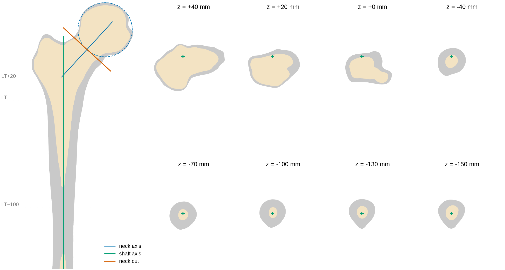

**图 1（V2A-F01）Real right femur (STEP): head r 25.3 mm, neck–shaft 137.5°, anteversion 6.1°, offset 39.5 mm**　左：颈平面（过截骨中心，由干轴与颈轴张成）切面，灰为皮质、米色为松质骨；蓝色虚圆为头球拟合，蓝线为颈轴，绿线为干轴，橙线为颈中段截骨线（距头心 25 mm），点线为 LT、LT+20、LT−100 高度。右：垂直干轴的 8 个横断面（z 为相对小转子的高度），内侧向右、前方向上，+ 为干轴。轮廓取距离场零等值线。

数据 v2/reports/V2A_real_femur/figures/V2A-F01.csv（sha 59f1771f）· 作图 v2/report_v2a.py:plot_f01 · 生成脚本 v2/report_v2a.py（sha cbcd9c9f） · 单位 x: mm；y: mm

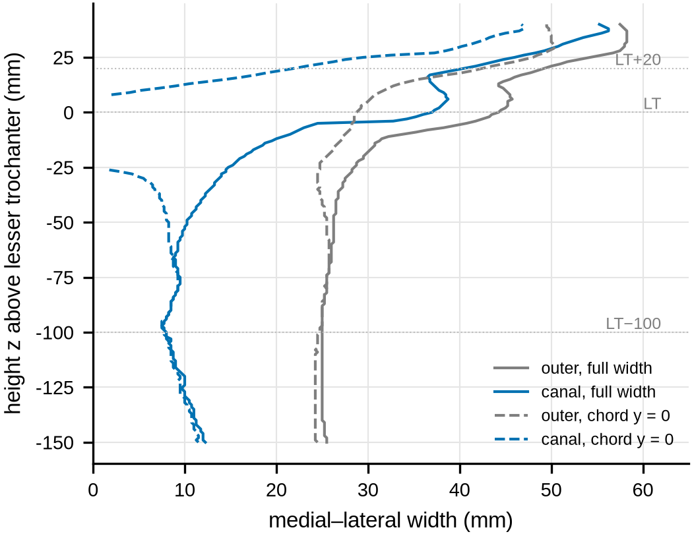

**图 2（V2A-F02）Dorr A by cortical index (0.68); canal flare index 5.40 by full width vs 2.93 by the chord through the shaft axis**　内外侧（x）方向宽度沿干轴高度 z（z = 0 为小转子）。实线：该高度截面在内外侧方向的全宽（对应正位片投影，Dorr 判据的量法）；虚线：过干轴的冠状弦（y = 0）。CFI = LT+20 髓腔宽 / 峡部髓腔宽；CI = (外径 − 髓腔)/外径 @ LT−100。

数据 v2/reports/V2A_real_femur/figures/V2A-F02.csv（sha 0c572f4c）· 作图 v2/report_v2a.py:plot_f02 · 生成脚本 v2/report_v2a.py（sha cbcd9c9f） · 单位 z: mm；width: mm

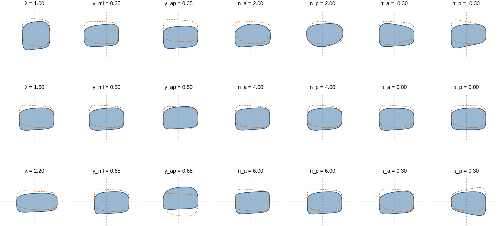

**图 3（V2A-F03）Seven cross-section variables; the anterior and posterior halves carry their own squareness and keystone**　每列只变一个截面变量，其余取一个不对称基准（γ_ml 0.56、γ_ap 0.44、n_a 3、n_p 5、τ_a 0.15、τ_p −0.10）；截面面积统一 250 mm²，内侧向右、前方向上。橙色虚线为关于前后侧中线（y = 0）的镜像，与实形不重合即前后不对称。

数据 v2/reports/V2A_real_femur/figures/V2A-F03.csv（sha f458efa6）· 作图 v2/report_v2a.py:plot_f03 · 生成脚本 v2/report_v2a.py（sha cbcd9c9f） · 单位 x: mm；y: mm

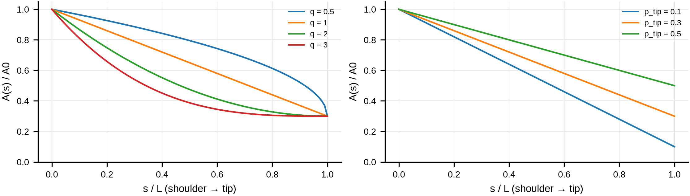

**图 4（V2A-F04）Area-reduction curve A(s)/A0 = ρ_tip + (1 − ρ_tip)(1 − s/L)^q: q sets where the area is lost, ρ_tip how much**　左：固定 ρ_tip = 0.3 改变 q；右：固定 q = 1 改变 ρ_tip。s 从肩部（0）到尖端（L）。

数据 v2/reports/V2A_real_femur/figures/V2A-F04.csv（sha e829e52b）· 作图 v2/report_v2a.py:plot_f04 · 生成脚本 v2/report_v2a.py（sha cbcd9c9f） · 单位 t: s/L

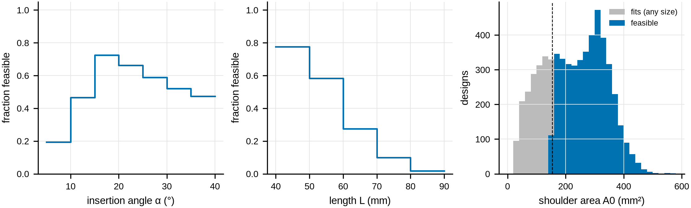

**图 5（V2A-F05）35% of 8192 random designs fit the real femur; short stems at 15–25° fit best**　8192 点打乱 Sobol 设计（与 S4′ 参考集同一池种子 999）逐一模板化。可行 = 最小号能进、尖端面积 ≥ 12 mm²、肩部面积 ≥ 假体颈截面（π·7² = 154 mm²）。左、中：按插入角与长度分箱的可行率；右：肩部面积分布，灰为全部能放进去的，蓝为可行的，虚线为 154 mm²。

数据 v2/reports/V2A_real_femur/figures/V2A-F05.csv（sha 645f7d95）· 作图 v2/report_v2a.py:plot_f05 · 生成脚本 v2/report_v2a.py（sha cbcd9c9f） · 单位 alpha: deg；L: mm；A0: mm2

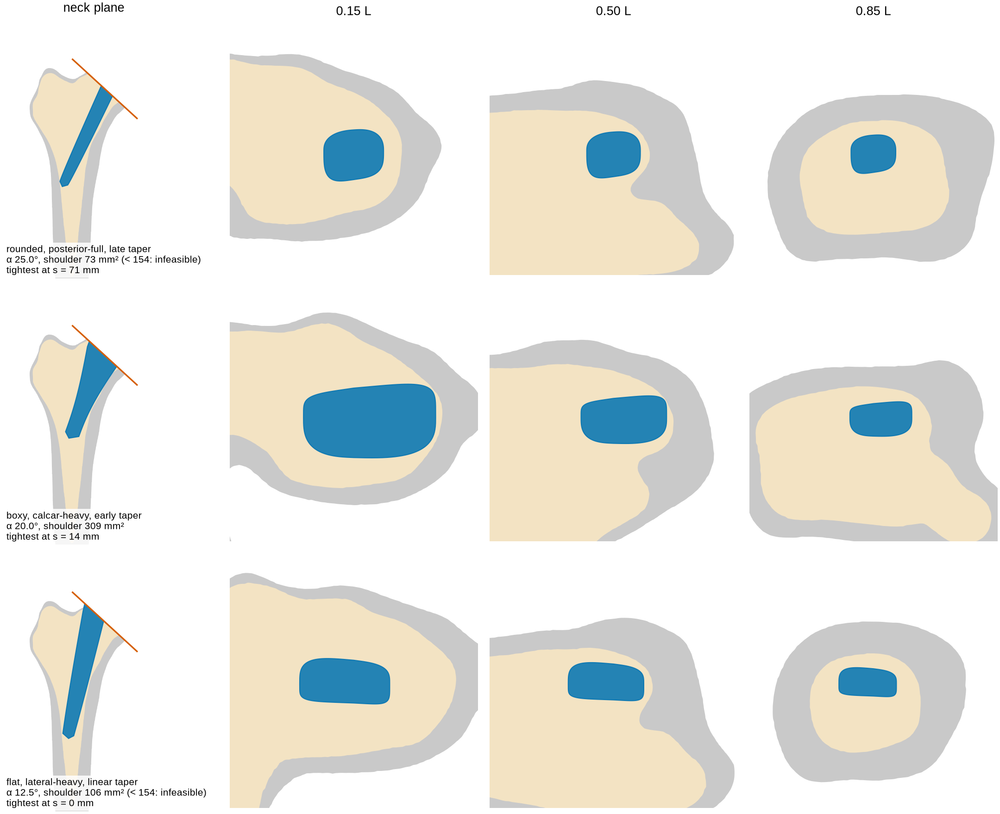

**图 6（V2A-F06）Three example stems in the real femur: 1 of 3 are large enough to carry the prosthetic neck**　每行一根示例柄（插入角为其设计值）。左：颈平面，橙线为截骨线，蓝色为柄在颈平面上的投影；右三列：垂直于柄轴、距肩部 0.15/0.50/0.85 L 的截面（内侧向右、前方向上），灰为皮质、米色为松质、蓝为柄截面；只画截骨面以下的保留骨。尺寸为皮质穿透 ≤ 0.25 mm 的最大号。

数据 v2/reports/V2A_real_femur/figures/V2A-F06.csv（sha 117533ba）· 作图 v2/report_v2a.py:plot_f06 · 生成脚本 v2/report_v2a.py（sha cbcd9c9f） · 单位 x: mm；y: mm；A0: mm2

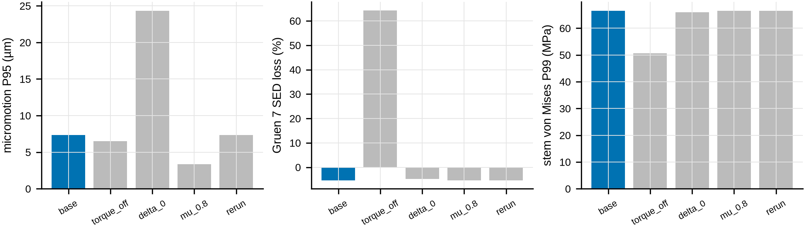

**图 7（V2A-F07）Sign checks: 3 of 3 micromotion responses go the expected way; rerun identical**　同一设计（calcar-heavy 示例，α 20°）的四个变体：基准；去掉前后向载荷分量（无扭转）；压配量 δ = 0；摩擦系数 μ = 0.8；以及重建网格重跑。每个变体都是完整的建模 + 求解 + 后处理。

数据 v2/reports/V2A_real_femur/figures/V2A-F07.csv（sha dbac8655）· 作图 v2/report_v2a_fe.py:plot_f07 · 生成脚本 v2/report_v2a_fe.py（sha 57fcf634） · 单位 value: see quantity

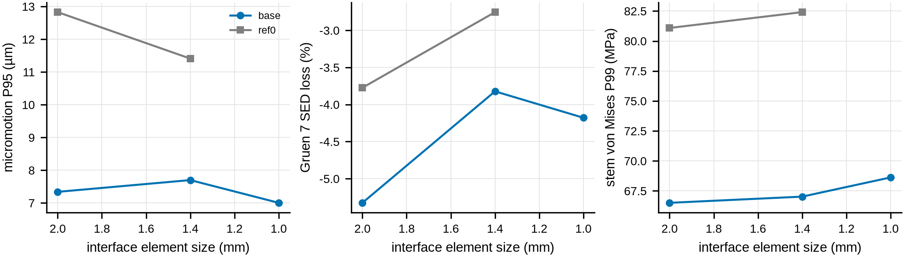

**图 8（V2A-F08）Mesh convergence: f1 changes by up to 5% between 2.0 and 1.0 mm interface elements**　两个设计（calcar-heavy 示例与参考池第 1 个可行设计）在界面单元 2.0、1.4、1.0 mm 下的三个关注量；完整股骨参照按同一网格档。GCI 按 Celik 2008（细化比 1.4、1.43），见 V2A-T05。

数据 v2/reports/V2A_real_femur/figures/V2A-F08.csv（sha 3f0b8f28）· 作图 v2/report_v2a_fe.py:plot_f08 · 生成脚本 v2/report_v2a_fe.py（sha 57fcf634） · 单位 h: mm

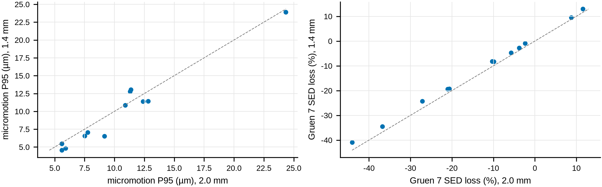

**图 9（V2A-F09）Ranking is preserved between meshes: Spearman f1 0.92, f2 0.99 (n = 12)**　参考池前 12 个可行设计在 2.0 与 1.4 mm 界面单元下的 f1、f2。虚线为 y = x。BO 只依赖排序，排序保持即可用较粗网格。

数据 v2/reports/V2A_real_femur/figures/V2A-F09.csv（sha 0e95cee5）· 作图 v2/report_v2a_fe.py:plot_f09 · 生成脚本 v2/report_v2a_fe.py（sha 57fcf634）

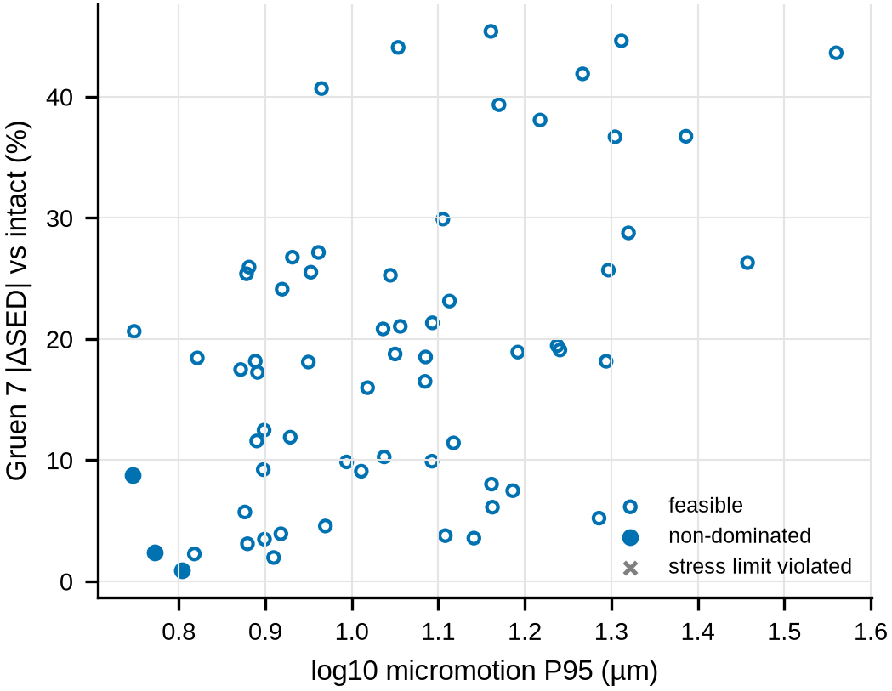

**图 10（V2A-F10）Reference set: 3 non-dominated designs among 64 solved (0 violate the stress limit)**　S4′ 参考集：参考池（种子 999）前 64 个可行设计全部 FE。横轴 log10(P95 微动 µm)，纵轴 Gruen 7 区 SED 相对完整股骨的偏离 |ΔSED|（2026-09-28 起的 f2）。实心为非支配前沿；叉号为违反柄应力约束者。超体积参考点 = 可行点各目标最大值 + 10% 范围 = (1.641, 49.86)。

数据 v2/reports/V2A_real_femur/figures/V2A-F10.csv（sha 5dd8bee4）· 作图 v2/report_v2a_fe.py:plot_f10 · 生成脚本 v2/report_v2a_fe.py（sha 57fcf634）

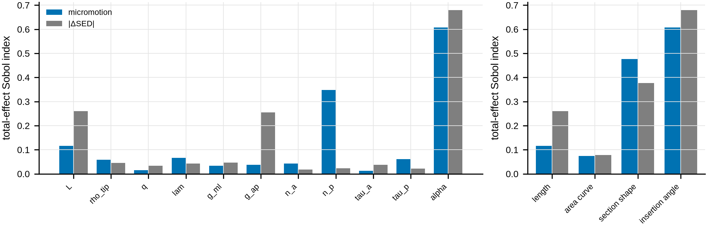

**图 11（V2A-F11）Global sensitivity: micromotion is driven mostly by insertion angle, deviation of proximal SED from intact by insertion angle**　在参考集（n = 64）上各拟合一个 GP（ARD Matérn 5/2，输入 [0,1]），在后验均值上用 Jansen 估计总效应指数 ST；组指数把组内变量一起替换。输入按单位立方体均匀分布，不可行区是 GP 外推，指数只作定性排序（Saltelli 2019）。

数据 v2/reports/V2A_real_femur/figures/V2A-F11.csv（sha dfad4d1a）· 作图 v2/report_v2a_fe.py:plot_f11 · 生成脚本 v2/report_v2a_fe.py（sha 57fcf634）

*（缺图 V2A-F12）*

*（缺图 V2A-F13）*

*（缺图 V2A-F14）*

*（缺图 V2A-F15）*

[[FIG:V2A-X01]]

[[FIG:V2A-X02]]

### 4.2 表

**表 1（V2A-T01）Real femur model: sources, volume checks, landmarks and Dorr indices**

| item | value | check |
|---|---|---|
| cortical STEP | cortical femur 2-zoned-4-sorted.STEP | sha256 1f8a33caac3a…; OCC volume 287059 mm³ (hollow) |
| cancellous STEP | cancellous femur 2-zoned-4.STEP | sha256 3c0e10bd02e1…; OCC volume 197040 mm³ |
| B-rep faces | cortical 286 = periosteal 179 + inner shell 107 | cancellous 107 |
| canal volume in box (SDF vs OCC) | 135793 vs 135872 mm³ | -0.06% |
| outer volume in box (SDF vs OCC) | 241140 vs 241228 mm³ | -0.04% |
| surface \|SDF\| P95 (canal / outer) | 0.059 / 0.059 mm | parity odd columns 0 / 0 |
| head radius | 25.34 mm | straight3d 24.6 mm (+0.74) |
| neck–shaft angle | 137.5° | straight3d 136.6° (+0.9) |
| anteversion (to posterior condylar line) | 6.1° | straight3d 5.9° (+0.2) |
| offset | 39.5 mm |  |
| CFI / CI, full width | 5.40 / 0.68 | Dorr A / A |
| CFI / CI, chord y = 0 | 2.93 / 0.69 | Dorr C / A |
| isthmus canal (full width) | 7.5 mm at z = -97 mm |  |

距离场体积与 OCC 体积都限于距离场盒子（模型坐标 x −45…75、y −45…45、z −160…110 mm）。straight3d 的对照值来自同一根股骨的 Job-1 四面体体素化（线性单元会略缩小曲面）。  数据 `v2/reports/V2A_real_femur/tables/V2A-T01.csv`（sha 5817fa47），生成脚本 `v2/report_v2a.py`。

**表 2（V2A-T02）Eleven design variables in four groups**

| group | variable | label | low | high |
|---|---|---|---|---|
| length | L | length L (mm) | 40 | 90 |
| area curve | rho_tip | tip/shoulder area ρ_tip | 0.1 | 0.5 |
| area curve | q | area-curve exponent q | 0.5 | 3 |
| section shape | lam | aspect ML/AP λ | 1 | 2.2 |
| section shape | g_ml | medial share γ_ml | 0.35 | 0.65 |
| section shape | g_ap | anterior share γ_ap | 0.35 | 0.65 |
| section shape | n_a | anterior squareness n_a | 2 | 6 |
| section shape | n_p | posterior squareness n_p | 2 | 6 |
| section shape | tau_a | anterior keystone τ_a | -0.3 | 0.3 |
| section shape | tau_p | posterior keystone τ_p | -0.3 | 0.3 |
| insertion angle | alpha | insertion angle α (°) | 5 | 40 |

尺寸 A0 与入口偏移 e 不是设计变量，由模板化给出（最大号，皮质穿透 ≤ 0.25 mm）。  数据 `v2/reports/V2A_real_femur/tables/V2A-T02.csv`（sha fc7a0580），生成脚本 `v2/report_v2a.py`。

**表 3（V2A-T03）FE model reporting items (Erdemir 2012)**

| item | value |
|---|---|
| geometry | real femur STEP (cortex hollow solid + cancellous solid), truncated at LT−150 mm, mid-neck cut 25 mm from head centre |
| elements | C3D10 (straight-sided), gmsh; interface 2.0 mm, far field 6.0 mm; median 26594 elements |
| materials | cortex 16800 MPa, cancellous 400 MPa, Ti6Al4V 110000 MPa, ν 0.3, linear elastic |
| interface (friction model) | surface-to-surface small sliding, μ 0.3, hard contact; press-fit δ 0.1 mm by *CONTACT INTERFERENCE, SHRINK |
| interface (bonded model) | *TIE, ADJUST=NO, position tolerance 0.3 mm |
| steps (friction) | PRESSFIT (head fixed) → RELEASE → LOAD |
| load | F = (-782, 698, -2149) N in model axes (+x medial, +y posterior, +z proximal), \|F\| = 2391 N, on all prosthetic-head nodes |
| boundary | all nodes on the truncation plane (z = −150 mm) fixed |
| QoIs | f1 = area-weighted P95 of tangential slip increment LOAD−RELEASE (µm); f2 = Gruen 7 SED loss vs intact (%); c = stem vM P99 (below cut) − 440 MPa |
| solver / wall time | Abaqus/Standard 2025, 4 cores per job; friction median 278 s, bonded median 37 s (n = 140) |

按 Erdemir 2012 的模型结构与仿真结构类目概括。  数据 `v2/reports/V2A_real_femur/tables/V2A-T03.csv`（sha d6d3f678），生成脚本 `v2/report_v2a.py`。

**表 4（V2A-T04）Sign checks and rerun determinism**

| check | observed |
|---|---|
| torque raises micromotion | True |
| no interference raises micromotion | True |
| higher friction lowers micromotion | True |
| rerun identical | True |
| torque_off: f1 / f2 / vm | 6.52 µm / 64.3% / 50.7 MPa (base 7.34 / -5.33 / 66.5) |
| delta_0: f1 / f2 / vm | 24.3 µm / -4.77% / 66 MPa (base 7.34 / -5.33 / 66.5) |
| mu_0.8: f1 / f2 / vm | 3.38 µm / -5.33% / 66.5 MPa (base 7.34 / -5.33 / 66.5) |
| rerun: f1 / f2 / vm | 7.34 µm / -5.33% / 66.5 MPa (base 7.34 / -5.33 / 66.5) |

方向检查只看 f1（P95 微动）；f2、柄应力照录。  数据 `v2/reports/V2A_real_femur/tables/V2A-T04.csv`（sha 1f6afd67），生成脚本 `v2/report_v2a_fe.py`。

**表 5（V2A-T05）Mesh convergence and GCI (Celik 2008)**

| quantity | h1.0 | h1.4 | h2.0 | p | gci_fine | rel_change_2.0_vs_1.0 |
|---|---|---|---|---|---|---|
| base:f1_p95_um | 7 | 7.7 | 7.34 | 1.96 | 0.133 | 0.0478 |
| base:f2_g7_loss_pct | -4.18 | -3.82 | -5.33 | 4.28 | 0.0331 | 0.275 |
| base:vm_p99 | 68.6 | 67 | 66.5 | 3.37 | 0.0139 | 0.0309 |

h1.0/h1.4/h2.0 为三档网格下的值；p 为表观阶数；gci_fine 为细网格的 GCI；最后一列为 2.0 对 1.0 的相对变化。  数据 `v2/reports/V2A_real_femur/tables/V2A-T05.csv`（sha ef974157），生成脚本 `v2/report_v2a_fe.py`。

*（缺表 V2A-T06）*

*（缺表 V2A-T07）*

## 5 验收

| ID | 判据 | 门槛 | 实测 | 状态 | 原因与处置 |
|---|---|---|---|---|---|
| V2A-A1 | 解剖量（头半径、颈干角、前倾）与 straight3d 在同一股骨上的实测之差 | < 1 mm、< 1° | head r +0.74 mm, NSA +0.88°, anteversion +0.18° | PASS |  |
| V2A-A2 | 距离场所围体积与 OCC 体积之差（髓腔、外形，盒内） | < 0.5% | canal -0.06%, outer -0.04% | PASS |  |
| V2A-A3 | 零过切数值复核：柄沿插入路径的采样点落在最终柄体外的个数 | 0 | 0 of 1,362,520 swept points outside the final stem (20 designs) | PASS |  |
| V2A-A4 | CAD 中柄体 ∩ 皮质 体积 / 柄体积（20 个参考设计的最大值） | ≤ 0.5% | max 0.46% (median 0.02%) of stem volume, 20 designs | PASS |  |
| V2A-A5 | 符号检查：去扭转 f1 降、δ = 0 f1 升、μ = 0.8 f1 降 | 全部方向正确 | 3/3 directions as expected torque raises micromotion: yes, no interference raises micromotion: yes, higher friction lowers micromotion: yes | PASS |  |
| V2A-A6 | 同一设计重建网格重跑，f1、f2、柄应力逐位相同 | 相同 | identical | PASS |  |
| V2A-A7 | 生产网格（2.0 mm）：对 1.0 mm 的 f1、f2 相对变化，或 12 设计 2.0 对 1.4 的 Spearman | < 10%，或 ≥ 0.9 | rel. change vs 1.0 mm: base·f1 5%, base·f2 27%; Spearman 2.0 vs 1.4: f1 0.92, f2 0.99 | PASS |  |
| V2A-A8 | 设计空间可行率（8192 点池，模板化 + 肩部不小于假体颈） | ≥ 30% | 34.7% of 8192 | PASS |  |
| V2A-A9 | 可行设计的 FE 失败率（L3–L5） | ≤ 5% | 6 of 146 (4.1%) at 2.0 mm; levels L3 | PASS |  |
| V2A-A10 | BO 中位超体积比（分母为全部评估点的已知最佳前沿） | ≥ 0.90 |  | PENDING |  |
| V2A-A11 | 3 个种子都高于同预算 Sobol 基线中位 | 3/3 |  | PENDING |  |
| V2A-A12 | GP 90% 预测区间在 64 点测试集上的实际覆盖率 | 0.80–0.97 |  | PENDING |  |

总判定：INCOMPLETE（全部 PASS 或写明理由的 NA 才算通过；不通过项的处置全部获用户同意时为 FAIL-APPROVED，可进入下一阶段；有 PENDING 或缺项为 INCOMPLETE）。

## 6 局限与下一阶段输入

**通用局限**

- 单一标本：G:\hip\260429 test 2bones 的一根右股骨（按皮质指数 Dorr A）；结论只对这根股骨成立，不代表 Dorr 型之间的差别。

- 材料均匀、线弹性：皮质 16.8 GPa、松质 400 MPa（假设），不模拟松质骨压碎与致密化。

- 单一上楼工况，方向取 Bergmann 2016 AVER75 的方向角，大小沿用 v1 的 2391 N；无肌力。

- 压配量 δ = 0.10 mm、摩擦系数 μ = 0.3 固定，只在符号检查中改变。

- 模板化规则（最大号、皮质穿透 ≤ 0.25 mm、肩部不小于假体颈截面）是简化的术中决策；插入角只在颈平面内变化，前倾方向固定。

- 无实验数据，不做 ASME V&V 40 意义上的确认（validation）；本测试检验代理 + 多目标 BO 能否在少量 FE 内找到好的前沿，不对柄设计下临床结论。

**下一阶段输入**

- 是否把同一流程扩到更多真实股骨或理想化 B/C 型（由用户决定）

- 生产网格与噪声底

## 附录 A 溯源

| 图/表 | 数据 sha | 作图函数 | 生成脚本 sha | 合成 | 来源 |
|---|---|---|---|---|---|
| V2A-F01 | 59f1771f | `v2/report_v2a.py:plot_f01` | cbcd9c9f | 否 | femur=v2/data/femur_real/*.STEP（sha256 见 SHA256SUMS.txt） |
| V2A-F02 | 0c572f4c | `v2/report_v2a.py:plot_f02` | cbcd9c9f | 否 |  |
| V2A-F03 | f458efa6 | `v2/report_v2a.py:plot_f03` | cbcd9c9f | 否 |  |
| V2A-F04 | e829e52b | `v2/report_v2a.py:plot_f04` | cbcd9c9f | 否 |  |
| V2A-F05 | 645f7d95 | `v2/report_v2a.py:plot_f05` | cbcd9c9f | 否 |  |
| V2A-F06 | 117533ba | `v2/report_v2a.py:plot_f06` | cbcd9c9f | 否 |  |
| V2A-F07 | dbac8655 | `v2/report_v2a_fe.py:plot_f07` | 57fcf634 | 否 |  |
| V2A-F08 | 3f0b8f28 | `v2/report_v2a_fe.py:plot_f08` | 57fcf634 | 否 |  |
| V2A-F09 | 0e95cee5 | `v2/report_v2a_fe.py:plot_f09` | 57fcf634 | 否 |  |
| V2A-F10 | 5dd8bee4 | `v2/report_v2a_fe.py:plot_f10` | 57fcf634 | 否 |  |
| V2A-F11 | dfad4d1a | `v2/report_v2a_fe.py:plot_f11` | 57fcf634 | 否 |  |
| V2A-X01 | ddc95f23 | `v2/report_v2a_fe.py:plot_f12` | 57fcf634 | 否 |  |
| V2A-X02 | 9b28cf5c | `v2/report_v2a_fe.py:plot_f13` | 57fcf634 | 否 |  |
| V2A-T01 | 5817fa47 | `—` | cbcd9c9f | 否 |  |
| V2A-T02 | fc7a0580 | `—` | cbcd9c9f | 否 |  |
| V2A-T03 | d6d3f678 | `—` | cbcd9c9f | 否 |  |
| V2A-T04 | 1f6afd67 | `—` | 57fcf634 | 否 |  |
| V2A-T05 | ef974157 | `—` | 57fcf634 | 否 |  |

## 附录 B 缺项

| 类别 | ID | 规范要求 |
|---|---|---|
| 图 | V2A-F12 | 超体积比对 FE 次数：3 个 BO 种子与同预算 Sobol 基线（重抽中位与区间），画 0.9 线 |
| 图 | V2A-F13 | 各种子 BO 前沿与已知最佳前沿叠图 |
| 图 | V2A-F14 | GP 校准：64 点测试集上名义覆盖对实际覆盖，及预测对 FE 值 |
| 图 | V2A-F15 | 前沿设计图册：截面形状、面积曲线与插入角 |
| 表 | V2A-T06 | BO 结果：各种子超体积比、IGD、FE 次数、机时；Sobol 基线 |
| 表 | V2A-T07 | 前沿设计清单：设计变量、肩部面积、f1、f2、柄应力 |
