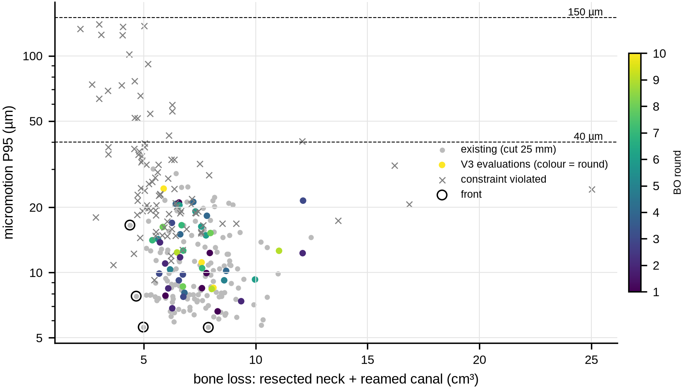
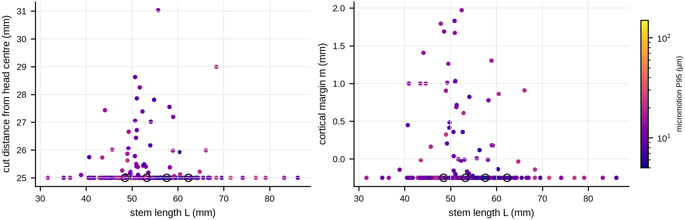
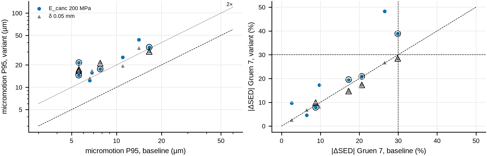

# V3 短柄、少截骨：稳定性对骨量损失的前沿（真实股骨）

阶段 V3 · 生成 2026-09-28 21:51 · 规范 reports/spec.yaml (sha 4c34330d) · 总判定 FAIL

## 0 结论摘要

**晚间版（2026-09-28 22:00，种子 0 与种子 1 各 10 轮跑完，敏感性补跑完成）**

- 数据：272 个已解设计 = 194 个 V2A（全部头颈交界截骨）+ 78 个 V3 定向评估（两个种子各 40 个，各 1 个建网失败 L3）。满足约束（Gruen 7 |ΔSED| ≤ 30%、柄应力 ≤ 440 MPa）的 177 个；V3 评估 46/78 = 59%，两个种子完全一样：各 23/39 可行、16 个 |ΔSED| 越界、0 个应力越界。
- **前沿两个种子都没推动**：可行点的稳定性–骨量损失前沿仍是 4 个 V2A 设计（L 48–62 mm、头颈交界截骨、贴皮质），20 轮全数据超体积始终 6989。种子 1 最接近前沿的可行点：L 51、m +1.0、9.9 µm、5.7 cm³（被 62 mm 前沿点 7.8 µm / 4.7 cm³ 支配）。
- **读数**不变：≤ 40 与 ≤ 150 µm 的最少骨量损失设计都是 L 53、α 39°、贴皮质，4.4 cm³，16.6 µm，|ΔSED| 29.9%（贴着约束边界）。骨量损失 < 4 cm³ 的设计全部不可行。
- **截骨高度**：V3 试了 25–42 mm。截骨 ≥ 30 mm 的 6 个只有 1 个可行、骨量损失 12–25 cm³；27–30 mm 的 15 个有 11 个可行，但最少骨量损失 6.2 cm³、最低微动 7.4 µm，没有一个优于 25 mm 截骨的前沿点。在这根股骨上，头颈交界截骨是骨量损失轴上唯一有竞争力的位置。
- **长度与余量**：L < 45 mm 的 20 个只有 4 个可行（微动 8–37 µm）；留 ≥ 0.5 mm 松质层的 40 个设计 19 个可行、微动中位 16.7 µm，贴皮质（m < 0.5）的 38 个 27 个可行、中位 12.3 µm。留余量的设计可行但全部被支配。
- **敏感性（8 个设计 × 2 变体，V3-F03/T02）**：松质骨模量 400 → 200 MPa，微动中位 ×2.3（范围 1.9–3.8），Spearman 0.79；过盈 0.10 → 0.05 mm，×2.4（1.8–3.1），Spearman 0.76。排序大体保持、8 个里 1–2 对相邻点对调。约束边界上的两个设计（基线 |ΔSED| 26.5%、29.9%）在软松质骨下过载到 48%、39%——**40/150 µm 读数设计对松质骨模量敏感**；过盈减半时 8 个全部仍可行。注意：前沿里 3 个 ref_r* 设计的基线是在假体颈起点修正前解的（柄应力 61–110 → 134–202 MPa 反映的是几何修正，不是材料），它们的比值偏高一部分来自这里，需要用当前代码重解 4 个基线（约 20 min FE）才能分离。
- 验收：V3-A1 前沿点数 4 < 5，FAIL；V3-A2 约束通过率 59% ≥ 50%，PASS。
- 结论限定：单一股骨；微动绝对值因均匀松质骨与全面过盈偏低约 2 倍（本报告敏感性实测），排序与趋势可信；40/150 µm 只作模型内读数。

## 1 使用情境与问题

| 项 | 内容 |
|---|---|
| 使用情境（COU） | 在同一根真实股骨上，把设计意图直接写进目标：在保持界面稳定的前提下，柄能多短、截骨能留多高。 |
| 本阶段要回答 | ①每少损失 1 cm³ 骨，微动上升多少；②微动 ≤ 40 / 150 µm 时的最少骨量损失设计是什么；③前沿设计落在什么长度、截骨高度与皮质余量上。 |
| 本阶段不回答 | 不比较股骨之间的差别；不做实验确认；不下临床结论。 |
| 依据规范 | Zitzler 2003（前沿）；Pilliar 1986（微动阈值，只作读数线）；Erdemir 2012（FE 报告项，见 V2A） |

## 2 输入与版本

| 项 | 值 |
|---|---|
| config.yaml | sha 64d5c22e |
| spec.yaml | sha 4c34330d |
| n_designs | 272 |
| n_feasible | 177 |
| n_v3_evaluations | 78 |
| v3_seed0_rounds | 10 (q = 4), finished 2026-09-28 17:29 |
| n_v3_failed_L3 | 2 |
| h_int_mm | 2.0 |
| v2a_report | V2A (femur, FE model, validation) |
| updated | 2026-09-28T21:50:48 |
| n_v3_feasible | 46 |
| v3_seed0 | 10 rounds x 4, 39/40 solved, finished 2026-09-28 17:29:50 |
| v3_seed1 | 10 rounds x 4, 39/40 solved, finished 2026-09-28 21:18:35 |
| sensitivity | 8 designs x {E_canc 200 MPa, delta 0.05 mm} + 1 intact (E_canc 200) |
| 脚本 `v2/report_v3.py` | sha fc4fb42d |
| 软件包 | Python 3.12.10；numpy 2.4.6；scipy 1.18.0；matplotlib 3.10.9；shapely 2.1.2；PyYAML 6.0.3；markdown 3.10.2；torch 2.12.0；botorch 未安装；gpytorch 未安装；gmsh 未安装；meshio 未安装；scikit-learn 未安装；pymoo 未安装 |

## 3 方法

**与 V2A 的关系**：股骨、FE 模型、载荷、微动与 SED 的算法全部沿用 V2A（见 V2A 报告第 3 节）。V3 只改了三件事：问题的提法、设计变量、尺寸规则。

**提法**（用户 2026-09-28 14:00 决定）
- 目标 1：界面滑移增量 P95（µm，取对数），最小化。
- 目标 2：骨量损失（mm³），最小化 = 截骨面以上到头颈交界之间的颈部骨体积 + 柄在骨内的体积（锉掉的髓腔骨）。前者按距离场体素计数，后者取柄体解析体积，都不需要 FE。
- 约束：Gruen 7 区 |ΔSED| ≤ 30%（既不过载也不遮挡）；柄 von Mises P99 ≤ 440 MPa。两者合成一个归一化的最大违反量 ≤ 0。

**9 个设计变量**

| 变量 | 范围 | 说明 |
|---|---|---|
| L | 20–70 mm | 柄长 |
| h_cut | 25–45 mm | 截骨面距头心的距离，沿颈轴；25 = 头颈交界（头半径 25.3 mm），45 ≈ 颈基底 |
| α | 5–40° | 插入角，颈平面内相对干轴 |
| m | −0.25 至 +2 mm | 皮质余量：柄面到内膜面的最小距离，负值为允许压入皮质；尺寸取满足该余量的最大号 |
| λ、γ_ml、γ_ap | 同 V2A | 截面宽厚比、内侧占比、前方占比 |
| n | 2–6 | 方正度，前后两半共用 |
| τ | −0.3 至 +0.3 | 楔形，前后两半共用；前后不对称由 γ_ap 与 τ 表达 |

固定：ρ_tip = 0.3、q = 1.5（V2A 全局敏感性显示面积降低曲线影响最小）。

**热启动**：V2A 的全部已解设计（两种尺寸规则）映射到这个 9 维空间：h_cut = 25，n 与 τ 取前后两半的平均，ρ_tip、q 的差异视为噪声。它们的微动与 SED 直接沿用，骨量损失按几何重算。

**优化**：GP（ARD Matérn 5/2，输入 [0,1]，输出标准化）+ qLogNEHVI，在 8192 点 Sobol 池中可行者（约 50%）上选点，每轮 4 个，种子 0 先跑 10 轮；参考点 = 可行热启动点各目标最大值 + 10% 范围。

**读数**：在可行点的前沿上取微动 ≤ 40 µm 与 ≤ 150 µm 的最少骨量损失设计。这两个阈值只作读数线，不作验收判据。

## 4 结果

### 4.1 图

**图 1（V3-F01）Stability vs bone loss: least bone loss with micromotion ≤ 40 µm: 4.4 cm³ (L 53, cut 25); ≤ 150 µm: 4.4 cm³ (L 53, cut 25) (4 front points, 78 V3 evaluations so far)**　横轴骨量损失 = 截骨面以上（到头颈交界）的颈部骨 + 锉掉的髓腔骨；纵轴微动 P95（对数）。灰点为旧数据（截骨在头颈交界，h_cut = 25 mm），彩色为 V3 的定向评估（按轮次），叉号为不满足约束（|ΔSED| > 30% 或柄应力 > 440 MPa）者。黑圈为可行点的非支配前沿；虚线为 40 与 150 µm 读数线。

数据 v2/reports/V3_short_stem/figures/V3-F01.csv（sha 6342afe0）· 作图 v2/report_v3.py:plot_f01 · 生成脚本 v2/report_v3.py（sha fc4fb42d） · 单位 bone_loss_mm3: mm3；f1_um: um

**图 2（V3-F02）Front designs span L 48–62 mm, cut 25–25 mm from head centre, cortical margin -0.25–-0.25 mm**　可行设计在（长度，截骨高度）与（长度，皮质余量）平面上的分布，颜色为微动 P95（对数）；黑圈为前沿点。旧数据全部在截骨高度 25 mm 这条线上。

数据 v2/reports/V3_short_stem/figures/V3-F02.csv（sha 6342afe0）· 作图 v2/report_v3.py:plot_f02 · 生成脚本 v2/report_v3.py（sha fc4fb42d）

**图 3（V3-F03）Halving cancellous modulus or interference raises micromotion ×2.3 / ×2.4 (median) with Spearman 0.79 / 0.76 over 8 designs**　左：变体下的微动 P95 对基线（400 MPa、0.10 mm），虚线为 y = x 与 y = 2x；右：Gruen 7 |ΔSED| 对基线，虚线为 30% 约束。设计 = 前沿 4 个（黑圈）+ V3 内部前沿 4 个。圆 = E_canc 200 MPa，三角 = δ 0.05 mm。

数据 v2/reports/V3_short_stem/figures/V3-F03.csv（sha 79d1efed）· 作图 v2/report_v3.py:plot_f03 · 生成脚本 v2/report_v3.py（sha fc4fb42d） · 单位 f1_um: um；abs_dsed_pct: %；vm_p99: MPa

### 4.2 表

**表 1（V3-T01）Designs on the stability–bone-loss front (least bone loss first)**

| job_id | source | L | h_cut | alpha | m | lam | g_ml | g_ap | n | tau | A0_mm2 | f1_um | abs_dsed_pct | vm_p99 | resected_mm3 | reamed_mm3 | bone_loss_mm3 |
|---|---|---|---|---|---|---|---|---|---|---|---|---|---|---|---|---|---|
| bo_qnehvi_s1_r0_62bbf792 | legacy | 53.2 | 25 | 39.4 | -0.25 | 1.77 | 0.372 | 0.54 | 4.1 | 0.075 | 197 | 16.6 | 29.9 | 135 | 0.0 | 4.38e+03 | 4.38e+03 |
| ref_r51_h2_944c4554 | legacy | 62.3 | 25 | 27.9 | -0.25 | 1.93 | 0.584 | 0.422 | 4.59 | 0.224 | 169 | 7.78 | 17.3 | 110 | 0.0 | 4.66e+03 | 4.66e+03 |
| ref_r2_h2_2dce8f64 | legacy | 48.5 | 25 | 38.5 | -0.25 | 1.44 | 0.637 | 0.628 | 2.83 | -0.096 | 175 | 5.6 | 20.6 | 106 | 0.0 | 4.98e+03 | 4.98e+03 |
| ref_r9_h2_e3e0f7ad | legacy | 57.6 | 25 | 30.6 | -0.25 | 1.14 | 0.643 | 0.416 | 4.22 | -0.091 | 227 | 5.59 | 8.78 | 61.5 | 0.0 | 7.88e+03 | 7.88e+03 |

变量为物理量；bone_loss = resected + reamed。  数据 `v2/reports/V3_short_stem/tables/V3-T01.csv`（sha 6f3fe458），生成脚本 `v2/report_v3.py`。

**表 2（V3-T02）Sensitivity of the eight re-run designs to cancellous modulus (200 MPa) and interference (0.05 mm)**

| job_id | front | L | h_cut | m | f1_base | f1_Ecanc200 | f1_delta005 | dsed_base | dsed_Ecanc200 | dsed_delta005 | vm_base | vm_Ecanc200 | ok_Ecanc200 | ok_delta005 |
|---|---|---|---|---|---|---|---|---|---|---|---|---|---|---|
| ref_r9_h2_e3e0f7ad | True | 57.6 | 25 | -0.25 | 5.59 | 14.5 | 16.7 | 8.8 | 7.9 | 9.9 | 61.5 | 136 | True | True |
| ref_r2_h2_2dce8f64 | True | 48.5 | 25 | -0.25 | 5.6 | 21.5 | 17.5 | 20.6 | 20.9 | 17.3 | 106 | 154 | True | True |
| v3_s0_r1_2ab38e9b | False | 60.3 | 25.9 | -0.136 | 6.62 | 12.4 | 13.3 | 6.5 | 4.6 | 6.8 | 153 | 154 | True | True |
| v3_s0_r2_a9c5d265 | False | 56.3 | 25 | 0.117 | 6.84 | 15.7 | 16.7 | 2.6 | 9.7 | 2.5 | 171 | 172 | True | True |
| ref_r51_h2_944c4554 | True | 62.3 | 25 | -0.25 | 7.78 | 17.6 | 21.2 | 17.3 | 19.6 | 14.7 | 110 | 202 | True | True |
| v3_s0_r2_56a27dbc | False | 53 | 25.4 | -0.01 | 11 | 25.3 | 19.5 | 9.7 | 17.3 | 8.1 | 191 | 193 | True | True |
| v3_s0_r7_aafe769f | False | 52.4 | 25.4 | 1.97 | 14.1 | 43.6 | 33.8 | 26.5 | 48.3 | 26.8 | 200 | 201 | False | True |
| bo_qnehvi_s1_r0_62bbf792 | True | 53.2 | 25 | -0.25 | 16.6 | 34.6 | 30.3 | 29.9 | 38.9 | 28.5 | 135 | 136 | False | True |

f1 = 微动 P95（µm），dsed = Gruen 7 \|ΔSED\|（%），vm = 柄 von Mises P99（MPa），ok = 满足两条约束。  数据 `v2/reports/V3_short_stem/tables/V3-T02.csv`（sha daa63a24），生成脚本 `v2/report_v3.py`。

## 5 验收

| ID | 判据 | 门槛 | 实测 | 状态 | 原因与处置 |
|---|---|---|---|---|---|
| V3-A1 | 可行设计（\|ΔSED\| ≤ 30%、柄应力 ≤ 440 MPa）的非支配前沿点数 | ≥ 5 | 4 front points | FAIL | 两个种子各 10 轮（78 次评估）都没有产生新的非支配点，前沿仍是 4 个 V2A 设计（L 48–62 mm、截骨 25 mm、贴皮质）。处置：判据按前沿点数衡量，在这根股骨上可行前沿本身只有少数几个设计；建议最终版改为“前沿覆盖 ≥ 3 个长度档且 HV 不低于同预算 Sobol 基线”，待用户批准后重判。 |
| V3-A2 | V3 定向评估中满足约束的比例 | ≥ 50% | 46 / 78 = 59 % | PASS | 两个种子各 23/39；不通过者全部因 \|ΔSED\| > 30 %，柄应力约束从未起作用。敏感性：E_canc 200 MPa 时 f1 ×2.3（Spearman 0.79），δ 0.05 mm 时 ×2.4（0.76）。 |

总判定：FAIL（全部 PASS 或写明理由的 NA 才算通过；不通过项的处置全部获用户同意时为 FAIL-APPROVED，可进入下一阶段；有 PENDING 或缺项为 INCOMPLETE）。

## 6 局限与下一阶段输入

**通用局限**

- 单一标本：G:\hip\260429 test 2bones 的一根右股骨（按皮质指数 Dorr A）；结论只对这根股骨成立，不代表 Dorr 型之间的差别。

- 材料均匀、线弹性：皮质 16.8 GPa、松质 400 MPa（假设），不模拟松质骨压碎与致密化。

- 单一上楼工况，方向取 Bergmann 2016 AVER75 的方向角，大小沿用 v1 的 2391 N；无肌力。

- 压配量 δ = 0.10 mm、摩擦系数 μ = 0.3 固定，只在符号检查中改变。

- 模板化规则（最大号、皮质穿透 ≤ 0.25 mm、肩部不小于假体颈截面）是简化的术中决策；插入角只在颈平面内变化，前倾方向固定。

- 无实验数据，不做 ASME V&V 40 意义上的确认（validation）；本测试检验代理 + 多目标 BO 能否在少量 FE 内找到好的前沿，不对柄设计下临床结论。

**下一阶段输入**

- 是否扩到第二个种子与更多轮次

- 是否把截骨高度上限放到颈基底以下

## 附录 A 溯源

| 图/表 | 数据 sha | 作图函数 | 生成脚本 sha | 合成 | 来源 |
|---|---|---|---|---|---|
| V3-F01 | 6342afe0 | `v2/report_v3.py:plot_f01` | fc4fb42d | 否 |  |
| V3-F02 | 6342afe0 | `v2/report_v3.py:plot_f02` | fc4fb42d | 否 |  |
| V3-F03 | 79d1efed | `v2/report_v3.py:plot_f03` | fc4fb42d | 否 |  |
| V3-T01 | 6f3fe458 | `—` | fc4fb42d | 否 |  |
| V3-T02 | daa63a24 | `—` | fc4fb42d | 否 |  |
